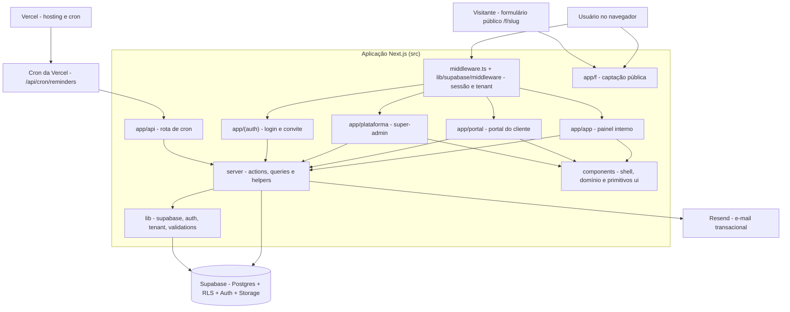

# 1. Arquitetura

> Estado documentado: branch `main`, commit `29aac19`, em 09/10/2026.

O **Orbit CRM** é um CRM SaaS **multi-tenant** (um sistema, várias empresas) para agências, consultorias e prestadores de serviço que trabalham por projeto/hora. Cada empresa é um **tenant** (`tenant_id` em todas as tabelas de negócio) e o isolamento é garantido no próprio Postgres por **Row Level Security (RLS)**. O app conecta com a **anon key** do Supabase (sujeita à RLS) e usa a **service role** só em fluxos administrativos controlados.

O stack é **Next.js 15** (App Router, TypeScript, React Server Components + Server Actions) sobre **Supabase** (Postgres, Auth, Storage, Realtime), com **Tailwind CSS v4**, **shadcn/ui** sobre `@base-ui/react` e **lucide-react`**. Validação com **Zod**, interatividade pontual com **TanStack Query**, e-mail transacional via **Resend** e deploy na **Vercel**.

## 1.1 Diagrama geral



## 1.2 Os módulos

O mapa detalha **18 módulos de código**. Cada um tem um arquivo em `docs/mapa/arquivos/`.

| Módulo | Arquivos | Responsabilidade |
|---|---:|---|
| [01 — Banco: migrations, seed e tipos](arquivos/01-banco-migrations-e-seed.md) | 46 | Schema versionado no Supabase (44 migrations): tabelas, RLS, funções `security definer`, triggers, RPCs do portal, rate limit e buckets de Storage. |
| [02 — Núcleo da aplicação](arquivos/02-nucleo-lib-aplicacao.md) | 25 | `src/lib`: middleware, clientes Supabase, sessão (`auth.ts`), tenant ativo, constantes (status/papéis), formatação, CSV, Gantt, relatórios, e-mail e logger. |
| [03 — Validações Zod](arquivos/03-validacoes-zod.md) | 21 | Schemas de entrada de todos os formulários e server actions. |
| [04 — Helpers do servidor](arquivos/04-servidor-helpers.md) | 7 | Utilitários das actions: permissões, limites de plano, documentos/faturas, campos personalizados, e-mail por tenant, notificações e lembretes. |
| [05 — Queries do servidor](arquivos/05-servidor-queries.md) | 23 | Leitura RSC por domínio (`src/server/queries/*`) via `supabase-js` sob RLS, incluindo as leituras do portal por RPC. |
| [06 — Server actions (núcleo)](arquivos/06-servidor-actions-core.md) | 15 | Mutações de acesso, equipe, plataforma e transversais (busca, importação, tags, campos, KB...). |
| [07 — Server actions (negócio)](arquivos/07-servidor-actions-negocio.md) | 16 | Mutações de clientes, CRM, entrega, financeiro, atendimento e portal. |
| [08 — Componentes do app](arquivos/08-componentes-app-nucleo.md) | 19 | Shell (sidebar, menu, topbar), seletor de empresa, busca, notificações e widgets compartilhados. |
| [09 — Componentes de domínio](arquivos/09-componentes-dominio.md) | 18 | Anexos, comentários, horas, editor de itens de documento, Gantt e "bits" de contrato/marco/projeto/tarefa/ticket. |
| [10 — Primitivos de UI](arquivos/10-componentes-ui.md) | 20 | Componentes shadcn/base-ui (botão, dialog, tabela, etc.); 19 em tabela de exceção. |
| [11 — App: base, auth e público](arquivos/11-app-nucleo-auth-e-publico.md) | 14 | Layouts raiz, redirecionamentos, páginas de erro, login, aceite de convite, cron e formulário público. |
| [12 — App: painel e clientes](arquivos/12-app-painel-e-clientes.md) | 10 | Layout interno, dashboard, auditoria (atividades) e o módulo de clientes/contatos. |
| [13 — App: projetos e tarefas](arquivos/13-app-projetos-e-tarefas.md) | 14 | Projetos (com marcos e Gantt) e tarefas (lista/kanban, checklist). |
| [14 — App: financeiro](arquivos/14-app-financeiro.md) | 24 | Orçamentos, faturas/pagamentos, despesas, contratos, timesheet, metas, relatórios e exportação CSV. |
| [15 — App: comercial e atendimento](arquivos/15-app-comercial-e-atendimento.md) | 21 | Leads (lista/kanban), tickets, base de conhecimento/FAQ e calendário. |
| [16 — App: configurações e plataforma](arquivos/16-app-configuracoes-e-plataforma.md) | 23 | Configurações do workspace (equipe, tags, campos, e-mail, captação, branding) e painel da plataforma. |
| [17 — Portal do cliente](arquivos/17-portal-do-cliente.md) | 18 | Área do cliente final: projetos, orçamentos, faturas, contratos, despesas, tickets e ajuda. |
| [18 — Testes e scripts](arquivos/18-testes-e-scripts.md) | 8 | Vitest (unit + RLS), Playwright (e2e) e o script de dados de demonstração. |

O inventário completo, com todos os 342 arquivos de código, está em [00-inventario](arquivos/00-inventario.md).

## 1.3 Camadas e fluxo de uma requisição

```
middleware.ts → lib/supabase/middleware.ts (renova sessão, resolve tenant por subdomínio, protege rotas)
  → RSC page (src/app/**/page.tsx) → src/server/queries/* (leitura via supabase-js sob RLS)
  → Client component (form/dialog) → src/server/actions/* (mutação: Zod → supabase-js → revalidatePath)
  → Supabase (Postgres + RLS)
```

- **Middleware** (`src/middleware.ts` → `src/lib/supabase/middleware.ts`): renova a sessão Supabase, recalcula o cabeçalho `x-tenant-slug` a partir do subdomínio (quando `NEXT_PUBLIC_ROOT_DOMAIN` estiver definido) e redireciona quem não está autenticado nas áreas `/app`, `/plataforma` e `/portal`.
- **Leitura:** as páginas são RSC e chamam funções de `src/server/queries/*`, que usam o cliente Supabase da sessão (`src/lib/supabase/server.ts`); a RLS já limita ao tenant do usuário.
- **Escrita:** formulários e dialogs são client components que chamam **server actions** (`src/server/actions/*`). Toda action valida a entrada com Zod, resolve a empresa ativa (`getActiveMembership`), escreve via `supabase-js` e chama `revalidatePath`. O padrão de retorno é `{ error? , success? }`.
- **Portal do cliente:** as leituras usam **RPCs `security definer`** (ex.: `portal_list_projects`) que projetam só colunas seguras; a aprovação de orçamento passa por `client_respond_estimate`.

## 1.4 Árvore de pastas (comentada)

```text
orbit-crm/
├── .github/workflows/        # CI (format/lint/types/test/build + e2e + audit), migrations e RLS
├── public/                   # SVGs do scaffold
├── scripts/                  # seed-demo.mjs (dados de demonstração)
├── src/
│   ├── app/                  # rotas (App Router): páginas, layouts e a rota de cron
│   │   ├── (auth)/           # login e aceite de convite (rotas fora do grupo na URL)
│   │   ├── api/cron/         # rota /api/cron/reminders (GET, protegida por CRON_SECRET)
│   │   ├── app/              # painel interno (dashboard e os módulos de negócio)
│   │   ├── f/[slug]/         # formulário público de captação (web-to-lead)
│   │   ├── plataforma/       # painel super-admin (empresas, planos)
│   │   └── portal/           # portal do cliente (somente leitura + tickets)
│   ├── components/
│   │   ├── app/              # componentes do produto (shell, domínio, widgets)
│   │   ├── ui/               # primitivos shadcn/base-ui
│   │   └── providers.tsx     # provedores globais (tema, React Query, toaster)
│   ├── hooks/                # use-mobile.ts
│   ├── lib/                  # núcleo: supabase, auth, tenant, constants, format, reports, ...
│   │   ├── documents/        # totals.ts (cálculo de subtotal/imposto/desconto/total)
│   │   ├── supabase/         # clientes browser/server/admin + middleware
│   │   └── validations/      # schemas Zod por domínio
│   ├── server/               # código server-only
│   │   ├── actions/          # server actions (mutações)
│   │   ├── queries/          # leituras RSC
│   │   └── *.ts              # helpers (email, notificações, plan-limits, ...)
│   └── middleware.ts         # porta de entrada do middleware
├── supabase/
│   ├── migrations/           # 44 migrations SQL (schema + RLS + RPCs + storage)
│   ├── seed.sql              # seed local (hoje só comentários)
│   └── config.toml           # configuração do Supabase CLI
├── tests/                    # unit (Vitest), rls (Vitest) e e2e (Playwright)
└── arquivos de raiz: AGENTS.md, PLANO.md, RELATORIO.md, README.md e configs
```

## 1.5 Como rodar

**Pré-requisitos:** Node ≥ 20 e um projeto **Supabase** (ou Supabase local via CLI). As variáveis obrigatórias estão listadas em `.env.example`; nenhum valor real foi copiado.

```text
// comandos do projeto (referência documental, não é trecho de código-fonte)
npm install
npm run dev            # http://localhost:3000
npm run build          # build de produção
npm run lint           # ESLint
npm run typecheck      # tsc --noEmit
npm test               # Vitest (unit)
npm run test:rls       # Vitest (isolamento RLS; prefira o Supabase local, ver AGENTS.md > Testes)
npm run test:e2e       # Playwright
npm run db:start       # Supabase local
npm run db:reset       # recria o banco local + migrations + seed
npm run db:types       # regenera src/lib/database.types.ts
npm run seed:demo      # popula o tenant de demonstração
```

**Pontos de entrada:** `/` (redireciona para `/app` ou `/login`), `/login`, `/app` (painel), `/portal` (cliente), `/plataforma` (super-admin), `/f/[slug]` (captação pública). A rota de cron é `GET /api/cron/reminders`, agendada no `vercel.json` para as 09:00.

## 1.6 Configuração e variáveis

Os nomes das variáveis estão em `.env.example`; os valores vivem no `.env.local` (não versionado) e na Vercel. Nenhum valor de segredo foi copiado.

| Variável | Uso |
|---|---|
| `NEXT_PUBLIC_SUPABASE_URL` / `NEXT_PUBLIC_SUPABASE_ANON_KEY` | cliente Supabase do navegador e do servidor (sujeito à RLS). |
| `SUPABASE_SERVICE_ROLE_KEY` | server-only; cliente admin que **ignora a RLS** (`src/lib/supabase/admin.ts`). |
| `NEXT_PUBLIC_SITE_URL` / `NEXT_PUBLIC_APP_NAME` | URL base e nome exibido. |
| `NEXT_PUBLIC_ROOT_DOMAIN` | habilita tenant por subdomínio (hoje inativo). |
| `NEXT_PUBLIC_DEMO_LOGIN` | exibe credenciais de demonstração no login. |
| `RESEND_API_KEY` / `EMAIL_FROM` | e-mail transacional; sem chave vira no-op. |
| `SUPER_ADMIN_EMAILS` | lista de e-mails super-admin (lida por `src/lib/env.ts`). |
| `CRON_SECRET` | protege a rota `/api/cron/reminders` (Bearer token). |

Arquivos de configuração relevantes: `next.config.ts`, `vercel.json` (cron), `components.json` (shadcn), `tsconfig.json` (alias `@/*` → `src/*`), `eslint.config.mjs`, `postcss.config.mjs`, `vitest.config.mts`, `vitest.rls.config.mts`, `playwright.config.ts` e os workflows em `.github/workflows/`.
