# 2. Processos ponta a ponta

> O "como funciona" do Orbit CRM: do gatilho do usuário até o banco e a resposta. Estado: `main@29aac19`.

São **14 processos** descritos aqui. Cada um lista os passos com o arquivo real, o que o banco vê, o que o usuário vê, o `sequenceDiagram` e onde mexer se mudar. No fim, a [tabela de resumo](#214-resumo). As fichas dos arquivos citados estão em [00-inventario](arquivos/00-inventario.md).

---

## 2.1 Entrar no painel (login, sessão e tenant ativo)

**Gatilho:** o usuário envia o formulário de `/login`.

**Passos:**
1. O formulário client ([`src/app/(auth)/login/login-form.tsx`](arquivos/11-app-nucleo-auth-e-publico.md) §11.9) chama a server action `signInAction`.
2. `signInAction` ([`src/server/actions/auth.ts`](arquivos/06-servidor-actions-core.md) §06.1) valida com `signInSchema` e chama `supabase.auth.signInWithPassword` via [`src/lib/supabase/server.ts`](arquivos/02-nucleo-lib-aplicacao.md) §02.5.
3. Deu certo: `redirect("/app")`. O **middleware** ([`src/lib/supabase/middleware.ts`](arquivos/02-nucleo-lib-aplicacao.md) §02.2) renova a sessão a cada request e protege `/app`.
4. O layout interno ([`src/app/app/layout.tsx`](arquivos/12-app-painel-e-clientes.md) §12.1) lê o usuário e as empresas via [`src/lib/auth.ts`](arquivos/02-nucleo-lib-aplicacao.md) §02.8 (`getUser`, `getMemberships`) e resolve a **empresa ativa** em [`src/lib/tenant.ts`](arquivos/02-nucleo-lib-aplicacao.md) §02.9 (`getActiveMembership`: subdomínio → cookie `orbit.tenant` → primeira).

**O banco vê:** Supabase Auth valida em `auth.users`; leituras em `profiles`, `memberships` e `tenants` (RLS: o usuário só vê o próprio profile e as empresas das quais é membro ativo).
**O usuário vê:** o dashboard da empresa ativa; o seletor de empresa permite trocar (cookie `orbit.tenant`).

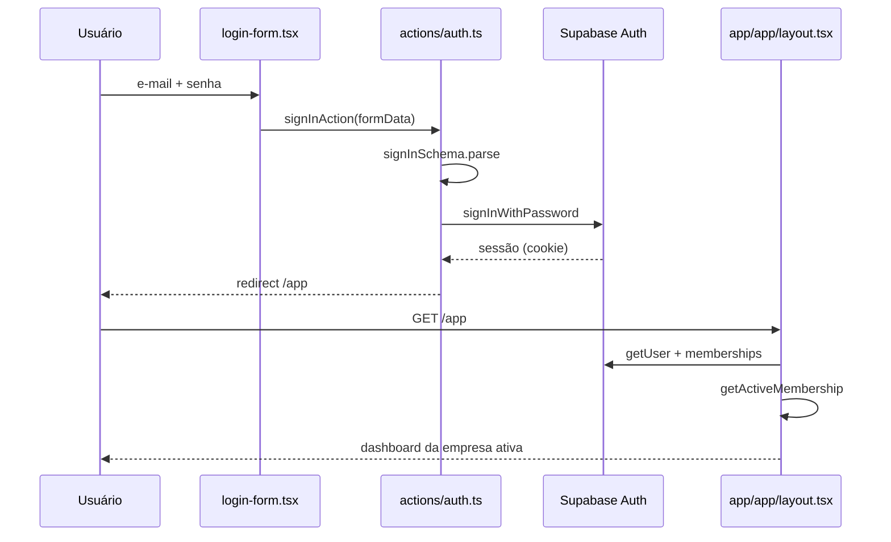

**Onde mexer:** [`actions/auth.ts`](arquivos/06-servidor-actions-core.md) §06.1, [`lib/auth.ts`](arquivos/02-nucleo-lib-aplicacao.md) §02.8, [`lib/tenant.ts`](arquivos/02-nucleo-lib-aplicacao.md) §02.9.

---

## 2.2 Aceitar convite de equipe

**Gatilho:** o convidado abre `/convite/<token>` e define nome/senha.

**Passos:**
1. O formulário ([`src/app/(auth)/convite/[token]/accept-invitation-form.tsx`](arquivos/11-app-nucleo-auth-e-publico.md) §11.11) chama `acceptInvitationAction`.
2. `acceptInvitationAction` ([`src/server/actions/team.ts`](arquivos/06-servidor-actions-core.md) §06.4) lê o convite com o **cliente admin** (`createAdminClient`, ignora RLS), valida token/expiração e, se o e-mail ainda não existe, cria o usuário (`admin.auth.admin.createUser`) e entra; se já existe, exige a senha correta.
3. Faz `upsert` em `memberships` (status `active`) e marca `invitations.accepted_at`; `redirect("/app")`.

**O banco vê:** lê `invitations`; cria/atualiza `auth.users`, `profiles` (trigger `handle_new_user`) e `memberships`; atualiza `invitations`.
**O usuário vê:** passa a ter acesso à empresa; o convite deixa de aceitar uso. Erros comuns: convite expirado, já usado, ou e-mail já cadastrado com senha diferente.

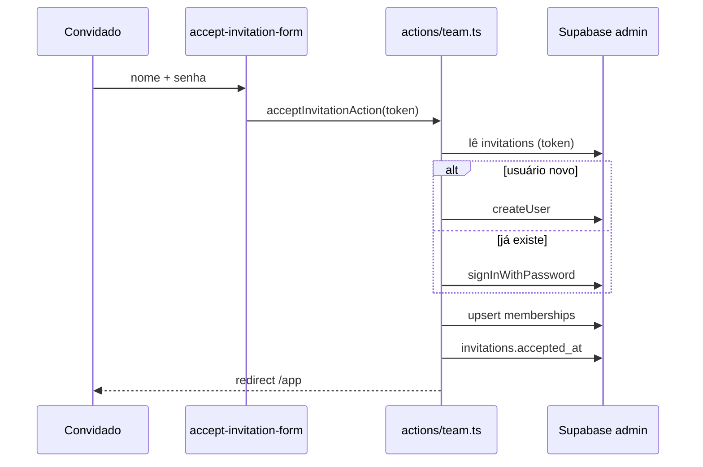

**Onde mexer:** [`actions/team.ts`](arquivos/06-servidor-actions-core.md) §06.4, [`actions/platform.ts`](arquivos/06-servidor-actions-core.md) §06.5 (cria empresa + defaults), [`lib/leads-defaults.ts`](arquivos/02-nucleo-lib-aplicacao.md) §02.19.

---

## 2.3 Cadastrar cliente e convidar para o portal

**Gatilho:** em `/app/clientes`, o usuário cria uma empresa e depois um contato.

**Passos:**
1. O dialog ([`src/app/app/clientes/company-form-dialog.tsx`](arquivos/12-app-painel-e-clientes.md) §12.5) chama `createCompanyAction`/`updateCompanyAction` ([`src/server/actions/companies.ts`](arquivos/07-servidor-actions-negocio.md) §07.1): valida com Zod, verifica **limite do plano** (`checkPlanLimit`, recurso `clients`) e grava em `companies` (soft delete via `deleted_at`).
2. O contato é criado por `createContactAction` ([`src/server/actions/contacts.ts`](arquivos/07-servidor-actions-negocio.md) §07.2) em `contacts`.
3. Para dar acesso ao portal, `inviteContactToPortalAction` cria/reaproveita o usuário no Supabase Auth (cliente admin) e grava `contacts.user_id` (só `owner`/`admin`).
4. A página de detalhe ([`src/app/app/clientes/[id]/page.tsx`](arquivos/12-app-painel-e-clientes.md) §12.7) lista contatos, projetos e campos personalizados.

**O banco vê:** grava `companies` e `contacts`; associa `contacts.user_id` a `auth.users`; grava valores de campos personalizados (`custom_field_values`).
**O usuário vê:** a empresa/contato na lista; o contato que recebeu convite entra em `/portal`. Erros: limite de plano atingido, e-mail já membro.

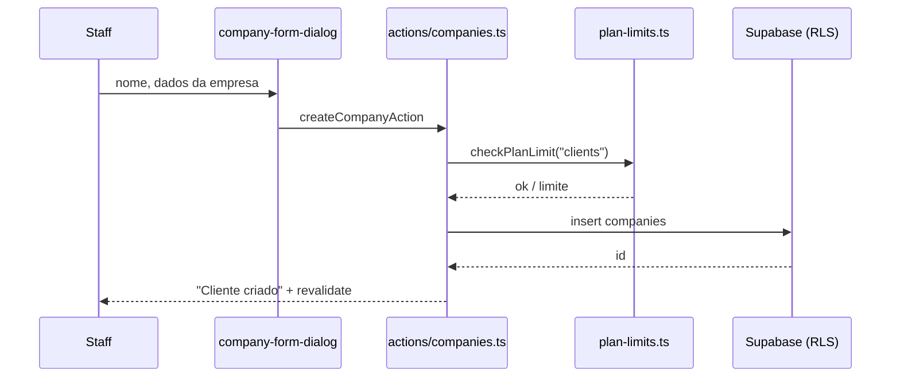

**Onde mexer:** [`actions/companies.ts`](arquivos/07-servidor-actions-negocio.md) §07.1, [`actions/contacts.ts`](arquivos/07-servidor-actions-negocio.md) §07.2, [`plan-limits.ts`](arquivos/04-servidor-helpers.md) §04.2.

---

## 2.4 Criar projeto, tarefas e cronograma (Gantt)

**Gatilho:** em `/app/projetos`, criar um projeto e adicionar tarefas; no detalhe, usar o cronograma.

**Passos:**
1. `createProjectAction` ([`src/server/actions/projects.ts`](arquivos/07-servidor-actions-negocio.md) §07.5) valida (`projectSchema`), checa o limite do plano (`projects`) e grava em `projects` (status 1–5, `billing_type` 1–3, `rate_per_hour`).
2. As tarefas são criadas por `createTaskAction` ([`src/server/actions/tasks.ts`](arquivos/07-servidor-actions-negocio.md) §07.6) em `tasks` (status 1–5, prioridade 1–4, `assignee_id`, `start_date`/`due_date`, `milestone_id`).
3. No cronograma ([`src/components/app/project-gantt.tsx`](arquivos/09-componentes-dominio.md) §09.17), arrastar/redimensionar persiste datas via [`src/server/actions/gantt.ts`](arquivos/07-servidor-actions-negocio.md) §07.8, e as dependências são gravadas em `task_dependencies` (helper puro em [`src/lib/gantt.ts`](arquivos/02-nucleo-lib-aplicacao.md) §02.20, com detecção de ciclos e auto-deslocamento).

**O banco vê:** `projects`, `tasks`, `milestones`, `task_dependencies`; leituras em `project_members` e `profiles`.
**O usuário vê:** projeto com progresso (derivado das tarefas concluídas), marcos e o Gantt. Erros: limite de plano; ciclo de dependência é bloqueado.

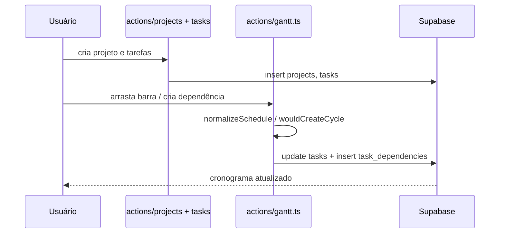

**Onde mexer:** [`actions/projects.ts`](arquivos/07-servidor-actions-negocio.md) §07.5, [`actions/tasks.ts`](arquivos/07-servidor-actions-negocio.md) §07.6, [`actions/gantt.ts`](arquivos/07-servidor-actions-negocio.md) §07.8, [`lib/gantt.ts`](arquivos/02-nucleo-lib-aplicacao.md) §02.20.

---

## 2.5 Apontar horas e faturar o tempo apontado

**Gatilho:** iniciar um timer em `/app/timesheet` ou lançar manualmente; depois "Faturar horas" no projeto.

**Passos:**
1. `startTimerAction`/`stopTimerAction`/`addManualEntryAction` ([`src/server/actions/time.ts`](arquivos/07-servidor-actions-negocio.md) §07.7) gravam em `time_entries`. Só existe **um timer aberto por usuário** (índice único no banco); `resolveRate` decide o valor-hora: do formulário, do projeto (`billing_type=2`) ou da tarefa (`billing_type=3`).
2. "Faturar horas" chama `invoiceBillableTimeAction` ([`src/server/actions/invoices.ts`](arquivos/07-servidor-actions-negocio.md) §07.10): busca `listUnbilledBillableEntries` ([`src/server/queries/time.ts`](arquivos/05-servidor-queries.md) §05.5), agrupa por tarefa/valor-hora, gera número via RPC `next_document_number`, cria a fatura + itens e marca as `time_entries` como `billed=true`.

**O banco vê:** `time_entries` (lê/grava), `projects`/`tasks` (para o rate), `invoices` e `document_items` (cria), `next_document_number` (sequência).
**O usuário vê:** horas somadas por projeto/pessoa; a fatura passa a existir em `/app/faturas` e as horas faturadas deixam de contar como "não faturadas". Erros: sem entradas faturáveis não faz nada.

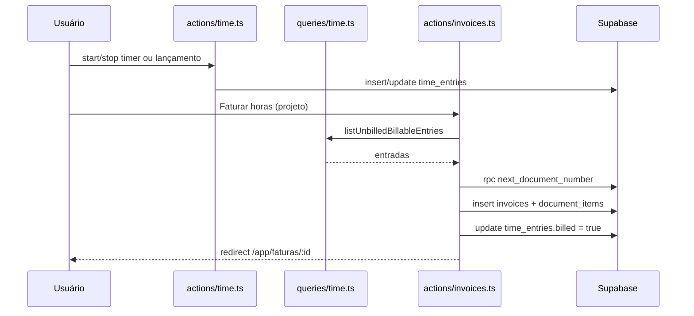

**Onde mexer:** [`actions/time.ts`](arquivos/07-servidor-actions-negocio.md) §07.7, [`actions/invoices.ts`](arquivos/07-servidor-actions-negocio.md) §07.10, [`server/documents.ts`](arquivos/04-servidor-helpers.md) §04.3.

---

## 2.6 Orçamento → conversão em fatura

**Gatilho:** criar um orçamento em `/app/orcamentos` e usar "Converter em fatura".

**Passos:**
1. `createEstimateAction` ([`src/server/actions/estimates.ts`](arquivos/07-servidor-actions-negocio.md) §07.9) faz `parseDocumentForm` ([`src/server/documents.ts`](arquivos/04-servidor-helpers.md) §04.3), calcula totais com `computeTotals` ([`src/lib/documents/totals.ts`](arquivos/02-nucleo-lib-aplicacao.md) §02.22), gera o número (`next_document_number`, kind `estimate`), insere em `estimates` (status 1 = rascunho) e os itens em `document_items`.
2. O status pode ser enviado (2), recusado (3) ou aceito (4) por `updateEstimateStatusAction`.
3. `convertEstimateToInvoiceAction` copia os dados do orçamento para uma nova `invoices` (status 1), copia os itens, marca o orçamento como aceito (`status=4`) com `invoice_id` e redireciona para a fatura.

**O banco vê:** `estimates` + `document_items` → `invoices` + `document_items` (novos) e atualização do `estimates` (`invoice_id`, `status`).
**O usuário vê:** número formatado (prefixo por tenant, ex.: `EST-000001` → `INV-000001`). O orçamento deixa o portal até o cliente aprovar (rascunho `status=1` não aparece no portal).

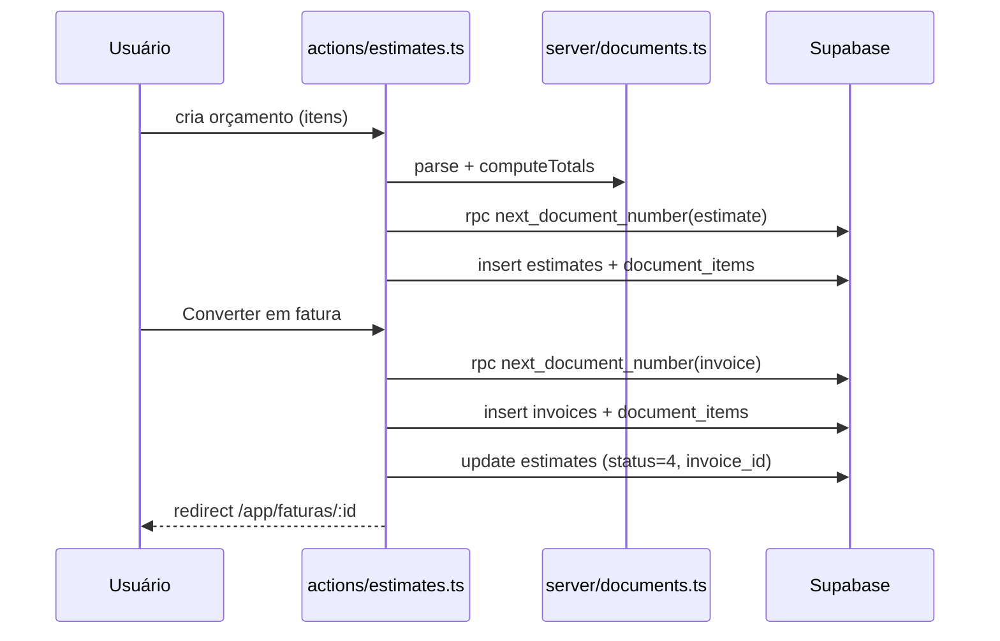

**Onde mexer:** [`actions/estimates.ts`](arquivos/07-servidor-actions-negocio.md) §07.9, [`server/documents.ts`](arquivos/04-servidor-helpers.md) §04.3, [`lib/documents/totals.ts`](arquivos/02-nucleo-lib-aplicacao.md) §02.22, [`04-modelo-de-dados](04-modelo-de-dados.md) §4.

---

## 2.7 Registrar pagamento e status da fatura

**Gatilho:** "Registrar pagamento" no detalhe da fatura.

**Passos:**
1. O dialog ([`src/app/app/faturas/record-payment-dialog.tsx`](arquivos/14-app-financeiro.md) §14.7) chama `recordPaymentAction` ([`src/server/actions/invoices.ts`](arquivos/07-servidor-actions-negocio.md) §07.10): valida valor/data e insere em `payments`.
2. `recomputeInvoiceStatus` soma os pagamentos e define o status: `1` em aberto, `3` parcial, `2` pago (tolerância de 0,001). Remover um pagamento (`deletePaymentAction`) recalcula.

**O banco vê:** `payments` (insere/apaga) e `invoices.status` (recalcula). Faturas canceladas/rascunho não recalculam.
**O usuário vê:** o status "Parcial"/"Pago" na lista e no detalhe. A RLS impede que o cliente veja rascunho (`status=6`) no portal.

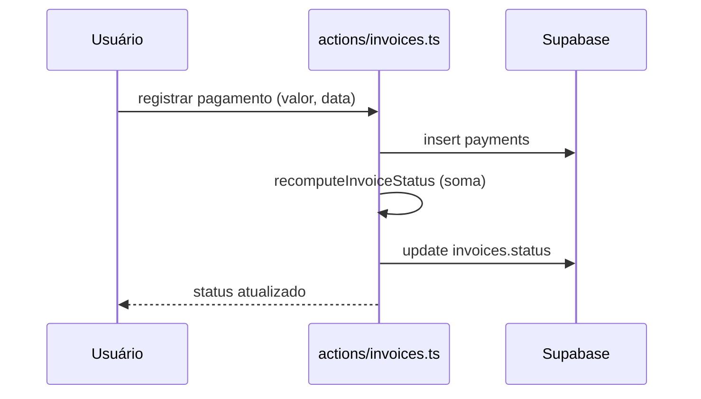

**Onde mexer:** [`actions/invoices.ts`](arquivos/07-servidor-actions-negocio.md) §07.10, [`14-app-financeiro.md`](arquivos/14-app-financeiro.md).

---

## 2.8 Converter lead em cliente (CRM)

**Gatilho:** "Converter em cliente" no detalhe do lead.

**Passos:**
1. `convertLeadToCustomerAction` ([`src/server/actions/leads.ts`](arquivos/07-servidor-actions-negocio.md) §07.3) checa o limite do plano (`clients`), cria a `companies` com os dados do lead, cria um `contacts` primário a partir do nome/e-mail e marca o lead (`converted_company_id`, `converted_at`, `status_id` = status "ganho") e registra uma `lead_activities`.
2. Redireciona para o cliente criado. Se o lead já foi convertido, vai direto ao cliente.

**O banco vê:** `companies` + `contacts` (novos), `leads` (atualizado), `lead_activities` (nova).
**O usuário vê:** o cliente passa a existir em `/app/clientes` e o lead aparece como ganho no Kanban.

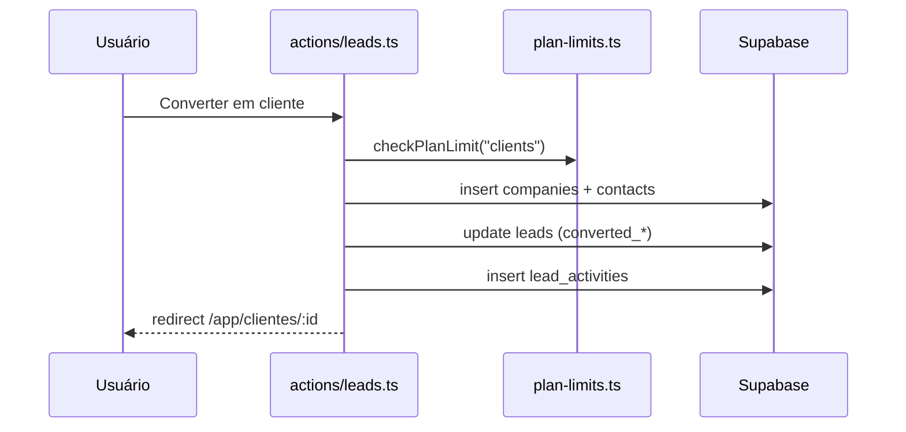

**Onde mexer:** [`actions/leads.ts`](arquivos/07-servidor-actions-negocio.md) §07.3, [`15-app-comercial-e-atendimento.md`](arquivos/15-app-comercial-e-atendimento.md).

---

## 2.9 Captação pública (web-to-lead)

**Gatilho:** um visitante preenche o formulário em `/f/<slug>`.

**Passos:**
1. O formulário client ([`src/app/f/[slug]/public-lead-form.tsx`](arquivos/11-app-nucleo-auth-e-publico.md) §11.14) chama `submitPublicLeadAction` ([`src/server/actions/public-lead.ts`](arquivos/07-servidor-actions-negocio.md) §07.13).
2. A action aplica **rate limit distribuído** (RPC `check_rate_limit` por IP), checa o **honeypot** (`company_website`; se preenchido, finge sucesso), valida com `publicLeadSchema`, confirma que a empresa tem `web_to_lead_enabled` e está dentro do limite do plano, e insere em `leads` com a origem configurada (`web_to_lead_source_id`).

**O banco vê:** RPC `check_rate_limit` (tabela `rate_limit_hits`); insert em `leads`.
**O usuário vê:** mensagem de sucesso; o lead aparece para a equipe com a origem do formulário. Erros: "Muitas tentativas", "Formulário indisponível".

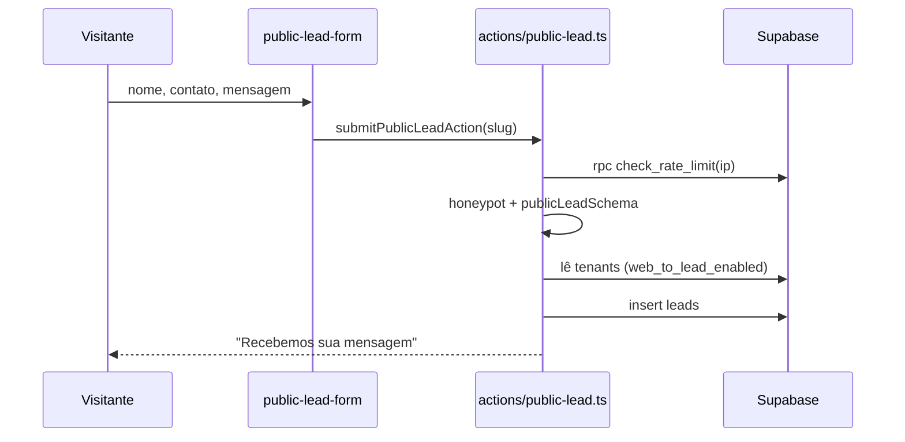

**Onde mexer:** [`actions/public-lead.ts`](arquivos/07-servidor-actions-negocio.md) §07.13, [`16-app-configuracoes-e-plataforma.md`](arquivos/16-app-configuracoes-e-plataforma.md) (ativação e link).

---

## 2.10 Portal do cliente: aprovar orçamento

**Gatilho:** o cliente abre um orçamento em `/portal/orcamentos/<id>` e aprova ou recusa.

**Passos:**
1. A página do portal ([`src/app/portal/(portal)/orcamentos/[id]/page.tsx`](arquivos/17-portal-do-cliente.md) §17.9) lê os dados via RPCs `security definer` (`portal_contact`, ...).
2. O botão chama `respondEstimateAction` ([`src/server/actions/portal.ts`](arquivos/07-servidor-actions-negocio.md) §07.15), que executa a RPC `client_respond_estimate(p_estimate, p_accept)` — a função valida que o orçamento é da empresa do contato e grava a decisão. `revalidatePath` atualiza a tela.

**O banco vê:** a RPC grava o status do orçamento (aceito/recusado). O cliente **não** lê a tabela `estimates` diretamente (sem policy de leitura direta), só via RPC.
**O usuário vê:** o status muda no portal e na área interna.

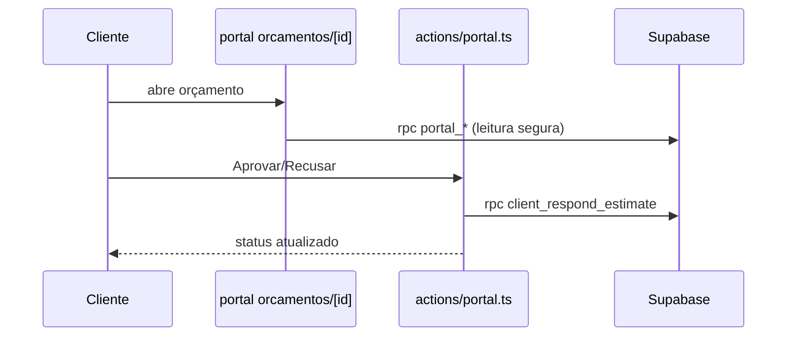

**Onde mexer:** [`actions/portal.ts`](arquivos/07-servidor-actions-negocio.md) §07.15, [`17-portal-do-cliente.md`](arquivos/17-portal-do-cliente.md), migrations `0008`/`0043`.

---

## 2.11 Portal do cliente: abrir e responder ticket

**Gatilho:** o cliente abre um ticket em `/portal/tickets`.

**Passos:**
1. O dialog ([`src/app/portal/(portal)/tickets/portal-ticket-dialog.tsx`](arquivos/17-portal-do-cliente.md) §17.16) chama `createPortalTicketAction` ([`src/server/actions/portal.ts`](arquivos/07-servidor-actions-negocio.md) §07.15): resolve o contato (`getPortalContact`), valida o assunto, checa o limite do plano (`tickets`, via `checkPlanLimitWith`), gera número (`next_document_number`, kind `ticket`, prefixo `TCK-`) e insere em `tickets` com `source="portal"`.
2. Respostas usam `addPortalTicketReplyAction` (grava `ticket_replies` com `is_internal=false`).

**O banco vê:** `tickets` (insert), `ticket_replies` (insert); leitura via policies de cliente. Notas internas da equipe nunca aparecem no portal.
**O usuário vê:** o ticket com número `TCK-000001` e a conversa; a equipe o vê em `/app/tickets`.

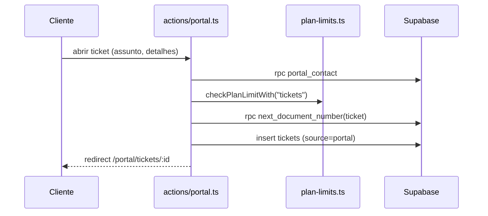

**Onde mexer:** [`actions/portal.ts`](arquivos/07-servidor-actions-negocio.md) §07.15, [`actions/tickets.ts`](arquivos/07-servidor-actions-negocio.md) §07.15.

---

## 2.12 Lembretes automáticos (cron)

**Gatilho:** a Vercel chama `GET /api/cron/reminders` às 09:00 (`vercel.json`).

**Passos:**
1. A rota ([`src/app/api/cron/reminders/route.ts`](arquivos/11-app-nucleo-auth-e-publico.md) §11.12) valida o header `Authorization: Bearer <CRON_SECRET>` com `timingSafeEqual` e chama `runReminders`.
2. `runReminders` ([`src/server/reminders.ts`](arquivos/04-servidor-helpers.md) §04.7) usa o cliente **admin** (ignora RLS), percorre os tenants e, para cada um: notifica+e-maila o responsável por tarefas que vencem em até 2 dias (`template task_due`), e notifica+e-maila os `owner`/`admin` por faturas vencidas em aberto/parcial (`template invoice_overdue`). Respeita `profiles.notify_email`.

**O banco vê:** lê `tenants`, `tasks`, `invoices`, `memberships`, `profiles`; grava `notifications` e `email_log`.
**O usuário vê:** notificação no sino (Realtime na `notifications`) e um e-mail; sem `RESEND_API_KEY`, o e-mail vira no-op mas a notificação é criada.

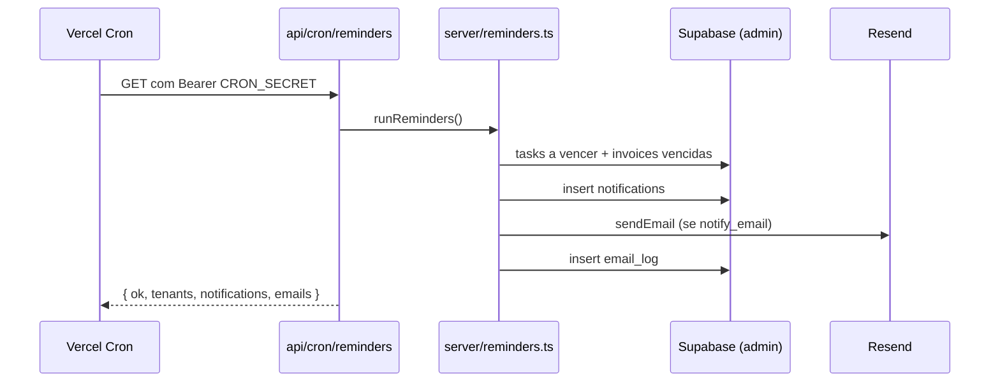

**Onde mexer:** [`server/reminders.ts`](arquivos/04-servidor-helpers.md) §04.7, [`server/email.ts`](arquivos/04-servidor-helpers.md) §04.5, [`11-app-nucleo-auth-e-publico.md`](arquivos/11-app-nucleo-auth-e-publico.md) §11.12.

---

## 2.13 Criar empresa e definir plano (super-admin)

**Gatilho:** super-admin cria uma empresa em `/plataforma`.

**Passos:**
1. `createTenantAction` ([`src/server/actions/platform.ts`](arquivos/06-servidor-actions-core.md) §06.5) confirma `is_super_admin`, gera `slug`, insere em `tenants`, inclui o autor como `owner` em `memberships`, e cria os defaults: `lead_statuses`, `lead_sources` e `departments` (de [`src/lib/leads-defaults.ts`](arquivos/02-nucleo-lib-aplicacao.md) §02.19).
2. Planos são gerenciados por `createPlanAction`/`updatePlanAction`/`deletePlanAction` (tabela `plans`, com `limits` por recurso); `setTenantPlanAction` associa o plano (`tenants.plan_id`).

**O banco vê:** `tenants`, `memberships`, `lead_statuses`, `lead_sources`, `departments`, `plans`.
**O usuário vê:** a empresa aparece no painel; os limites do plano passam a valer ao criar clientes/projetos/tarefas/tickets/leads.

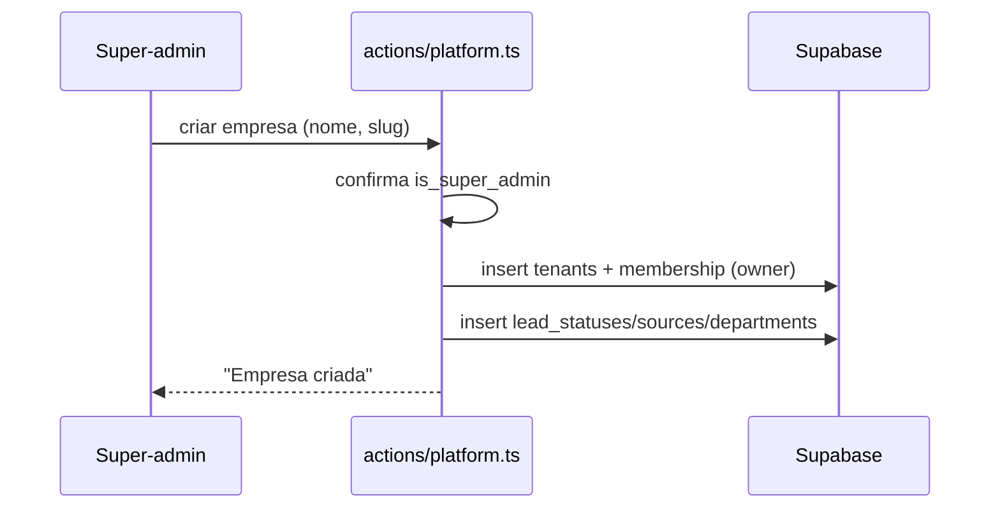

**Onde mexer:** [`actions/platform.ts`](arquivos/06-servidor-actions-core.md) §06.5, [`lib/leads-defaults.ts`](arquivos/02-nucleo-lib-aplicacao.md) §02.19, [`04-servidor-helpers.md`](arquivos/04-servidor-helpers.md) §04.2.

---

## 2.14 Resumo

| Processo | Arquivos-chave | Tabelas | Testes | Telas |
|---|---|---|---|---|
| 2.1 Entrar no painel | [`actions/auth.ts`](arquivos/06-servidor-actions-core.md), [`lib/auth.ts`](arquivos/02-nucleo-lib-aplicacao.md), [`lib/tenant.ts`](arquivos/02-nucleo-lib-aplicacao.md) | `profiles`, `memberships`, `tenants` | `tests/rls/isolation.test.ts` | `/login`, `/app` |
| 2.2 Aceitar convite | [`actions/team.ts`](arquivos/06-servidor-actions-core.md) | `invitations`, `memberships`, `profiles` | `tests/rls/isolation.test.ts` | `/convite/[token]` |
| 2.3 Cadastrar cliente/portal | [`actions/companies.ts`](arquivos/07-servidor-actions-negocio.md), [`actions/contacts.ts`](arquivos/07-servidor-actions-negocio.md) | `companies`, `contacts`, `custom_field_values` | `tests/rls/isolation.test.ts` | `/app/clientes` |
| 2.4 Projeto/tarefas/Gantt | [`actions/projects.ts`](arquivos/07-servidor-actions-negocio.md), [`actions/tasks.ts`](arquivos/07-servidor-actions-negocio.md), [`actions/gantt.ts`](arquivos/07-servidor-actions-negocio.md) | `projects`, `tasks`, `milestones`, `task_dependencies` | `tests/unit/gantt.test.ts` | `/app/projetos`, `/app/tarefas` |
| 2.5 Apontar e faturar horas | [`actions/time.ts`](arquivos/07-servidor-actions-negocio.md), [`actions/invoices.ts`](arquivos/07-servidor-actions-negocio.md) | `time_entries`, `invoices`, `document_items` | — | `/app/timesheet` |
| 2.6 Orçamento → fatura | [`actions/estimates.ts`](arquivos/07-servidor-actions-negocio.md) | `estimates`, `invoices`, `document_items` | `tests/unit/validations.test.ts` | `/app/orcamentos` |
| 2.7 Registrar pagamento | [`actions/invoices.ts`](arquivos/07-servidor-actions-negocio.md) | `payments`, `invoices` | `tests/rls/isolation.test.ts` (isolamento) | `/app/faturas/[id]` |
| 2.8 Converter lead | [`actions/leads.ts`](arquivos/07-servidor-actions-negocio.md) | `companies`, `contacts`, `leads`, `lead_activities` | `tests/rls/isolation.test.ts` | `/app/leads` |
| 2.9 Web-to-lead | [`actions/public-lead.ts`](arquivos/07-servidor-actions-negocio.md) | `rate_limit_hits`, `leads` | — | `/f/[slug]` |
| 2.10 Aprovar orçamento (portal) | [`actions/portal.ts`](arquivos/07-servidor-actions-negocio.md) | `estimates` (via RPC) | — | `/portal/orcamentos/[id]` |
| 2.11 Ticket do portal | [`actions/portal.ts`](arquivos/07-servidor-actions-negocio.md) | `tickets`, `ticket_replies` | `tests/rls/isolation.test.ts` | `/portal/tickets` |
| 2.12 Lembretes (cron) | [`server/reminders.ts`](arquivos/04-servidor-helpers.md) | `tasks`, `invoices`, `notifications`, `email_log` | — | sino de notificações, e-mail |
| 2.13 Criar empresa/plano | [`actions/platform.ts`](arquivos/06-servidor-actions-core.md) | `tenants`, `memberships`, `plans`, defaults | — | `/plataforma` |

> Observação: `tests/rls/isolation.test.ts` cobre o **isolamento entre tenants** de forma transversal (118 casos), não cada fluxo individualmente. As fichas e os testes estão detalhados em [18-testes-e-scripts](arquivos/18-testes-e-scripts.md).
