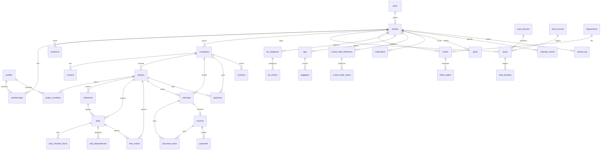

# 04. Modelo de dados

> 44 tabelas · 0 enums nativos · 2 buckets de Storage · 22 funções expostas via PostgREST.

O Orbit CRM tem **44 tabelas** e **nenhum `enum` nativo do Postgres** (o bloco `Enums` do `database.types.ts` é vazio — os domínios são codificados como `smallint` ou `text` com `check`). O **schema canônico** vive em `supabase/migrations/` (`0001`–`0044`), e os **tipos TypeScript gerados** a partir dele estão em `src/lib/database.types.ts` (artefato gerado por `npm run db:types`, nunca editado à mão). Toda tabela de negócio tem `tenant_id` e RLS; o desenho das migrations, RLS e RPCs está em [01-banco](arquivos/01-banco-migrations-e-seed.md) §01.4, os status/domínios também aparecem nas [validações Zod](arquivos/03-validacoes-zod.md) e o uso nas telas está em [processos](02-processos.md). As regras de acesso e convenções transversais ficam em [regras e convenções](05-regras-e-convencoes.md).

## §04.1 Tabelas por área

Fonte: as migrations reais em `supabase/migrations/*.sql` (coluna citada) e a conferência em `src/lib/database.types.ts`.

### Plataforma e infraestrutura

| Tabela | Papel (1 linha) |
|---|---|
| `profiles` | Perfil 1:1 com `auth.users` (`full_name`, `avatar_url`, `is_super_admin`, `email`, `notify_email`) — `0001_init_platform.sql:10`, `0044:58`. |
| `tenants` | Workspace/empresa-cliente do SaaS: `slug`, marca (`primary_color`, `logo_url`), plano, prefixos e contadores de numeração — `0001:19`, `0007:7`, `0010:3`, `0015:17`, `0032:3`. |
| `memberships` | Vínculo usuário × tenant × papel (`owner`/`admin`/`member`) com status — `0001:31`. |
| `invitations` | Convite por e-mail com `token` UUID, papel e validade — `0001:44`. |
| `plans` | Catálogo de planos (preço, trial, `limits` jsonb por recurso, "mais popular") — `0015:3`. |
| `roadmap_items` | Backlog/roadmap da plataforma, restrito ao super-admin — `0017:5`. |
| `notifications` | Notificações internas por usuário (`read_at`, `url`), publicada no Realtime — `0016:3`, `0027`. |
| `rate_limit_hits` | Registro de hits para o rate limit distribuído das rotas públicas; sem policies (acesso só via `check_rate_limit`) — `0044:7`. |

### Entrega (clientes, projetos, tarefas, horas)

| Tabela | Papel (1 linha) |
|---|---|
| `companies` | Empresas clientes do tenant (dados fiscais/endereço) com soft delete — `0002:3`. |
| `contacts` | Contatos de uma `company`; `user_id` liga o contato a um login do portal — `0002:28`, `0008:4`. |
| `projects` | Projetos: status, `billing_type`, orçamento, custo/hora, prazos e progresso — `0003:3`. |
| `project_members` | Equipe do projeto (usuários alocados, `unique (project_id, user_id)`) — `0003:35`. |
| `milestones` | Marcos do projeto (status 1–3, cor, ordem) — `0018:3`. |
| `tasks` | Tarefas: status, prioridade, responsável, faturável/valor-hora, `milestone_id` opcional — `0004:3`, `0018:34`. |
| `task_checklist_items` | Itens de checklist da tarefa (`is_done`, `position`) — `0004:35`. |
| `task_dependencies` | Dependências entre tarefas (predecessora/sucessora), sem auto-dependência — `0035:3`. |
| `time_entries` | Apontamentos de horas (timer/ manual), `is_billable`, `rate`, `billed` — `0006:3`. |
| `comments` | Comentários polimórficos (`entity_type`/`entity_id`) em task/project — `0005:57`. |
| `attachments` | Anexos polimórficos (task/project/ticket) com `storage_path` no bucket privado — `0005:70`, `0010:117`. |

### Financeiro

| Tabela | Papel (1 linha) |
|---|---|
| `estimates` | Orçamentos: status, itens, desconto/imposto, numeração e conversão em fatura (`invoice_id`) — `0007:60`. |
| `invoices` | Faturas: status, vencimento, totais e `formatted_number` — `0007:18`. |
| `document_items` | Itens de documento (`rel_type` estimate/invoice): descrição, qty, rate, imposto — `0007:105`. |
| `payments` | Pagamentos (parciais) ligados a uma fatura — `0007:127`. |
| `expenses` | Despesas por categoria, projeto e/ou cliente, com `billable` — `0024:3`. |
| `contracts` | Contratos com cliente: valor, vigência (início/término) e status 1–3 — `0025:3`. |

### Comercial (CRM)

| Tabela | Papel (1 linha) |
|---|---|
| `leads` | Oportunidades: valor, responsável, cidade e vínculo opcional a status/origem; guarda conversão em cliente — `0014:29`. |
| `lead_statuses` | Estágios configuráveis do funil (`is_won`/`is_lost`, cor, ordem) — `0014:3`. |
| `lead_sources` | Origens de lead configuráveis (usadas também pelo web-to-lead) — `0014:19`. |
| `lead_activities` | Timeline de atividades por lead — `0014:62`. |

### Atendimento e conhecimento

| Tabela | Papel (1 linha) |
|---|---|
| `departments` | Departamentos de atendimento do tenant (`unique (tenant_id, name)`) — `0010:45`. |
| `tickets` | Tickets: prioridade, tipo, status, `formatted_number` (`TCK-`) e origem (staff/portal/email) — `0010:59`. |
| `ticket_replies` | Respostas do ticket com nota interna (`is_internal`) e autor staff/contato — `0010:91`. |
| `kb_categories` | Categorias da base de conhecimento — `0011:3`. |
| `kb_articles` | Artigos publicáveis (`slug`, `views`), leitura do cliente só se publicado — `0011:15`. |
| `faqs` | Perguntas frequentes publicáveis — `0011:37`. |

### Agenda e auditoria

| Tabela | Papel (1 linha) |
|---|---|
| `calendar_events` | Eventos com data/hora e cliente/projeto opcionais — `0028:3`. |
| `activity_log` | Trilha de auditoria (quem/`entity`/`action`), escrita apenas pelo trigger `log_activity` — `0029:3`. |

### Metas

| Tabela | Papel (1 linha) |
|---|---|
| `goals` | Metas por período com métrica `revenue`/`leads`/`hours` e alvo — `0030:3`. |

### Comunicação

| Tabela | Papel (1 linha) |
|---|---|
| `email_templates` | Modelos de e-mail por tenant (`key`, `subject`, `body`) — `0031:3`. |
| `email_log` | Histórico de envios (`to_email`, `status` sent/skipped/error) — `0031:22`. |

### Transversais (tags e campos personalizados)

| Tabela | Papel (1 linha) |
|---|---|
| `tags` | Tags por tenant (nome único por `lower(name)`, cor) — `0019:3`. |
| `taggables` | Vínculo polimórfico tag × entidade (`company`/`project`/`task`/`lead`/`ticket`) — `0019:17`. |
| `custom_field_definitions` | Definição de campos personalizados por entidade (`field_type`, `options`, `required`) — `0020:4`. |
| `custom_field_values` | Valores por registro (armazenados como `text`), polimórficos — `0020:27`. |

## §04.2 Campos-chave e convenções

- **PK `uuid`** com `default gen_random_uuid()` em quase todas as tabelas (`0001:11`); exceção: `rate_limit_hits` usa `id bigint generated always as identity` (`0044:8`).
- **`created_at`/`updated_at`** (`timestamptz not null default now()`); o `updated_at` é mantido pelo trigger `set_updated_at()` — definido em `0001:129` e criado tabela a tabela (ex.: `0002:51`, `0003:52`).
- **Soft delete** via `deleted_at timestamptz` nas tabelas de negócio principais (companies, contacts, projects, tasks, invoices, estimates, tickets, leads, expenses, contracts, milestones, goals, calendar_events, custom fields); as listas filtram `where deleted_at is null`.
- **Dinheiro** é sempre `numeric(15, 2)` (`projects.project_cost`, `invoices.total`, `expenses.amount`, `contracts.value`, `leads.value`, `goals.target`), e `discount_percent` é `numeric(5, 2)` (`0007:33`).
- **Numeração de documentos por tenant**: `estimates`/`invoices`/`tickets` guardam `number int`, `prefix` e **`formatted_number`** ("EST-", "INV-", "TCK-"), com os contadores (`next_estimate_number`, `next_invoice_number`, `next_ticket_number`) e prefixos no `tenants` (`0007:7`, `0010:3`); a reserva é atômica via `next_document_number(tenant, kind)` (`0007:163`).
- **Índices em `(tenant_id, ...)`** e parciais com `where deleted_at is null` (ex.: `companies_tenant_name_idx` em `0002:25`, `tasks_tenant_status_idx` em `0004:32`).
- **"unique id+tenant" para FKs compostas**: cada tabela filha cria `unique (id, tenant_id)` (ex.: `companies_id_tenant_key` `0002:22`, `projects_id_tenant_key` `0003:27`) e as FKs referenciam o par `(id, tenant_id)` — garante que a referência não cruza tenants (ex.: `contacts_company_fk` `0002:42`). Há variações de 3 colunas, como `milestones_id_project_tenant_key` e `tasks_milestone_fk` (`0018:25`, `0018:39`).
- **Um timer em execução por usuário**: índice único parcial `time_entries (tenant_id, user_id) where ended_at is null` (`0006:25`).

## §04.3 Enums / domínios

O banco **não usa `enum`**: os status são `smallint`/`text` com `check`, e no front ficam centralizados em **`src/lib/constants.ts`**:

| Domínio | Valores (no banco) | Onde |
|---|---|---|
| Status de projeto | `smallint` 1–5 (`check status between 1 and 5`) | `0003:9` · `constants.ts:8` |
| Tipo de cobrança do projeto | `smallint` 1–3 | `0003:10` · `constants.ts:18` |
| Status de tarefa | `smallint` 1–5 | `0004:9` · `constants.ts:26` |
| Prioridade de tarefa | `smallint` 1–4 | `0004:10` · `constants.ts:36` |
| Status de marco | `smallint` 1–3 | `0018:9` · `constants.ts:45` |
| Status de orçamento (`estimates`) | `smallint` 1–5 | `0007:68` · `constants.ts:85` |
| Status de fatura (`invoices`) | `smallint in (1,2,3,5,6)` — o **4 não é usado** | `0007:26` · `constants.ts:95` |
| Status de contrato | `smallint` 1–3 | `0025:12` · `constants.ts:105` |
| Status de ticket | `smallint` 1–6 | `0010:66` · `constants.ts:133` |
| Prioridade de ticket | `smallint` 1–4 | `0010:67` · `constants.ts:144` |
| Tipo de ticket | `smallint` 1–4 | `0010:68` · `constants.ts:153` |
| Prioridade de roadmap | `smallint` 1–4 | `0017:15` |
| Tipos de campo personalizado | `text` (`text`/`textarea`/`number`/`date`/`select`/`checkbox`) | `0020:12` · `constants.ts:65` |

Domínios em **`text` com `check`** (não numéricos): papel de membership `owner/admin/member` (`0001:35`), status do tenant `active/suspended` (`0001:25`), `plan_status active/trial/suspended` (`0015:19`), `discount_type before_tax/after_tax` (`0007:32`), `entity_type` polimórfico, `tickets.source staff/portal/email` (`0010:74`), `goals.metric revenue/leads/hours` (`0030:7`), `email_log.status sent/skipped/error` (`0031:28`), `activity_log.action insert/update/delete` (`0029:9`). No front, esses mapas vivem em `src/lib/constants.ts` (e `EXPENSE_CATEGORIES`/`PAYMENT_MODES` em `constants.ts:113`/`:124`), e as validações correspondentes em [03-validacoes-zod](arquivos/03-validacoes-zod.md).

## §04.4 Relações principais

- `tenants` → muitas `memberships` e `invitations`; `profiles` → muitas `memberships` (`unique (tenant_id, user_id)`).
- `companies` → muitos `contacts`, `projects`, `estimates`, `invoices`, `contracts`, `expenses`, `calendar_events`.
- `projects` → muitos `project_members`, `milestones`, `tasks`, `time_entries`, `expenses`, `calendar_events`.
- `tasks` → muitos `task_checklist_items`, `time_entries` e `task_dependencies` (FK dupla para `tasks`); `tasks.milestone_id` → `milestones`.
- `estimates`/`invoices` → muitos `document_items` (via `rel_type`/`rel_id`); `estimates.invoice_id` → `invoices` (conversão); `invoices` → muitos `payments`.
- `tickets` → muitos `ticket_replies`; `tickets` → `departments`, `companies`, `contacts`, `projects`.
- `leads` → muitos `lead_activities`; `leads` → `lead_statuses`, `lead_sources`.
- `kb_categories` → muitos `kb_articles`; `tenants` → muitos `faqs`.
- Polimórficos (sem FK direta, validados por `entity_belongs_to_tenant`): `comments`, `attachments` (task/project/ticket), `taggables` (tag × company/project/task/lead/ticket) e `custom_field_values` (campo × company/project/task/lead).
- 1:N por tenant: `notifications`, `goals`, `email_templates`, `email_log`, `calendar_events`, `activity_log`, `tags`, `custom_field_definitions`, `plans` (1 plano → muitos `tenants`).

## §04.5 Diagrama de entidades

As entidades polimórficas (`comments`, `attachments`, `taggables`, `custom_field_values`) não aparecem ligadas por FK no diagrama porque se relacionam por `entity_type`/`entity_id`, não por chave estrangeira.

## §04.6 O que é negócio vs. plataforma

- **Plataforma (SaaS/tenancy):** `profiles`, `tenants`, `memberships`, `invitations`, `plans`, `roadmap_items`, `notifications`, `rate_limit_hits`. Não pertencem a um módulo de negócio do cliente: controlam acesso, cobrança, suporte ao produto e infraestrutura. `profiles`/`tenants`/`plans`/`roadmap_items` são sensíveis (super-admin).
- **Negócio (escopo do tenant):** todo o resto — entrega (`companies`…`attachments`), financeiro, comercial, atendimento, agenda/auditoria, metas, comunicação e as tabelas transversais (`tags`/`taggables`, `custom_field_definitions`/`custom_field_values`). Todas têm `tenant_id` e RLS por `is_tenant_member`/`has_tenant_role`.

## §04.7 Contagens

Conferido lendo `supabase/migrations/*.sql` e `src/lib/database.types.ts`:

- **44 tabelas** em `public` (43 aparecem em `database.types.ts`; `rate_limit_hits` fica de fora porque não tem policies nem grants, sendo acessível só pela função `check_rate_limit`).
- **0 enums** nativos (bloco `Enums` vazio em ambos os schemas).
- **2 buckets** de Storage: `attachments` (privado, `0005:130`) e `branding` (público, `0021`).
- **22 funções expostas** no PostgREST (bloco `Functions` de `database.types.ts:2646`), incluindo as **7 RPCs do portal** (`portal_contact`, `portal_list_projects`, `portal_get_project`, `portal_list_tasks`, `portal_list_milestones`, `portal_list_contracts`, `portal_list_expenses`), mais `check_rate_limit`, `client_respond_estimate`, `next_document_number` e `time_entries_summary`; as demais funções `security definer` (`is_tenant_member`, `has_tenant_role`, `is_super_admin`, `shares_tenant`, `entity_belongs_to_tenant`, `log_activity`, `protect_*`, `handle_*`) são internas.
