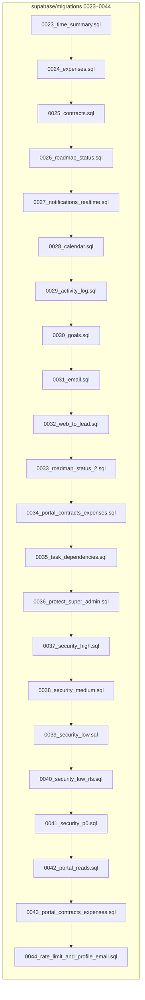
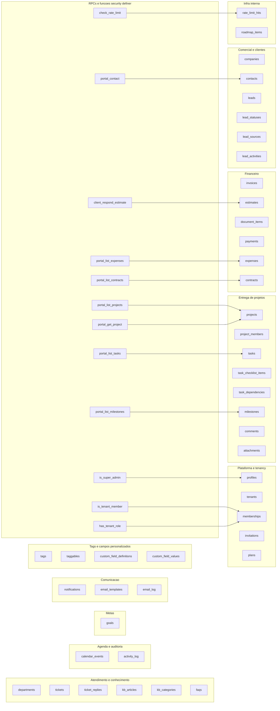

# 01. Banco: migrations, seed e tipos

> 46 arquivos de código · 2 fichas completas + 44 migrations em tabela de exceção (e mais o `config.toml`, que é configuração).

Este módulo é o **schema versionado do Supabase**: as 44 migrations que criam tabelas, RLS, funções `security definer`, triggers, as RPCs do portal, o rate limit e os buckets de Storage, mais o `seed.sql`, o `config.toml` do Supabase CLI e o `database.types.ts` gerado. É a fonte de verdade do banco — tudo o que as [validações Zod](03-validacoes-zod.md) §3 e os [helpers do servidor](04-servidor-helpers.md) §4 fazem precisa existir aqui antes. O desenho das tabelas está em [modelo de dados](../04-modelo-de-dados.md) §4 e as regras de acesso em [regras e convenções](../05-regras-e-convencoes.md) §5.

## Dependências do módulo

O `config.toml` aponta o `seed.sql` e a pasta de migrations; o seed roda **depois** das migrations; e `database.types.ts` é gerado **a partir** do schema resultante. As migrations são uma cadeia linear: cada arquivo assume o que o anterior criou. Por isso o diagrama foi dividido em dois (a numeração é a ordem de aplicação, não uma dependência de import).

```mermaid
flowchart LR
  cfg["supabase/config.toml"]
  seed["supabase/seed.sql"]
  types["src/lib/database.types.ts"]
  subgraph migA["supabase/migrations 0001–0022"]
    a1["0001_init_platform.sql"] --> a2["0002_companies_contacts.sql"] --> a3["0003_projects.sql"] --> a4["0004_tasks.sql"] --> a5["0005_comments_attachments.sql"] --> a6["0006_time_entries.sql"] --> a7["0007_finance.sql"] --> a8["0008_client_portal.sql"] --> a9["0009_client_storage.sql"] --> a10["0010_helpdesk.sql"] --> a11["0011_knowledge_base.sql"] --> a12["0012_client_tickets.sql"] --> a13["0013_client_kb_categories.sql"] --> a14["0014_leads.sql"] --> a15["0015_plans.sql"] --> a16["0016_notifications.sql"] --> a17["0017_roadmap_items.sql"] --> a18["0018_milestones.sql"] --> a19["0019_tags.sql"] --> a20["0020_custom_fields.sql"] --> a21["0021_branding.sql"] --> a22["0022_seed_backlog_suggestions.sql"]
  end
  cfg --> seed
  seed --> a1
  types --> a22
  cfg --> a1
```

## Grupos de tabelas e RPCs

## Fichas

### §01.1 `src/lib/database.types.ts`

**Propósito:** tipos TypeScript do banco, gerados automaticamente, usados para tipar os clientes Supabase do projeto inteiro.
**Processo:** o arquivo é **gerado**, nunca editado à mão. O script `db:types` (`supabase gen types typescript --linked > src/lib/database.types.ts`) lê o schema do projeto Supabase remoto e escreve: o tipo `Json`; o tipo `Database` com os schemas `graphql_public` e `public`; dentro de `public`, os blocos `Tables` (as tabelas do schema, cada uma com `Row`/`Insert`/`Update`/`Relationships`), `Functions` (as RPCs, ex. `portal_list_projects`, `check_rate_limit`, `time_entries_summary`) e `Enums`/`CompositeTypes` vazios; e, no fim, os utilitários `Tables<>`, `TablesInsert<>`, `TablesUpdate<>`, `Enums<>` e `DatabaseWithoutInternals`. Os clientes importam o tipo `Database` e o passam como genérico (`createServerClient<Database>`, etc.), o que dá autocomplete e checagem de schema em tempo de compilação.
**Estado:** `implementado` — 2917 linhas; `__InternalSupabase.PostgrestVersion = "14.5"` e o bloco `public` contém as tabelas e funções reais.
**Testes:** sem teste (é artefato gerado; o que é testado é o schema, em `tests/rls/isolation.test.ts`).
**Depende de:**
- Schema do banco criado por `supabase/migrations/*` (lê tabelas, colunas, relacionamentos e funções). Não importa nada do projeto.

**Usado por:** `src/lib/supabase/server.ts`, `src/lib/supabase/client.ts`, `src/lib/supabase/admin.ts` e `src/lib/supabase/middleware.ts` (todos fazem `createClient<Database>`/`createServerClient<Database>`/`createBrowserClient<Database>`).
**Bibliotecas externas:** nenhuma (é só declaração de tipos).

### §01.2 `supabase/seed.sql`

**Propósito:** ponto de entrada do seed do Supabase CLI em `supabase db reset`; hoje só contém comentários de orientação, sem inserir dados.
**Processo:** o `config.toml` habilita o seed (`[db.seed] enabled = true` e `sql_paths = ["./seed.sql"]`), então o CLI executa este arquivo **após** aplicar as migrations. O conteúdo atual não tem SQL: apenas explica que usuários de autenticação não são criados aqui (usar `supabase auth admin` ou o painel de super-admin em `/plataforma`) e mostra o `update public.profiles set is_super_admin = true where id = '...'` para promover um usuário local.
**Estado:** `stub` — 7 linhas, todas comentários (nenhum `insert`/`create`).
**Testes:** sem teste.
**Depende de:**
- `supabase/migrations/*`: roda depois delas; depende das tabelas existirem.

**Usado por:** `supabase/config.toml` (referenciado em `db.seed.sql_paths`) e o Supabase CLI no `db reset`.
**Bibliotecas externas:** Supabase CLI.

### §01.3 `supabase/config.toml`

**Propósito:** configuração local do Supabase CLI do projeto `orbit-crm` (portas, banco, auth, storage, realtime, seed).
**Processo:** define `project_id = "orbit-crm"` e os blocos que o CLI usa ao rodar `supabase start`/`stop`/`db reset`/`db push`. Principais: `[api]` (porta 54321, `schemas = ["public", "graphql_public"]`, `max_rows = 1000`), `[db]` (porta 54322, `major_version = 17`), `[db.migrations] enabled = true`, `[db.seed] enabled = true` com `sql_paths = ["./seed.sql"]`, `[storage] file_size_limit = "50MiB"`, `[auth]` (site local, `enable_signup = true`, senha mínima 6) e `[realtime] enabled = true`. Há muitos blocos comentados (SMTP, captcha, OAuth, MFA) e variáveis por `env(...)` — nenhum valor de segredo real está no arquivo.
**Estado:** `implementado` — 415 linhas, config padrão do CLI ajustada ao projeto.
**Testes:** sem teste.
**Depende de:**
- `supabase/seed.sql`: aponta como arquivo de seed.
- `supabase/migrations/`: configura a execução das migrations.

**Usado por:** Supabase CLI (`supabase start`, `db reset`, `db push`) — não é importado por código da aplicação.
**Bibliotecas externas:** Supabase CLI.

## Tabela de exceção — as 44 migrations

Migrations formam uma família homogênea (DDL versionado) por isso ficam em tabela em vez de ficha completa. O comportamento de RLS/RPCs que elas criam é exercitado por `tests/rls/isolation.test.ts`.

| Migration | O que muda no banco | Motivo da exceção |
|---|---|---|
| `0001_init_platform.sql` | Cria `profiles`, `tenants`, `memberships`, `invitations`; funções `is_tenant_member`, `has_tenant_role`, `is_super_admin`, `shares_tenant`, `set_updated_at`, `handle_new_user`; triggers de `updated_at` e `on_auth_user_created`; RLS das 4 tabelas. | Migração de fundação (plataforma/multi-tenant). |
| `0002_companies_contacts.sql` | Cria `companies` e `contacts` com FK composta `(id, tenant_id)`. | Migração de schema. |
| `0003_projects.sql` | Cria `projects` e `project_members` (FK composta, RLS por membro). | Migração de schema. |
| `0004_tasks.sql` | Cria `tasks` e `task_checklist_items`. | Migração de schema. |
| `0005_comments_attachments.sql` | Cria `comments` e `attachments`; funções `entity_belongs_to_tenant` e `storage_path_tenant`; cria o bucket privado `attachments` e as policies de `storage.objects`. | Migração de schema + Storage. |
| `0006_time_entries.sql` | Cria `time_entries`; índice único que garante um timer em execução por usuário. | Migração de schema. |
| `0007_finance.sql` | Adiciona colunas financeiras em `tenants`; cria `invoices`, `estimates`, `document_items`, `payments`; função `next_document_number`; amplia `entity_belongs_to_tenant` para estimate/invoice. | Migração de schema + função de numeração. |
| `0008_client_portal.sql` | Adiciona `contacts.user_id`; funções do cliente `is_client_of_company`, `client_can_view_project`, `client_can_view_document`, `client_can_view_entity` e RPC `client_respond_estimate`; policies de leitura do portal. | Migração de portal/RPC. |
| `0009_client_storage.sql` | Policy de leitura do bucket `attachments` pelo cliente (via `contacts`). | Migração de Storage (portal). |
| `0010_helpdesk.sql` | Colunas `ticket_prefix`/`next_ticket_number` em `tenants`; recria `next_document_number` (ticket); cria `departments`, `tickets`, `ticket_replies`; amplia `entity_belongs_to_tenant` e o check de `attachments` para `ticket`. | Migração de schema + função. |
| `0011_knowledge_base.sql` | Cria `kb_categories`, `kb_articles`, `faqs`; policies de leitura pública para o cliente. | Migração de schema. |
| `0012_client_tickets.sql` | Recria `next_document_number` (cliente pode criar ticket), `client_can_view_ticket` e `client_can_view_entity`; policies de ticket/resposta/departamento no portal. | Migração de RLS/RPC do portal. |
| `0013_client_kb_categories.sql` | Policy de leitura de `kb_categories` pelo cliente. | Migração de RLS (portal). |
| `0014_leads.sql` | Cria `lead_statuses`, `lead_sources`, `leads`, `lead_activities`. | Migração de schema. |
| `0015_plans.sql` | Cria `plans`; colunas de plano em `tenants` (`plan_id`, `plan_status`, `trial_ends_at`, `subscription_ends_at`); policies; insere 3 planos padrão. | Migração de schema + carga inicial. |
| `0016_notifications.sql` | Cria `notifications`. | Migração de schema. |
| `0017_roadmap_items.sql` | Cria `roadmap_items` (só super-admin) e insere o backlog inicial. | Migração de schema + carga. |
| `0018_milestones.sql` | Cria `milestones`; adiciona `tasks.milestone_id` com FK composta; policy de leitura do cliente. | Migração de schema. |
| `0019_tags.sql` | Cria `tags` e `taggables`; amplia `entity_belongs_to_tenant` para `company`/`lead`. | Migração de schema + função. |
| `0020_custom_fields.sql` | Cria `custom_field_definitions` e `custom_field_values`. | Migração de schema. |
| `0021_branding.sql` | Cria o bucket público `branding` e suas policies (leitura pública, escrita por tenant). | Migração de Storage. |
| `0022_seed_backlog_suggestions.sql` | Insere sugestões de melhoria em `roadmap_items`. | Migração de dados (backlog). |
| `0023_time_summary.sql` | Cria a função `time_entries_summary` (RPC de totais de horas/valor). | Migração de RPC/agregação. |
| `0024_expenses.sql` | Cria `expenses` (FK composta com project/company). | Migração de schema. |
| `0025_contracts.sql` | Cria `contracts`. | Migração de schema. |
| `0026_roadmap_status.sql` | Atualiza status de itens do roadmap (`done`/`in_progress`). | Migração de dados. |
| `0027_notifications_realtime.sql` | Adiciona `notifications` à publicação `supabase_realtime`; adiciona `profiles.notify_email`. | Migração de Realtime + coluna. |
| `0028_calendar.sql` | Cria `calendar_events`. | Migração de schema. |
| `0029_activity_log.sql` | Cria `activity_log`; função `log_activity` (security definer) e triggers de auditoria nas tabelas de negócio. | Migração de schema + auditoria. |
| `0030_goals.sql` | Cria `goals`. | Migração de schema. |
| `0031_email.sql` | Cria `email_templates` e `email_log`. | Migração de schema. |
| `0032_web_to_lead.sql` | Colunas `web_to_lead_enabled`/`web_to_lead_source_id` em `tenants` + FK para `lead_sources`. | Migração de schema. |
| `0033_roadmap_status_2.sql` | Atualiza status do roadmap (fases F12–F16). | Migração de dados. |
| `0034_portal_contracts_expenses.sql` | Policies do cliente para `contracts` e `expenses` (faturáveis). | Migração de RLS (portal). |
| `0035_task_dependencies.sql` | Cria `task_dependencies` (FK composta para tasks, sem auto-dependência). | Migração de schema. |
| `0036_protect_super_admin.sql` | Revoga `update` de `profiles` e concede só colunas editáveis; função/trigger `protect_super_admin`. | Migração de segurança. |
| `0037_security_high.sql` | Policies de `memberships` (só owner mexe em owner); `client_can_view_attachment_path`; trigger `protect_tenant_platform_columns`; policy de delete de `time_entries`. | Migração de segurança (alto). |
| `0038_security_medium.sql` | Policy `notifications_insert`; `client_can_view_ticket` isolado por tenant; policy `tickets_client_select`. | Migração de segurança (médio). |
| `0039_security_low.sql` | Função `is_authenticated_staff` + policy `plans_select`; revoga `execute` de funções para `public`/`anon`. | Migração de segurança (baixo). |
| `0040_security_low_rls.sql` | Ajusta policies de leitura do portal (soft-delete), `notifications_update`, `email_log_insert`, `document_items_update`. | Migração de segurança/RLS. |
| `0041_security_p0.sql` | Corrige achados P0: anexo exige `storage_path_tenant`; `memberships`/`invitations` só owner cria owner; `protect_contact_user_id`; `client_can_view_document` esconde rascunhos; policies de estimates/invoices do cliente. | Migração de segurança (P0). |
| `0042_portal_reads.sql` | Cria RPCs `portal_contact`, `portal_list_projects`, `portal_get_project`, `portal_list_tasks`, `portal_list_milestones`; remove a leitura direta do cliente em companies/projects/tasks/profiles. | Migração de RPC/portal. |
| `0043_portal_contracts_expenses.sql` | Cria RPCs `portal_list_contracts` e `portal_list_expenses`; remove a leitura direta do cliente nessas tabelas. | Migração de RPC/portal. |
| `0044_rate_limit_and_profile_email.sql` | Cria `rate_limit_hits` + função `check_rate_limit`; adiciona `profiles.email`; recria `handle_new_user` e cria `handle_user_email_update` + trigger em `auth.users`. | Migração de schema + RPC de rate limit. |

## RPCs e funções

**Funções `security definer`** (ignoram RLS de propósito e usam `search_path = public`):

- `is_tenant_member(uuid)`, `has_tenant_role(uuid, text[])`, `is_super_admin()`, `shares_tenant(uuid)` — created in `0001_init_platform.sql`.
- `entity_belongs_to_tenant(text, uuid, uuid)` — `0005` (ampliada em `0007`, `0010`, `0019`); `storage_path_tenant(text)` — `0005`.
- `next_document_number(uuid, text)` — `0007` (recriada em `0010` e `0012`).
- `is_client_of_company(uuid)`, `client_can_view_project(uuid)`, `client_can_view_document(text, uuid)`, `client_can_view_entity(text, uuid)`, `client_respond_estimate(uuid, boolean)` — `0008` (várias recriadas em `0012` e `0041`).
- `client_can_view_ticket(uuid)` — `0012` (recriada em `0038`).
- `log_activity()` — `0029`.
- `protect_super_admin()` — `0036`; `client_can_view_attachment_path(text)` e `protect_tenant_platform_columns()` — `0037` (a primeira recriada em `0041`); `is_authenticated_staff()` — `0039`; `protect_contact_user_id()` — `0041`.
- `handle_new_user()` e `handle_user_email_update()` — `0044`.
- `time_entries_summary(uuid, uuid, uuid)` — `0023` (esta é `security invoker`, não definer).

**RPCs do portal** (leitura por `supabase.rpc` e uso nas telas do cliente): `portal_contact()`, `portal_list_projects(uuid)`, `portal_get_project(uuid, uuid)`, `portal_list_tasks(uuid)`, `portal_list_milestones(uuid)` — todas em `0042`; `portal_list_contracts(uuid)` e `portal_list_expenses(uuid)` — `0043`. Além delas, `client_respond_estimate(uuid, boolean)` (`0008`) aprova/rejeita orçamento e `check_rate_limit(text, integer, integer)` (`0044`) faz o rate limit distribuído usado pelas rotas públicas. A partir de `0039`/`0041`/`0042`/`0043`, o `execute` dessas funções é revogado de `public`/`anon` e concedido só a `authenticated` e `service_role`.

## Buckets de Storage

- **`attachments`** — criado **privado** em `0005_comments_attachments.sql`; o caminho começa com o `tenant_id` (`storage_path_tenant`) e as policies de `storage.objects` liberam `select`/`insert`/`delete` para membros do tenant. A leitura pelo cliente do portal foi adicionada em `0009_client_storage.sql` e endurecida em `0037_security_high.sql` (só anexos de entidades visíveis, via `client_can_view_attachment_path`) e `0041_security_p0.sql` (o prefixo tem de bater com o `tenant_id` da linha). Guarda anexos de task/project/ticket.
- **`branding`** — criado **público** em `0021_branding.sql`; leitura liberada para todos (`to public`) e escrita (`insert`/`update`/`delete`) restrita ao tenant dono do prefixo do caminho. Guarda logos por tenant.

## Tabela das fichas do módulo

| § | Arquivo | Propósito em 1 linha |
|---|---------|----------------------|
| §01.1 | `src/lib/database.types.ts` | Tipos TypeScript gerados do schema, usados para tipar os clientes Supabase. |
| §01.2 | `supabase/seed.sql` | Seed local do `db reset`; hoje só comentários (stub). |
| §01.3 | `supabase/config.toml` | Configuração local do Supabase CLI (portas, banco, auth, storage, seed). |
| §01.4 | `supabase/migrations/0001–0044` | 44 migrations com DDL, RLS, funções e RPCs (ver tabela de exceção acima). |
