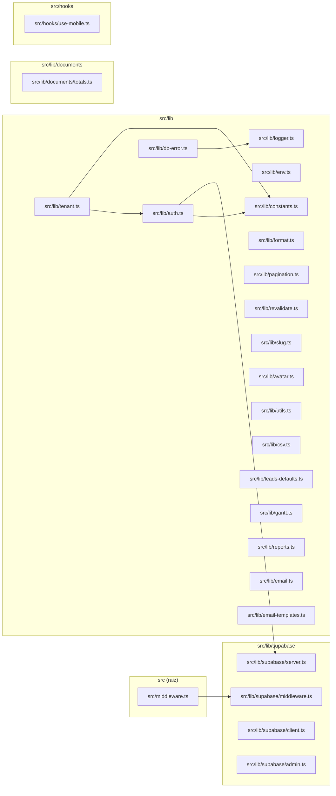

# 02. Núcleo da aplicação (src/lib) e sessão

> 25 arquivos de código · 25 fichas completas · 0 em tabela de exceção.

Este módulo reúne a fundação compartilhada do Orbit CRM: o middleware que roda em toda requisição e renova a sessão, os quatro clientes Supabase (browser, servidor, middleware e admin), os helpers de sessão/tenant (`auth.ts`, `tenant.ts`), as constantes/enums do domínio e um conjunto de utilitários puros (formatação, paginação, CSV, slug, avatar, Gantt, relatórios, totais de documentos, e-mail e templates). Praticamente todo o resto do sistema — `src/server/queries/*`, `src/server/actions/*`, páginas e componentes — importa de aqui. Como isso funciona na prática (quem chama `createClient()`, como o `tenant_id` é resolvido, etc.) está em [processos](../02-processos.md) §2, [arquitetura](../01-arquitetura.md) §1 e [regras e convenções](../05-regras-e-convencoes.md) §5; as tabelas citadas (`profiles`, `memberships`, `tenants`) estão em [modelo de dados](../04-modelo-de-dados.md) §4.

## Diagrama de dependências do módulo

## Fichas

### `src/middleware.ts`
**Propósito:** Ponto de entrada do middleware do Next.js; delega toda requisição para `updateSession`, que renova a sessão e protege as rotas.
**Processo:** Exporta `middleware(request: NextRequest)`, que apenas retorna `updateSession(request)` (importado de `@/lib/supabase/middleware`). O `config.matcher` exclui `_next/static`, `_next/image`, `favicon.ico` e arquivos de imagem (`svg`, `png`, `jpg`, `jpeg`, `gif`, `webp`, `ico`) para não executar em assets.
**Estado:** `implementado`
**Testes:** sem teste.
**Depende de:**
- `src/lib/supabase/middleware.ts`: `updateSession`.
- Config: `config.matcher` define em quais caminhos o middleware roda.
**Usado por:** o próprio Next.js (arquivo de convenção `src/middleware.ts` — ponto de entrada; nenhum import no código do projeto).
**Bibliotecas externas:** `next` (tipo `NextRequest`).

### `src/lib/supabase/middleware.ts`
**Propósito:** Renova a sessão Supabase a cada requisição e aplica a guarda de rotas (manda deslogados para login e logados para fora das telas de login).
**Processo:** `updateSession(request)` roda em sequência: (1) apaga o header `x-tenant-slug` que venha do cliente (nunca confia nele); (2) se `NEXT_PUBLIC_ROOT_DOMAIN` estiver definido, extrai o subdomínio do `host` e grava `x-tenant-slug` (resolução de tenant por subdomínio, hoje inativa sem a variável); (3) cria um client SSR com `createServerClient` ligado aos cookies da requisição (`getAll`/`setAll`, recriando a `NextResponse.next` a cada escrita; cookies `httpOnly`, `secure` em produção, `sameSite: "lax"`); (4) chama `supabase.auth.getUser()`; (5) calcula `isAuthRoute` (prefixos `/login`, `/portal/login`) e `isProtected` (prefixos `/app`, `/plataforma`, `/portal`); (6) sem usuário em rota protegida → `NextResponse.redirect` para `/login` ou `/portal/login` com `?redirect=<pathname>`; com usuário em rota de login → redirect para `/app` ou `/portal`.
**Estado:** `implementado`
**Testes:** sem teste.
**Depende de:**
- `@supabase/ssr`: `createServerClient`.
- `@/lib/database.types`: tipo `Database`.
- Config/env: `NEXT_PUBLIC_SUPABASE_URL`, `NEXT_PUBLIC_SUPABASE_ANON_KEY`, `NEXT_PUBLIC_ROOT_DOMAIN`, `NODE_ENV`.
**Usado por:** `src/middleware.ts` (é o único consumidor).
**Bibliotecas externas:** `@supabase/ssr` (`^0.12.7`), `next`.

### `src/lib/supabase/server.ts`
**Propósito:** Criar o cliente Supabase para uso no servidor (RSC, Server Actions e route handlers), usando os cookies da sessão.
**Processo:** `createClient()` lê o cookie store com `await cookies()` (de `next/headers`) e retorna `createServerClient<Database>` com `getAll`/`setAll`. No `setAll` há um `try/catch` proposital: ao ser chamado de um Server Component não é possível escrever cookies, então o erro é engolido e a renovação fica a cargo do middleware. Também aplica `cookieOptions` (`httpOnly`, `secure` em produção, `sameSite: "lax"`).
**Estado:** `implementado`
**Testes:** sem teste.
**Depende de:**
- `@supabase/ssr`: `createServerClient`.
- `next/headers`: `cookies`.
- `@/lib/database.types`: tipo `Database`.
- Config/env: `NEXT_PUBLIC_SUPABASE_URL`, `NEXT_PUBLIC_SUPABASE_ANON_KEY`, `NODE_ENV`.
**Usado por:** cliente padrão do servidor — `src/lib/auth.ts`, `src/server/plan-limits.ts`, todos os `src/server/queries/*` e `src/server/actions/*` e diversas páginas (`src/app/app/*/page.tsx`, `src/app/plataforma/page.tsx`). Busca por `@/lib/supabase/server` retornou 62 imports.
**Bibliotecas externas:** `@supabase/ssr` (`^0.12.7`), `next`.

### `src/lib/supabase/client.ts`
**Propósito:** Criar o cliente Supabase no navegador (browser), para uso em componentes client.
**Processo:** `createClient()` retorna `createBrowserClient<Database>` com a URL e a chave anônima públicas. Não lê variáveis de servidor.
**Estado:** `implementado`
**Testes:** sem teste.
**Depende de:**
- `@supabase/ssr`: `createBrowserClient`.
- `@/lib/database.types`: tipo `Database`.
- Config/env: `NEXT_PUBLIC_SUPABASE_URL`, `NEXT_PUBLIC_SUPABASE_ANON_KEY`.
**Usado por:** `src/components/app/attachment-uploader.tsx`, `src/components/app/notifications-bell.tsx` (upload para Storage e escuta de tempo real de notificações).
**Bibliotecas externas:** `@supabase/ssr` (`^0.12.7`).

### `src/lib/supabase/admin.ts`
**Propósito:** Criar o cliente Supabase com a `service role`, que **ignora o RLS**, para fluxos administrativos controlados no servidor.
**Processo:** `createAdminClient()` lê `NEXT_PUBLIC_SUPABASE_URL` e `SUPABASE_SERVICE_ROLE_KEY`; se faltar alguma, lança `Error` ("...não configurados."). Retorna `createClient<Database>(url, serviceRoleKey, { auth: { autoRefreshToken: false, persistSession: false } })` usando o `@supabase/supabase-js` puro (não o SSR).
**Estado:** `implementado`
**Testes:** sem teste.
**Depende de:**
- `@supabase/supabase-js`: `createClient`.
- `@/lib/database.types`: tipo `Database`.
- Config/env: `NEXT_PUBLIC_SUPABASE_URL`, `SUPABASE_SERVICE_ROLE_KEY`.
**Usado por:** `src/server/reminders.ts` (cron), `src/app/(auth)/convite/[token]/page.tsx`, `src/app/f/[slug]/page.tsx`, `src/server/actions/team.ts`, `src/server/actions/public-lead.ts`, `src/server/actions/portal.ts`, `src/server/actions/contacts.ts`.
**Bibliotecas externas:** `@supabase/supabase-js` (`^2.117.1`).

### `src/lib/auth.ts`
**Propósito:** Centralizar leitura de sessão e conta: usuário logado, perfil, vínculos (memberships) com tenants e checagem de super-admin.
**Processo:** `getUser()` (envolvido em `cache`) chama `createClient()` + `supabase.auth.getUser()`. `requireUser()` chama `getUser()` e, se não houver, faz `redirect("/login")`. `getProfile()` (cache) lê de `profiles` (`id, full_name, avatar_url, is_super_admin, notify_email`). `getMemberships()` (cache) lê `memberships` com `status = "active"` e um join para `tenants(...)`, filtrando vínculos sem tenant e mapeando para o tipo `Membership` (camelCase + `tenantId`). `requireSuperAdmin()` chama `requireUser()` + `getProfile()` e redireciona para `/app` se `is_super_admin` for falso.
**Estado:** `implementado`
**Testes:** sem teste direto.
**Depende de:**
- `src/lib/supabase/server.ts`: `createClient()`.
- `src/lib/constants.ts`: tipo `Role`.
- Tabelas: lê `profiles`, `memberships`, `tenants`; autenticação via `auth.getUser()`.
**Usado por:** quase todas as pages do app, o layout `src/app/app/layout.tsx`, `src/app/plataforma/layout.tsx` (`requireSuperAdmin`), `src/lib/tenant.ts` (`getMemberships`), praticamente todos os `src/server/actions/*` (`getUser`, `getProfile`) e componentes (`app-sidebar`, `tenant-switcher`, `user-menu`, `comments-section`).
**Bibliotecas externas:** `react` (`cache`); `next/navigation` (`redirect`).

### `src/lib/tenant.ts`
**Propósito:** Resolver qual tenant (empresa) está ativo para o usuário logado, a partir das memberships.
**Processo:** `getActiveTenant(memberships)` retorna `null` se não houver vínculos. A prioridade é: (1) o header `x-tenant-slug` (subdomínio) — procura a membership cujo `tenant.slug` bate; (2) o cookie `TENANT_COOKIE` (`orbit.tenant`) — procura por `tenant.id`; (3) fallback para a primeira membership. `getActiveMembership()` chama `getMemberships()` e delega para `getActiveTenant`.
**Estado:** `implementado`
**Testes:** sem teste.
**Depende de:**
- `next/headers`: `cookies`, `headers`.
- `src/lib/constants.ts`: `TENANT_COOKIE`.
- `src/lib/auth.ts`: `getMemberships`, tipo `Membership`.
- Cookie: lê `orbit.tenant`; header: lê `x-tenant-slug`.
**Usado por:** `src/app/app/layout.tsx`, muitas páginas do app (`getActiveTenant`) e a maioria dos `src/server/actions/*` (`getActiveMembership`). Busca por `@/lib/tenant` retornou 53 imports.
**Bibliotecas externas:** `next` (`next/headers`).

### `src/lib/constants.ts`
**Propósito:** Fonte única de rótulos, cores e enums do domínio (status de projeto/tarefa/ticket, prioridades, billing, campos personalizados, despesas, formas de pagamento) e do nome da app/tenant.
**Processo:** Exporta `APP_NAME` ("Orbit CRM") e `TENANT_COOKIE` ("orbit.tenant"); `ROLES` (`["owner","admin","member"]`) e o tipo `Role`; e vários mapas indexados por número inteiro (`PROJECT_STATUSES`, `TASK_STATUSES`, `TASK_PRIORITIES`, `MILESTONE_STATUSES`, `ESTIMATE_STATUSES`, `INVOICE_STATUSES`, `CONTRACT_STATUSES`, `TICKET_STATUSES`, `TICKET_PRIORITIES`, `TICKET_TYPES`, `CUSTOM_FIELD_TYPES`, `CUSTOM_FIELD_ENTITIES`, `PROJECT_BILLING_TYPES`) mais as listas `MILESTONE_COLORS`/`TAG_COLORS`, `EXPENSE_CATEGORIES` e `PAYMENT_MODES`, cada um com tipo derivado (`keyof typeof`). É só dado estático, sem lógica.
**Estado:** `implementado`
**Testes:** sem teste.
**Depende de:** nada (arquivo puro).
**Usado por:** 37 imports — `src/lib/auth.ts` e `src/lib/tenant.ts` (`Role`, `TENANT_COOKIE`); `src/server/permissions.ts`, `src/server/custom-fields.ts`, `src/server/actions/tenant.ts`; diálogos, badges e páginas (projetos, tarefas, tickets, faturas, orçamentos, contratos, despesas, configurações) e o `src/app/app/exportar/[entity]/route.ts`.
**Bibliotecas externas:** nenhuma.

### `src/lib/env.ts`
**Propósito:** Validar e tipar as variáveis de ambiente do servidor com Zod, e listar os e-mails de super-admin.
**Processo:** `serverEnvSchema` define `NEXT_PUBLIC_SUPABASE_URL` e `NEXT_PUBLIC_SUPABASE_ANON_KEY` (obrigatórias), `SUPABASE_SERVICE_ROLE_KEY`/`RESEND_API_KEY` (opcionais), `NEXT_PUBLIC_SITE_URL` (default `http://localhost:3000`), `NEXT_PUBLIC_APP_NAME` (default "Orbit CRM"), `EMAIL_FROM` e `SUPER_ADMIN_EMAILS`. `env()` faz `safeParse(process.env)`, lança `Error` com os campos inválidos listados, e guarda o resultado em cache de módulo (`cached`). `superAdminEmails()` separa `SUPER_ADMIN_EMAILS` por vírgula, normaliza para minúsculas e descarta vazios.
**Estado:** `implementado` — porém **sem consumidores**: a busca por `@/lib/env`, `env()` e `superAdminEmails` só encontra o próprio arquivo. Os outros módulos leem `process.env` diretamente.
**Testes:** sem teste.
**Depende de:**
- `zod`: construção do schema.
- Config/env: lê `NEXT_PUBLIC_SUPABASE_URL`, `NEXT_PUBLIC_SUPABASE_ANON_KEY`, `SUPABASE_SERVICE_ROLE_KEY`, `NEXT_PUBLIC_SITE_URL`, `NEXT_PUBLIC_APP_NAME`, `RESEND_API_KEY`, `EMAIL_FROM`, `SUPER_ADMIN_EMAILS`.
**Usado por:** nenhum arquivo do projeto (grep sem resultados além do próprio).
**Bibliotecas externas:** `zod` (`^4.6.5`).

### `src/lib/db-error.ts`
**Propósito:** Padronizar o tratamento de erro de banco nas Server Actions: loga no servidor e devolve uma mensagem genérica ao cliente.
**Processo:** `dbError(context, error, message = "Não foi possível concluir a operação. Tente novamente.")` chama `logger.error(\`db.${context}\`, { error: error?.message ?? "unknown" })` e retorna `{ error: message }` — evitando vazar detalhes de schema/constraint.
**Estado:** `implementado`
**Testes:** sem teste.
**Depende de:**
- `src/lib/logger.ts`: `logger.error`.
**Usado por:** 25 imports em `src/server/actions/*` (companies, contacts, projects, tasks, tickets, invoices, estimates, contracts, expenses, goals, leads, kb, milestones, tags, team, tenant, time, portal, platform, profile, notifications, gantt, email, custom-fields, calendar, attachments).
**Bibliotecas externas:** nenhuma.

### `src/lib/logger.ts`
**Propósito:** Logger mínimo que emite linhas JSON no console, com níveis `info`, `warn` e `error`.
**Processo:** `emit(level, message, context)` monta `{ level, message, time: new Date().toISOString(), ...context }`, serializa com `JSON.stringify` e imprime em `console.error`/`console.warn`/`console.log` conforme o nível. O objeto `logger` expõe os três métodos.
**Estado:** `implementado`
**Testes:** sem teste.
**Depende de:** nada (usa `console` nativo).
**Usado por:** `src/app/api/cron/reminders/route.ts`, `src/lib/db-error.ts`, `src/server/actions/public-lead.ts`, `src/server/actions/import.ts`.
**Bibliotecas externas:** nenhuma.

### `src/lib/format.ts`
**Propósito:** Formatar valores para exibição em português: dinheiro (BRL por padrão) e data.
**Processo:** `formatMoney(value, currency = "BRL")` devolve `"—"` para `null`/`undefined` e usa `Intl.NumberFormat("pt-BR", { style: "currency", currency })`; se a moeda for inválida cai no `catch` e retorna `"<currency> <n>"` com duas casas. `formatDate(value)` devolve `"—"` ou `new Date(value).toLocaleDateString("pt-BR")`.
**Estado:** `implementado`
**Testes:** sem teste.
**Depende de:** nada (usa `Intl`/`Date` nativos).
**Usado por:** 33 imports em páginas do app e do portal (`src/app/app/*/page.tsx`, `src/app/portal/(portal)/*`) e diálogos (`estimate-form-dialog`, `invoice-form-dialog`).
**Bibliotecas externas:** nenhuma.

### `src/lib/pagination.ts`
**Propósito:** Definir o tamanho de página e interpretar o parâmetro `?page=` de forma segura.
**Processo:** Exporta `PAGE_SIZE = 20` e `parsePage(value)` que aceita `string | string[] | undefined`, pega o primeiro item de um array, converte para número e devolve `Math.floor` quando finito e ≥ 1, senão `1`.
**Estado:** `implementado`
**Testes:** sem teste.
**Depende de:** nada.
**Usado por:** 13 imports — páginas de listagem (`tarefas`, `projetos`, `clientes`, `tickets`, `faturas`, `orcamentos`, `contratos`, `despesas`, `leads`, `atividades`, `timesheet`) e os componentes `src/components/app/pagination.tsx` e `src/components/app/time-entries-table.tsx` (que usam `PAGE_SIZE`).
**Bibliotecas externas:** nenhuma.

### `src/lib/revalidate.ts`
**Propósito:** Revalidar os caminhos afetados quando uma entidade (tarefa/projeto/ticket) muda, incluindo as listas.
**Processo:** `revalidateEntity(entityType, entityId)` chama `revalidatePath` do Next: para `"task"` revalida `/app/tarefas/${entityId}`, para `"project"` `/app/projetos/${entityId}`, para `"ticket"` `/app/tickets/${entityId}`; e sempre revalida as listas `/app/tarefas` e `/app/projetos`.
**Estado:** `implementado`
**Testes:** sem teste.
**Depende de:**
- `next/cache`: `revalidatePath`.
**Usado por:** `src/server/actions/attachments.ts`, `src/server/actions/comments.ts`.
**Bibliotecas externas:** `next`.

### `src/lib/slug.ts`
**Propósito:** Gerar um slug ASCII a partir de um texto (usado em artigos da base de conhecimento).
**Processo:** `slugify(value)` normaliza `NFD`, remove acentos (`\u0300-\u036f`), minúsculiza, troca qualquer sequência não alfanumérica por `-`, remove hífens das pontas e corta em 80 caracteres.
**Estado:** `implementado`
**Testes:** sem teste.
**Depende de:** nada.
**Usado por:** `src/server/actions/kb.ts` (`slugify`).
**Bibliotecas externas:** nenhuma.

### `src/lib/avatar.ts`
**Propósito:** Derivar iniciais e uma cor determinística a partir de um nome, para avatares sem imagem.
**Processo:** `initialsOf(name)` pega a 1ª letra das duas primeiras palavras e devolve em maiúsculas (ou `"?"`). `colorFor(name)` faz um hash simples (`hash*31 + charCode`, módulo do tamanho da paleta `COLORS`, 7 cores) e retorna a cor correspondente — o mesmo nome sempre gera a mesma cor.
**Estado:** `implementado`
**Testes:** sem teste.
**Depende de:** nada.
**Usado por:** `src/components/app/avatar-stack.tsx`, `src/components/app/entity-avatar.tsx`.
**Bibliotecas externas:** nenhuma.

### `src/lib/utils.ts`
**Propósito:** Reexportar o utilitário `cn` (merge de classes Tailwind) usado pelos componentes de UI.
**Processo:** É um único `export { cn } from "cn"` — repassa a função da dependência `cn`.
**Estado:** `implementado`
**Testes:** sem teste.
**Depende de:**
- Pacote `cn` (`^0.4.0`): função `cn`.
**Usado por:** 14 imports em componentes e páginas (`calendario`, `leads`/`lead-kanban`, `relatorios`, `metas`, `base-conhecimento`, `tarefas`, `configuracoes`, portal `portal-nav`, `avatar-stack`, `entity-avatar`, `pagination`, `stat-card`, `tag-filter`).
**Bibliotecas externas:** `cn` (`^0.4.0`).

### `src/lib/csv.ts`
**Propósito:** Gerar e interpretar CSV (separador `;`) com proteção contra injeção de fórmula e suporte a aspas.
**Processo:** `escapeCell(value)` neutraliza fórmulas que começam com `=`, `+`, `-`, `@`, TAB ou CR prefixando `'`, e faz o escaping de aspas/quebras com `"..."`. `toCsv(headers, rows)` junta com `;` e `\r\n`. `parseCsv(text)` remove o BOM, detecta o delimitador (`;` vs `,` por contagem), percorre caractere a caractere tratando aspas (`""` vira `"`) e quebras de linha, e descarta linhas totalmente vazias.
**Estado:** `implementado`
**Testes:** `tests/unit/csv.test.ts` (`toCsv` e `parseCsv`).
**Depende de:** nada.
**Usado por:** `src/server/actions/import.ts` (`parseCsv`), `src/app/app/exportar/[entity]/route.ts` (`toCsv`).
**Bibliotecas externas:** nenhuma.

### `src/lib/leads-defaults.ts`
**Propósito:** Valores padrão semeados quando um tenant é criado: status de lead, origens de lead e departamentos de suporte.
**Processo:** Exporta constantes puras: `DEFAULT_LEAD_STATUSES` (6 status com `name`, `color`, `position`, `is_default`, `is_won`, `is_lost`), `DEFAULT_LEAD_SOURCES` (7 origens) e `DEFAULT_DEPARTMENTS` (3 departamentos).
**Estado:** `implementado`
**Testes:** sem teste.
**Depende de:** nada.
**Usado por:** `src/server/actions/platform.ts` (ao criar um tenant, insere esses defaults nas tabelas `lead_statuses`, `lead_sources` e `departments`).
**Bibliotecas externas:** nenhuma.

### `src/lib/gantt.ts`
**Propósito:** Cálculo puro de cronograma para o Gantt: somar/diferenciar dias, propagar datas por dependências e detectar ciclos.
**Processo:** `addDays` e `diffDays` trabalham com strings `YYYY-MM-DD`. `normalizeSchedule(tasks, dependencies, edited)` aplica a edição a uma tarefa e propaga em largura (BFS) para as sucessoras: se a sucessora começa antes do dia seguinte ao fim da predecessora, desloca início e prazo pelo mesmo delta; devolve só as tarefas que mudaram. Há um guarda de 100.000 iterações. `wouldCreateCycle(dependencies, taskId, dependsOnId)` percorre as sucessoras em DFS e retorna `true` se `taskId` já depende (direta ou indiretamente) de `dependsOnId` ou se são a mesma tarefa.
**Estado:** `implementado`
**Testes:** `tests/unit/gantt.test.ts` (`addDays`/`diffDays`, `normalizeSchedule`, `wouldCreateCycle`).
**Depende de:** nada.
**Usado por:** `src/server/actions/gantt.ts` (`normalizeSchedule`, `wouldCreateCycle`), `src/components/app/project-gantt.tsx` (`addDays`).
**Bibliotecas externas:** nenhuma.

### `src/lib/reports.ts`
**Propósito:** Montar as linhas das tabelas de relatório (rentabilidade, produtividade e conversão de leads por origem) a partir de dados já lidos do banco.
**Processo:** `buildProfitability(labels, revenueBy, expenseBy)` cruza receita/despesa por id e calcula `margin`, ordenando por margem desc. `buildProductivity(members, tasks, entries, sinceMs)` conta tarefas concluídas (status 5) por responsável desde `sinceMs` e soma tempo (segundos) e valor faturável (`segundos/3600 * rate` quando billable), filtrando quem não tem tarefas nem tempo. `buildLeadConversionBySource(leads, statuses)` agrupa leads por origem, classifica em `won`/`lost`/`open` usando `is_won`/`is_lost` dos status, soma `wonValue` e calcula a taxa de conversão (`won/total`).
**Estado:** `implementado`
**Testes:** `tests/unit/reports.test.ts` (as três funções).
**Depende de:** nada.
**Usado por:** `src/server/queries/reports.ts` (é o único consumidor).
**Bibliotecas externas:** nenhuma.

### `src/lib/documents/totals.ts`
**Propósito:** Calcular subtotal, imposto, desconto e total de um documento financeiro (orçamento/fatura) a partir dos itens e do cabeçalho.
**Processo:** `computeTotals(items, input)` soma `qty * rate` por item (arredondando a 2 casas com `EPSILON`), calcula o imposto por item (`qty*rate/100 * tax_rate`), aplica desconto: em `before_tax` o desconto é sobre o subtotal e o imposto é reescalado pelo `ratio` restante; em `after_tax` o desconto incide sobre `subtotal + imposto`. O total é `subtotal + imposto - desconto + ajuste`. Tipos `LineItemInput`, `TotalsInput` e `Totals`.
**Estado:** `implementado`
**Testes:** sem teste.
**Depende de:** nada.
**Usado por:** `src/server/documents.ts` (`computeTotals`, `LineItemInput`), `src/server/actions/invoices.ts` e `estimates.ts`, `src/components/app/document-items-editor.tsx` e os diálogos `estimate-form-dialog.tsx`/`invoice-form-dialog.tsx`.
**Bibliotecas externas:** nenhuma.

### `src/lib/email.ts`
**Propósito:** Enviar e-mail transacional via API HTTP do Resend, degradando com segurança quando não há chave.
**Processo:** `sendEmail({ to, subject, html })` lê `RESEND_API_KEY` e `EMAIL_FROM` (fallback `"Orbit CRM <nao-responda@orbitcrm.app>"`). Sem a chave, loga e retorna `{ sent: false, skipped: true }`. Com a chave, faz `fetch` `POST https://api.resend.com/emails` com `Authorization: Bearer <key>`; em resposta HTTP não-OK retorna `{ sent: false, error: text }`; em erro de rede retorna `{ sent: false, error: "network" }`; sucesso → `{ sent: true }`.
**Estado:** `implementado`
**Testes:** sem teste.
**Depende de:**
- Config/env: `RESEND_API_KEY`, `EMAIL_FROM`.
- Endpoint externo: `https://api.resend.com/emails`.
**Usado por:** `src/server/email.ts` (`sendTenantEmail`).
**Bibliotecas externas:** `fetch` nativo (nenhum SDK).

### `src/lib/email-templates.ts`
**Propósito:** Guardar os templates de e-mail padrão (assunto/corpo) e as funções de renderização/escape.
**Processo:** `EMAIL_TEMPLATES` é um `Record` com `task_due`, `invoice_overdue` e `member_invite`, cada um com `label`, `description`, `subject` e `body` usando marcadores `{{var}}`. `renderTemplate(text, vars)` substitui `{{chave}}` pelo valor (ou string vazia). `escapeHtml(value)` escapa `&`, `<`, `>`, `"` e `'`.
**Estado:** `implementado`
**Testes:** `tests/unit/validations.test.ts` (describe `renderTemplate`).
**Depende de:** nada.
**Usado por:** `src/server/email.ts` (`EMAIL_TEMPLATES`, `renderTemplate`, `escapeHtml`), `src/server/actions/email.ts` (valida a chave em `EMAIL_TEMPLATES`), `src/app/app/configuracoes/email-section.tsx` (lista os templates editáveis).
**Bibliotecas externas:** nenhuma.

### `src/hooks/use-mobile.ts`
**Propósito:** Hook React que informa se a viewport está no tamanho "mobile" (abaixo de 768px).
**Processo:** `useIsMobile()` mantém um estado booleano, cria `window.matchMedia("(max-width: 767px)")`, registra o listener `change` que atualiza o estado com `window.innerWidth < 768`, faz a checagem inicial e remove o listener no cleanup. Retorna `!!isMobile`.
**Estado:** `implementado`
**Testes:** sem teste.
**Depende de:**
- `react`: `useState`, `useEffect`.
**Usado por:** `src/components/ui/sidebar.tsx` (decide o comportamento mobile da sidebar).
**Bibliotecas externas:** `react` (`19.1.0`).

## Tabela das fichas do módulo

| § | Arquivo | Propósito em 1 linha |
|---|---------|----------------------|
| §02.1 | `src/middleware.ts` | Ponto de entrada do middleware; delega para `updateSession`. |
| §02.2 | `src/lib/supabase/middleware.ts` | Renova a sessão e protege/redireciona rotas a cada request. |
| §02.3 | `src/lib/supabase/server.ts` | Cliente Supabase do servidor (RSC/actions) com cookies. |
| §02.4 | `src/lib/supabase/client.ts` | Cliente Supabase do navegador. |
| §02.5 | `src/lib/supabase/admin.ts` | Cliente com service role que ignora RLS. |
| §02.6 | `src/lib/auth.ts` | Sessão/conta: usuário, perfil, memberships e super-admin. |
| §02.7 | `src/lib/tenant.ts` | Resolve o tenant ativo (subdomínio → cookie → primeiro). |
| §02.8 | `src/lib/constants.ts` | Rótulos, cores e enums do domínio e nome da app. |
| §02.9 | `src/lib/env.ts` | Valida as variáveis de ambiente do servidor com Zod. |
| §02.10 | `src/lib/db-error.ts` | Loga erro de banco e devolve mensagem genérica. |
| §02.11 | `src/lib/logger.ts` | Logger JSON nos níveis info/warn/error. |
| §02.12 | `src/lib/format.ts` | Formata dinheiro (BRL) e datas em pt-BR. |
| §02.13 | `src/lib/pagination.ts` | `PAGE_SIZE` e parser seguro do `?page=`. |
| §02.14 | `src/lib/revalidate.ts` | Revalida rotas de entidade e listas após mudanças. |
| §02.15 | `src/lib/slug.ts` | Gera slug ASCII a partir de texto. |
| §02.16 | `src/lib/avatar.ts` | Iniciais e cor determinística para avatares. |
| §02.17 | `src/lib/utils.ts` | Reexporta o `cn` (merge de classes Tailwind). |
| §02.18 | `src/lib/csv.ts` | Gera e interpreta CSV com proteção contra fórmulas. |
| §02.19 | `src/lib/leads-defaults.ts` | Defaults semeados ao criar tenant (status/origens/departamentos). |
| §02.20 | `src/lib/gantt.ts` | Cálculo de cronograma: dias, propagação e ciclos. |
| §02.21 | `src/lib/reports.ts` | Monta linhas de relatórios (rentabilidade, produtividade, conversão). |
| §02.22 | `src/lib/documents/totals.ts` | Calcula subtotal/imposto/desconto/total de documentos. |
| §02.23 | `src/lib/email.ts` | Envia e-mail transacional via API do Resend. |
| §02.24 | `src/lib/email-templates.ts` | Templates padrão de e-mail, render e escape HTML. |
| §02.25 | `src/hooks/use-mobile.ts` | Hook que detecta viewport mobile (<768px). |
