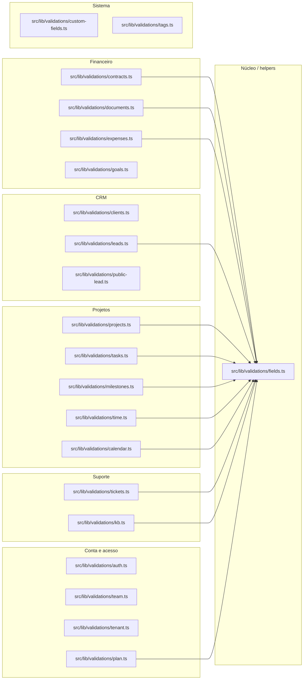

# 03. Validações Zod

> 21 arquivos de código · 21 fichas completas · 0 em tabela de exceção.

Este módulo reúne os schemas Zod que validam **toda entrada** do sistema: o que chega por formulários (client components que enviam `FormData` para Server Actions) e o que chega pelas rotas públicas. Cada arquivo exporta um ou mais schemas (e, às vezes, o tipo TypeScript inferido com `z.infer`). As Server Actions fazem `schema.safeParse(...)` e, em caso de erro, devolvem `{ error }` com a primeira mensagem; em caso de sucesso, usam `parsed.data` para gravar no banco. O módulo é uma camada puramente de regras — não acessa banco, não renderiza nada. Convenções de processo e resposta estão em [processos](../02-processos.md) §2 e em [regras e convenções](../05-regras-e-convencoes.md) §5.

## Dependências do módulo

## Fichas

### `src/lib/validations/auth.ts`
**Propósito:** Valida o login (e-mail + senha) e a criação de um novo tenant/empresa.
**Processo:** `signInSchema` exige `email` (formato de e-mail) e `password` (mínimo 6). `createTenantSchema` exige `name` (mínimo 2) e `slug` opcional que, se informado, só aceita minúsculas, números e hífen (`/^[a-z0-9-]+$/`). Exporta os tipos `SignInInput` e `CreateTenantInput`.
**Estado:** `implementado`
**Testes:** `tests/unit/validations.test.ts` (bloco `signInSchema`).
**Depende de:**
- `zod`: construção dos schemas.
**Usado por:** `src/server/actions/auth.ts`, `src/server/actions/portal.ts` (`signInSchema`); `src/server/actions/platform.ts` (`createTenantSchema`).
**Bibliotecas externas:** `zod` (`^4.6.5`).

### `src/lib/validations/calendar.ts`
**Propósito:** Valida os dados de um evento de agenda/calendário.
**Processo:** `calendarEventSchema` exige `title` (1–200) e `start_at`; aceita `description` (texto longo opcional via helper), `end_at` opcional e os UUIDs opcionais `company_id` e `project_id`. Exporta o tipo `CalendarEventInput`.
**Estado:** `implementado`
**Testes:** `tests/unit/validations.test.ts` (bloco `calendarEventSchema`).
**Depende de:**
- `zod`: construção do schema.
- `src/lib/validations/fields.ts`: usa `optionalLongText` para `description`.
**Usado por:** `src/server/actions/calendar.ts` (grava em `calendar_events`).
**Bibliotecas externas:** `zod`.

### `src/lib/validations/clients.ts`
**Propósito:** Valida o cadastro de clientes (empresas) e de contatos.
**Processo:** `companySchema` exige `name` e aceita uma série de campos opcionais (`vat`, `phone`, `website`, `address`, `city`, `state`, `zip`, `country`, `notes`) processados por um helper local que corta espaços, limita tamanho e transforma string vazia em `undefined`. `contactSchema` exige `first_name`, aceita `email` (vazio ou válido), demais campos opcionais e `is_primary` com padrão `false`. Exporta `CompanyInput` e `ContactInput`.
**Estado:** `implementado`
**Testes:** sem teste.
**Depende de:**
- `zod`: construção dos schemas.
**Usado por:** `src/server/actions/companies.ts` (`companySchema`, grava em `companies`); `src/server/actions/contacts.ts` (`contactSchema`, grava em `contacts`).
**Bibliotecas externas:** `zod`.

### `src/lib/validations/contracts.ts`
**Propósito:** Valida os dados de um contrato.
**Processo:** `contractSchema` exige `title` (1–200); aceita `company_id` (UUID opcional), `description` e `note` (texto longo opcional), `value` (número opcional via helper), `start_date`/`end_date` (datas opcionais), e `status` como inteiro de 1 a 3 com padrão 1. Exporta `ContractInput`.
**Estado:** `implementado`
**Testes:** `tests/unit/validations.test.ts` (bloco `contractSchema`).
**Depende de:**
- `zod`: construção do schema.
- `src/lib/validations/fields.ts`: usa `optionalDate`, `optionalLongText`, `optionalNumber`.
**Usado por:** `src/server/actions/contracts.ts` (grava em `contracts`).
**Bibliotecas externas:** `zod`.

### `src/lib/validations/custom-fields.ts`
**Propósito:** Valida a definição de um campo personalizado (metadado), não o valor preenchido.
**Processo:** `customFieldDefinitionSchema` exige `entity_type` (`company` | `project` | `task` | `lead`), `label` (1–80) e `key` (1–60, apenas `[a-z0-9_]`); aceita `field_type` com padrão `text`, `required` (padrão `false`), `position` (inteiro ≥ 0, padrão 0) e `options` (lista de strings, padrão `[]`). Exporta `CustomFieldDefinitionInput`.
**Estado:** `implementado`
**Testes:** `tests/unit/validations.test.ts` (bloco `customFieldDefinitionSchema`).
**Depende de:**
- `zod`: construção do schema.
**Usado por:** `src/server/actions/custom-fields.ts` (grava em `custom_field_definitions`).
**Bibliotecas externas:** `zod`.

### `src/lib/validations/documents.ts`
**Propósito:** Valida documentos financeiros (orçamentos/faturas) com seus itens de linha.
**Processo:** `lineItemSchema` valida cada item (`description` obrigatória, `qty` ≥ 0 padrão 1, `rate` padrão 0, `unit`, `tax_name`, `tax_rate`). `documentSchema` valida o cabeçalho: `company_id`/`project_id` opcionais, `date` obrigatória, `due_date`/`expiry_date` opcionais, `currency` (padrão `BRL`), `discount_type` (`before_tax` | `after_tax`), percentuais/ajuste opcionais, notas e termos, e `items` com **ao menos um** item. Exporta `DocumentInput`.
**Estado:** `implementado`
**Testes:** sem teste.
**Depende de:**
- `zod`: construção dos schemas.
- `src/lib/validations/fields.ts`: usa `optionalDate`, `optionalLongText`, `optionalNumber`, `optionalText`.
**Usado por:** `src/server/documents.ts` (funções de parse e `buildDocumentValues`), que por sua vez é usado por `src/server/actions/estimates.ts` e `src/server/actions/invoices.ts` (tabelas `estimates`, `invoices`, `document_items`). O `lineItemSchema` é usado internamente por `documentSchema`.
**Bibliotecas externas:** `zod`.

### `src/lib/validations/expenses.ts`
**Propósito:** Valida o lançamento de uma despesa.
**Processo:** `expenseSchema` exige `title` (1–200), `amount` (número ≥ 0, aceita string e converte) e `date`; aceita `category` (texto opcional até 80), `project_id`/`company_id` (UUID opcional), `billable` (padrão `false`) e `note` (texto longo opcional). Exporta `ExpenseInput`.
**Estado:** `implementado`
**Testes:** `tests/unit/validations.test.ts` (bloco `expenseSchema`).
**Depende de:**
- `zod`: construção do schema.
- `src/lib/validations/fields.ts`: usa `optionalLongText`.
**Usado por:** `src/server/actions/expenses.ts` (grava em `expenses`).
**Bibliotecas externas:** `zod`.

### `src/lib/validations/fields.ts`
**Propósito:** Reúne os construtores reutilizáveis de campos opcionais usados pelos demais schemas.
**Processo:** Exporta `optionalText` (trim, máx 500, vazio → `undefined`), `optionalLongText` (máx 5000), `optionalDate` (trim) e a função `optionalNumber()` (pré-processa `""`/`null`/`undefined` para `undefined`, converte para número, usa `Number.isNaN` para descartar valores inválidos e exige número ≥ 0 opcional).
**Estado:** `implementado`
**Testes:** sem teste (sua lógica é exercitada indiretamente pelos testes dos schemas que o usam).
**Depende de:**
- `zod`: `z.string`, `z.preprocess`, `z.number`.
**Usado por:** `src/lib/validations/calendar.ts`, `contracts.ts`, `documents.ts`, `expenses.ts`, `kb.ts`, `leads.ts`, `milestones.ts`, `plan.ts`, `projects.ts`, `tasks.ts`, `tickets.ts`, `time.ts`.
**Bibliotecas externas:** `zod`.

### `src/lib/validations/goals.ts`
**Propósito:** Valida uma meta (goal) de período.
**Processo:** `goalSchema` exige `metric` (`revenue` | `leads` | `hours`), `period_start`, `period_end` e `target` (número ≥ 0); `title` é opcional. Um `.refine` garante que `period_end >= period_start`, com a mensagem anexada ao campo `period_end`. Exporta `GoalInput`.
**Estado:** `implementado`
**Testes:** `tests/unit/validations.test.ts` (bloco `goalSchema`).
**Depende de:**
- `zod`: construção do schema.
**Usado por:** `src/server/actions/goals.ts` (grava em `goals`).
**Bibliotecas externas:** `zod`.

### `src/lib/validations/kb.ts`
**Propósito:** Valida categorias, artigos e FAQs da base de conhecimento.
**Processo:** `kbCategorySchema` exige `name` e aceita `description` (texto longo). `kbArticleSchema` exige `title`, aceita `category_id` (UUID), `excerpt`, `content` e `is_published` (padrão `false`). `faqSchema` exige `question`, aceita `answer` e `is_published` (padrão `true`). Exporta `KbCategoryInput`, `KbArticleInput` e `FaqInput`.
**Estado:** `implementado`
**Testes:** sem teste.
**Depende de:**
- `zod`: construção dos schemas.
- `src/lib/validations/fields.ts`: usa `optionalLongText`, `optionalText`.
**Usado por:** `src/server/actions/kb.ts` (grava em `kb_categories`, `kb_articles`, `faqs`).
**Bibliotecas externas:** `zod`.

### `src/lib/validations/leads.ts`
**Propósito:** Valida o lead e suas entidades auxiliares (status, origem e atividade).
**Processo:** `leadSchema` exige `name` e aceita muitos campos opcionais (`company`, `title`, `email` vazio ou válido, `phone`, `website`, `description`, `status_id`, `source_id`, `value`, `assignee_id`, `city`, `state`, `country`). `leadStatusSchema` exige `name` e aceita `color`, `is_won`, `is_lost`. `leadSourceSchema` exige `name`. `leadActivitySchema` exige `description` (1–2000). Exporta `LeadInput`.
**Estado:** `implementado`
**Testes:** sem teste.
**Depende de:**
- `zod`: construção dos schemas.
- `src/lib/validations/fields.ts`: usa `optionalLongText`, `optionalNumber`, `optionalText`.
**Usado por:** `src/server/actions/leads.ts` (grava em `leads`, `lead_statuses`, `lead_sources`, `lead_activities`).
**Bibliotecas externas:** `zod`.

### `src/lib/validations/milestones.ts`
**Propósito:** Valida um marco (milestone) de projeto.
**Processo:** `milestoneSchema` exige `project_id` (UUID, mensagem "Selecione um projeto") e `name`; aceita `description`, `status` (inteiro 1–3, padrão 1), `color` (hex `#rrggbb`, padrão `#0062FF`) e `start_date`/`due_date` opcionais. Exporta `MilestoneInput`.
**Estado:** `implementado`
**Testes:** `tests/unit/validations.test.ts` (bloco `milestoneSchema`).
**Depende de:**
- `zod`: construção do schema.
- `src/lib/validations/fields.ts`: usa `optionalDate`, `optionalLongText`.
**Usado por:** `src/server/actions/milestones.ts` (grava em `milestones`; ao excluir, também atualiza `tasks`).
**Bibliotecas externas:** `zod`.

### `src/lib/validations/plan.ts`
**Propósito:** Valida um plano comercial (usado no painel da plataforma/super-admin).
**Processo:** `planSchema` exige `name`; aceita `description`, `price` (padrão 0), `interval` (`monthly` | `yearly`, padrão `monthly`), `trial_days` (padrão 0), `most_popular` (padrão `false`) e um objeto `limits` com os tetos `clients`, `projects`, `tasks`, `tickets`, `leads`. Cada teto usa um `limitField` local que converte vazio para `null` ou inteiro ≥ 0. Exporta `PlanInput`.
**Estado:** `implementado`
**Testes:** sem teste.
**Depende de:**
- `zod`: construção do schema.
- `src/lib/validations/fields.ts`: usa `optionalLongText`.
**Usado por:** `src/server/actions/platform.ts` (grava em `plans`).
**Bibliotecas externas:** `zod`.

### `src/lib/validations/projects.ts`
**Propósito:** Valida um projeto.
**Processo:** `projectSchema` exige `name`; aceita `company_id` (UUID), `description`, `status` (inteiro 1–5, padrão 1), `billing_type` (inteiro 1–3, padrão 1), `start_date`/`deadline`, `progress` (inteiro 0–100, padrão 0), `progress_from_tasks` (padrão `false`), `project_cost`, `rate_per_hour` e `estimated_hours` (números opcionais). Exporta `ProjectInput`.
**Estado:** `implementado`
**Testes:** sem teste.
**Depende de:**
- `zod`: construção do schema.
- `src/lib/validations/fields.ts`: usa `optionalDate`, `optionalLongText`, `optionalNumber`.
**Usado por:** `src/server/actions/projects.ts` (grava em `projects`).
**Bibliotecas externas:** `zod`.

### `src/lib/validations/public-lead.ts`
**Propósito:** Valida o lead enviado por um formulário público (captação externa).
**Processo:** `publicLeadSchema` exige `name` (1–200); aceita `email` (vazio ou válido, normalizado para minúsculas), `phone` (máx 40) e `message` (máx 2000). Diferente dos demais, aqui não há `optionalText`: os campos opcionais simplesmente não usam transform para `undefined`. Exporta `PublicLeadInput`.
**Estado:** `implementado`
**Testes:** `tests/unit/validations.test.ts` (bloco `publicLeadSchema`).
**Depende de:**
- `zod`: construção do schema.
**Usado por:** `src/server/actions/public-lead.ts` (grava em `leads`, resolve o tenant via `tenants`).
**Bibliotecas externas:** `zod`.

### `src/lib/validations/tags.ts`
**Propósito:** Valida uma tag (etiqueta) com cor.
**Processo:** `tagSchema` exige `name` (1–60) e `color` no formato hex `#rrggbb` com padrão `#0062FF`. Exporta `TagInput`.
**Estado:** `implementado`
**Testes:** `tests/unit/validations.test.ts` (bloco `tagSchema`).
**Depende de:**
- `zod`: construção do schema.
**Usado por:** `src/server/actions/tags.ts` (grava em `tags`; também associa via `taggables`).
**Bibliotecas externas:** `zod`.

### `src/lib/validations/tasks.ts`
**Propósito:** Valida uma tarefa e um item de checklist.
**Processo:** `taskSchema` exige `project_id` (UUID) e `name`; aceita `description`, `status` (1–5, padrão 1), `priority` (1–4, padrão 2), `start_date`/`due_date`, `assignee_id`, `milestone_id`, `billable` (padrão `false`) e `hourly_rate`. `checklistItemSchema` exige `title` (1–500). Exporta `TaskInput` e `ChecklistItemInput`.
**Estado:** `implementado`
**Testes:** sem teste.
**Depende de:**
- `zod`: construção dos schemas.
- `src/lib/validations/fields.ts`: usa `optionalDate`, `optionalLongText`, `optionalNumber`.
**Usado por:** `src/server/actions/tasks.ts` (grava em `tasks` e `task_checklist_items`).
**Bibliotecas externas:** `zod`.

### `src/lib/validations/team.ts`
**Propósito:** Valida o convite de um membro e a aceitação do convite.
**Processo:** `inviteMemberSchema` exige `email` (normalizado para minúsculas) e `role` (`admin` | `member`, padrão `member`). `acceptInvitationSchema` exige `full_name` (1–120) e `password` (mínimo 8). Exporta `InviteMemberInput` e `AcceptInvitationInput`.
**Estado:** `implementado`
**Testes:** `tests/unit/validations.test.ts` (bloco `team schemas`).
**Depende de:**
- `zod`: construção dos schemas.
**Usado por:** `src/server/actions/team.ts` (grava em `memberships`, `invitations` e `profiles`).
**Bibliotecas externas:** `zod`.

### `src/lib/validations/tenant.ts`
**Propósito:** Valida as configurações da empresa (nome e cor primária de marca).
**Processo:** `tenantSettingsSchema` exige `name` (1–120) e `primary_color` no formato hex `#rrggbb` com padrão `#0062FF`. Exporta `TenantSettingsInput`.
**Estado:** `implementado`
**Testes:** `tests/unit/validations.test.ts` (bloco `tenantSettingsSchema`).
**Depende de:**
- `zod`: construção do schema.
**Usado por:** `src/server/actions/tenant.ts` (grava em `tenants` e `branding`).
**Bibliotecas externas:** `zod`.

### `src/lib/validations/tickets.ts`
**Propósito:** Valida um ticket de suporte e sua resposta.
**Processo:** `ticketSchema` exige `subject`; aceita `details`, `status` (1–6, padrão 1), `priority` (1–4, padrão 2), `type` (1–4, padrão 3) e os UUIDs opcionais `department_id`, `company_id`, `contact_id`, `assignee_id`, `project_id`. `ticketReplySchema` exige `body` (1–5000) e `is_internal` (padrão `false`). Exporta `TicketInput` e `TicketReplyInput`.
**Estado:** `implementado`
**Testes:** sem teste.
**Depende de:**
- `zod`: construção dos schemas.
- `src/lib/validations/fields.ts`: usa `optionalLongText`.
**Usado por:** `src/server/actions/tickets.ts` (grava em `tickets` e `ticket_replies`).
**Bibliotecas externas:** `zod`.

### `src/lib/validations/time.ts`
**Propósito:** Valida um lançamento manual de horas (apontamento de tempo).
**Processo:** `manualEntrySchema` exige `project_id` (UUID) e `date`; exige `hours` como número positivo, com máximo de 24 por lançamento; aceita `task_id` (UUID), `note` (texto curto opcional), `is_billable` (padrão `false`) e `rate` (número opcional). Exporta `ManualEntryInput`.
**Estado:** `implementado`
**Testes:** sem teste.
**Depende de:**
- `zod`: construção do schema.
- `src/lib/validations/fields.ts`: usa `optionalNumber`, `optionalText`.
**Usado por:** `src/server/actions/time.ts` (grava em `time_entries`).
**Bibliotecas externas:** `zod`.

## Tabela das fichas do módulo

| § | Arquivo | Propósito em 1 linha |
|---|---------|----------------------|
| §03.1 | `src/lib/validations/auth.ts` | Login e criação de tenant. |
| §03.2 | `src/lib/validations/calendar.ts` | Evento de agenda. |
| §03.3 | `src/lib/validations/clients.ts` | Clientes (empresas) e contatos. |
| §03.4 | `src/lib/validations/contracts.ts` | Contratos. |
| §03.5 | `src/lib/validations/custom-fields.ts` | Definição de campo personalizado. |
| §03.6 | `src/lib/validations/documents.ts` | Documentos financeiros e itens de linha. |
| §03.7 | `src/lib/validations/expenses.ts` | Despesas. |
| §03.8 | `src/lib/validations/fields.ts` | Helpers de campos opcionais reutilizáveis. |
| §03.9 | `src/lib/validations/goals.ts` | Metas por período. |
| §03.10 | `src/lib/validations/kb.ts` | Categorias, artigos e FAQs da base de conhecimento. |
| §03.11 | `src/lib/validations/leads.ts` | Leads, status, origens e atividades. |
| §03.12 | `src/lib/validations/milestones.ts` | Marcos de projeto. |
| §03.13 | `src/lib/validations/plan.ts` | Planos comerciais e limites. |
| §03.14 | `src/lib/validations/projects.ts` | Projetos. |
| §03.15 | `src/lib/validations/public-lead.ts` | Lead de formulário público. |
| §03.16 | `src/lib/validations/tags.ts` | Tags com cor. |
| §03.17 | `src/lib/validations/tasks.ts` | Tarefas e itens de checklist. |
| §03.18 | `src/lib/validations/team.ts` | Convite e aceitação de membro. |
| §03.19 | `src/lib/validations/tenant.ts` | Configurações da empresa (marca). |
| §03.20 | `src/lib/validations/tickets.ts` | Tickets de suporte e respostas. |
| §03.21 | `src/lib/validations/time.ts` | Lançamento manual de horas. |
