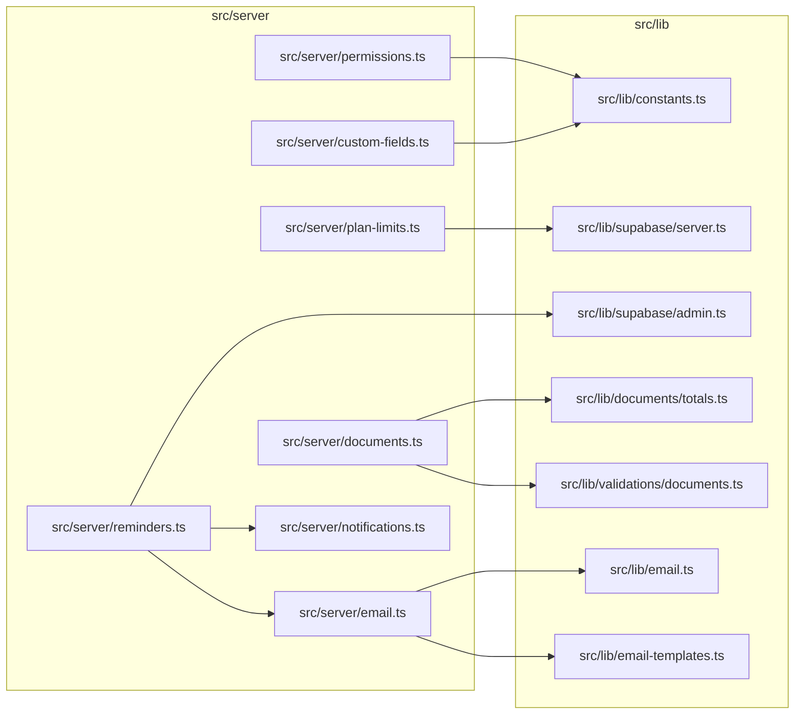

# 04. Helpers do servidor

> 7 arquivos de código · 7 fichas completas · 0 em tabela de exceção.

Este módulo reúne funções utilitárias usadas pelas **server actions** do projeto. São helpers pequenos e reutilizáveis para: checar papéis gerenciais (`isManager`), verificar limites do plano (`checkPlanLimit`), montar orçamentos/faturas e seus valores, gravar campos personalizados, enviar e-mail transacional por tenant, criar notificações in-app e rodar o job de lembretes. Todos vivem em `src/server` e não são páginas nem rotas; quem os chama são os arquivos de `src/server/actions/*` e o cron em `src/app/api/cron/reminders`. O conceito de tenant, papéis e planos está em [regras e convenções](../05-regras-e-convencoes.md) §5 e o desenho das tabelas tocadas (plano, notificações, e-mail, itens de documento) em [modelo de dados](../04-modelo-de-dados.md) §4.

## Diagrama de dependências do módulo

## Fichas

### `src/server/permissions.ts`

**Propósito:** define quem é "gerente" de um tenant, para as ações que só podem ser feitas por `owner` ou `admin`.
**Processo:** exporta a constante `MANAGER_ROLES` (lista `["owner", "admin"]`) e a função `isManager(role: Role)`, que devolve `true` quando o papel recebido é `owner` ou `admin`. É uma checagem pura, sem I/O; as actions chamam `isManager(active.role)` e, se for falso, retornam cedo (`return`) ou redirecionam para `/app`.
**Estado:** `implementado` — arquivo completo em 7 linhas, só constantes e a função.
**Testes:** sem teste (busca por `isManager`/`MANAGER_ROLES` em `tests/` não retornou nada).
**Depende de:**
- `src/lib/constants.ts`: importa o tipo `Role` (união `"owner" | "admin" | "member"`).

**Usado por:** `src/server/actions/attachments.ts`, `src/server/actions/kb.ts`, `src/server/actions/tags.ts`, `src/server/actions/custom-fields.ts`, `src/server/actions/leads.ts`. Observação: `src/server/actions/team.ts` **não** importa daqui — ele redefine a mesma lista `MANAGER_ROLES = ["owner", "admin"]` localmente (linha 21), uma pequena duplicação.
**Bibliotecas externas:** nenhuma.

### `src/server/plan-limits.ts`

**Propósito:** verificar se o tenant ainda pode criar novos registros de um recurso (clientes, projetos, tarefas, tickets, leads) conforme os limites do plano contratado.
**Processo:** `checkPlanLimitWith(supabase, tenantId, resource)` traduz o nome do recurso em tabela pelo mapa `RESOURCE_TABLES` (`clients`→`companies`, os demais mantêm o nome). Depois lê `tenants` com o relacionamento `plan:plans(limits)` e pega o valor `limits[resource]`; se for `null`/`undefined`, considera sem limite e devolve `{ ok: true }`. Em seguida conta as linhas da tabela com `tenant_id` e `deleted_at is null`; se o total já atingiu o limite, devolve `{ ok: false, remaining: 0, message }`; caso contrário `{ ok: true, remaining }`. `checkPlanLimit(tenantId, resource)` é o atalho que cria o cliente da sessão via `createClient()` e delega para `checkPlanLimitWith`.
**Estado:** `implementado`.
**Testes:** sem teste (busca por `checkPlanLimit` em `tests/` não retornou nada).
**Depende de:**
- `src/lib/supabase/server.ts`: `createClient()` para o cliente autenticado.
- Tabelas: lê `tenants` (coluna de relacionamento `plan_id`), `plans` (coluna `limits` jsonb) e conta em `companies`, `projects`, `tasks`, `tickets`, `leads`.

**Usado por:** `src/server/actions/companies.ts`, `leads.ts`, `import.ts`, `tickets.ts`, `projects.ts`, `tasks.ts` (via `checkPlanLimit`) e `src/server/actions/portal.ts`, `public-lead.ts` (via `checkPlanLimitWith`, em fluxos sem sessão/portal).
**Bibliotecas externas:** `@supabase/supabase-js` (só o tipo `SupabaseClient`).

### `src/server/documents.ts`

**Propósito:** reunir os utilitários compartilhados por orçamentos (estimates) e faturas (invoices): ler o formulário, calcular os totais, gravar os itens, ler configurações financeiras do tenant e formatar o número do documento.
**Processo:** `parseDocumentForm(formData)` faz `JSON.parse` do campo `items` e valida tudo com `documentSchema.safeParse` (Zod). `buildDocumentValues(data)` chama `computeTotals` (de `src/lib`) para obter `subtotal`, `total_tax`, `discount_total` e `total`, e devolve o objeto de colunas para inserir no banco. `replaceDocumentItems(supabase, tenantId, relType, relId, items)` apaga os `document_items` daquele documento (`rel_type` + `rel_id`) e insere as novas linhas com `position = índice`. `getTenantFinanceSettings(supabase, tenantId)` lê `tenants.currency/invoice_prefix/estimate_prefix` com padrões `BRL`, `INV-`, `EST-`. `formatDocumentNumber(prefix, number)` devolve `PREFIX` + número com 6 dígitos (`padStart`).
**Estado:** `implementado`.
**Testes:** sem teste (busca por `parseDocumentForm`, `buildDocumentValues`, `computeTotals` e `documentSchema` em `tests/` não retornou nada).
**Depende de:**
- `src/lib/documents/totals.ts`: `computeTotals` e o tipo `LineItemInput`.
- `src/lib/validations/documents.ts`: `documentSchema` e o tipo `DocumentInput`.
- Tabelas: lê `tenants`; lê/apaga/insere em `document_items`.

**Usado por:** `src/server/actions/estimates.ts` e `src/server/actions/invoices.ts` (todas as funções) e as páginas `src/app/app/faturas/page.tsx`, `src/app/app/faturas/[id]/page.tsx`, `src/app/app/orcamentos/page.tsx`, `src/app/app/orcamentos/[id]/page.tsx` (apenas `getTenantFinanceSettings`).
**Bibliotecas externas:** `@supabase/supabase-js` (tipo `SupabaseClient`).

### `src/server/custom-fields.ts`

**Propósito:** persistir os valores dos campos personalizados de uma entidade (cliente, projeto, tarefa, lead) a partir do `FormData` do formulário.
**Processo:** `saveCustomFieldValues(supabase, tenantId, entityType, entityId, formData)` busca as definições ativas em `custom_field_definitions` (`tenant_id` + `entity_type` + `is_active`). Para cada definição monta a chave `cf_<key>` e lê o valor bruto do `FormData`: se for `checkbox`, converte `"on"`/`"true"` em `"true"` e o resto em `"false"`; senão faz `trim` e usa `null` quando vazio. Valor `null` apaga a linha correspondente de `custom_field_values`; qualquer outro valor faz `upsert` com conflito em `field_id,entity_type,entity_id`.
**Estado:** `implementado`.
**Testes:** sem teste (busca por `saveCustomFieldValues` em `tests/` não retornou nada).
**Depende de:**
- `src/lib/constants.ts`: tipo `CustomFieldEntity`.
- Tabelas: lê `custom_field_definitions`; apaga/insere em `custom_field_values`.

**Usado por:** `src/server/actions/companies.ts`, `leads.ts`, `projects.ts`, `tasks.ts`.
**Bibliotecas externas:** `@supabase/supabase-js` (tipo `SupabaseClient`).

### `src/server/email.ts`

**Propósito:** enviar e-mail transacional usando o template do tenant (com fallback para os padrões) e registrar o envio no log.
**Processo:** `sendTenantEmail(supabase, { tenantId, templateKey, to, vars })` busca o template em `email_templates` por `tenant_id` + `key`. Usa `EMAIL_TEMPLATES[templateKey]` como fallback quando não há personalizado. Renderiza assunto e corpo com `renderTemplate` (substitui `{{var}}`), escapando os valores no HTML do corpo com `escapeHtml`. Chama `sendEmail` de `src/lib/email` e traduz o resultado em `sent`/`skipped`/`error`. Por fim insere uma linha em `email_log` (`to_email`, `subject`, `template_key`, `status`, `error`) e devolve `{ sent }`.
**Estado:** `implementado`.
**Testes:** sem teste direto; `renderTemplate` é o único destes helpers coberto, em `tests/unit/validations.test.ts` (describe `renderTemplate`).
**Depende de:**
- `src/lib/email.ts`: `sendEmail` (usa as variáveis `RESEND_API_KEY` e `EMAIL_FROM` e chama a API `https://api.resend.com/emails`).
- `src/lib/email-templates.ts`: `EMAIL_TEMPLATES`, `renderTemplate`, `escapeHtml`.
- Tabelas: lê `email_templates`; insere em `email_log`.

**Usado por:** `src/server/reminders.ts` e `src/server/actions/team.ts` (template `member_invite`).
**Bibliotecas externas:** `@supabase/supabase-js` (tipo `SupabaseClient`); o envio HTTP real fica em `src/lib/email.ts`.

### `src/server/notifications.ts`

**Propósito:** criar uma notificação in-app para um usuário do tenant.
**Processo:** `createNotification(supabase, input)` recebe `{ tenantId, userId, title, body?, url?, type? }` (tipo `CreateNotificationInput`) e faz um `insert` na tabela `notifications`, usando `type` padrão `"info"` e `null` para `body`/`url` ausentes. É um helper simples de escrita; não faz nenhuma checagem.
**Estado:** `implementado`.
**Testes:** sem teste (busca por `createNotification` em `tests/` não retornou nada).
**Depende de:**
- Tabela: insere em `notifications`.

**Usado por:** `src/server/reminders.ts` (é o único consumidor).
**Bibliotecas externas:** `@supabase/supabase-js` (tipo `SupabaseClient`).

### `src/server/reminders.ts`

**Propósito:** job de lembretes que percorre os tenants e gera notificações + e-mails para tarefas a vencer e faturas vencidas.
**Processo:** `runReminders()` cria um cliente administrativo (`createAdminClient`, ignora RLS) e lista os `tenants`. Calcula a data de hoje e daqui a 2 dias (strings `YYYY-MM-DD`). Para cada tenant: (1) busca `tasks` não deletadas, com status diferente de 5, com `assignee_id` preenchido e `due_date` entre hoje e hoje+2; para cada tarefa chama `createNotification` (tipo `task_due`) e, se o responsável tiver e-mail (`admin.auth.admin.getUserById`) e `profiles.notify_email` permitir, envia `sendTenantEmail` com template `task_due`; (2) busca `invoices` não deletadas com status em `[1, 3]` (em aberto/parcial) e `due_date` anterior a hoje; se houver, busca `memberships` ativas com papel `owner`/`admin` e, para cada admin, cria notificação (`invoice_overdue`) e envia e-mail se permitido. Retorna `{ tenants, notifications, emails }` com as contagens. O `APP_URL` vem de `NEXT_PUBLIC_SITE_URL` (fallback `http://localhost:3000`).
**Estado:** `implementado`.
**Testes:** sem teste (busca por `runReminders` em `tests/` não retornou nada).
**Depende de:**
- `src/lib/supabase/admin.ts`: `createAdminClient()` (variáveis `NEXT_PUBLIC_SUPABASE_URL` e `SUPABASE_SERVICE_ROLE_KEY`).
- `src/server/notifications.ts`: `createNotification`.
- `src/server/email.ts`: `sendTenantEmail`.
- Tabelas: lê `tenants`, `tasks`, `invoices`, `memberships`, `profiles`; escreve em `notifications` (via helper) e `email_log` (via helper, dentro de `sendTenantEmail`).
- Autenticação: `admin.auth.admin.getUserById` para descobrir o e-mail do usuário.
- Config/env: `NEXT_PUBLIC_SITE_URL`.

**Usado por:** `src/app/api/cron/reminders/route.ts` (ponto de entrada — rota de cron autenticada por `CRON_SECRET`).
**Bibliotecas externas:** o cliente admin de `@supabase/supabase-js` (via `src/lib/supabase/admin.ts`).

## Tabela das fichas do módulo

| § | Arquivo | Propósito em 1 linha |
|---|---------|----------------------|
| §04.1 | `src/server/permissions.ts` | Dizer se um papel é gerencial (`owner`/`admin`) via `isManager`. |
| §04.2 | `src/server/plan-limits.ts` | Checar o limite do plano antes de criar clientes/projetos/tarefas/tickets/leads. |
| §04.3 | `src/server/documents.ts` | Helpers de orçamento/fatura: parse do formulário, totais, itens, configurações e número. |
| §04.4 | `src/server/custom-fields.ts` | Gravar/apagar valores de campos personalizados de uma entidade. |
| §04.5 | `src/server/email.ts` | Enviar e-mail transacional por tenant e registrar em `email_log`. |
| §04.6 | `src/server/notifications.ts` | Criar notificação in-app para um usuário. |
| §04.7 | `src/server/reminders.ts` | Job de lembretes de tarefas vencendo e faturas vencidas (notificação + e-mail). |
