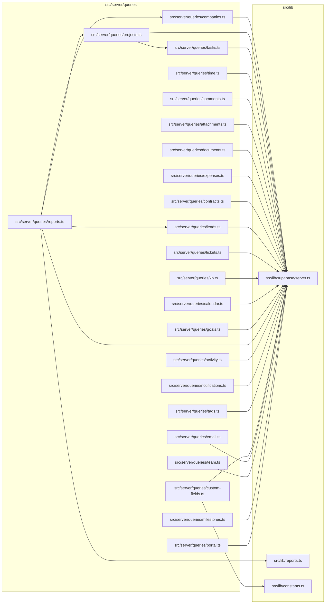

# 05. Servidor — queries (leitura RSC)

> 23 arquivos de código · 23 fichas completas · 0 em tabela de exceção.

Este módulo reúne as funções de **leitura** usadas pelas páginas RSC (React Server Components) e por componentes de servidor. Diferente das server actions (`src/server/actions/*`, que escrevem e revalidam), aqui só se lê o banco: listagens, detalhes, contagens, agregações e alguns cálculos puros. Todas criam o cliente autenticado com `createClient()` de `src/lib/supabase/server.ts`, então passam por **RLS** (Row Level Security) com o `tenant_id` sempre filtrado explicitamente. O desenho das tabelas lidas está em [modelo de dados](../04-modelo-de-dados.md) §4 e o conceito de tenant/RLS em [regras e convenções](../05-regras-e-convencoes.md) §5.

## Diagrama de dependências do módulo

## Fichas

### `src/server/queries/companies.ts`

**Propósito:** ler empresas (clientes) e seus contatos para as telas de clientes, projetos, faturas, orçamentos, tickets e calendário.
**Processo:** `listCompanies(tenantId)` lê `companies` (colunas `id, name, phone, website, city, country`, `deleted_at is null`, ordenado por nome). `listCompaniesPage(tenantId, { page, pageSize, ids })` faz o mesmo com `count: "exact"` e `.range()` para paginação; se `ids` vier vazio, devolve lista vazia. `getCompany(tenantId, id)` busca uma empresa por `id` + `tenant_id` com `.maybeSingle()`. `listContacts(tenantId, companyId)` lê `contacts` da empresa (primários primeiro, depois por nome). `countContactsByCompany(tenantId)` lê todos os `company_id` de `contacts` e conta em memória num `Record<string, number>`.
**Estado:** `implementado`.
**Testes:** sem teste (busca por `listCompanies`/`getCompany` em `tests/` não retornou nada).
**Depende de:**
- `src/lib/supabase/server.ts`: `createClient()`.
- Tabelas: lê `companies` e `contacts`.

**Usado por:** `src/server/queries/reports.ts` (`listCompanies`); páginas `src/app/app/clientes/page.tsx`, `clientes/[id]/page.tsx`, `projetos/page.tsx`, `projetos/[id]/page.tsx`, `tickets/page.tsx`, `tickets/[id]/page.tsx`, `faturas/page.tsx`, `faturas/[id]/page.tsx`, `orcamentos/page.tsx`, `orcamentos/[id]/page.tsx`, `despesas/page.tsx`, `contratos/page.tsx`, `calendario/page.tsx`; e `src/app/app/exportar/[entity]/route.ts`.
**Bibliotecas externas:** nenhuma (usa o cliente de `@supabase/supabase-js` via helper).

### `src/server/queries/projects.ts`

**Propósito:** ler projetos, seus responsáveis/membros e os membros do tenant, sempre recalculando o progresso a partir das tarefas quando marcado.
**Processo:** `listProjects(tenantId)` lê `projects` com o relacionamento `company:companies(id, name)`; depois chama `taskCountsByProject(tenantId)` (de `tasks.ts`) e, para cada projeto com `progress_from_tasks`, troca `progress` por `progressFromCounts(counts[id])`. `listProjectsPage` faz o mesmo com `count: "exact"` e `.range()`. `getProject(tenantId, id)` busca um projeto com `.maybeSingle()`. `countMembersByProject(tenantId)` conta `project_members` em memória. `listProjectMembers(tenantId, projectId)` lê `project_members` e busca nomes/avatares em `profiles`. `listTenantMembers(tenantId)` lê `memberships` ativas e junta com `profiles` para devolver `{ user_id, role, full_name }`. `projectMembersByProject(tenantId)` agrupa membros por projeto num `Record`.
**Estado:** `implementado`.
**Testes:** sem teste.
**Depende de:**
- `src/lib/supabase/server.ts`: `createClient()`.
- `src/server/queries/tasks.ts`: `taskCountsByProject`, `progressFromCounts`.
- Tabelas: lê `projects`, `companies` (relação), `project_members`, `profiles`, `memberships`.

**Usado por:** `src/server/queries/reports.ts` (`listTenantMembers`); páginas `src/app/app/page.tsx`, `timesheet/page.tsx`, `projetos/page.tsx`, `projetos/[id]/page.tsx`, `tarefas/page.tsx`, `tarefas/[id]/page.tsx`, `leads/page.tsx`, `leads/[id]/page.tsx`, `tickets/page.tsx`, `tickets/[id]/page.tsx`, `faturas/page.tsx`, `faturas/[id]/page.tsx`, `orcamentos/page.tsx`, `orcamentos/[id]/page.tsx`, `despesas/page.tsx`, `calendario/page.tsx`; e diálogos `projetos/project-form-dialog.tsx`.
**Bibliotecas externas:** nenhuma.

### `src/server/queries/tasks.ts`

**Propósito:** ler tarefas (listagem/detalhe), itens de checklist, dependências e contagens por projeto para o board e os cartões.
**Processo:** `listTasks(tenantId, { projectId? })` lê `tasks` com `project:projects(id, name)` e chama `attachAssigneeNames` (busca `profiles` para preencher `assignee_name`); ordena por `due_date`. `listTasksPage` idem com paginação. `getTask(tenantId, id)` retorna a tarefa por `id`. `listChecklist(tenantId, taskId)` lê `task_checklist_items` ordenado por `position`. `listTaskDependencies(tenantId, taskIds)` lê `task_dependencies`. `taskCountsByProject(tenantId)` percorre `tasks` e conta `{done, total}` por projeto (considera `done` o status `5`). `progressFromCounts(counts)` calcula a porcentagem arredondada.
**Estado:** `implementado`.
**Testes:** sem teste.
**Depende de:**
- `src/lib/supabase/server.ts`: `createClient()`.
- Tabelas: lê `tasks`, `projects` (relação), `profiles`, `task_checklist_items`, `task_dependencies`.

**Usado por:** `src/server/queries/projects.ts` (`taskCountsByProject`, `progressFromCounts`); páginas `src/app/app/page.tsx`, `timesheet/page.tsx`, `projetos/page.tsx`, `projetos/[id]/page.tsx`, `tarefas/page.tsx`, `tarefas/[id]/page.tsx`; diálogos `tarefas/task-form-dialog.tsx`, `tarefas/task-detail-dialog.tsx`.
**Bibliotecas externas:** nenhuma.

### `src/server/queries/time.ts`

**Propósito:** ler registros de horas (time entries), a entrada em andamento, resumos e horas faturáveis ainda não cobradas; também formata/calcula durações.
**Processo:** `listTimeEntries` lê `time_entries` com `project`/`task`/`user` (profiles), filtra por projeto/tarefa e limita a 200. `listTimeEntriesPage` idem com paginação. `summarizeTimeEntries(tenantId, {projectId?, taskId?})` chama a **RPC `time_entries_summary`** e devolve `{ seconds, billableAmount }`. `getRunningEntry(tenantId, userId)` acha a entrada sem `ended_at` do usuário. As funções puras `entrySeconds`, `sumSeconds`, `billableAmount`, `formatDuration` calculam/formatação. `listUnbilledBillableEntries(tenantId, projectId)` lista entradas `is_billable=true`, `billed=false` e encerradas, com nome da tarefa. `summarizeBillable(entries)` agrega contagem, segundos e valor.
**Estado:** `implementado`.
**Testes:** sem teste.
**Depende de:**
- `src/lib/supabase/server.ts`: `createClient()`.
- Tabelas: lê `time_entries`, `projects` (relação), `tasks` (relação), `profiles` (relação).
- RPC: `time_entries_summary` (parâmetros `p_tenant`, `p_project`, `p_task`).

**Usado por:** `src/server/actions/invoices.ts` (`listUnbilledBillableEntries`); páginas `src/app/app/page.tsx` (`formatDuration`), `relatorios/page.tsx` (`formatDuration`), `timesheet/page.tsx` (`getRunningEntry`), `projetos/[id]/page.tsx`; componente `src/components/app/time-entries-table.tsx`; e `src/app/app/exportar/[entity]/route.ts`.
**Bibliotecas externas:** nenhuma.

### `src/server/queries/comments.ts`

**Propósito:** listar os comentários de uma entidade genérica (projeto, tarefa, lead etc.), com o nome do autor.
**Processo:** `listComments(tenantId, entityType, entityId)` lê `comments` filtrando por `entity_type`/`entity_id`, ordenado por `created_at`; depois busca os autores em `profiles` e devolve `CommentRow[]` com `author_name`.
**Estado:** `implementado`.
**Testes:** sem teste.
**Depende de:**
- `src/lib/supabase/server.ts`: `createClient()`.
- Tabelas: lê `comments`, `profiles`.

**Usado por:** `src/components/app/comments-section.tsx` (único consumidor).
**Bibliotecas externas:** nenhuma.

### `src/server/queries/attachments.ts`

**Propósito:** listar anexos de uma entidade e gerar URLs assinadas temporárias do Storage para exibi-los.
**Processo:** `listAttachments(tenantId, entityType, entityId)` lê `attachments` por tipo/entidade; se houver linhas, chama `supabase.storage.from("attachments").createSignedUrls(paths, 3600)` e mapeia cada `storage_path` para sua URL assinada (1 hora). Devolve `AttachmentRow[]` com `url`.
**Estado:** `implementado`.
**Testes:** sem teste.
**Depende de:**
- `src/lib/supabase/server.ts`: `createClient()`.
- Tabelas: lê `attachments`.
- Storage: bucket `attachments` (via `createSignedUrls`).

**Usado por:** `src/components/app/attachments-section.tsx`, `src/app/portal/(portal)/tickets/[id]/page.tsx` e `src/app/portal/(portal)/projetos/[id]/page.tsx`.
**Bibliotecas externas:** nenhuma.

### `src/server/queries/documents.ts`

**Propósito:** ler orçamentos (estimates), faturas (invoices), seus itens de linha e pagamentos — cobre as telas internas e do portal.
**Processo:** `listEstimates`/`listEstimatesPage`/`getEstimate` leem `estimates` (com `company:companies(id, name)`); `listInvoices`/`listInvoicesPage`/`getInvoice` fazem o mesmo com `invoices`. `listDocumentItems(tenantId, relType, relId)` lê `document_items` (`rel_type` = `"estimate"`/`"invoice"`) ordenado por `position`. `listPayments(tenantId, invoiceId)` lê `payments`. `sumPayments(tenantId, invoiceId)` soma os valores em memória.
**Estado:** `implementado`.
**Testes:** sem teste.
**Depende de:**
- `src/lib/supabase/server.ts`: `createClient()`.
- Tabelas: lê `estimates`, `invoices`, `companies` (relação), `document_items`, `payments`.

**Usado por:** `src/server/actions/estimates.ts` (`getEstimate`, `listDocumentItems`); páginas `src/app/app/orcamentos/page.tsx`, `orcamentos/[id]/page.tsx`, `faturas/page.tsx`, `faturas/[id]/page.tsx`, `src/app/portal/(portal)/orcamentos/[id]/page.tsx`, `faturas/[id]/page.tsx`; diálogos `orcamentos/estimate-form-dialog.tsx`, `faturas/invoice-form-dialog.tsx`; e `src/app/app/exportar/[entity]/route.ts`.
**Bibliotecas externas:** nenhuma.

### `src/server/queries/expenses.ts`

**Propósito:** listar despesas com filtros por projeto/empresa, para a tela de despesas e exportação.
**Processo:** usa as colunas `EXPENSE_COLUMNS` com `project:projects(id, name)` e `company:companies(id, name)`. `listExpenses(tenantId, filters)` aplica filtros opcionais e ordena por `date` desc. `listExpensesPage` idem com `count: "exact"` e `.range()`.
**Estado:** `implementado`.
**Testes:** sem teste.
**Depende de:**
- `src/lib/supabase/server.ts`: `createClient()`.
- Tabelas: lê `expenses`, `projects` (relação), `companies` (relação).

**Usado por:** `src/app/app/despesas/page.tsx` (`listExpensesPage`), `src/app/app/despesas/expense-form-dialog.tsx` (tipo `Expense`) e `src/app/app/exportar/[entity]/route.ts` (`listExpenses`).
**Bibliotecas externas:** nenhuma.

### `src/server/queries/contracts.ts`

**Propósito:** listar contratos com filtros por empresa/status e buscar um contrato por id.
**Processo:** colunas `CONTRACT_COLUMNS` com `company:companies(id, name)`. `listContracts(tenantId, filters)` aplica `companyId` e `status` (convertido com `Number`) e ordena por `created_at` desc. `listContractsPage` idem com `count` e `.range()`. `getContract(tenantId, id)` busca por id com `.maybeSingle()`.
**Estado:** `implementado`.
**Testes:** sem teste.
**Depende de:**
- `src/lib/supabase/server.ts`: `createClient()`.
- Tabelas: lê `contracts`, `companies` (relação).

**Usado por:** `src/app/app/contratos/page.tsx` (`listContractsPage`) e `src/app/app/contratos/contract-form-dialog.tsx` (tipo `Contract`).
**Bibliotecas externas:** nenhuma.

### `src/server/queries/leads.ts`

**Propósito:** ler leads, seus status, origens e o histórico de atividades, para o kanban, formulários e relatórios.
**Processo:** `listLeadStatuses` lê `lead_statuses`; `listLeadSources` lê `lead_sources`. `listLeads(tenantId, { statusId? })` lê `leads` com `status:lead_statuses(id,name,color)` e `source:lead_sources(id,name)`, resolve `assignee_name` em `profiles` e ordena por `updated_at` desc; `listLeadsPage` idem com paginação e filtro por `ids`. `getLead(tenantId, id)` devolve o lead. `listLeadActivities(tenantId, leadId)` lê `lead_activities` e resolve o nome do autor.
**Estado:** `implementado`.
**Testes:** sem teste.
**Depende de:**
- `src/lib/supabase/server.ts`: `createClient()`.
- Tabelas: lê `leads`, `lead_statuses` (relação), `lead_sources` (relação), `lead_activities`, `profiles`.

**Usado por:** `src/server/queries/reports.ts` (`listLeadStatuses`, `listLeads`); `src/server/actions/leads.ts` (`getLead`, `listLeadStatuses`); páginas `src/app/app/leads/page.tsx`, `leads/[id]/page.tsx`, `configuracoes/page.tsx` (`listLeadSources`); diálogos/componentes `leads/lead-form-dialog.tsx`, `leads/lead-kanban.tsx`, `leads/lead-settings.tsx`; e `src/app/app/exportar/[entity]/route.ts`.
**Bibliotecas externas:** nenhuma.

### `src/server/queries/tickets.ts`

**Propósito:** ler tickets, departamentos e respostas do ticket (incluindo internas) para a tela de suporte.
**Processo:** `listDepartments` lê `departments`. `listTickets(tenantId)` lê `tickets` com `department:departments(name)` e `company:companies(id,name)`, resolve `assignee_name` em `profiles` e ordena por `updated_at` desc; `listTicketsPage` idem com paginação. `getTicket(tenantId, id)` devolve o ticket. `listTicketReplies(tenantId, ticketId)` lê `ticket_replies` e resolve nomes de autor (`profiles`) e de contato (`contacts`, montando `"first last"`).
**Estado:** `implementado`.
**Testes:** sem teste.
**Depende de:**
- `src/lib/supabase/server.ts`: `createClient()`.
- Tabelas: lê `tickets`, `departments` (relação), `companies` (relação), `ticket_replies`, `profiles`, `contacts`.

**Usado por:** `src/app/app/tickets/page.tsx` (`listDepartments`, `listTicketsPage`), `src/app/app/tickets/[id]/page.tsx` e `src/app/app/tickets/ticket-form-dialog.tsx` (tipo `Ticket`).
**Bibliotecas externas:** nenhuma.

### `src/server/queries/kb.ts`

**Propósito:** ler a base de conhecimento (categorias, artigos e FAQs); ao abrir um artigo, incrementa o contador de visualizações.
**Processo:** `listKbCategories` lê `kb_categories`; `listKbArticles(tenantId, { categoryId? })` lê `kb_articles` com `category:kb_categories(id,name)`; `getKbArticle(tenantId, id)` busca o artigo e, se encontrado, faz um `update` em `kb_articles` somando 1 em `views` (única escrita deste módulo de leitura); `listFaqs` lê `faqs`.
**Estado:** `implementado`.
**Testes:** sem teste.
**Depende de:**
- `src/lib/supabase/server.ts`: `createClient()`.
- Tabelas: lê `kb_categories`, `kb_articles`, `faqs`; **escreve** em `kb_articles` (`views`).

**Usado por:** `src/app/app/base-conhecimento/page.tsx` (`listFaqs`, `listKbArticles`, `listKbCategories`), `src/app/app/base-conhecimento/[id]/page.tsx` (`getKbArticle`, `listKbCategories`) e `src/app/app/base-conhecimento/article-form-dialog.tsx` (tipo `KbArticle`).
**Bibliotecas externas:** nenhuma.

### `src/server/queries/calendar.ts`

**Propósito:** montar os itens do calendário mensal juntando eventos, tarefas, faturas e contratos.
**Processo:** `listMonthEvents(tenantId, fromDate, toDate)` lê `calendar_events` no intervalo. `listCalendarItems(tenantId, fromDate, toDate)` dispara quatro consultas em paralelo (`Promise.all`): eventos, `tasks` (status != 5) por `due_date`, `invoices` (status em `[1, 3]`) por `due_date` e `contracts` por `end_date`; converte cada linha em um `CalendarItem` com `kind`, cor (`KIND_COLORS`) e `href` interno, e ordena por data. A função auxiliar `localDate` formata a data no fuso local.
**Estado:** `implementado`.
**Testes:** sem teste.
**Depende de:**
- `src/lib/supabase/server.ts`: `createClient()`.
- Tabelas: lê `calendar_events`, `tasks`, `invoices`, `contracts`.

**Usado por:** `src/app/app/calendario/page.tsx` (`listCalendarItems`, `listMonthEvents`) e `src/app/app/calendario/event-form-dialog.tsx` (tipo `CalendarEvent`).
**Bibliotecas externas:** nenhuma.

### `src/server/queries/goals.ts`

**Propósito:** listar metas do tenant já com o valor alcançado e a porcentagem de progresso calculada.
**Processo:** `listGoals(tenantId)` lê `goals` e, para cada meta, chama `achievedFor(tenantId, goal)`. Conforme a métrica, `achievedFor` soma: `revenue` → `invoices.total` (status != 5) no período; `leads` → contagem em `leads` no período; `hours` → soma de `time_entries.duration_seconds` (faturáveis) convertida para horas. `progress` é `Math.round(achieved/target*100)`. `getGoal(tenantId, id)` busca uma meta por id.
**Estado:** `implementado`.
**Testes:** sem teste.
**Depende de:**
- `src/lib/supabase/server.ts`: `createClient()`.
- Tabelas: lê `goals`, `invoices`, `leads`, `time_entries`.

**Usado por:** `src/app/app/metas/page.tsx` (`listGoals`) e `src/app/app/metas/goal-form-dialog.tsx` (tipo `Goal`).
**Bibliotecas externas:** nenhuma.

### `src/server/queries/reports.ts`

**Propósito:** agregar todos os dados dos relatórios (financeiro, leads, produtividade, despesas, horas) num único objeto `ReportData` para a página de relatórios e a exportação.
**Processo:** `getReportData(tenantId, filters)` calcula a data de corte (`days`) e dispara várias consultas em paralelo: `listCompanies`, `projects`, `listLeads`, `listLeadStatuses`, `listTenantMembers`. Em seguida monta cláusulas filtradas por empresa/projeto sobre `invoices` (período e todas), `payments` (com `invoice:invoices(company_id, project_id)`), `time_entries`, `expenses` (com `project:projects(name)`) e `tasks`. Calcula em memória: funil de leads por status e conversão (`buildLeadConversionBySource`), faturamento/recebido/em aberto, evolução de 6 meses, top clientes, lucro por projeto/cliente (`buildProfitability`), produtividade (`buildProductivity`), despesas por categoria/projeto e horas por projeto/usuário. Usa `EMPTY_IDS` para forçar lista vazia quando a empresa não tem projetos.
**Estado:** `implementado`.
**Testes:** sem teste (a lógica pura de `src/lib/reports.ts` não tem teste pesquisado aqui).
**Depende de:**
- `src/lib/supabase/server.ts`: `createClient()`.
- `src/server/queries/companies.ts`: `listCompanies`.
- `src/server/queries/projects.ts`: `listTenantMembers`.
- `src/server/queries/leads.ts`: `listLeadStatuses`, `listLeads`, tipo `LeadStatus`.
- `src/lib/reports.ts`: `buildLeadConversionBySource`, `buildProductivity`, `buildProfitability` e tipos.
- Tabelas: lê `projects`, `invoices`, `payments`, `time_entries`, `expenses`, `tasks`.

**Usado por:** `src/app/app/relatorios/page.tsx` e `src/app/app/exportar/[entity]/route.ts`.
**Bibliotecas externas:** nenhuma.

### `src/server/queries/activity.ts`

**Propósito:** listar o log de atividades do tenant com paginação e filtro por entidade.
**Processo:** `listActivityPage(tenantId, { page, pageSize, entity? })` lê `activity_log` com `actor:profiles(full_name)`, aplica filtro `entity` opcional, conta com `count: "exact"` e pagina com `.range()`, ordenando por `created_at` desc.
**Estado:** `implementado`.
**Testes:** sem teste.
**Depende de:**
- `src/lib/supabase/server.ts`: `createClient()`.
- Tabelas: lê `activity_log`, `profiles` (relação).

**Usado por:** `src/app/app/atividades/page.tsx` (único consumidor).
**Bibliotecas externas:** nenhuma.

### `src/server/queries/notifications.ts`

**Propósito:** ler as notificações in-app de um usuário e contar as não lidas.
**Processo:** `listNotifications(tenantId, userId, limit = 15)` lê `notifications` do usuário ordenando por `created_at` desc e limitando. `unreadCount(tenantId, userId)` usa `count: "exact", head: true` filtrando `read_at is null`.
**Estado:** `implementado`.
**Testes:** sem teste.
**Depende de:**
- `src/lib/supabase/server.ts`: `createClient()`.
- Tabelas: lê `notifications`.

**Usado por:** `src/app/app/layout.tsx` (`listNotifications`, `unreadCount`) e `src/components/app/notifications-bell.tsx` (tipo `NotificationRow`).
**Bibliotecas externas:** nenhuma.

### `src/server/queries/tags.ts`

**Propósito:** ler tags e os vínculos tag↔entidade (taggables) para filtros/pickers de etiquetas.
**Processo:** `listTags(tenantId)` lê `tags`. `tagsForEntity(tenantId, entityType, entityId)` lê os `tag_id` em `taggables` e depois as tags correspondentes. `entityIdsByTag(tenantId, entityType, tagId)` devolve os `entity_id` ligados a uma tag. O tipo `TaggedEntityType` restringe a `"company" | "project" | "task" | "lead" | "ticket"`.
**Estado:** `implementado`.
**Testes:** sem teste.
**Depende de:**
- `src/lib/supabase/server.ts`: `createClient()`.
- Tabelas: lê `tags`, `taggables`.

**Usado por:** `src/server/actions/tags.ts` (tipo `TaggedEntityType`); páginas `src/app/app/projetos/page.tsx`, `projetos/[id]/page.tsx`, `tarefas/page.tsx`, `tarefas/[id]/page.tsx`, `leads/page.tsx`, `leads/[id]/page.tsx`, `tickets/page.tsx`, `tickets/[id]/page.tsx`, `clientes/page.tsx`, `clientes/[id]/page.tsx`, `configuracoes/page.tsx`; diálogos/componentes `configuracoes/tag-form-dialog.tsx`, `configuracoes/tags-section.tsx`, `components/app/tag-filter.tsx`, `components/app/tag-picker.tsx`.
**Bibliotecas externas:** nenhuma.

### `src/server/queries/custom-fields.ts`

**Propósito:** ler as definições de campos personalizados de uma entidade e os valores preenchidos para uma entidade concreta.
**Processo:** usa as colunas `DEFINITION_COLUMNS`. `listCustomFieldDefinitions(tenantId, entityType)` lê `custom_field_definitions` ativas (`is_active = true`) ordenadas por `position`. `listCustomFieldDefinitionsAll(tenantId)` lê todas, ordenadas por `entity_type`/`position`. `customFieldValuesForEntity(tenantId, entityType, entityId)` lê `custom_field_values` e devolve um `Record` `field_id → value` (ignorando valores `null`).
**Estado:** `implementado`.
**Testes:** sem teste.
**Depende de:**
- `src/lib/supabase/server.ts`: `createClient()`.
- `src/lib/constants.ts`: tipo `CustomFieldEntity`.
- Tabelas: lê `custom_field_definitions`, `custom_field_values`.

**Usado por:** páginas `src/app/app/projetos/page.tsx`, `projetos/project-form-dialog.tsx`, `projetos/[id]/page.tsx`, `tarefas/page.tsx`, `tarefas/[id]/page.tsx`, `tarefas/task-form-dialog.tsx`, `leads/page.tsx`, `leads/[id]/page.tsx`, `leads/lead-form-dialog.tsx`, `clientes/page.tsx`, `clientes/company-form-dialog.tsx`, `configuracoes/page.tsx`, `configuracoes/custom-fields-section.tsx`, `configuracoes/custom-field-form-dialog.tsx`; componentes `src/components/app/custom-field-inputs.tsx`, `custom-fields-view.tsx`.
**Bibliotecas externas:** nenhuma.

### `src/server/queries/email.ts`

**Propósito:** ler os templates de e-mail do tenant (em mapa por chave) e o log dos últimos envios.
**Processo:** `listEmailTemplates(tenantId)` lê `email_templates` (`key, subject, body`) e devolve um `Record<string, EmailTemplateRow>`. `listEmailLog(tenantId, limit = 20)` lê `email_log` ordenado por `created_at` desc.
**Estado:** `implementado`.
**Testes:** sem teste.
**Depende de:**
- `src/lib/supabase/server.ts`: `createClient()`.
- Tabelas: lê `email_templates`, `email_log`.

**Usado por:** `src/app/app/configuracoes/page.tsx` (`listEmailLog`, `listEmailTemplates`) e `src/app/app/configuracoes/email-section.tsx` (tipos `EmailLogRow`, `EmailTemplateRow`).
**Bibliotecas externas:** nenhuma.

### `src/server/queries/team.ts`

**Propósito:** listar os membros do tenant (com papel e dados do perfil) e os convites pendentes.
**Processo:** `listTeamMembers(tenantId)` lê `memberships` ativas com `profile:profiles(full_name, email)` e ordena por papel (`owner` < `admin` < `member`). `listPendingInvitations(tenantId)` lê `invitations` não aceitos e ainda não expirados (`accepted_at is null`, `expires_at > agora`).
**Estado:** `implementado`.
**Testes:** sem teste.
**Depende de:**
- `src/lib/supabase/server.ts`: `createClient()`.
- Tabelas: lê `memberships`, `profiles` (relação), `invitations`.

**Usado por:** `src/app/app/configuracoes/page.tsx` e `src/app/app/configuracoes/team-section.tsx` (tipos `TeamInvitation`, `TeamMember`).
**Bibliotecas externas:** nenhuma.

### `src/server/queries/milestones.ts`

**Propósito:** listar marcos (milestones) de um projeto com contagem de tarefas e progresso, além de opções para selects.
**Processo:** `listMilestones(tenantId, projectId)` faz duas consultas em paralelo: `milestones` do projeto (colunas `MILESTONE_COLUMNS`) e as `tasks` do projeto com `milestone_id` não nulo; conta `{done, total}` por marco em memória e calcula `progress` (100% se o marco tem `status === 3`). `listMilestoneOptions(tenantId)` lista `{ id, name, project_id }` de todos os marcos. `getMilestone(tenantId, id)` busca um marco.
**Estado:** `implementado`.
**Testes:** sem teste.
**Depende de:**
- `src/lib/supabase/server.ts`: `createClient()`.
- Tabelas: lê `milestones`, `tasks`.

**Usado por:** páginas `src/app/app/projetos/[id]/page.tsx`, `src/app/app/tarefas/[id]/page.tsx` (`listMilestoneOptions`), `src/app/app/tarefas/page.tsx` (`listMilestoneOptions`); diálogos `projetos/[id]/milestone-form-dialog.tsx` (tipo `Milestone`), `tarefas/task-form-dialog.tsx` (tipo `MilestoneOption`).
**Bibliotecas externas:** nenhuma.

### `src/server/queries/portal.ts`

**Propósito:** ler os dados do **portal do cliente** (contact, projetos, tarefas, marcos, documentos, contratos, despesas, tickets e base de conhecimento), garantindo o escopo pela empresa do contato via RPCs `SECURITY DEFINER`.
**Processo:** `getPortalContact()` usa `auth.getUser()` e chama a **RPC `portal_contact`**; a maioria das listagens chama RPCs que já filtram pelo tenant do contato: `listPortalProjects` → `portal_list_projects(p_company)`, `getPortalProject` → `portal_get_project`, `listPortalTasks` → `portal_list_tasks(p_project)`, `listPortalMilestones` → `portal_list_milestones(p_project)`, `listPortalContracts` → `portal_list_contracts(p_company)`, `listPortalExpenses` → `portal_list_expenses(p_company)`. Já `listPortalEstimates`/`listPortalInvoices`/`listPortalTickets`/`getPortalTicket`/`listPortalTicketReplies`/`listPortalArticles`/`getPortalArticle`/`listPortalFaqs` consultam tabelas diretamente por `company_id` (`estimates`, `invoices`, `tickets`, `ticket_replies`, `kb_articles`, `faqs`). `listPortalExpenses` recompõe o objeto `project` a partir de `project_id`/`project_name`.
**Estado:** `implementado`.
**Testes:** sem teste.
**Depende de:**
- `src/lib/supabase/server.ts`: `createClient()`.
- RPCs: `portal_contact`, `portal_list_projects`, `portal_get_project`, `portal_list_tasks`, `portal_list_milestones`, `portal_list_contracts`, `portal_list_expenses`.
- Tabelas: lê `estimates`, `invoices`, `tickets`, `ticket_replies`, `kb_articles`, `kb_categories` (relação), `faqs`.
- Autenticação: `supabase.auth.getUser()`.

**Usado por:** `src/server/actions/portal.ts` (`getPortalContact`); páginas do portal `src/app/portal/(portal)/layout.tsx`, `page.tsx`, `projetos/page.tsx`, `projetos/[id]/page.tsx`, `orcamentos/page.tsx`, `orcamentos/[id]/page.tsx`, `faturas/page.tsx`, `faturas/[id]/page.tsx`, `contratos/page.tsx`, `despesas/page.tsx`, `tickets/page.tsx`, `tickets/[id]/page.tsx`, `ajuda/page.tsx`, `ajuda/[id]/page.tsx`.
**Bibliotecas externas:** nenhuma.

## Tabela das fichas do módulo

| § | Arquivo | Propósito em 1 linha |
|---|---------|----------------------|
| §05.1 | `src/server/queries/companies.ts` | Ler empresas e contatos (listagem, paginação, detalhe, contagem). |
| §05.2 | `src/server/queries/projects.ts` | Ler projetos com progresso, membros do projeto e membros do tenant. |
| §05.3 | `src/server/queries/tasks.ts` | Ler tarefas, checklist, dependências e contagens/progresso por projeto. |
| §05.4 | `src/server/queries/time.ts` | Ler horas, entrada em andamento, resumo (RPC) e horas faturáveis. |
| §05.5 | `src/server/queries/comments.ts` | Listar comentários de uma entidade com nome do autor. |
| §05.6 | `src/server/queries/attachments.ts` | Listar anexos e gerar URLs assinadas do Storage. |
| §05.7 | `src/server/queries/documents.ts` | Ler orçamentos, faturas, itens e pagamentos. |
| §05.8 | `src/server/queries/expenses.ts` | Listar despesas com filtro por projeto/empresa. |
| §05.9 | `src/server/queries/contracts.ts` | Listar/buscar contratos com filtro por empresa/status. |
| §05.10 | `src/server/queries/leads.ts` | Ler leads, status, origens e atividades. |
| §05.11 | `src/server/queries/tickets.ts` | Ler tickets, departamentos e respostas. |
| §05.12 | `src/server/queries/kb.ts` | Ler categorias, artigos e FAQs; incrementar views do artigo. |
| §05.13 | `src/server/queries/calendar.ts` | Montar itens do calendário (eventos, tarefas, faturas, contratos). |
| §05.14 | `src/server/queries/goals.ts` | Listar metas com valor alcançado e progresso. |
| §05.15 | `src/server/queries/reports.ts` | Agregar todos os dados dos relatórios num `ReportData`. |
| §05.16 | `src/server/queries/activity.ts` | Listar o log de atividades paginado. |
| §05.17 | `src/server/queries/notifications.ts` | Listar notificações do usuário e contagem de não lidas. |
| §05.18 | `src/server/queries/tags.ts` | Ler tags e vínculos tag↔entidade. |
| §05.19 | `src/server/queries/custom-fields.ts` | Ler definições e valores de campos personalizados. |
| §05.20 | `src/server/queries/email.ts` | Ler templates de e-mail e o log de envios. |
| §05.21 | `src/server/queries/team.ts` | Listar membros do tenant e convites pendentes. |
| §05.22 | `src/server/queries/milestones.ts` | Listar marcos com progresso e opções para selects. |
| §05.23 | `src/server/queries/portal.ts` | Ler dados do portal do cliente via RPCs e tabelas. |
