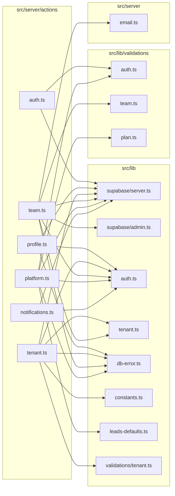
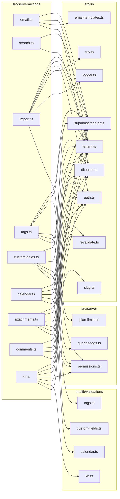

# 06. Server actions — núcleo (acesso, equipe, plataforma e transversais)

> 15 arquivos de código · 15 fichas completas · 0 em tabela de exceção.

Este módulo reúne as **server actions** de base do Orbit CRM: login/logout, preferências do perfil, troca e edição da empresa (tenant), convites e papéis da equipe, administração da plataforma (super-admin), notificações, modelos de e-mail, busca global, importação de CSV, tags, campos personalizados, agenda, anexos, comentários e base de conhecimento. Todas seguem o mesmo padrão: começam com `"use server"`, leem o `FormData` ou um objeto de entrada, validam com Zod, escrevem no Supabase pelo cliente da sessão (ou pelo cliente admin quando precisam ignorar RLS), devolvem `{ error? }` ou `{ success? }` e, quando faz sentido, chamam `revalidatePath`. Conceitos de papéis, tenant e isolamento estão em [regras e convenções](../05-regras-e-convencoes.md) §5; o desenho das tabelas em [modelo de dados](../04-modelo-de-dados.md) §4.

## Diagrama de dependências do módulo

Como o módulo é grande, os dois diagramas abaixo são complementares (cada um é autossuficiente). As setas significam "depende de".

## Fichas

### `src/server/actions/auth.ts`

**Propósito:** entrar no sistema com e-mail/senha e sair dele, usando o Supabase Auth.
**Processo:** `signInAction(prevState, formData)` lê `email` e `password` do formulário, valida com `signInSchema.safeParse` (Zod) e, se falhar, devolve `{ error: "Informe um e-mail e senha válidos." }`. Cria o cliente da sessão com `createClient()` e chama `supabase.auth.signInWithPassword`; em erro devolve `{ error: "Credenciais inválidas." }`; em sucesso chama `redirect("/app")`. `signOutAction()` cria o cliente, chama `supabase.auth.signOut()` e redireciona para `/login`.
**Estado:** `implementado`.
**Testes:** sem teste (busca por `signInAction`/`signOutAction` em `tests/` não retornou nada).
**Depende de:**
- `src/lib/supabase/server.ts`: `createClient()` (cliente autenticado por cookies).
- `src/lib/validations/auth.ts`: `signInSchema`.
- Autenticação Supabase: `signInWithPassword` e `signOut`.

**Usado por:** `src/app/(auth)/login/login-form.tsx` (usa `signInAction` e o tipo `AuthState`), `src/app/app/layout.tsx` e `src/components/app/user-menu.tsx` (usam `signOutAction`). Não é rota de API; é ponto de entrada das telas de login/logout.
**Bibliotecas externas:** `next/navigation` (`redirect`); Supabase Auth.

### `src/server/actions/profile.ts`

**Propósito:** salvar a preferência do usuário de receber (ou não) notificações por e-mail.
**Processo:** `updateNotificationPrefsAction(prevState, formData)` pega o usuário com `getUser()`; sem usuário devolve `{ error: "Não autenticado." }`. Lê o checkbox `notify_email` (`"on"` = ligado) e faz `update` em `profiles.notify_email` filtrando por `id = user.id`. Em erro usa `dbError("profile", error)`; em sucesso chama `revalidatePath("/app/configuracoes")` e devolve `{ success: "Preferências atualizadas." }`. Este é o único campo de perfil editável hoje (nome/avatar não têm action aqui).
**Estado:** `implementado`.
**Testes:** sem teste (busca por `updateNotificationPrefsAction` em `tests/` não retornou nada).
**Depende de:**
- `src/lib/supabase/server.ts`: `createClient()`.
- `src/lib/auth.ts`: `getUser()` (usuário autenticado).
- `src/lib/db-error.ts`: `dbError()`.
- Tabela: atualiza `profiles`.

**Usado por:** `src/app/app/configuracoes/notification-prefs-form.tsx`.
**Bibliotecas externas:** `next/cache` (`revalidatePath`).

### `src/server/actions/tenant.ts`

**Propósito:** trocar a empresa ativa do usuário e editar as configurações da empresa (nome, cor, logo e web-to-lead).
**Processo:** `setActiveTenantAction(tenantId)` confere se o `tenantId` está entre as empresas de `getMemberships()`; se não, lança erro "Você não tem acesso a esta empresa."; se sim grava o cookie `TENANT_COOKIE` (httpOnly, 30 dias) e redireciona para `/app`. `updateWebToLeadAction` exige papel `owner`/`admin` e atualiza `tenants.web_to_lead_enabled` e `web_to_lead_source_id`. `updateTenantSettingsAction` também exige `owner`/`admin`, valida nome/cor com `tenantSettingsSchema`, e, se houver um arquivo `logo` (imagem até 2 MB), sobe para o bucket `branding` em `<tenantId>/logo-<uuid>.<ext>`, pega a URL pública com `getPublicUrl` e grava em `tenants.logo_url`; por fim faz `revalidatePath("/app", "layout")`.
**Estado:** `implementado`.
**Testes:** sem teste (busca por `setActiveTenantAction`/`updateTenantSettingsAction` em `tests/` não retornou nada).
**Depende de:**
- `src/lib/supabase/server.ts`: `createClient()`.
- `src/lib/auth.ts`: `getMemberships()`.
- `src/lib/tenant.ts`: `getActiveMembership()`.
- `src/lib/constants.ts`: `TENANT_COOKIE`.
- `src/lib/validations/tenant.ts`: `tenantSettingsSchema`.
- `src/lib/db-error.ts`: `dbError()`.
- Tabelas: lê `memberships`; atualiza `tenants`.
- Storage: bucket `branding` (upload + `getPublicUrl`).

**Usado por:** `src/components/app/tenant-switcher.tsx` (`setActiveTenantAction`), `src/app/app/configuracoes/company-settings-form.tsx` (`updateTenantSettingsAction`) e `src/app/app/configuracoes/web-to-lead-form.tsx` (`updateWebToLeadAction`).
**Bibliotecas externas:** `next/headers` (`cookies`), `next/navigation` (`redirect`), `next/cache` (`revalidatePath`); `crypto.randomUUID`.

### `src/server/actions/team.ts`

**Propósito:** gerenciar a equipe do tenant: convidar por e-mail, aceitar convite, trocar papéis e remover membros.
**Processo:** helpers internos `getBaseUrl()` (monta a URL do link a partir de `NEXT_PUBLIC_SITE_URL` ou dos headers) e `countOwners(tenantId)` (conta owners ativos). `inviteMemberAction` exige `owner`/`admin`, valida com `inviteMemberSchema`, checa no cliente admin se o e-mail já tem perfil/membership e se há convite pendente; insere em `invitations`, monta o link `/convite/<token>` e tenta enviar por `sendTenantEmail` (template `member_invite`), devolvendo o link de qualquer forma. `updateMemberRoleAction({userId, role})` só deixa `owner` conceder/revogar `owner` e impede rebaixar o último owner. `removeMemberAction` segue a mesma proteção. `revokeInvitationAction` apaga um convite. `acceptInvitationAction` valida `acceptInvitationSchema`, confere token/expiração; se o e-mail já existe, faz login com a senha informada; se não, cria a conta com `admin.auth.admin.createUser({ email_confirm: true })` e faz login; então faz `upsert` em `memberships` (status `active`) e marca `accepted_at`. `acceptInvitationAsCurrentUserAction` faz o mesmo para o usuário já logado, com e-mail conferindo.
**Estado:** `implementado`.
**Testes:** sem teste (busca por `inviteMemberAction`/`acceptInvitationAction` em `tests/` não retornou nada).
**Depende de:**
- `src/lib/supabase/server.ts`: `createClient()`.
- `src/lib/supabase/admin.ts`: `createAdminClient()` (ignora RLS; usado em `profiles`, `invitations`, `memberships` e `auth.admin.createUser`).
- `src/lib/auth.ts`: `getUser()`.
- `src/lib/tenant.ts`: `getActiveMembership()`.
- `src/lib/validations/team.ts`: `inviteMemberSchema`, `acceptInvitationSchema`.
- `src/server/email.ts`: `sendTenantEmail`.
- `src/lib/db-error.ts`: `dbError()`.
- Tabelas: lê/escreve `profiles`, `memberships`, `invitations`.
- Config/env: `NEXT_PUBLIC_SITE_URL`; headers `x-forwarded-host`/`x-forwarded-proto`.

**Usado por:** `src/app/(auth)/convite/[token]/accept-invitation-form.tsx` (`acceptInvitationAction`, `acceptInvitationAsCurrentUserAction`), `src/app/app/configuracoes/member-row-actions.tsx` (`updateMemberRoleAction`, `removeMemberAction`), `src/app/app/configuracoes/invite-member-dialog.tsx` (`inviteMemberAction`) e `src/app/app/configuracoes/revoke-invitation-button.tsx` (`revokeInvitationAction`).
**Bibliotecas externas:** `next/headers` (`headers`), `next/cache` (`revalidatePath`), `next/navigation` (`redirect`).

### `src/server/actions/platform.ts`

**Propósito:** ações do super-admin da plataforma: criar empresas (com dados iniciais) e gerenciar planos.
**Processo:** `slugify(value)` gera um slug a partir do nome. `createTenantAction` só roda para `is_super_admin`, valida com `createTenantSchema`, insere em `tenants`, inclui o criador como `owner` em `memberships` e semeia `lead_statuses`, `lead_sources` e `departments` com as listas padrão (`DEFAULT_*`). `parsePlan(formData)` valida com `planSchema` (nome, preço, intervalo, trial, `most_popular` e `limits` de clients/projects/tasks/tickets/leads). `createPlanAction`/`updatePlanAction` exigem super-admin e escrevem em `plans`. `deletePlanAction`, `setTenantPlanAction` (define `tenants.plan_id`) e `deleteTenantAction` também exigem super-admin; todas revalidam `/plataforma`.
**Estado:** `implementado`.
**Testes:** sem teste (busca por `createTenantAction`/`createPlanAction` em `tests/` não retornou nada).
**Depende de:**
- `src/lib/supabase/server.ts`: `createClient()`.
- `src/lib/auth.ts`: `getProfile()`, `getUser()` (flag `is_super_admin`).
- `src/lib/leads-defaults.ts`: `DEFAULT_LEAD_STATUSES`, `DEFAULT_LEAD_SOURCES`, `DEFAULT_DEPARTMENTS`.
- `src/lib/validations/auth.ts`: `createTenantSchema`.
- `src/lib/validations/plan.ts`: `planSchema`.
- `src/lib/db-error.ts`: `dbError()`.
- Tabelas: escreve `tenants`, `memberships`, `lead_statuses`, `lead_sources`, `departments`, `plans`; atualiza/apaga `tenants` e `plans`.

**Usado por:** `src/app/plataforma/create-tenant-form.tsx` (`createTenantAction`), `src/app/plataforma/plan-form-dialog.tsx` (`createPlanAction`, `updatePlanAction`), `src/app/plataforma/admin-buttons.tsx` (`deletePlanAction`, `deleteTenantAction`) e `src/app/plataforma/set-plan-select.tsx` (`setTenantPlanAction`).
**Bibliotecas externas:** `next/cache` (`revalidatePath`); `String.normalize` (sem lib externa).

### `src/server/actions/notifications.ts`

**Propósito:** marcar uma ou todas as notificações do usuário como lidas.
**Processo:** `markNotificationReadAction({ id })` exige usuário logado e `id`; atualiza `notifications.read_at` filtrando por `id` **e** `user_id` (garante que só o dono altera). `markAllNotificationsReadAction()` faz o mesmo para todas as notificações do usuário com `read_at is null`. Ambas chamam `revalidatePath("/app", "layout")`.
**Estado:** `implementado`.
**Testes:** sem teste (busca por `markNotificationReadAction`/`markAllNotificationsReadAction` em `tests/` não retornou nada).
**Depende de:**
- `src/lib/supabase/server.ts`: `createClient()`.
- `src/lib/auth.ts`: `getUser()`.
- Tabela: atualiza `notifications`.

**Usado por:** `src/components/app/notifications-bell.tsx`.
**Bibliotecas externas:** `next/cache` (`revalidatePath`).

### `src/server/actions/email.ts`

**Propósito:** salvar ou restaurar o padrão dos modelos de e-mail personalizados do tenant.
**Processo:** `saveEmailTemplateAction` exige `owner`/`admin`, confere se a `key` existe em `EMAIL_TEMPLATES`, valida que assunto e corpo não estão vazios e faz `upsert` em `email_templates` com conflito em `tenant_id,key`. `resetEmailTemplateAction` (mesma permissão) apaga a linha daquela `key`, voltando o tenant a usar o template padrão. Ambas revalidam `/app/configuracoes`.
**Estado:** `implementado`.
**Testes:** sem teste (busca por `saveEmailTemplateAction` em `tests/` não retornou nada).
**Depende de:**
- `src/lib/supabase/server.ts`: `createClient()`.
- `src/lib/tenant.ts`: `getActiveMembership()`.
- `src/lib/email-templates.ts`: `EMAIL_TEMPLATES`.
- `src/lib/db-error.ts`: `dbError()`.
- Tabela: upsert/apaga em `email_templates`.

**Usado por:** `src/app/app/configuracoes/email-template-dialog.tsx` (`saveEmailTemplateAction`) e `src/app/app/configuracoes/reset-email-template-button.tsx` (`resetEmailTemplateAction`).
**Bibliotecas externas:** `next/cache` (`revalidatePath`).

### `src/server/actions/search.ts`

**Propósito:** busca global por clientes, projetos e tarefas do tenant ativo (usada na paleta de busca).
**Processo:** `searchAction(query)` pega a membership ativa; sem ela devolve `[]`. Ignora termos com menos de 2 caracteres. Monta o padrão `%termo%` e, em paralelo (`Promise.all`), consulta `companies` (nome/cidade), `projects` (nome) e `tasks` (nome), todos filtrando `tenant_id`, `deleted_at is null` e `ilike` no nome, com `limit(5)`. Converte cada linha em um `SearchResult` (`id`, `title`, `subtitle`, `href`, `type`), montando links como `/app/clientes/<id>`, `/app/projetos/<id>` e `/app/tarefas/<id>`.
**Estado:** `implementado`.
**Testes:** sem teste (busca por `searchAction` em `tests/` não retornou nada).
**Depende de:**
- `src/lib/supabase/server.ts`: `createClient()`.
- `src/lib/tenant.ts`: `getActiveMembership()`.
- Tabelas: lê `companies`, `projects`, `tasks`.

**Usado por:** `src/components/app/search-dialog.tsx` (usa `searchAction` e o tipo `SearchResult`).
**Bibliotecas externas:** `next/cache` não é usado; nenhuma externa relevante.

### `src/server/actions/import.ts`

**Propósito:** importar clientes ou leads a partir de um arquivo CSV, respeitando o limite do plano e ignorando duplicados.
**Processo:** `readCsv(formData)` recusa arquivo ausente/vazio ou maior que 2 MB e lê o texto com `parseCsv`. `normalizeHeader` (remove acentos, minúsculas) e `mapRows(rows, columns)` decidem se a primeira linha é cabeçalho e mapeiam colunas por nome ou por posição. `importCompaniesAction` exige empresa ativa, verifica o limite com `checkPlanLimit(active.tenantId, "clients")`, filtra linhas sem `name`, carrega os nomes existentes de `companies` para pular duplicados, e insere cada novo registro; para no limite. `importLeadsAction` é análogo, com o limite `"leads"`, deduplicação por e-mail/nome e conversão do valor (`Number`, trocando vírgula por ponto). Erros por linha são logados com `logger.error` e acumulados em `errors`; o retorno traz `created`, `skipped` e `errors`.
**Estado:** `implementado`.
**Testes:** sem teste para as actions; a função `parseCsv` (de `src/lib/csv.ts`) é coberta em `tests/unit/csv.test.ts`.
**Depende de:**
- `src/lib/supabase/server.ts`: `createClient()`.
- `src/lib/auth.ts`: `getUser()`.
- `src/lib/tenant.ts`: `getActiveMembership()`.
- `src/lib/csv.ts`: `parseCsv()`.
- `src/server/plan-limits.ts`: `checkPlanLimit()`.
- `src/lib/logger.ts`: `logger.error`.
- Tabelas: lê/insere `companies` e `leads`.

**Usado por:** `src/app/app/clientes/page.tsx` (`importCompaniesAction`), `src/app/app/leads/page.tsx` (`importLeadsAction`) e `src/components/app/import-csv-dialog.tsx` (tipo `ImportState`).
**Bibliotecas externas:** `next/cache` (`revalidatePath`).

### `src/server/actions/tags.ts`

**Propósito:** criar, editar, apagar tags e associá-las a entidades (cliente, projeto, tarefa, lead, ticket).
**Processo:** `ENTITY_PATHS` mapeia cada tipo de entidade à sua rota. `parseTag(formData)` valida com `tagSchema`. `createTagAction` e `updateTagAction` inserem/atualizam `tags` (erro `23505` = nome duplicado); ao editar, `revalidateTagUsage()` revalida todas as listas. `deleteTagAction` exige `isManager`. `setEntityTagAction({tagId, entityType, entityId, assign})` faz `upsert`/`delete` em `taggables` (conflito `tag_id,entity_type,entity_id`) e revalida a entidade. `createTagForEntityAction` cria a tag e já a associa à entidade na mesma chamada.
**Estado:** `implementado`.
**Testes:** sem teste (busca por `createTagAction`/`setEntityTagAction` em `tests/` não retornou nada).
**Depende de:**
- `src/lib/supabase/server.ts`: `createClient()`.
- `src/lib/tenant.ts`: `getActiveMembership()`.
- `src/server/permissions.ts`: `isManager()`.
- `src/lib/validations/tags.ts`: `tagSchema`.
- `src/server/queries/tags.ts`: tipo `TaggedEntityType`.
- `src/lib/db-error.ts`: `dbError()`.
- Tabelas: escreve `tags` e `taggables`.

**Usado por:** `src/components/app/tag-picker.tsx` (`createTagForEntityAction`, `setEntityTagAction`), `src/app/app/configuracoes/tag-form-dialog.tsx` (`createTagAction`, `updateTagAction`) e `src/app/app/configuracoes/delete-tag-button.tsx` (`deleteTagAction`).
**Bibliotecas externas:** `next/cache` (`revalidatePath`).

### `src/server/actions/custom-fields.ts`

**Propósito:** gerenciar as definições de campos personalizados por entidade do tenant.
**Processo:** `parseDefinition(formData)` divide o campo `options` por linha/vírgula em uma lista e valida com `customFieldDefinitionSchema` (`entity_type`, `label`, `key`, `field_type`, `required`, `position`, `options`). `createCustomFieldAction` insere em `custom_field_definitions` (erro `23505` = chave repetida na entidade); `updateCustomFieldAction` atualiza por `id`+`tenant_id`; `deleteCustomFieldAction` exige `isManager` e apaga. Todas revalidam `/app/configuracoes`.
**Estado:** `implementado`.
**Testes:** sem teste (busca por `createCustomFieldAction` em `tests/` não retornou nada).
**Depende de:**
- `src/lib/supabase/server.ts`: `createClient()`.
- `src/lib/tenant.ts`: `getActiveMembership()`.
- `src/server/permissions.ts`: `isManager()`.
- `src/lib/validations/custom-fields.ts`: `customFieldDefinitionSchema`.
- `src/lib/db-error.ts`: `dbError()`.
- Tabela: escreve `custom_field_definitions`.

**Usado por:** `src/app/app/configuracoes/custom-field-form-dialog.tsx` (`createCustomFieldAction`, `updateCustomFieldAction`) e `src/app/app/configuracoes/delete-custom-field-button.tsx` (`deleteCustomFieldAction`).
**Bibliotecas externas:** `next/cache` (`revalidatePath`).

### `src/server/actions/calendar.ts`

**Propósito:** criar, editar e apagar (exclusão lógica) eventos da agenda.
**Processo:** `toIso(value)` converte uma string de data em ISO ou `null`. `parseEvent(formData)` valida com `calendarEventSchema` (título, descrição, início, fim, empresa, projeto). `createCalendarEventAction` insere em `calendar_events` com `created_by`; `updateCalendarEventAction` atualiza por `id`+`tenant_id`; `deleteCalendarEventAction` faz soft delete (`deleted_at`). Todas revalidam `/app/calendario`.
**Estado:** `implementado`.
**Testes:** sem teste (busca por `createCalendarEventAction` em `tests/` não retornou nada).
**Depende de:**
- `src/lib/supabase/server.ts`: `createClient()`.
- `src/lib/auth.ts`: `getUser()`.
- `src/lib/tenant.ts`: `getActiveMembership()`.
- `src/lib/validations/calendar.ts`: `calendarEventSchema`.
- `src/lib/db-error.ts`: `dbError()`.
- Tabela: escreve `calendar_events`.

**Usado por:** `src/app/app/calendario/event-form-dialog.tsx` (`createCalendarEventAction`, `updateCalendarEventAction`) e `src/app/app/calendario/delete-event-button.tsx` (`deleteCalendarEventAction`).
**Bibliotecas externas:** `next/cache` (`revalidatePath`), `next/navigation` (`redirect`).

### `src/server/actions/attachments.ts`

**Propósito:** registrar no banco um anexo já enviado ao Storage e apagar anexos.
**Processo:** `registerAttachmentAction(input)` aceita apenas entidades `task`, `project`, `ticket` e exige que `storagePath` comece com `<tenantId>/` (evita apontar para arquivo de outro tenant); insere em `attachments` (com `uploaded_by`) e revalida a entidade. `deleteAttachmentAction(formData)` lê `id`, `storage_path`, `entity_type` e `entity_id`; só permite apagar se o usuário for gerente (`isManager`) ou o autor (`uploaded_by === user.id`); remove o arquivo do bucket `attachments` e apaga a linha.
**Estado:** `implementado`.
**Testes:** sem teste (busca por `registerAttachmentAction` em `tests/` não retornou nada).
**Depende de:**
- `src/lib/supabase/server.ts`: `createClient()`.
- `src/lib/auth.ts`: `getUser()`.
- `src/lib/tenant.ts`: `getActiveMembership()`.
- `src/server/permissions.ts`: `isManager()`.
- `src/lib/revalidate.ts`: `revalidateEntity()`.
- `src/lib/db-error.ts`: `dbError()`.
- Tabela: escreve `attachments`.
- Storage: bucket `attachments` (remove).

**Usado por:** `src/components/app/attachment-uploader.tsx` (`registerAttachmentAction`) e `src/components/app/delete-attachment-button.tsx` (`deleteAttachmentAction`).
**Bibliotecas externas:** nenhuma além do cliente Supabase (via helper).

### `src/server/actions/comments.ts`

**Propósito:** adicionar e apagar comentários em tarefas e projetos.
**Processo:** `addCommentAction(formData)` aceita apenas entidades `task` e `project`; lê `entity_id` e `content` (trim) e insere em `comments` com `author_id`, revalidando a entidade. `deleteCommentAction` busca o comentário, e só permite apagar se o autor for o usuário ou se o papel for `owner`/`admin` (moderação).
**Estado:** `implementado`.
**Testes:** sem teste (busca por `addCommentAction` em `tests/` não retornou nada).
**Depende de:**
- `src/lib/supabase/server.ts`: `createClient()`.
- `src/lib/auth.ts`: `getUser()`.
- `src/lib/tenant.ts`: `getActiveMembership()`.
- `src/lib/revalidate.ts`: `revalidateEntity()`.
- Tabela: escreve `comments`.

**Usado por:** `src/components/app/comments-section.tsx` (`addCommentAction`) e `src/components/app/delete-comment-button.tsx` (`deleteCommentAction`).
**Bibliotecas externas:** nenhuma além do cliente Supabase (via helper).

### `src/server/actions/kb.ts`

**Propósito:** gerenciar categorias, artigos e FAQs da base de conhecimento.
**Processo:** `uniqueSlug(tenantId, title, ignoreId)` gera um slug único (`slug-2`, `slug-3`…) a partir de `slugify(title)`. `createKbCategoryAction`/`deleteKbCategoryAction` mexem em `kb_categories` (apagar exige `isManager`). `createKbArticleAction` valida com `kbArticleSchema`, gera o slug e insere em `kb_articles`, redirecionando para o artigo; `updateKbArticleAction` atualiza mantendo o slug único; `deleteKbArticleAction` faz soft delete (`deleted_at`) e redireciona (exige `isManager`). `createFaqAction`/`deleteFaqAction` mexem em `faqs`. Todas revalidam `/app/base-conhecimento`.
**Estado:** `implementado`.
**Testes:** sem teste (busca por `createKbArticleAction` em `tests/` não retornou nada).
**Depende de:**
- `src/lib/supabase/server.ts`: `createClient()`.
- `src/lib/auth.ts`: `getUser()`.
- `src/lib/tenant.ts`: `getActiveMembership()`.
- `src/server/permissions.ts`: `isManager()`.
- `src/lib/slug.ts`: `slugify()`.
- `src/lib/validations/kb.ts`: `kbCategorySchema`, `kbArticleSchema`, `faqSchema`.
- `src/lib/db-error.ts`: `dbError()`.
- Tabelas: escreve `kb_categories`, `kb_articles`, `faqs`.

**Usado por:** `src/app/app/base-conhecimento/article-form-dialog.tsx` (`createKbArticleAction`, `updateKbArticleAction`), `src/app/app/base-conhecimento/category-form-dialog.tsx` (`createKbCategoryAction`), `src/app/app/base-conhecimento/faq-form-dialog.tsx` (`createFaqAction`) e `src/app/app/base-conhecimento/delete-icons.tsx` (`deleteKbArticleAction`, `deleteKbCategoryAction`, `deleteFaqAction`).
**Bibliotecas externas:** `next/cache` (`revalidatePath`), `next/navigation` (`redirect`).

## Tabela das fichas do módulo

| § | Arquivo | Propósito em 1 linha |
|---|---------|----------------------|
| §06.1 | `src/server/actions/auth.ts` | Entrar (`signInAction`) e sair (`signOutAction`) via Supabase Auth. |
| §06.2 | `src/server/actions/profile.ts` | Salvar a preferência de notificação por e-mail do usuário. |
| §06.3 | `src/server/actions/tenant.ts` | Trocar a empresa ativa e editar nome/cor/logo e web-to-lead. |
| §06.4 | `src/server/actions/team.ts` | Convidar, aceitar, trocar papel e remover membros da equipe. |
| §06.5 | `src/server/actions/platform.ts` | Ações do super-admin: criar empresas e gerenciar planos. |
| §06.6 | `src/server/actions/notifications.ts` | Marcar notificações como lidas (uma ou todas). |
| §06.7 | `src/server/actions/email.ts` | Salvar/restaurar modelos de e-mail personalizados do tenant. |
| §06.8 | `src/server/actions/search.ts` | Busca global por clientes, projetos e tarefas. |
| §06.9 | `src/server/actions/import.ts` | Importar clientes/leads por CSV respeitando o plano. |
| §06.10 | `src/server/actions/tags.ts` | Criar/editar/apagar tags e associá-las a entidades. |
| §06.11 | `src/server/actions/custom-fields.ts` | Gerenciar definições de campos personalizados. |
| §06.12 | `src/server/actions/calendar.ts` | Criar/editar/apagar eventos da agenda. |
| §06.13 | `src/server/actions/attachments.ts` | Registrar e apagar anexos (banco + Storage). |
| §06.14 | `src/server/actions/comments.ts` | Adicionar e apagar comentários em tarefas/projetos. |
| §06.15 | `src/server/actions/kb.ts` | Gerenciar categorias, artigos e FAQs da base de conhecimento. |
