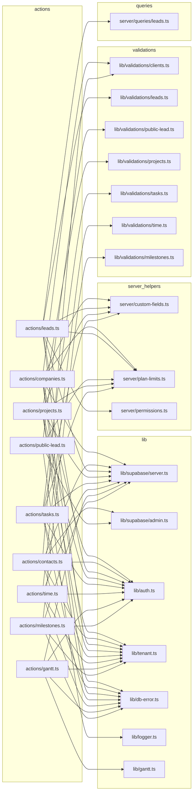
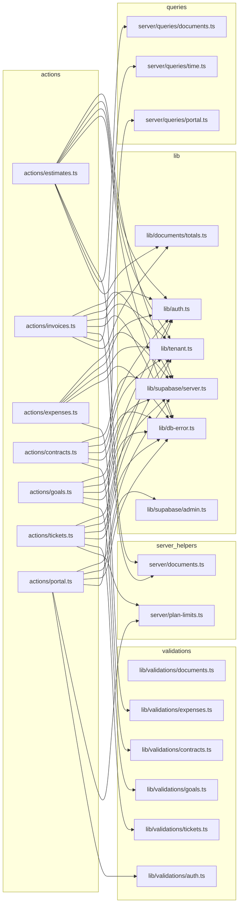

# 07. Server actions — negócio (clientes, CRM, entrega, financeiro e atendimento)

> 16 arquivos de código · 16 fichas completas · 0 em tabela de exceção.

Este módulo reúne as Server Actions que **escrevem** os dados do dia a dia do
produto: clientes/contatos, CRM (leads), captação pública, entrega (projetos,
tarefas, cronograma, marcos, horas) e a parte financeira/atendimento (orçamentos,
faturas, despesas, contratos, metas, tickets e portal do cliente). Todas seguem o
mesmo desenho: rodam no servidor (`"use server"`), começam obtendo a empresa ativa
com `getActiveMembership()`, validam a entrada com um schema Zod, gravam via
`supabase-js` (respeitando RLS pelo `tenant_id`) e devolvem `{ error? }` ou
`{ success? }`, disparando `revalidatePath(...)` para atualizar as telas. Algumas
precisam de privilégios (`createAdminClient`) ou chamam RPCs do banco. A validação
reutilizada está detalhada em [03-validacoes-zod](03-validacoes-zod.md) e as
tabelas em [modelo de dados](../04-modelo-de-dados.md) §4.

## Diagrama de dependências do módulo

Como o conjunto passa de ~40 nós, ele foi dividido em dois diagramas: o primeiro
cobre clientes/CRM/entrega; o segundo, financeiro e atendimento. A seta
`A --> B` significa "A depende de B".

### `src/server/actions/companies.ts`

**Propósito:** Criar, editar e excluir (soft delete) clientes/empresas do tenant.
**Processo:** `createCompanyAction` valida o plano (`checkPlanLimit(..., "clients")`), faz `parseCompany` com `companySchema`, insere em `companies` (com `tenant_id` e `created_by`) e grava campos personalizados via `saveCustomFieldValues(..., "company", ...)`. `updateCompanyAction` repete a validação e atualiza por `id`+`tenant_id`. `deleteCompanyAction` marca `deleted_at` e redireciona. Todas terminam com `revalidatePath("/app/clientes")`.
**Estado:** `implementado`
**Testes:** sem teste (nenhum arquivo de teste encontrado no projeto).
**Depende de:**
- `src/lib/supabase/server.ts`: cliente Supabase autenticado (RLS).
- `src/lib/auth.ts`: `getUser` para `created_by`.
- `src/lib/tenant.ts`: `getActiveMembership` (tenant ativo e papel).
- `src/lib/validations/clients.ts`: `companySchema`.
- `src/server/custom-fields.ts`: `saveCustomFieldValues`.
- `src/server/plan-limits.ts`: `checkPlanLimit` (recurso `clients`).
- `src/lib/db-error.ts`: `dbError`.
- Banco: tabelas `companies`, `custom_field_definitions`, `custom_field_values`, `tenants` (via plano).
**Usado por:** `src/app/app/clientes/company-form-dialog.tsx` (`createCompanyAction`, `updateCompanyAction`), `src/app/app/clientes/delete-company-button.tsx` (`deleteCompanyAction`).
**Bibliotecas externas:** `next/cache`, `next/navigation`.

### `src/server/actions/contacts.ts`

**Propósito:** CRUD de contatos de um cliente e liberação de acesso ao portal do cliente.
**Processo:** `createContactAction`/`updateContactAction` validam com `contactSchema` e gravam em `contacts` ligados a `company_id`. `deleteContactAction` marca `deleted_at`. `inviteContactToPortalAction` exige papel `owner`/`admin`, confere se o contato tem e-mail e ainda não tem `user_id`, cria o usuário com `createAdminClient().auth.admin.createUser` (senha mínima de 8) e grava o `user_id` no contato. Revalida `/app/clientes` e `/app/clientes/[id]`.
**Estado:** `implementado`
**Testes:** sem teste.
**Depende de:**
- `src/lib/supabase/server.ts`: cliente autenticado.
- `src/lib/supabase/admin.ts`: `createAdminClient` (ignora RLS) para criar usuário.
- `src/lib/auth.ts`: `getUser`.
- `src/lib/tenant.ts`: `getActiveMembership` (papel para o convite).
- `src/lib/validations/clients.ts`: `contactSchema`.
- `src/lib/db-error.ts`: `dbError`.
- Banco/Auth: tabelas `contacts`, `memberships`; Supabase Auth Admin.
**Usado por:** `src/app/app/clientes/[id]/contact-form-dialog.tsx`, `src/app/app/clientes/[id]/delete-contact-button.tsx`, `src/app/app/clientes/[id]/invite-portal-dialog.tsx` (`inviteContactToPortalAction`).
**Bibliotecas externas:** `next/cache`, `@supabase/supabase-js` (indireto via lib).

### `src/server/actions/leads.ts`

**Propósito:** CRUD de leads, mudança de status (kanban), atividades, conversão em cliente e gestão de status/origens.
**Processo:** `createLeadAction` verifica limite do plano (`leads`), valida `leadSchema`, insere em `leads` e salva campos personalizados (`lead`). `updateLeadAction`, `updateLeadStatusAction` e `setLeadStatusAction` atualizam status. `addLeadActivityAction` insere em `lead_activities`. `convertLeadToCustomerAction` usa `getLead`, checa limite de `clients`, cria a `companies`, cria um `contacts` primário, marca o lead como convertido (status `is_won` obtido por `listLeadStatuses`), registra a atividade e redireciona. `createLeadStatusAction`/`deleteLeadStatusAction` (só gestor via `isManager`) e `createLeadSourceAction`/`deleteLeadSourceAction` gerenciam `lead_statuses` e `lead_sources`.
**Estado:** `implementado`
**Testes:** sem teste.
**Depende de:**
- `src/lib/supabase/server.ts`: cliente autenticado.
- `src/lib/auth.ts`: `getUser`.
- `src/lib/tenant.ts`: `getActiveMembership`.
- `src/lib/validations/leads.ts`: `leadSchema`, `leadStatusSchema`, `leadSourceSchema`, `leadActivitySchema`.
- `src/server/queries/leads.ts`: `getLead`, `listLeadStatuses`.
- `src/server/custom-fields.ts`: `saveCustomFieldValues`.
- `src/server/plan-limits.ts`: `checkPlanLimit` (`leads`, `clients`).
- `src/server/permissions.ts`: `isManager`.
- `src/lib/db-error.ts`: `dbError`.
- Banco: `leads`, `lead_activities`, `lead_statuses`, `lead_sources`, `companies`, `contacts`, `custom_field_values`.
**Usado por:** `src/app/app/leads/lead-form-dialog.tsx`, `lead-kanban.tsx` (`setLeadStatusAction`), `lead-settings.tsx` (status/origens), `lead-status-select.tsx` (`updateLeadStatusAction`), `src/app/app/leads/[id]/page.tsx` (`addLeadActivityAction`), `src/app/app/leads/[id]/lead-actions.tsx` (`convertLeadToCustomerAction`, `deleteLeadAction`).
**Bibliotecas externas:** `next/cache`, `next/navigation`.

### `src/server/actions/public-lead.ts`

**Propósito:** Receber o envio do formulário público de captação ("web-to-lead") e criar o lead sem sessão.
**Processo:** `submitPublicLeadAction` valida o `slug`, aplica rate limit distribuído via RPC `check_rate_limit` (bucket por IP, 5/min) usando `createAdminClient`, e um honeypot (`company_website`) que finge sucesso para bots. Valida `publicLeadSchema`, busca o tenant em `tenants` (`web_to_lead_enabled`, `web_to_lead_source_id`), checa limite com `checkPlanLimitWith(admin, ...)` e insere o lead em `leads` via admin. Erros são registrados com `logger`.
**Estado:** `implementado`
**Testes:** sem teste.
**Depende de:**
- `src/lib/supabase/admin.ts`: `createAdminClient` (fluxo sem usuário).
- `src/lib/validations/public-lead.ts`: `publicLeadSchema`.
- `src/server/plan-limits.ts`: `checkPlanLimitWith`.
- `src/lib/logger.ts`: `logger`.
- `next/headers` do Next.
- Banco/RPC: RPC `check_rate_limit`; tabelas `tenants`, `leads`.
**Usado por:** `src/app/f/[slug]/public-lead-form.tsx` (`submitPublicLeadAction`) — ponto de entrada público da rota `/f/[slug]`.
**Bibliotecas externas:** `next/headers`.

### `src/server/actions/projects.ts`

**Propósito:** CRUD de projetos e gerência de membros (equipe) do projeto.
**Processo:** `createProjectAction`/`updateProjectAction` checam limite (`projects`), validam `projectSchema`, gravam em `projects`, definem `date_finished` quando status=4 e salvam campos personalizados (`project`). `deleteProjectAction` marca `deleted_at`. `addProjectMemberAction` confere a `memberships` ativa antes de inserir em `project_members`; `removeProjectMemberAction` apaga o vínculo. Revalida `/app/projetos` e `/app/projetos/[id]`.
**Estado:** `implementado`
**Testes:** sem teste.
**Depende de:**
- `src/lib/supabase/server.ts`, `src/lib/auth.ts` (`getUser`), `src/lib/tenant.ts`.
- `src/lib/validations/projects.ts`: `projectSchema`.
- `src/server/custom-fields.ts`, `src/server/plan-limits.ts`, `src/lib/db-error.ts`.
- Banco: `projects`, `project_members`, `memberships`, `custom_field_values`.
**Usado por:** `src/app/app/projetos/project-form-dialog.tsx`, `src/app/app/projetos/delete-project-button.tsx`, `src/app/app/projetos/[id]/page.tsx` (`addProjectMemberAction`), `src/app/app/projetos/[id]/remove-member-button.tsx` (`removeProjectMemberAction`).
**Bibliotecas externas:** `next/cache`, `next/navigation`.

### `src/server/actions/tasks.ts`

**Propósito:** CRUD de tarefas, mudança de status e itens de checklist.
**Processo:** `createTaskAction`/`updateTaskAction` checam limite (`tasks`), validam `taskSchema`, gravam em `tasks` (definindo `date_finished` quando status=5) e salvam campos personalizados (`task`). `updateTaskStatusAction` aceita 1..5. `deleteTaskAction` faz soft delete e redireciona para `redirect_to`. `addChecklistItemAction`, `toggleChecklistItemAction` e `deleteChecklistItemAction` gerenciam `task_checklist_items`. Revalida `/app/tarefas`, `/app/projetos` e o projeto.
**Estado:** `implementado`
**Testes:** sem teste.
**Depende de:**
- `src/lib/supabase/server.ts`, `src/lib/auth.ts`, `src/lib/tenant.ts`.
- `src/lib/validations/tasks.ts`: `taskSchema`, `checklistItemSchema`.
- `src/server/custom-fields.ts`, `src/server/plan-limits.ts`, `src/lib/db-error.ts`.
- Banco: `tasks`, `task_checklist_items`, `custom_field_values`.
**Usado por:** `src/app/app/tarefas/task-form-dialog.tsx`, `src/app/app/tarefas/task-status-select.tsx` (`updateTaskStatusAction`), `src/app/app/tarefas/delete-task-button.tsx`, `src/app/app/tarefas/[id]/page.tsx` (checklist).
**Bibliotecas externas:** `next/cache`, `next/navigation`.

### `src/server/actions/time.ts`

**Propósito:** Apontamento de horas: cronômetro (iniciar/parar), lançamento manual e exclusão.
**Processo:** `startTimerAction` fecha qualquer `time_entries` em aberto do usuário, resolve a tarifa com `resolveRate` (tarifa fixa do projeto quando `billing_type=2`, da tarefa quando 3, ou override) e insere uma nova entrada aberta. `stopTimerAction` calcula `duration_seconds` e fecha a entrada. `addManualEntryAction` valida `manualEntrySchema`, monta início/fim a partir da data e horas e insere. `deleteTimeEntryAction` apaga por `id`+`tenant_id`. Revalida `/app/timesheet`.
**Estado:** `implementado`
**Testes:** sem teste.
**Depende de:**
- `src/lib/supabase/server.ts`, `src/lib/auth.ts` (`getUser`), `src/lib/tenant.ts`.
- `src/lib/validations/time.ts`: `manualEntrySchema`.
- `src/lib/db-error.ts`: `dbError`.
- Banco: `time_entries`, `projects`, `tasks`.
**Usado por:** `src/app/app/timesheet/timer-widget.tsx` (`startTimerAction`, `stopTimerAction`), `src/app/app/timesheet/manual-entry-dialog.tsx`, `src/components/app/delete-time-entry-button.tsx` (`deleteTimeEntryAction`).
**Bibliotecas externas:** `next/cache`, `@supabase/supabase-js` (tipo `SupabaseClient`).

### `src/server/actions/gantt.ts`

**Propósito:** Editar datas das tarefas no cronograma e gerenciar dependências (com detecção de ciclo).
**Processo:** `updateTaskScheduleAction` valida datas (`DATE_RE`), carrega tarefas e dependências com `loadProjectSchedule`, calcula o deslocamento em cascata com `normalizeSchedule` e grava as mudanças em `tasks`. `addTaskDependencyAction` impede auto-dependência e ciclos (`wouldCreateCycle`) e insere em `task_dependencies` (tratando erro `23505` de duplicidade); `removeTaskDependencyAction` apaga por id. Revalida tarefas e o projeto.
**Estado:** `implementado`
**Testes:** sem teste.
**Depende de:**
- `src/lib/supabase/server.ts`, `src/lib/auth.ts`, `src/lib/tenant.ts`.
- `src/lib/gantt.ts`: `normalizeSchedule`, `wouldCreateCycle`, tipos.
- `src/lib/db-error.ts`.
- Banco: `tasks`, `task_dependencies`.
**Usado por:** `src/components/app/project-gantt.tsx` (`updateTaskScheduleAction`), `src/components/app/gantt-dependency-dialog.tsx` (dependências).
**Bibliotecas externas:** `next/cache`.

### `src/server/actions/milestones.ts`

**Propósito:** CRUD de marcos (milestones) de um projeto.
**Processo:** `createMilestoneAction` valida `milestoneSchema`, calcula `position` pela contagem existente e insere em `milestones` (com `date_finished` quando status=3). `updateMilestoneAction` atualiza por id. `deleteMilestoneAction` primeiro desvincula tarefas (`tasks.milestone_id = null`) e depois marca `deleted_at` no marco. Revalida `/app/projetos/[id]`.
**Estado:** `implementado`
**Testes:** sem teste.
**Depende de:**
- `src/lib/supabase/server.ts`, `src/lib/auth.ts`, `src/lib/tenant.ts`.
- `src/lib/validations/milestones.ts`: `milestoneSchema`.
- `src/lib/db-error.ts`.
- Banco: `milestones`, `tasks`.
**Usado por:** `src/app/app/projetos/[id]/milestone-form-dialog.tsx`, `src/app/app/projetos/[id]/delete-milestone-button.tsx`.
**Bibliotecas externas:** `next/cache`, `next/navigation`.

### `src/server/actions/estimates.ts`

**Propósito:** CRUD de orçamentos, mudança de status e conversão de orçamento em fatura.
**Processo:** usa os helpers de `server/documents.ts` (`parseDocumentForm`, `buildDocumentValues`, `replaceDocumentItems`, `getTenantFinanceSettings`, `formatDocumentNumber`). `createEstimateAction` pega número via RPC `next_document_number` (`estimate`), insere em `estimates` (status 1) e grava os itens. `updateEstimateAction` regrava valores e itens. `updateEstimateStatusAction` aceita 1..5. `convertEstimateToInvoiceAction` lê `getEstimate`/`listDocumentItems`, gera número `invoice`, cria a `invoices` copiando campos/totais, copia os itens e marca o orçamento (`invoice_id`, status 4), redirecionando para a fatura.
**Estado:** `implementado`
**Testes:** sem teste.
**Depende de:**
- `src/server/documents.ts`, `src/lib/documents/totals.ts` (tipo `LineItemInput`).
- `src/server/queries/documents.ts`: `getEstimate`, `listDocumentItems`.
- `src/lib/supabase/server.ts`, `src/lib/auth.ts`, `src/lib/tenant.ts`, `src/lib/db-error.ts`.
- Banco/RPC: RPC `next_document_number`; tabelas `estimates`, `invoices`, `document_items`, `tenants`.
**Usado por:** `src/app/app/orcamentos/[id]/page.tsx` (`convertEstimateToInvoiceAction`, `updateEstimateStatusAction`), `src/app/app/orcamentos/estimate-form-dialog.tsx` (criar/editar), `src/app/app/orcamentos/delete-estimate-button.tsx`.
**Bibliotecas externas:** `next/cache`, `next/navigation`.

### `src/server/actions/invoices.ts`

**Propósito:** CRUD de faturas, pagamentos, recálculo de status e faturamento de horas de projeto.
**Processo:** `recomputeInvoiceStatus` soma `payments` e define status (1 aberto / 2 pago / 3 parcial), ignorando status 5/6. `createInvoiceAction`/`updateInvoiceAction` usam os helpers de `server/documents.ts` e o RPC `next_document_number` (`invoice`). `recordPaymentAction`/`deletePaymentAction` gerenciam `payments` e recalculam. `updateInvoiceStatusAction` aceita 1/5/6. `invoiceBillableTimeAction` usa `listUnbilledBillableEntries`, agrupa horas por tarefa/tarifa, calcula totais com `computeTotals`, cria a fatura, grava itens e marca as horas como `billed`.
**Estado:** `implementado`
**Testes:** sem teste.
**Depende de:**
- `src/server/documents.ts`, `src/lib/documents/totals.ts` (`computeTotals`).
- `src/server/queries/time.ts`: `listUnbilledBillableEntries`.
- `src/lib/supabase/server.ts`, `src/lib/auth.ts`, `src/lib/tenant.ts`, `src/lib/db-error.ts`.
- Banco/RPC: RPC `next_document_number`; tabelas `invoices`, `payments`, `document_items`, `time_entries`, `projects`, `tenants`.
**Usado por:** `src/app/app/faturas/[id]/page.tsx` (`updateInvoiceStatusAction`), `invoice-form-dialog.tsx` (criar/editar), `record-payment-dialog.tsx` (`recordPaymentAction`), `delete-invoice-button.tsx`, `delete-payment-button.tsx`, `src/app/app/projetos/[id]/invoice-time-button.tsx` (`invoiceBillableTimeAction`).
**Bibliotecas externas:** `next/cache`, `next/navigation`, `@supabase/supabase-js` (tipo `SupabaseClient`).

### `src/server/actions/expenses.ts`

**Propósito:** CRUD de despesas, podendo vinculá-las a projeto/cliente.
**Processo:** `createExpenseAction`/`updateExpenseAction` validam `expenseSchema` e gravam em `expenses` (com `tenant_id` e `created_by`). `deleteExpenseAction` marca `deleted_at`. Revalida `/app/despesas`.
**Estado:** `implementado`
**Testes:** sem teste.
**Depende de:**
- `src/lib/supabase/server.ts`, `src/lib/auth.ts` (`getUser`), `src/lib/tenant.ts`.
- `src/lib/validations/expenses.ts`: `expenseSchema`.
- `src/lib/db-error.ts`.
- Banco: `expenses`.
**Usado por:** `src/app/app/despesas/expense-form-dialog.tsx`, `src/app/app/despesas/delete-expense-button.tsx`.
**Bibliotecas externas:** `next/cache`, `next/navigation`.

### `src/server/actions/contracts.ts`

**Propósito:** CRUD de contratos de clientes.
**Processo:** `createContractAction`/`updateContractAction` validam `contractSchema` e gravam em `contracts` (com `tenant_id`, `created_by`). `deleteContractAction` marca `deleted_at`. Revalida `/app/contratos`.
**Estado:** `implementado`
**Testes:** sem teste.
**Depende de:**
- `src/lib/supabase/server.ts`, `src/lib/auth.ts` (`getUser`), `src/lib/tenant.ts`.
- `src/lib/validations/contracts.ts`: `contractSchema`.
- `src/lib/db-error.ts`.
- Banco: `contracts`.
**Usado por:** `src/app/app/contratos/contract-form-dialog.tsx`, `src/app/app/contratos/delete-contract-button.tsx`.
**Bibliotecas externas:** `next/cache`, `next/navigation`.

### `src/server/actions/goals.ts`

**Propósito:** CRUD de metas por período e métrica.
**Processo:** `createGoalAction`/`updateGoalAction` validam `goalSchema` (métricas `revenue`/`leads`/`hours`, fim ≥ início) e gravam em `goals` (com `tenant_id`, `created_by`). `deleteGoalAction` marca `deleted_at`. Revalida `/app/metas`.
**Estado:** `implementado`
**Testes:** sem teste.
**Depende de:**
- `src/lib/supabase/server.ts`, `src/lib/auth.ts` (`getUser`), `src/lib/tenant.ts`.
- `src/lib/validations/goals.ts`: `goalSchema`.
- `src/lib/db-error.ts`.
- Banco: `goals`.
**Usado por:** `src/app/app/metas/goal-form-dialog.tsx`, `src/app/app/metas/delete-goal-button.tsx`.
**Bibliotecas externas:** `next/cache`, `next/navigation`.

### `src/server/actions/tickets.ts`

**Propósito:** CRUD de tickets de atendimento (staff), status, respostas internas/públicas e exclusão.
**Processo:** `createTicketAction` checa limite (`tickets`), valida `ticketSchema`, gera número via RPC `next_document_number` (`ticket`), monta `formatted_number` com `ticket_prefix` do tenant e insere em `tickets` com `source: "staff"`. `updateTicketAction`/`updateTicketStatusAction` (1..6) ajustam `closed_at`. `deleteTicketAction` marca `deleted_at`. `addTicketReplyAction`/`deleteTicketReplyAction` gerenciam `ticket_replies` (com `is_internal`).
**Estado:** `implementado`
**Testes:** sem teste.
**Depende de:**
- `src/lib/supabase/server.ts`, `src/lib/auth.ts` (`getUser`), `src/lib/tenant.ts`.
- `src/lib/validations/tickets.ts`: `ticketSchema`, `ticketReplySchema`.
- `src/server/plan-limits.ts`, `src/lib/db-error.ts`.
- Banco/RPC: RPC `next_document_number`; tabelas `tickets`, `ticket_replies`, `tenants`.
**Usado por:** `src/app/app/tickets/[id]/page.tsx` (`addTicketReplyAction`, `updateTicketStatusAction`), `src/app/app/tickets/[id]/delete-reply-button.tsx`, `src/app/app/tickets/ticket-form-dialog.tsx`, `src/app/app/tickets/delete-ticket-button.tsx`.
**Bibliotecas externas:** `next/cache`, `next/navigation`.

### `src/server/actions/portal.ts`

**Propósito:** Login/logout do portal do cliente, resposta a orçamentos e abertura de tickets pelo cliente.
**Processo:** `portalSignInAction` valida `signInSchema` e chama `supabase.auth.signInWithPassword`; `portalSignOutAction` encerra a sessão. `respondEstimateAction` chama a RPC `client_respond_estimate`. `createPortalTicketAction` obtém o contato com `getPortalContact`, checa o limite via `checkPlanLimitWith(admin, ...)`, gera número (`next_document_number`) e insere ticket com `source: "portal"` (empresa/contato do usuário). `addPortalTicketReplyAction` insere resposta em `ticket_replies` com `contact_id` e `is_internal: false`.
**Estado:** `implementado`
**Testes:** sem teste.
**Depende de:**
- `src/lib/supabase/server.ts`, `src/lib/supabase/admin.ts` (`createAdminClient`).
- `src/server/queries/portal.ts`: `getPortalContact` (RPC `portal_contact`).
- `src/server/plan-limits.ts`: `checkPlanLimitWith`.
- `src/lib/validations/auth.ts`: `signInSchema`.
- `src/lib/db-error.ts`.
- Banco/RPC: RPCs `next_document_number`, `client_respond_estimate`, `portal_contact`; tabelas `tickets`, `ticket_replies`, `tenants`.
**Usado por:** `src/app/portal/login/login-form.tsx` (`portalSignInAction`), `src/app/portal/(portal)/layout.tsx` (`portalSignOutAction`), `src/app/portal/(portal)/orcamentos/[id]/page.tsx` (`respondEstimateAction`), `src/app/portal/(portal)/tickets/portal-ticket-dialog.tsx` (`createPortalTicketAction`), `src/app/portal/(portal)/tickets/[id]/page.tsx` (`addPortalTicketReplyAction`).
**Bibliotecas externas:** `next/cache`, `next/navigation`.

## Tabela das fichas do módulo

| § | Arquivo | Propósito em 1 linha |
|---|---------|----------------------|
| §07.1 | `src/server/actions/companies.ts` | CRUD (soft delete) de clientes/empresas. |
| §07.2 | `src/server/actions/contacts.ts` | CRUD de contatos e liberação de acesso ao portal. |
| §07.3 | `src/server/actions/leads.ts` | CRUD de leads, status/origens, atividades e conversão em cliente. |
| §07.4 | `src/server/actions/public-lead.ts` | Captação pública (web-to-lead) com rate limit e honeypot. |
| §07.5 | `src/server/actions/projects.ts` | CRUD de projetos e membros da equipe. |
| §07.6 | `src/server/actions/tasks.ts` | CRUD de tarefas, status e checklist. |
| §07.7 | `src/server/actions/time.ts` | Apontamento de horas: cronômetro, lançamento manual e exclusão. |
| §07.8 | `src/server/actions/gantt.ts` | Cronograma: datas das tarefas e dependências com detecção de ciclo. |
| §07.9 | `src/server/actions/milestones.ts` | CRUD de marcos de projeto. |
| §07.10 | `src/server/actions/estimates.ts` | CRUD de orçamentos e conversão em fatura. |
| §07.11 | `src/server/actions/invoices.ts` | CRUD de faturas/pagamentos e faturamento de horas. |
| §07.12 | `src/server/actions/expenses.ts` | CRUD de despesas. |
| §07.13 | `src/server/actions/contracts.ts` | CRUD de contratos. |
| §07.14 | `src/server/actions/goals.ts` | CRUD de metas. |
| §07.15 | `src/server/actions/tickets.ts` | CRUD de tickets (staff), status e respostas. |
| §07.16 | `src/server/actions/portal.ts` | Login/logout do portal, resposta a orçamento e tickets do cliente. |
