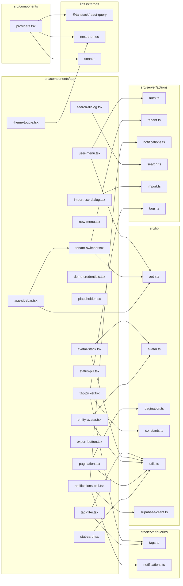

# 08. Componentes do app — shell e widgets compartilhados

> 19 arquivos de código · 19 fichas completas · 0 em tabela de exceção.

Este módulo reúne o "esqueleto" visual do Orbit CRM e os widgets genéricos reaproveitados por várias telas: o provedor global de tema/React Query (`providers.tsx`), a barra lateral de navegação, e os componentes do cabeçalho (troca de empresa, menu do usuário, sino de notificações, busca, tema, botão "Novo"). Também cobre os pedaços reutilizáveis de listagem/detalhe (paginação, card de indicador, pill de status, avatar de entidade, pilha de avatares, exportação/importação CSV, tags). A maioria são client components (`"use client"`) porque lidam com estado, transições e chamadas a actions; os puramente visuais são server components. Onde eles aparecem no fluxo de navegação e a que actions se ligam está descrito em [processos](../02-processos.md) §2 e os papéis de acesso em [regras e convenções](../05-regras-e-convencoes.md) §5. As tabelas citadas (`notifications`, `tags`, `taggables`, `companies`, `leads`, `tenants`, `memberships`, `profiles`) estão em [modelo de dados](../04-modelo-de-dados.md) §4.

## Diagrama de dependências do módulo

## Fichas

### `src/components/providers.tsx`
**Propósito:** Componente raiz cliente que envolve toda a aplicação com os provedores globais (tema, React Query, tooltip e toaster).
**Processo:** Cria um `QueryClient` único via `useState` com `staleTime: 30_000` e `refetchOnWindowFocus: false`. Renderiza `ThemeProvider` (next-themes, `attribute="class"`, tema `system`) por fora, depois `QueryClientProvider`, `TooltipProvider` e `Toaster` (sonner, `richColors`, `position="top-right"`) por dentro, passando `children`.
**Estado:** `implementado`
**Testes:** sem teste.
**Depende de:**
- `@tanstack/react-query`: cliente e provider de cache/mutações.
- `next-themes`: tema claro/escuro via classe.
- `@/components/ui/sonner`: `Toaster` de notificações.
- `@/components/ui/tooltip`: `TooltipProvider`.
**Usado por:** `src/app/layout.tsx` (root layout).
**Bibliotecas externas:** `@tanstack/react-query`, `next-themes`, `sonner`.
**O que renderiza e quais actions chama:** não renderiza UI própria; só empilha providers. Não chama actions/queries.

### `src/components/app/app-sidebar.tsx`
**Propósito:** Barra lateral (`Sidebar` colapsável) com o logotipo/seletor de empresa e todos os links de navegação do app.
**Processo:** Recebe `memberships` e `activeTenantId`. No cabeçalho renderiza `TenantSwitcher`. Monta a lista `NAV_ITEMS` (17 rotas `/app/...` com ícones `lucide-react`) e gera cada item num `SidebarMenuButton` com `render={<Link>}`, marcando `isActive` quando `usePathname() === item.href`.
**Estado:** `implementado`
**Testes:** sem teste.
**Depende de:**
- `./tenant-switcher`: seletor de empresa no topo.
- `@/components/ui/sidebar`: primitivos `Sidebar*`.
- `@/lib/auth`: tipo `Membership`.
- `next/link`, `next/navigation`: links e `usePathname`.
**Usado por:** `src/app/app/layout.tsx`.
**Bibliotecas externas:** `lucide-react`, `next`.
**O que renderiza e quais actions chama:** menu lateral de navegação. Não chama actions diretamente (a troca de empresa fica no `TenantSwitcher`).

### `src/components/app/user-menu.tsx`
**Propósito:** Menu do usuário logado (avatar com iniciais) no cabeçalho, com a opção "Sair".
**Processo:** Calcula iniciais a partir de `full_name` ou do prefixo do e-mail. Renderiza um `DropdownMenu` que mostra nome/e-mail e um item destrutivo que dispara `startTransition(() => signOutAction())`; enquanto `isPending` o item fica desabilitado.
**Estado:** `implementado`
**Testes:** sem teste.
**Depende de:**
- `@/server/actions/auth`: `signOutAction`.
- `@/lib/auth`: tipo `Profile`.
- `@/components/ui/avatar`, `@/components/ui/dropdown-menu`: UI.
**Usado por:** `src/app/app/layout.tsx`.
**Bibliotecas externas:** `lucide-react`, React (`useTransition`).
**O que renderiza e quais actions chama:** avatar + dropdown. Chama a action `signOutAction` (encerra a sessão Supabase e redireciona para `/login`).

### `src/components/app/tenant-switcher.tsx`
**Propósito:** Dropdown para trocar a empresa (tenant) ativa entre as memberships do usuário.
**Processo:** Resolve a membership ativa por `activeTenantId` (fallback para a primeira); se não houver, retorna `null`. Mostra nome e papel traduzido (Proprietário/Administrador/Membro). Cada item chama `startTransition(() => setActiveTenantAction(tenant.id))`.
**Estado:** `implementado`
**Testes:** sem teste.
**Depende de:**
- `@/server/actions/tenant`: `setActiveTenantAction` (grava cookie `orbit.tenant` e redireciona para `/app`).
- `@/lib/auth`: tipo `Membership`.
- `@/components/ui/dropdown-menu`, `@/components/ui/sidebar`: UI.
**Usado por:** `src/components/app/app-sidebar.tsx`.
**Bibliotecas externas:** `lucide-react`, React (`useTransition`).
**O que renderiza e quais actions chama:** seletor de empresa. Chama `setActiveTenantAction`; a validação de acesso fica na própria action (`getMemberships`).

### `src/components/app/notifications-bell.tsx`
**Propósito:** Sino de notificações com contador de não lidas, lista suspensa e atualização em tempo real.
**Processo:** Recebe `notifications` e `unread`. Num `useEffect` cria o cliente Supabase do browser, pega o usuário e assina `postgres_changes` na tabela `notifications` filtrando `user_id=eq.<id>`, chamando `router.refresh()` a cada evento; limpa o canal no cleanup. Renderiza badge com contagem (máx. `9+`), botão "Marcar lidas" (`markAllNotificationsReadAction`), e cada item vira `Link` para `notification.url` (`render={<Link>}`) e, ao clicar, chama `markNotificationReadAction({ id })`.
**Estado:** `implementado`
**Testes:** sem teste.
**Depende de:**
- `@/lib/supabase/client`: `createClient` (realtime).
- `@/server/actions/notifications`: `markNotificationReadAction`, `markAllNotificationsReadAction`.
- `@/server/queries/notifications`: tipo `NotificationRow`.
- `@/components/ui/dropdown-menu`: UI.
**Usado por:** `src/app/app/layout.tsx`.
**Bibliotecas externas:** `lucide-react`, `next`, `@supabase/supabase-js` (realtime), React.
**O que renderiza e quais actions chama:** sino + dropdown de notificações. Chama as actions de marcar lida; escuta realtime da tabela `notifications`.

### `src/components/app/theme-toggle.tsx`
**Propósito:** Botão que alterna entre tema claro e escuro.
**Processo:** Usa `useTheme()` (next-themes) e um estado `mounted` (evita hydration mismatch). Lê `resolvedTheme`; ao clicar chama `setTheme(isDark ? "light" : "dark")`. Mostra ícone `Sun` quando escuro e `Moon` caso contrário.
**Estado:** `implementado`
**Testes:** sem teste.
**Depende de:**
- `@/components/ui/button`: botão icon.
- `next-themes`: `useTheme`.
**Usado por:** `src/app/app/layout.tsx`.
**Bibliotecas externas:** `next-themes`, `lucide-react`, React.
**O que renderiza e quais actions chama:** botão de tema. Não chama actions/queries.

### `src/components/app/new-menu.tsx`
**Propósito:** Botão "Novo" no cabeçalho com atalhos para criar os principais registros.
**Processo:** Renderiza um `DropdownMenu` cujo gatilho é um `Button` com `Plus`. Percorre `ITEMS` (Cliente, Projeto, Tarefa, Orçamento, Fatura) e cria um `DropdownMenuItem` por rota usando `render={<Link href>}`.
**Estado:** `implementado`
**Testes:** sem teste.
**Depende de:**
- `@/components/ui/button`, `@/components/ui/dropdown-menu`: UI.
**Usado por:** `src/app/app/layout.tsx`.
**Bibliotecas externas:** `lucide-react`, `next`.
**O que renderiza e quais actions chama:** botão + menu de atalhos de navegação. Não chama actions.

### `src/components/app/search-dialog.tsx`
**Propósito:** Modal de busca global por clientes, projetos e tarefas.
**Processo:** Mantém estado `open`, `query`, `results`. Ao digitar (`run`) faz `startTransition(async () => setResults(await searchAction(value)))`. Mostra "Buscando..." durante a transição e "Nada encontrado." quando há termo (>=2 chars) sem resultado; lista cada `SearchResult` como `Link` para `result.href` com rótulo do tipo. Ao fechar, limpa query/resultados.
**Estado:** `implementado`
**Testes:** sem teste.
**Depende de:**
- `@/server/actions/search`: `searchAction`, tipo `SearchResult`.
- `@/components/ui/dialog`, `@/components/ui/input`: UI.
**Usado por:** `src/app/app/layout.tsx`.
**Bibliotecas externas:** `lucide-react`, `next`, React (`useState`, `useTransition`).
**O que renderiza e quais actions chama:** diálogo de busca. Chama `searchAction` (server action) a cada digitação.

### `src/components/app/demo-credentials.tsx`
**Propósito:** Bloco informativo nas telas de login que mostra credenciais demo e permite preencher o formulário com um clique.
**Processo:** Recebe `email`, `password` e `label`. Exibe os dados em fonte monoespaçada e um botão que, via `document.querySelector("#email")/#password`, escreve os valores nos campos e marca `filled`. O rótulo do botão muda para "Credenciais preenchidas".
**Estado:** `implementado`
**Testes:** sem teste.
**Depende de:**
- `@/components/ui/button`: UI.
**Usado por:** `src/app/(auth)/login/page.tsx`, `src/app/portal/login/page.tsx`.
**Bibliotecas externas:** React (`useState`).
**O que renderiza e quais actions chama:** card de credenciais demo. Não chama actions; manipula o DOM do formulário de login.

### `src/components/app/placeholder.tsx`
**Propósito:** Placeholder de tela "em construção" com título e descrição.
**Processo:** Componente puro (sem hooks) que recebe `title` e `description` e renderiza um cabeçalho e um bloco tracejado "Em construção — previsto para a Fase 1.".
**Estado:** `implementado` (mas sem uso no código atual — busca por `Placeholder` só encontra a própria definição).
**Testes:** sem teste.
**Depende de:** nenhum arquivo do projeto.
**Usado por:** nenhum (não há imports; aparentemente reservado para telas futuras).
**Bibliotecas externas:** nenhuma.
**O que renderiza e quais actions chama:** título + descrição + caixa vazia. Não chama actions.

### `src/components/app/stat-card.tsx`
**Propósito:** Card de indicador (KPI) com ícone, valor e rótulo, em cinco tons de cor.
**Processo:** Recebe `label`, `value`, `icon` (LucideIcon) e `tone` (default `primary`). Renderiza um `Card` cujo conteúdo mostra um quadrado colorido (`TONES[tone]` via `cn`) com o ícone e, ao lado, valor em destaque e rótulo.
**Estado:** `implementado`
**Testes:** sem teste.
**Depende de:**
- `@/lib/utils`: `cn`.
- `@/components/ui/card`: UI.
**Usado por:** `src/app/app/page.tsx`, `src/app/app/relatorios/page.tsx`, `src/app/portal/(portal)/page.tsx`.
**Bibliotecas externas:** `lucide-react` (tipo `LucideIcon`).
**O que renderiza e quais actions chama:** card de métrica. Não chama actions/queries (recebe valor pronto por props).

### `src/components/app/pagination.tsx`
**Propósito:** Controle de paginação por query string com botões "Anterior"/"Próxima".
**Processo:** Recebe `page`, `total`, `pageSize` (default `PAGE_SIZE`) e `hrefFor(page)`. Calcula `totalPages` e retorna `null` se sobra só uma página. Mostra "Página X de Y · N registro(s)" e renderiza `Link`s (ou `span` desabilitado) com `hrefFor(page±1)`.
**Estado:** `implementado`
**Testes:** sem teste.
**Depende de:**
- `@/lib/utils`: `cn`.
- `@/lib/pagination`: `PAGE_SIZE`.
- `next/link`: navegação.
**Usado por:** `src/components/app/time-entries-table.tsx`, `src/app/app/orcamentos/page.tsx`, `src/app/app/despesas/page.tsx`, `src/app/app/atividades/page.tsx`, `src/app/app/contratos/page.tsx`, `src/app/app/clientes/page.tsx`, `src/app/app/leads/page.tsx`, `src/app/app/tickets/page.tsx`, `src/app/app/projetos/page.tsx`, `src/app/app/faturas/page.tsx`, `src/app/app/tarefas/page.tsx`.
**Bibliotecas externas:** `next`.
**O que renderiza e quais actions chama:** paginação. Não chama actions; a página monta `hrefFor` com o parâmetro `page`.

### `src/components/app/status-pill.tsx`
**Propósito:** Pill/badge colorido para exibir o nome de um status com um ponto na cor correspondente.
**Processo:** Recebe `name` e `color`; renderiza um `Badge` `secondary` com um círculo colorido (`style={{ backgroundColor: color }}`) e o nome.
**Estado:** `implementado`
**Testes:** sem teste.
**Depende de:**
- `@/components/ui/badge`: UI.
**Usado por:** `src/app/app/leads/[id]/page.tsx`, `src/app/app/leads/page.tsx`, `src/app/app/relatorios/page.tsx`.
**Bibliotecas externas:** nenhuma.
**O que renderiza e quais actions chama:** pill de status. Não chama actions/queries.

### `src/components/app/entity-avatar.tsx`
**Propósito:** Avatar quadrado com iniciais e cor derivada do nome, para clientes e entidades.
**Processo:** Recebe `name` e `className`. Aplica `colorFor(name)` como cor de fundo e `initialsOf(name)` como conteúdo inicial, combinando classes com `cn`.
**Estado:** `implementado`
**Testes:** sem teste.
**Depende de:**
- `@/lib/avatar`: `colorFor`, `initialsOf`.
- `@/lib/utils`: `cn`.
**Usado por:** `src/app/app/clientes/page.tsx`, `src/app/app/tarefas/task-detail-dialog.tsx`.
**Bibliotecas externas:** nenhuma.
**O que renderiza e quais actions chama:** avatar com iniciais. Não chama actions/queries.

### `src/components/app/avatar-stack.tsx`
**Propósito:** Pilha de avatares circulares (membros de um projeto) com contador de excedentes.
**Processo:** Recebe `people` e `max` (default 4). Se vazio, retorna `null`. Mostra até `max` avatares sobrepostos (`-ml-2`, cor via `colorFor`, iniciais via `initialsOf`, `title` com o nome) e um badge `+extra` quando sobra gente.
**Estado:** `implementado`
**Testes:** sem teste.
**Depende de:**
- `@/lib/avatar`: `colorFor`, `initialsOf`.
- `@/lib/utils`: `cn`.
**Usado por:** `src/app/app/projetos/page.tsx`.
**Bibliotecas externas:** nenhuma.
**O que renderiza e quais actions chama:** pilha de avatares. Não chama actions/queries.

### `src/components/app/export-button.tsx`
**Propósito:** Botão de "Exportar CSV" que aponta para uma URL de download.
**Processo:** Recebe `href` e renderiza um `Button` (variant `outline`, `nativeButton={false}`) que vira `<a href>` via `render`, com ícone `Download`.
**Estado:** `implementado`
**Testes:** sem teste.
**Depende de:**
- `@/components/ui/button`: UI.
**Usado por:** `src/app/app/orcamentos/page.tsx`, `src/app/app/timesheet/page.tsx`, `src/app/app/despesas/page.tsx`, `src/app/app/clientes/page.tsx`, `src/app/app/leads/page.tsx`, `src/app/app/faturas/page.tsx`.
**Bibliotecas externas:** `lucide-react`.
**O que renderiza e quais actions chama:** botão/link de exportação. Não chama action; dispara um GET para a rota de exportação informada em `href`.

### `src/components/app/import-csv-dialog.tsx`
**Propósito:** Diálogo genérico de importação de CSV, parametrizado pela action de import.
**Processo:** Recebe `action` (server action no formato `useActionState`), `hint` e `label`. Usa `useActionState(action, undefined)`; num `useEffect` exibe toasts de sucesso/erro (até 3 erros) e fecha o diálogo. Renderiza um formulário com `input type="file"` (`name="file"`, aceita CSV, obrigatório) e botões Cancelar/Importar.
**Estado:** `implementado`
**Testes:** sem teste.
**Depende de:**
- `@/server/actions/import`: tipo `ImportState`.
- `@/components/ui/dialog`, `@/components/ui/input`, `@/components/ui/label`, `@/components/ui/button`: UI.
**Usado por:** `src/app/app/clientes/page.tsx` (passa `importCompaniesAction`), `src/app/app/leads/page.tsx` (passa `importLeadsAction`).
**Bibliotecas externas:** `sonner`, React (`useActionState`).
**O que renderiza e quais actions chama:** diálogo de upload CSV. Chama a action recebida por prop (`importCompaniesAction`/`importLeadsAction`), que lê a tabela correspondente (`companies` ou `leads`).

### `src/components/app/tag-filter.tsx`
**Propósito:** Filtro horizontal de tags por query string nas telas de listagem.
**Processo:** Recebe `tags`, `active` e `hrefFor(tagId | null)`. Se não há tags, retorna `null`. Renderiza um link "Todas as tags" mais um link por tag (com ponto colorido), destacando o ativo via `cn`.
**Estado:** `implementado`
**Testes:** sem teste.
**Depende de:**
- `@/server/queries/tags`: tipo `Tag`.
- `@/lib/utils`: `cn`.
- `next/link`: navegação.
**Usado por:** `src/app/app/clientes/page.tsx`, `src/app/app/leads/page.tsx`, `src/app/app/projetos/page.tsx`, `src/app/app/tickets/page.tsx`, `src/app/app/tarefas/page.tsx`.
**Bibliotecas externas:** `next`.
**O que renderiza e quais actions chama:** filtro por tag. Não chama actions; a página monta `hrefFor` com o parâmetro de tag.

### `src/components/app/tag-picker.tsx`
**Propósito:** Seletor de tags de uma entidade (atribuir/remover) com criação inline, além do diálogo interno de nova tag.
**Processo:** Exporta `TagPicker` e o componente local `TagCreateDialog`. `TagPicker` recebe `entityType`, `entityId`, `assigned` e `all`; mantém o conjunto de ids atribuídos e um estado `createOpen`. Remover/atribuir dispara `startTransition(() => setEntityTagAction({ tagId, entityType, entityId, assign }))`. O dropdown lista as tags como `DropdownMenuCheckboxItem` (`onCheckedChange` chama `setTag`) e um item "Nova tag…" que abre `TagCreateDialog`. O diálogo usa `useActionState(createTagForEntityAction)` com campos ocultos `entity_type`/`entity_id`, escolha de cor (`TAG_COLORS`) e toasts de sucesso/erro.
**Estado:** `implementado`
**Testes:** sem teste.
**Depende de:**
- `@/server/actions/tags`: `createTagForEntityAction`, `setEntityTagAction`, tipo `TagFormState`.
- `@/server/queries/tags`: tipos `Tag`, `TaggedEntityType`.
- `@/lib/constants`: `TAG_COLORS`.
- `@/components/ui/*` (button, dialog, dropdown-menu, input, label): UI.
**Usado por:** `src/app/app/clientes/[id]/page.tsx`, `src/app/app/tickets/[id]/page.tsx`, `src/app/app/leads/[id]/page.tsx`, `src/app/app/projetos/[id]/page.tsx`, `src/app/app/tarefas/[id]/page.tsx`.
**Bibliotecas externas:** `sonner`, `lucide-react`, React (`useActionState`, `useEffect`, `useState`, `useTransition`).
**O que renderiza e quais actions chama:** chips de tags + dropdown + diálogo de criação. Chama `setEntityTagAction` (grava/apaga em `taggables`) e `createTagForEntityAction` (insere em `tags` e `taggables`).

## Tabela das fichas do módulo

| § | Arquivo | Propósito em 1 linha |
|---|---------|----------------------|
| §08.1 | `src/components/providers.tsx` | Provedores globais (tema, React Query, tooltip, toaster). |
| §08.2 | `src/components/app/app-sidebar.tsx` | Barra lateral com navegação e seletor de empresa. |
| §08.3 | `src/components/app/user-menu.tsx` | Menu do usuário com opção de sair. |
| §08.4 | `src/components/app/tenant-switcher.tsx` | Troca a empresa ativa. |
| §08.5 | `src/components/app/notifications-bell.tsx` | Sino de notificações com contador e realtime. |
| §08.6 | `src/components/app/theme-toggle.tsx` | Alterna tema claro/escuro. |
| §08.7 | `src/components/app/new-menu.tsx` | Botão "Novo" com atalhos de criação. |
| §08.8 | `src/components/app/search-dialog.tsx` | Busca global por clientes, projetos e tarefas. |
| §08.9 | `src/components/app/demo-credentials.tsx` | Credenciais demo nas telas de login. |
| §08.10 | `src/components/app/placeholder.tsx` | Tela "em construção" (sem uso atual). |
| §08.11 | `src/components/app/stat-card.tsx` | Card de KPI com ícone, valor e rótulo. |
| §08.12 | `src/components/app/pagination.tsx` | Paginação por query string. |
| §08.13 | `src/components/app/status-pill.tsx` | Badge de status colorido. |
| §08.14 | `src/components/app/entity-avatar.tsx` | Avatar quadrado com iniciais e cor do nome. |
| §08.15 | `src/components/app/avatar-stack.tsx` | Pilha de avatares de membros. |
| §08.16 | `src/components/app/export-button.tsx` | Botão/link de exportação CSV. |
| §08.17 | `src/components/app/import-csv-dialog.tsx` | Diálogo genérico de importação CSV. |
| §08.18 | `src/components/app/tag-filter.tsx` | Filtro horizontal de tags. |
| §08.19 | `src/components/app/tag-picker.tsx` | Seletor/criador de tags de uma entidade. |
