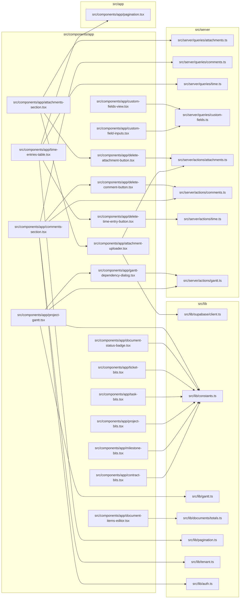

# 09. Componentes de domínio (anexos, comentários, horas, documentos, Gantt e bits)

> 18 arquivos de código · 18 fichas completas · 0 em tabela de exceção.

Este módulo reúne componentes de UI que dão suporte a conceitos de negócio do Orbit CRM: painéis de **anexos** e **comentários** (com upload/download no Supabase Storage), botões de remoção (anexo, comentário, apontamento de horas), a **tabela de apontamentos** com resumo de tempo/faturamento, um conjunto de selos de status ("bits") para projeto, tarefa, ticket, marco, contrato e documentos, inputs/exibição de **campos personalizados**, o editor de itens de documentos (orçamento/fatura) e o **Gantt** interativo de projeto com diálogo de dependências. A maioria são componentes de apresentação que chamam **server actions** (`src/server/actions/*`) ou leem via **queries RSC** (`src/server/queries/*`); os que precisam de interatividade (upload, drag no Gantt, editor de itens) são client components (`"use client"`). Contexto de tenant, papéis e isolamento em [regras e convenções](../05-regras-e-convencoes.md) §5; tabelas tocadas em [modelo de dados](../04-modelo-de-dados.md) §4.

## Diagrama de dependências do módulo

## Fichas

### `src/components/app/attachments-section.tsx`

**Propósito:** painel de anexos de uma entidade (tarefa, projeto ou ticket): lista os arquivos já enviados e oferece o uploader e o botão de remover.
**Processo:** é um componente RSC assíncrono. No servidor chama `listAttachments(tenantId, entityType, entityId)` (query que lê a tabela `attachments`) e renderiza um `Card` "Anexos". Para cada anexo mostra um link (`attachment.url`) que abre em nova aba, o nome (`file_name`) e o tamanho formatado por `humanSize` (B/KB/MB). Cabeçalho traz `<AttachmentUploader>`; cada linha traz `<DeleteAttachmentButton>`. Se não houver anexos, mostra "Nenhum anexo ainda.".
**Estado:** `implementado`.
**Testes:** sem teste (não há teste para `AttachmentsSection` em `tests/`).
**Depende de:**
- `src/server/queries/attachments.ts`: `listAttachments` (lê a tabela `attachments`).
- `src/components/app/attachment-uploader.tsx`: `AttachmentUploader`.
- `src/components/app/delete-attachment-button.tsx`: `DeleteAttachmentButton`.
- `src/components/ui/card.tsx`: `Card`, `CardContent`, `CardHeader`, `CardTitle`.
- Tabelas: lê `attachments`.
- **Renderiza:** cabeçalho "Anexos" com uploader e a lista de anexos com tamanho.
- **Actions chamadas:** nenhuma diretamente (delega aos filhos).

**Usado por:** `src/app/app/projetos/[id]/page.tsx`, `src/app/app/tickets/[id]/page.tsx`, `src/app/app/tarefas/[id]/page.tsx` (confirmado por Grep pelo nome `AttachmentsSection`).
**Bibliotecas externas:** `lucide-react` (ícone `FileText`).

### `src/components/app/attachment-uploader.tsx`

**Propósito:** botão/label client que envia um arquivo ao bucket `attachments` do Supabase Storage e registra o metadado no banco.
**Processo:** `"use client"`. `handleChange` (no `onChange` de um `<input type="file">` escondido) pega o primeiro arquivo, liga `isUploading`, cria o cliente com `createClient()` e monta o caminho `${tenantId}/${entityType}/${entityId}/${crypto.randomUUID()}-${sanitize(file.name)}` — `sanitize` troca caracteres fora de `[a-zA-Z0-9._-]` por `_` e corta nos últimos 120. Faz `supabase.storage.from("attachments").upload(path, file, { contentType, upsert: false })`; em caso de erro lança. Depois chama `registerAttachmentAction({ entityType, entityId, storagePath, fileName, mimeType, sizeBytes })` (server action) e, se retornar `error`, lança. Em sucesso mostra `toast.success("Anexo enviado.")` e `router.refresh()`; no `catch` mostra `toast.error`; no `finally` desliga `isUploading` e limpa o input. O label mostra "Anexar" ou "Enviando...".
**Estado:** `implementado`.
**Testes:** sem teste.
**Depende de:**
- `src/lib/supabase/client.ts`: `createClient()` (cliente do navegador).
- `src/server/actions/attachments.ts`: `registerAttachmentAction`.
- Storage: bucket `attachments` (upload).
- **Renderiza:** label estilizado com ícone de clipe e input de arquivo oculto.
- **Actions chamadas:** `registerAttachmentAction`.

**Usado por:** `src/components/app/attachments-section.tsx` (confirmado por Grep).
**Bibliotecas externas:** `react` (`useState`), `next/navigation` (`useRouter`), `sonner` (`toast`), `lucide-react` (`Paperclip`).

### `src/components/app/delete-attachment-button.tsx`

**Propósito:** botão client que remove um anexo (registro + arquivo no Storage) com confirmação.
**Processo:** `"use client"`. Renderiza um `<form action={deleteAttachmentAction}>` com campos ocultos `id`, `storage_path`, `entity_type`, `entity_id`. No `onSubmit`, se `confirm("Remover este anexo?")` for falso, chama `event.preventDefault()`. O submit dispara a server action `deleteAttachmentAction`, que apaga de `attachments` e chama `storage.from("attachments").remove([path])`.
**Estado:** `implementado`.
**Testes:** sem teste.
**Depende de:**
- `src/server/actions/attachments.ts`: `deleteAttachmentAction` (apaga `attachments` e o objeto no Storage).
- **Renderiza:** ícone de lixeira dentro de um form.
- **Actions chamadas:** `deleteAttachmentAction`.

**Usado por:** `src/components/app/attachments-section.tsx` (confirmado por Grep).
**Bibliotecas externas:** `lucide-react` (`Trash2`).

### `src/components/app/comments-section.tsx`

**Propósito:** painel de comentários de uma tarefa ou projeto, com lista, formulário de novo comentário e botão de remover para autor ou moderadores.
**Processo:** RSC assíncrono. Em paralelo chama `listComments(tenantId, entityType, entityId)` (lê `comments` e junta autores via `profiles`), `getUser()` e `getActiveMembership()`; define `canModerate = active?.role === "owner" || active?.role === "admin"`. Renderiza um `Card` com a lista (`author_name`, data formatada por `formatDateTime` em pt-BR, conteúdo em `whitespace-pre-wrap`) e, se `comment.author_id === user?.id || canModerate`, mostra `<DeleteCommentButton>`. Abaixo, um `<form action={addCommentAction}>` com campos ocultos `entity_type`/`entity_id`, um `Textarea` `content` (obrigatório) e o botão "Comentar".
**Estado:** `implementado`.
**Testes:** sem teste.
**Depende de:**
- `src/server/queries/comments.ts`: `listComments` (lê `comments`, `profiles`).
- `src/server/actions/comments.ts`: `addCommentAction` (insere em `comments`).
- `src/lib/tenant.ts`: `getActiveMembership` (papel do usuário).
- `src/lib/auth.ts`: `getUser`.
- `src/components/app/delete-comment-button.tsx`: `DeleteCommentButton`.
- `src/components/ui/card.tsx`, `src/components/ui/button.tsx`, `src/components/ui/textarea.tsx`.
- Tabelas: lê `comments`, `profiles`; escreve `comments` (via action).
- **Renderiza:** card "Comentários" com lista + formulário.
- **Actions chamadas:** `addCommentAction` (e `deleteCommentAction` via filho).

**Usado por:** `src/app/app/tarefas/[id]/page.tsx`, `src/app/app/projetos/[id]/page.tsx` (confirmado por Grep).
**Bibliotecas externas:** nenhuma relevante.

### `src/components/app/delete-comment-button.tsx`

**Propósito:** botão client que remove um comentário, com confirmação.
**Processo:** `"use client"`. `<form action={deleteCommentAction}>` com campo oculto `id`; `onSubmit` cancela se o usuário recusar `confirm("Remover este comentário?")`. O submit chama `deleteCommentAction`, que confere permissão (autor ou moderador) e apaga de `comments`.
**Estado:** `implementado`.
**Testes:** sem teste.
**Depende de:**
- `src/server/actions/comments.ts`: `deleteCommentAction` (apaga `comments`).
- `src/components/ui/button.tsx`: `Button` (variant `ghost`).
- **Renderiza:** botão "Remover".
- **Actions chamadas:** `deleteCommentAction`.

**Usado por:** `src/components/app/comments-section.tsx` (confirmado por Grep).
**Bibliotecas externas:** nenhuma.

### `src/components/app/delete-time-entry-button.tsx`

**Propósito:** botão client que remove um apontamento de horas, com confirmação.
**Processo:** `"use client"`. `<form action={deleteTimeEntryAction}>` com campo oculto `id`; `onSubmit` cancela se o usuário recusar `confirm("Remover este apontamento?")`. O submit chama `deleteTimeEntryAction`, que apaga a linha em `time_entries`.
**Estado:** `implementado`.
**Testes:** sem teste.
**Depende de:**
- `src/server/actions/time.ts`: `deleteTimeEntryAction` (apaga `time_entries`).
- **Renderiza:** ícone de lixeira.
- **Actions chamadas:** `deleteTimeEntryAction`.

**Usado por:** `src/components/app/time-entries-table.tsx` (confirmado por Grep).
**Bibliotecas externas:** `lucide-react` (`Trash2`).

### `src/components/app/time-entries-table.tsx`

**Propósito:** tabela de apontamentos de horas com totais (duração e valor faturável), usada tanto em contexto de projeto/tarefa quanto globalmente com paginação.
**Processo:** RSC assíncrono. Se receber `page` (e `paginationBasePath`), usa `listTimeEntriesPage(tenantId, { page, pageSize: PAGE_SIZE, projectId, taskId })`; senão usa `listTimeEntries(tenantId, { projectId, taskId })`. Sempre chama `summarizeTimeEntries(tenantId, { projectId, taskId })` para os totais. Renderiza um `Card` com cabeçalho (título, `formatDuration(total)` e `currency(amount)`); a tabela mostra colunas condicionais: `Usuário` só se `showUser`, `Projeto` só se **não** houver `projectId`, `Tarefa` só se **não** houver `taskId`. Para cada linha calcula duração (usa `duration_seconds` ou, se nulo, o tempo desde `started_at`, marcando "(em andamento)" quando `ended_at === null`), faturável (`is_billable`) e valor (`entryValue` com `rate`). A última coluna tem `<DeleteTimeEntryButton>`. Se paginado, renderiza `<Pagination>` cujos links são `${paginationBasePath}?page=N` (página 1 sem query).
**Estado:** `implementado`.
**Testes:** sem teste.
**Depende de:**
- `src/server/queries/time.ts`: `listTimeEntries`, `listTimeEntriesPage`, `summarizeTimeEntries`, `formatDuration` (leem `time_entries`, agregam).
- `src/lib/pagination.ts`: `PAGE_SIZE` (= 20).
- `src/components/app/pagination.tsx`: `Pagination`.
- `src/components/app/delete-time-entry-button.tsx`: `DeleteTimeEntryButton`.
- `src/components/ui/card.tsx`, `src/components/ui/table.tsx`.
- Tabelas: lê `time_entries` (e relacionamentos de `projects`/`tasks` na query).
- **Renderiza:** card com total/faturável e tabela de apontamentos; opcionalmente paginação.
- **Actions chamadas:** `deleteTimeEntryAction` (via filho).

**Usado por:** `src/app/app/projetos/[id]/page.tsx`, `src/app/app/tarefas/[id]/page.tsx`, `src/app/app/timesheet/page.tsx` (confirmado por Grep).
**Bibliotecas externas:** nenhuma relevante (`Intl` nativo para moeda).

### `src/components/app/contract-bits.tsx`

**Propósito:** selo (`Badge`) que exibe o status de um contrato e destaca quando está vencido.
**Processo:** `ContractStatusBadge({ status, endDate })` busca a configuração em `CONTRACT_STATUSES[status]`; se não existir, retorna `null`. Calcula `expired` quando `status === 1` (ativo) e `endDate` é anterior a hoje. Renderiza um `Badge` com bolinha colorida (`config.color` ou laranja `#f59e0b` se vencido) e o rótulo `config.label` — ou "Vencido".
**Estado:** `implementado`.
**Testes:** sem teste.
**Depende de:**
- `src/lib/constants.ts`: `CONTRACT_STATUSES` e o tipo `ContractStatus`.
- `src/components/ui/badge.tsx`: `Badge`.
- **Renderiza:** badge de status de contrato.

**Usado por:** `src/app/app/contratos/page.tsx`, `src/app/portal/(portal)/contratos/page.tsx` (confirmado por Grep).
**Bibliotecas externas:** nenhuma.

### `src/components/app/milestone-bits.tsx`

**Propósito:** selo que exibe o status de um marco (milestone) de projeto.
**Processo:** `MilestoneStatusBadge({ status })` lê `MILESTONE_STATUSES[status]`; se não existir, retorna `null`. Renderiza `Badge` com bolinha (`config.color`) e `config.label`.
**Estado:** `implementado`.
**Testes:** sem teste.
**Depende de:**
- `src/lib/constants.ts`: `MILESTONE_STATUSES` e o tipo `MilestoneStatus`.
- `src/components/ui/badge.tsx`: `Badge`.
- **Renderiza:** badge de status de marco.

**Usado por:** `src/app/app/projetos/[id]/page.tsx`, `src/app/portal/(portal)/projetos/[id]/page.tsx` (confirmado por Grep).
**Bibliotecas externas:** nenhuma.

### `src/components/app/project-bits.tsx`

**Propósito:** reúne dois elementos visuais de projeto: o selo de status e a barra de progresso.
**Processo:** `ProjectStatusBadge({ status })` lê `PROJECT_STATUSES[status]` (retorna `null` se ausente) e renderiza `Badge` com bolinha + rótulo. `ProgressBar({ value })` trava o valor entre 0 e 100 (`Math.max(0, Math.min(100, value))`) e desenha uma barra `bg-primary` com largura em `%`, seguida do texto "N%".
**Estado:** `implementado`.
**Testes:** sem teste.
**Depende de:**
- `src/lib/constants.ts`: `PROJECT_STATUSES` e o tipo `ProjectStatus`.
- `src/components/ui/badge.tsx`: `Badge`.
- **Renderiza:** badge de status e barra de progresso.

**Usado por:** `src/app/app/page.tsx`, `src/app/app/projetos/[id]/page.tsx`, `src/app/portal/(portal)/page.tsx`, `src/app/portal/(portal)/projetos/[id]/page.tsx`, `src/app/portal/(portal)/projetos/page.tsx` (confirmado por Grep).
**Bibliotecas externas:** nenhuma.

### `src/components/app/task-bits.tsx`

**Propósito:** selos de **status** e **prioridade** de tarefa.
**Processo:** `TaskStatusBadge({ status })` lê `TASK_STATUSES[status]`; `TaskPriorityBadge({ priority })` lê `TASK_PRIORITIES[priority]`. Ambos retornam `null` se a chave não existir e renderizam `Badge` com bolinha (`config.color`) e `config.label`.
**Estado:** `implementado`.
**Testes:** sem teste.
**Depende de:**
- `src/lib/constants.ts`: `TASK_STATUSES`, `TASK_PRIORITIES`.
- `src/components/ui/badge.tsx`: `Badge`.
- **Renderiza:** badges de status/prioridade de tarefa.

**Usado por:** `src/app/app/projetos/[id]/page.tsx`, `src/app/app/tarefas/[id]/page.tsx`, `src/app/app/tarefas/task-detail-dialog.tsx`, `src/app/portal/(portal)/projetos/[id]/page.tsx` (confirmado por Grep).
**Bibliotecas externas:** nenhuma.

### `src/components/app/ticket-bits.tsx`

**Propósito:** selos de **status**, **prioridade** e **tipo** de ticket.
**Processo:** `TicketStatusBadge({ status })` lê `TICKET_STATUSES[status]`; `TicketPriorityBadge({ priority })` lê `TICKET_PRIORITIES[priority]` — ambos retornam `null` se a chave não existir e renderizam `Badge` com bolinha + rótulo. `TicketTypeBadge({ type })` lê `TICKET_TYPES[type]` e renderiza `Badge variant="outline"` só com o rótulo (sem cor).
**Estado:** `implementado`.
**Testes:** sem teste.
**Depende de:**
- `src/lib/constants.ts`: `TICKET_STATUSES`, `TICKET_PRIORITIES`, `TICKET_TYPES`.
- `src/components/ui/badge.tsx`: `Badge`.
- **Renderiza:** badges de status/prioridade/tipo de ticket.

**Usado por:** `src/app/app/tickets/page.tsx`, `src/app/app/tickets/[id]/page.tsx`, `src/app/portal/(portal)/tickets/page.tsx`, `src/app/portal/(portal)/tickets/[id]/page.tsx` (confirmado por Grep).
**Bibliotecas externas:** nenhuma.

### `src/components/app/custom-field-inputs.tsx`

**Propósito:** renderiza os campos personalizados de uma entidade como inputs de formulário (texto, número, data, select, textarea, checkbox) para uso dentro de dialogs de criação/edição.
**Processo:** recebe `fields: CustomFieldDefinition[]` e `values?` (mapa `id → string`). Se não houver campos, retorna `null`. Para cada campo monta `name = "cf_<key>"` e `value = values?.[field.id] ?? ""`. `checkbox` vira um `<input type="checkbox">` com `defaultChecked={value === "true"}`; `textarea` vira `Textarea`; `select` vira `<select>` com as `options`; os demais viram `Input` com `type` derivado (`number`/`date`/`text`). Campos obrigatórios ganham `required` e um "*" no label.
**Estado:** `implementado`.
**Testes:** sem teste.
**Depende de:**
- `src/server/queries/custom-fields.ts`: tipo `CustomFieldDefinition`.
- `src/components/ui/input.tsx`, `src/components/ui/label.tsx`, `src/components/ui/textarea.tsx`.
- **Renderiza:** grade de inputs de campos personalizados (prefixo de nome `cf_`).
- **Actions chamadas:** nenhuma (apenas campos de formulário; o submit é do dialog que o contém).

**Usado por:** `src/app/app/projetos/project-form-dialog.tsx`, `src/app/app/clientes/company-form-dialog.tsx`, `src/app/app/leads/lead-form-dialog.tsx`, `src/app/app/tarefas/task-form-dialog.tsx` (confirmado por Grep).
**Bibliotecas externas:** nenhuma relevante.

### `src/components/app/custom-fields-view.tsx`

**Propósito:** card somente-leitura que exibe os valores preenchidos dos campos personalizados de uma entidade (usado nas páginas de detalhe).
**Processo:** `CustomFieldsCard({ fields, values })` percorre os campos, resolve o texto com `displayValue` (checkbox → "Sim"/"Não"; date → data pt-BR; vazio/undefined → `null`) e filtra os nulos. Se não sobrar item, retorna `null`. Caso contrário, renderiza um `Card` "Campos personalizados" com uma `<dl>` de duas colunas (`label` + texto).
**Estado:** `implementado`.
**Testes:** sem teste.
**Depende de:**
- `src/server/queries/custom-fields.ts`: tipo `CustomFieldDefinition`.
- `src/components/ui/card.tsx`: `Card`, `CardContent`, `CardHeader`, `CardTitle`.
- **Renderiza:** card com pares label/valor dos campos personalizados.

**Usado por:** `src/app/app/clientes/[id]/page.tsx`, `src/app/app/leads/[id]/page.tsx`, `src/app/app/projetos/[id]/page.tsx`, `src/app/app/tarefas/[id]/page.tsx` (confirmado por Grep).
**Bibliotecas externas:** nenhuma.

### `src/components/app/document-items-editor.tsx`

**Propósito:** editor client de itens de orçamento/fatura: linhas com descrição, quantidade, valor e imposto, com adicionar/remover.
**Processo:** `"use client"`; recebe `items: LineItemInput[]` e `onChange`. `update(index, patch)` aplica alteração imutável a um item; `add()` acrescenta `{ description: "", qty: 1, rate: 0 }`; `remove(index)` filtra o item. Renderiza um grid de colunas fixas (Descrição, Qtd, Valor, Imp. %) com `Input`s controlados; o último item não pode ser removido (`disabled={items.length === 1}`). Botão "Adicionar item" chama `add()`. O estado vive no dialog pai, que recalcula os totais e envia ao servidor.
**Estado:** `implementado`.
**Testes:** sem teste.
**Depende de:**
- `src/lib/documents/totals.ts`: tipo `LineItemInput`.
- `src/components/ui/button.tsx`, `src/components/ui/input.tsx`.
- **Renderiza:** grade editável de itens de documento.
- **Actions chamadas:** nenhuma (o dialog pai faz o submit).

**Usado por:** `src/app/app/orcamentos/estimate-form-dialog.tsx`, `src/app/app/faturas/invoice-form-dialog.tsx` (confirmado por Grep).
**Bibliotecas externas:** `lucide-react` (`Plus`, `Trash2`).

### `src/components/app/document-status-badge.tsx`

**Propósito:** selos de status para orçamentos (estimates) e faturas (invoices), destacando faturas vencidas.
**Processo:** `StatusPill` é um helper interno que desenha um `Badge` com bolinha colorida. `EstimateStatusBadge({ status })` lê `ESTIMATE_STATUSES[status]` (retorna `null` se ausente) e mostra o pill. `InvoiceStatusBadge({ status, dueDate })` calcula `isOverdue` quando `status` é 1 (aberta) ou 3 (parcial?) e `dueDate` é anterior a hoje; nesse caso mostra "Vencida" em vermelho `#ef4444`; senão usa `INVOICE_STATUSES[status]`.
**Estado:** `implementado`.
**Testes:** sem teste.
**Depende de:**
- `src/lib/constants.ts`: `ESTIMATE_STATUSES`, `INVOICE_STATUSES`, tipos `EstimateStatus`, `InvoiceStatus`.
- `src/components/ui/badge.tsx`: `Badge`.
- **Renderiza:** badges de status de orçamento/fatura.

**Usado por:** `src/app/app/page.tsx`, `src/app/app/orcamentos/page.tsx`, `src/app/app/orcamentos/[id]/page.tsx`, `src/app/app/faturas/page.tsx`, `src/app/app/faturas/[id]/page.tsx`, `src/app/portal/(portal)/page.tsx`, `src/app/portal/(portal)/orcamentos/page.tsx`, `src/app/portal/(portal)/orcamentos/[id]/page.tsx`, `src/app/portal/(portal)/faturas/page.tsx`, `src/app/portal/(portal)/faturas/[id]/page.tsx` (confirmado por Grep).
**Bibliotecas externas:** nenhuma.

### `src/components/app/project-gantt.tsx`

**Propósito:** cronograma (Gantt) interativo do projeto: barras de tarefas e marcadores de marco posicionados por data, com arrastar para mover/reajustar, linha de "hoje" e setas de dependência.
**Processo:** `"use client"`. Recebe `projectId`, `tasks`, `milestones`, `dependencies`, `projectStart`, `projectDeadline` e `canEdit`. Monta a lista `items` (tarefas + marcos) aplicando overrides de `draft` (estado local otimista), filtrando itens sem datas. Calcula o intervalo (`min`/`max`), `totalDays`, `pxPerDay` e usa um `ResizeObserver` para medir `chartWidth`. Gera os rótulos de meses e a linha de hoje. `beginDrag` (no `onPointerDown` de alças/mover) guarda o estado do arrasto; os `pointermove`/`pointerup` em `window` calculam `delta` em dias (com `addDays` de `src/lib/gantt`) e, ao soltar, chamam `updateTaskScheduleAction({ id, projectId, start_date, due_date })`; erro faz `toast.error` e desfaz o `draft`. As dependências são desenhadas num `<svg>` sobreposto (setas com `marker`). Cada tarefa tem um link `/app/tarefas/<id>` e, quando `canEdit`, um `<GanttDependencyDialog>`. Sem itens, mostra mensagem pedindo datas.
**Estado:** `implementado`.
**Testes:** `tests/unit/gantt.test.ts` cobre apenas os helpers de `src/lib/gantt.ts` (não há teste do componente).
**Depende de:**
- `src/components/app/gantt-dependency-dialog.tsx`: `GanttDependencyDialog`.
- `src/server/actions/gantt.ts`: `updateTaskScheduleAction`.
- `src/lib/gantt.ts`: `addDays`.
- `src/lib/constants.ts`: `TASK_STATUSES` (cor da barra por status).
- Tabelas: escreve `tasks` (via action de cronograma); lê dados recebidos por props.
- **Renderiza:** Gantt com barras arrastáveis, marcos, linha de hoje e setas de dependência.
- **Actions chamadas:** `updateTaskScheduleAction` (e `addTaskDependencyAction`/`removeTaskDependencyAction` via diálogo).

**Usado por:** `src/app/app/projetos/[id]/page.tsx` (confirmado por Grep).
**Bibliotecas externas:** `react` (`useEffect`, `useRef`, `useState`), `next/link` (`Link`), `sonner` (`toast`).

### `src/components/app/gantt-dependency-dialog.tsx`

**Propósito:** diálogo client para ver, adicionar e remover dependências (predecessoras) de uma tarefa no Gantt.
**Processo:** `"use client"`. Usa `useActionState(addTaskDependencyAction)`; um `useEffect` dispara `toast` conforme `state.success`/`state.error`. Calcula `predecessors` (deps cujo `task_id` é a tarefa) e `candidates` (outras tarefas que ainda não são predecessoras). Renderiza um `Dialog` (trigger com ícone `Link2`): lista as predecessoras com `RemoveDependencyButton` e um `<form>` com `project_id`, `task_id` e um `<select name="depends_on_task_id">` + botão "Adicionar". `RemoveDependencyButton` usa um form cuja action chama `removeTaskDependencyAction` e mostra toast do resultado.
**Estado:** `implementado`.
**Testes:** sem teste.
**Depende de:**
- `src/server/actions/gantt.ts`: `addTaskDependencyAction`, `removeTaskDependencyAction`, tipo `GanttState`.
- `src/components/ui/*`: `dialog`, `button`, `label`.
- Tabelas: escreve/apaga as dependências de tarefas (via actions; tabela gerenciada em `src/server/actions/gantt.ts`).
- **Renderiza:** diálogo de dependências com lista de predecessoras e seletor.
- **Actions chamadas:** `addTaskDependencyAction`, `removeTaskDependencyAction`.

**Usado por:** `src/components/app/project-gantt.tsx` (confirmado por Grep).
**Bibliotecas externas:** `react` (`useActionState`, `useEffect`, `useState`), `sonner` (`toast`), `lucide-react` (`Link2`, `X`).

## Tabela das fichas do módulo

| § | Arquivo | Propósito em 1 linha |
|---|---------|----------------------|
| §09.1 | `src/components/app/attachments-section.tsx` | Painel que lista e gerencia anexos de tarefa/projeto/ticket. |
| §09.2 | `src/components/app/attachment-uploader.tsx` | Envia arquivo ao Storage e registra metadado via server action. |
| §09.3 | `src/components/app/delete-attachment-button.tsx` | Botão que remove anexo (registro + arquivo) com confirmação. |
| §09.4 | `src/components/app/comments-section.tsx` | Painel com lista e formulário de comentários de tarefa/projeto. |
| §09.5 | `src/components/app/delete-comment-button.tsx` | Botão que remove comentário com confirmação e checagem de permissão. |
| §09.6 | `src/components/app/delete-time-entry-button.tsx` | Botão que remove apontamento de horas com confirmação. |
| §09.7 | `src/components/app/time-entries-table.tsx` | Tabela de apontamentos com totais e paginação opcional. |
| §09.8 | `src/components/app/contract-bits.tsx` | Selo de status de contrato, destacando vencidos. |
| §09.9 | `src/components/app/milestone-bits.tsx` | Selo de status de marco de projeto. |
| §09.10 | `src/components/app/project-bits.tsx` | Selo de status de projeto e barra de progresso. |
| §09.11 | `src/components/app/task-bits.tsx` | Selos de status e prioridade de tarefa. |
| §09.12 | `src/components/app/ticket-bits.tsx` | Selos de status, prioridade e tipo de ticket. |
| §09.13 | `src/components/app/custom-field-inputs.tsx` | Inputs de formulário para campos personalizados. |
| §09.14 | `src/components/app/custom-fields-view.tsx` | Card somente-leitura com valores dos campos personalizados. |
| §09.15 | `src/components/app/document-items-editor.tsx` | Editor de itens de orçamento/fatura (adicionar/editar/remover). |
| §09.16 | `src/components/app/document-status-badge.tsx` | Selos de status de orçamento e fatura (com "Vencida"). |
| §09.17 | `src/components/app/project-gantt.tsx` | Gantt interativo com barras arrastáveis, marcos e dependências. |
| §09.18 | `src/components/app/gantt-dependency-dialog.tsx` | Diálogo para gerenciar dependências de tarefa no Gantt. |
