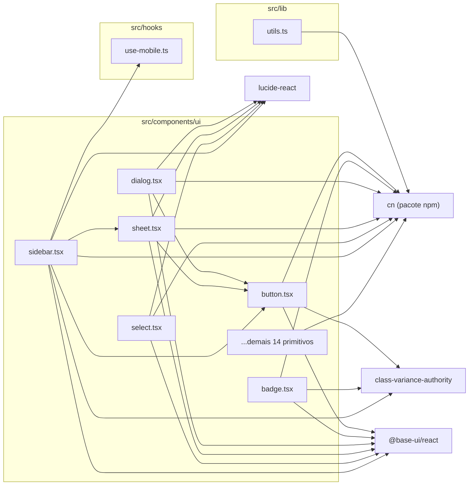

# 10. Primitivos de UI (shadcn / base-ui)

> 20 arquivos de código · 1 ficha completa (o representante `button.tsx`) · 19 em tabela de exceção.

Este módulo reúne os componentes de interface "de base" do Orbit CRM (padrão shadcn, `style: base-nova`, conforme `components.json`) construídos em cima da biblioteca `@base-ui/react`. São peças burras e reutilizáveis — botão, entrada, diálogo, menu, tabela, barra lateral etc. — sem regra de negócio: eles apenas renderizam HTML estilizado com Tailwind v4 e repassam `props`. Todo o resto do app (`src/components/app/*`, páginas, formulários e dialogs) compõe essas primitivas. Por serem gerados em família e quase idênticos entre si, ganham a ficha completa de **um** representante (`button.tsx`) e seguem em tabela de exceção — o que **não** significa que sejam irrelevantes: `button`, `input`, `label`, `dialog` e `card` são dos arquivos mais importados do projeto.

Um detalhe comum a quase todos: importam o utilitário de classes `cn` diretamente do pacote npm `cn` (`import { cn } from "cn"`), e não de `@/lib/utils` — que existe, mas só reexporta o mesmo `cn` (`export { cn } from "cn"`).

## Diagrama de dependências do módulo

Setas significam "depende de". `dialog.tsx` e `sheet.tsx` reaproveitam `button.tsx` (botão de fechar); `sidebar.tsx` é o mais composto, puxando `button`, `input`, `separator`, `sheet`, `skeleton`, `tooltip` e o hook `use-mobile.ts`.

---

## Ficha do representante

### `src/components/ui/button.tsx`
**Propósito:** Botão padrão do app, com variantes visuais e tamanhos prontos, embrulhando o `Button` do `@base-ui/react`. É a primitiva mais reutilizada da interface.

**Processo:** o arquivo define `buttonVariants` com `cva(...)`, que mapeia `variant` (`default`, `outline`, `secondary`, `ghost`, `destructive`, `link`) e `size` (`default`, `xs`, `sm`, `lg`, `icon`, `icon-xs`, `icon-sm`, `icon-lg`) para classes Tailwind. O componente `Button` recebe `className`, `variant`, `size` e o restante das props; monta o nome de classes com `cn(buttonVariants({ variant, size, className }))` e renderiza `<ButtonPrimitive data-slot="button" .../>`, repassando todas as demais props ao primitivo do base-ui. Exporta `Button` e `buttonVariants` (este último para reuso em outros componentes, como links estilizados). Suporta ícones via `data-icon=inline-start/inline-end` e herda estados de acessibilidade (`disabled`, `aria-invalid`) do base-ui.

**Estado:** `implementado` — componente funcional completo (57 linhas), sem TODO/FIXME.

**Testes:** sem teste (nenhum arquivo `*.test.*`/`*.spec.*` importa `components/ui` — confirmado por Grep).

**Depende de:**
- `@base-ui/react/button`: primitivo `ButtonPrimitive` que fornece o comportamento acessível do botão.
- `class-variance-authority`: `cva`/`VariantProps` para gerar as variações de estilo.
- `cn` (pacote npm `cn`): junta as classes de estilo.

**Usado por:** amplamente por todo o app — 86 arquivos importam `@/components/ui/button`, entre eles `src/components/ui/dialog.tsx`, `src/components/ui/sheet.tsx`, `src/components/ui/sidebar.tsx`, `src/app/(auth)/login/login-form.tsx`, `src/app/error.tsx`, `src/app/not-found.tsx`, `src/components/app/app-sidebar.tsx`, `src/app/app/timesheet/timer-widget.tsx`.

**Bibliotecas externas:** `@base-ui/react`, `class-variance-authority`, `cn`.

---

## Tabela de exceção — família homogênea de primitivos

São 20 primitivos gerados no mesmo padrão (shadcn `base-nova` sobre `@base-ui/react`, estilizados com Tailwind e `cn`). Em cada um só mudam os componentes exportados e as ações que chamam; o formato da ficha é o mesmo. Por isso ficam aqui em tabela, com a **ficha completa de `button.tsx` acima** como representante. Nenhum tem teste próprio.

| Arquivo | O que exporta | Motivo da exceção |
| --- | --- | --- |
| `src/components/ui/avatar.tsx` | `Avatar`, `AvatarImage`, `AvatarFallback`, `AvatarBadge`, `AvatarGroup`, `AvatarGroupCount` | Família homogênea de primitivos shadcn gerados (avatar sobre `@base-ui/react/avatar`). |
| `src/components/ui/badge.tsx` | `Badge`, `badgeVariants` | Família homogênea de primitivos shadcn gerados (etiqueta com `cva` + `useRender`). |
| `src/components/ui/breadcrumb.tsx` | `Breadcrumb`, `BreadcrumbList`, `BreadcrumbItem`, `BreadcrumbLink`, `BreadcrumbPage`, `BreadcrumbSeparator`, `BreadcrumbEllipsis` | Família homogênea de primitivos shadcn gerados (trilha de navegação). Ainda sem uso fora do módulo. |
| `src/components/ui/button.tsx` | `Button`, `buttonVariants` | Representante: ficha completa acima. Primitivo mais usado do app. |
| `src/components/ui/card.tsx` | `Card`, `CardHeader`, `CardFooter`, `CardTitle`, `CardAction`, `CardDescription`, `CardContent` | Família homogênea de primitivos shadcn gerados (cartão/conta juntando props com `cn`). |
| `src/components/ui/checkbox.tsx` | `Checkbox` | Família homogênea de primitivos shadcn gerados (caixa de seleção sobre `@base-ui/react/checkbox`). |
| `src/components/ui/dialog.tsx` | `Dialog`, `DialogTrigger`, `DialogPortal`, `DialogClose`, `DialogOverlay`, `DialogContent`, `DialogHeader`, `DialogFooter`, `DialogTitle`, `DialogDescription` | Família homogênea de primitivos shadcn gerados (janela modal; reaproveita `Button` no X de fechar). |
| `src/components/ui/dropdown-menu.tsx` | `DropdownMenu`, `DropdownMenuPortal`, `DropdownMenuTrigger`, `DropdownMenuContent`, `DropdownMenuGroup`, `DropdownMenuLabel`, `DropdownMenuItem`, `DropdownMenuCheckboxItem`, `DropdownMenuRadioGroup`, `DropdownMenuRadioItem`, `DropdownMenuSeparator`, `DropdownMenuShortcut`, `DropdownMenuSub`, `DropdownMenuSubTrigger`, `DropdownMenuSubContent` | Família homogênea de primitivos shadcn gerados (menu suspenso sobre `@base-ui/react/menu`). |
| `src/components/ui/input.tsx` | `Input` | Família homogênea de primitivos shadcn gerados (campo de texto sobre `@base-ui/react/input`). |
| `src/components/ui/label.tsx` | `Label` | Família homogênea de primitivos shadcn gerados (rótulo simples de `<label>`). |
| `src/components/ui/select.tsx` | `Select`, `SelectTrigger`, `SelectContent`, `SelectItem`, `SelectGroup`, `SelectLabel`, `SelectValue`, `SelectSeparator`, `SelectScrollUpButton`, `SelectScrollDownButton` | Família homogênea de primitivos shadcn gerados (seleção sobre `@base-ui/react/select`). Ainda sem uso fora do módulo. |
| `src/components/ui/separator.tsx` | `Separator` | Família homogênea de primitivos shadcn gerados (linha divisória sobre `@base-ui/react/separator`). |
| `src/components/ui/sheet.tsx` | `Sheet`, `SheetTrigger`, `SheetClose`, `SheetContent`, `SheetHeader`, `SheetFooter`, `SheetTitle`, `SheetDescription` | Família homogênea de primitivos shadcn gerados (painel lateral; reusa `Dialog` do base-ui e `Button`). |
| `src/components/ui/sidebar.tsx` | `Sidebar`, `SidebarProvider`, `SidebarTrigger`, `SidebarRail`, `SidebarInset`, `SidebarInput`, `SidebarHeader`, `SidebarFooter`, `SidebarSeparator`, `SidebarContent`, `SidebarGroup`, `SidebarGroupAction`, `SidebarGroupContent`, `SidebarGroupLabel`, `SidebarMenu`, `SidebarMenuItem`, `SidebarMenuAction`, `SidebarMenuBadge`, `SidebarMenuButton`, `SidebarMenuSkeleton`, `SidebarMenuSub`, `SidebarMenuSubButton`, `SidebarMenuSubItem`, `useSidebar` | Família homogênea de primitivos shadcn gerados; é o maior/quem mais compõe (usa `useIsMobile`, `Button`, `Input`, `Separator`, `Sheet`, `Skeleton`, `Tooltip`). Guarda estado do menu em cookie `sidebar_state`. |
| `src/components/ui/skeleton.tsx` | `Skeleton` | Família homogênea de primitivos shadcn gerados (bloco de carregamento). |
| `src/components/ui/sonner.tsx` | `Toaster` | Família homogênea de primitivos shadcn gerados; embrulha o `Toaster` do pacote `sonner`, ajustando ícones e cores pelo tema (`next-themes`). |
| `src/components/ui/table.tsx` | `Table`, `TableHeader`, `TableBody`, `TableFooter`, `TableHead`, `TableRow`, `TableCell`, `TableCaption` | Família homogênea de primitivos shadcn gerados (tabela HTML estilizada). |
| `src/components/ui/tabs.tsx` | `Tabs`, `TabsList`, `TabsTrigger`, `TabsContent`, `tabsListVariants` | Família homogênea de primitivos shadcn gerados (abas sobre `@base-ui/react/tabs`). Ainda sem uso fora do módulo. |
| `src/components/ui/textarea.tsx` | `Textarea` | Família homogênea de primitivos shadcn gerados (campo de texto multilinha). |
| `src/components/ui/tooltip.tsx` | `Tooltip`, `TooltipTrigger`, `TooltipContent`, `TooltipProvider` | Família homogênea de primitivos shadcn gerados (dica flutuante sobre `@base-ui/react/tooltip`; o `TooltipProvider` é montado em `providers.tsx`). |

---

## Fichas do módulo

| § | Arquivo | Propósito em 1 linha |
| --- | --- | --- |
| §10.1 | `src/components/ui/button.tsx` | Botão padrão do app, com variantes e tamanhos, sobre `@base-ui/react/button` (ficha completa acima; os demais 19 primitivos seguem na tabela de exceção). |
