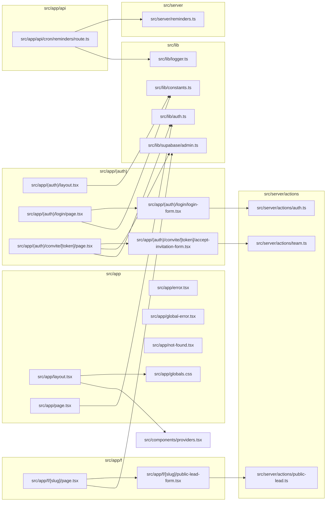

# 11. App: layouts raiz, autenticação, convite e páginas públicas

> 14 arquivos de código · 14 fichas completas · 0 em tabela de exceção.

Este módulo cobre a "casca" do App Router do Next.js: o `layout.tsx` raiz e o CSS global que definem fontes, tema e providers; as páginas especiais de erro (`error.tsx`, `global-error.tsx`, `not-found.tsx`); o redirecionamento da raiz (`/`); o grupo `(auth)` com login e aceite de convite; a rota de API do cron de lembretes; e a página pública de captação de leads (`/f/[slug]`). São os pontos de entrada que qualquer visita toca antes de entrar na área logada `/app`. Autenticação, papéis e isolamento por tenant estão descritos em [regras e convenções](../05-regras-e-convencoes.md) §5; os fluxos de login e de convite em [processos](../02-processos.md) §2.

## Diagrama de dependências do módulo

## Fichas

### `src/app/layout.tsx`

**Propósito:** layout raiz da aplicação; monta o `<html>`/`<body>`, carrega as fontes, injeta o CSS global e envolve todas as páginas com os providers de tema, cache de consultas e toasts.
**Processo:** define as fontes locais `poppins` e `roboto` (via `next/font/local`, a partir de arquivos `.ttf` em `src/app/fonts`) e `robotoMono` (`next/font/google`, `Roboto_Mono`), cada uma expondo uma variável CSS (`--font-poppins`, `--font-roboto`, `--font-roboto-mono`). Lê `process.env.NEXT_PUBLIC_APP_NAME` (fallback `"Orbit CRM"`) e monta o objeto `metadata` (título com template `%s · <appName>` e descrição padrão). O componente `RootLayout` renderiza `<html lang="pt-BR" suppressHydrationWarning>` com as classes das fontes, o `<body className="antialiased">` com `<Providers>{children}</Providers>` e os componentes de observabilidade `<Analytics />` e `<SpeedInsights />`.
**Estado:** `implementado`.
**Testes:** sem teste (nenhum teste importa `layout.tsx`).
**Depende de:**
- `src/app/globals.css`: importado para aplicar Tailwind e tokens de tema.
- `src/components/providers.tsx`: `Providers` (tema/cache/toasts).
- Env: `NEXT_PUBLIC_APP_NAME` (opcional, só o nome exibido).
- Bibliotecas externas: `next/font/local`, `next/font/google`, `@vercel/analytics/next`, `@vercel/speed-insights/next`.

**Usado por:** ponto de entrada — o Next.js App Router aplica automaticamente este layout a **todas** as rotas. Nenhum arquivo do projeto o importa.
**Bibliotecas externas:** `next`, `@vercel/analytics`, `@vercel/speed-insights`.

**Rota da página:** todas as rotas (layout raiz) · **O que o usuário vê e faz:** não é uma tela; define idioma, fontes, tema e wrappers globais que aparecem em qualquer página.
**APIs/actions que chama:** nenhuma · **Guardas:** nenhuma (rota pública).

### `src/app/page.tsx`

**Propósito:** página inicial da raiz `/`; apenas decide para onde mandar o visitante.
**Processo:** `Home` é assíncrono, chama `getUser()` de `src/lib/auth.ts` e executa `redirect(user ? "/app" : "/login")`. Ou seja: usuário logado vai para a área do app, anônimo vai para o login. Não renderiza nada.
**Estado:** `implementado`.
**Testes:** `tests/e2e/smoke.spec.ts` — teste "raiz redireciona para /login quando não autenticado".
**Depende de:**
- `src/lib/auth.ts`: `getUser()` (lê a sessão via Supabase).

**Usado por:** ponto de entrada — rota `/` resolvida automaticamente pelo Next.js.
**Bibliotecas externas:** `next/navigation` (`redirect`).

**Rota da página:** `/` · **O que o usuário vê e faz:** nada; é redirecionado para `/app` (logado) ou `/login` (anônimo).
**APIs/actions que chama:** `getUser` (query de sessão) · **Guardas:** redireciona conforme sessão.

### `src/app/error.tsx`

**Propósito:** tela de erro padrão (error boundary) das rotas; mostra a mensagem e um botão para tentar de novo.
**Processo:** é um client component (`"use client"`) que recebe `error` e `reset` do Next. Registra o erro com `console.error` dentro de um `useEffect`. Renderiza um bloco centralizado com o título "Algo deu errado", a `error.message` (ou um texto padrão) e um `Button` que chama `reset()`.
**Estado:** `implementado`.
**Testes:** sem teste (nenhum teste importa `error.tsx`).
**Depende de:**
- `src/components/ui/button.tsx`: componente `Button`.

**Usado por:** ponto de entrada — o Next.js usa automaticamente como error boundary das rotas; nenhum arquivo o importa.
**Bibliotecas externas:** `react`.

**Rota da página:** qualquer rota (error boundary) · **O que o usuário vê e faz:** vê o erro e pode clicar em "Tentar novamente" para re-renderizar o trecho.
**APIs/actions que chama:** nenhuma · **Guardas:** nenhuma.

### `src/app/global-error.tsx`

**Propósito:** fallback de último nível quando o próprio layout raiz falha ao renderizar.
**Processo:** client component que recebe `error` e `reset`. Diferente de `error.tsx`, renderiza seu **próprio** `<html>`/`<body>` com estilos inline (sem Tailwind, pois o CSS pode não ter carregado), mostrando "Algo deu errado", a mensagem e um botão que chama `reset()`.
**Estado:** `implementado`.
**Testes:** sem teste.
**Depende de:** nada do projeto (só `react`).

**Usado por:** ponto de entrada — usado automaticamente pelo Next.js como boundary global; nenhum arquivo o importa.
**Bibliotecas externas:** `react`.

**Rota da página:** qualquer rota (global error boundary) · **O que o usuário vê e faz:** vê um HTML mínimo e o botão "Tentar novamente".
**APIs/actions que chama:** nenhuma · **Guardas:** nenhuma.

### `src/app/not-found.tsx`

**Propósito:** tela 404 padrão.
**Processo:** componente server que renderiza um bloco centralizado com "404", o título "Página não encontrada" e um `Button` que usa a prop `render` com `<Link href="/app" />` para levar o usuário de volta ao app.
**Estado:** `implementado`.
**Testes:** sem teste.
**Depende de:**
- `src/components/ui/button.tsx`: `Button` (com padrão `render`/`nativeButton`).
- `next/link` (importado direto).

**Usado por:** ponto de entrada — disparado automaticamente por `notFound()` e por rotas inexistentes; nenhum arquivo o importa.
**Bibliotecas externas:** `next/link`.

**Rota da página:** qualquer rota inexistente · **O que o usuário vê e faz:** vê "Página não encontrada" e o botão "Ir para o app".
**APIs/actions que chama:** nenhuma · **Guardas:** nenhuma.

### `src/app/globals.css`

**Propósito:** folha de estilos global: importa o Tailwind e o CSS do shadcn, define o tema (cores claro/escuro), as fontes e tamanhos de texto do projeto.
**Processo:** importa `tailwindcss`, `tw-animate-css` e `shadcn/tailwind.css`; declara `@custom-variant dark`. No bloco `@theme inline` liga tokens (`--color-*`) às variáveis e define `--font-sans`/`--font-mono`/`--font-heading` (apontando para as variáveis das fontes do layout) e a escala de `--text-*`. Em `:root` define as cores do tema claro; em `.dark` as do tema escuro. No `@layer base` aplica borda/anel a tudo, `bg-background text-foreground` no `body` e `font-heading` em `h1`–`h6`.
**Estado:** `implementado`.
**Testes:** sem teste.
**Depende de:** nenhum arquivo do projeto (só os pacotes `tailwindcss`, `tw-animate-css`, `shadcn`).

**Usado por:** `src/app/layout.tsx` (import de `./globals.css`).
**Bibliotecas externas:** `tailwindcss`, `tw-animate-css`, `shadcn`.

**Rota da página:** não é página (CSS global, importado pelo layout raiz).
**O que o usuário vê e faz:** não renderiza; define a aparência (cores, fontes, tema claro/escuro) de toda a interface.

### `src/app/(auth)/layout.tsx`

**Propósito:** layout do grupo de rotas `(auth)` (login e convite); monta uma coluna lateral de marca e centraliza o conteúdo.
**Processo:** `AuthLayout` renderiza um `grid min-h-svh lg:grid-cols-2`. A coluna esquerda (só visível em telas grandes) tem fundo `bg-primary`, bolhas decorativas com `aria-hidden`, o logotipo "O", o nome `APP_NAME` e textos de marketing; a direita centraliza o `children`. `APP_NAME` vem de `src/lib/constants.ts`. Usa a classe `font-heading` definida no CSS global.
**Estado:** `implementado`.
**Testes:** sem teste.
**Depende de:**
- `src/lib/constants.ts`: `APP_NAME`.

**Usado por:** o Next.js aplica automaticamente às rotas do grupo `(auth)`: `src/app/(auth)/login/page.tsx` e `src/app/(auth)/convite/[token]/page.tsx`.
**Bibliotecas externas:** nenhuma.

**Rota da página:** layout de `/login` e `/convite/[token]` · **O que o usuário vê e faz:** vê a tela de login/convite com um painel de marca ao lado em telas grandes.
**APIs/actions que chama:** nenhuma · **Guardas:** nenhuma.

### `src/app/(auth)/login/page.tsx`

**Propósito:** página de login do time (equipe), em `/login`.
**Processo:** server component com `metadata` (título "Entrar"). Lê `process.env.NEXT_PUBLIC_DEMO_LOGIN`; se for `"true"`, exibe o componente `DemoCredentials` (e-mail/senha de demonstração) abaixo do formulário. Renderiza um `Card` com o logotipo, o `APP_NAME`, a descrição e o componente `LoginForm`. No rodapé há um link para o portal do cliente (`/portal/login`).
**Estado:** `implementado`.
**Testes:** `tests/e2e/smoke.spec.ts` — teste "página de login mostra o formulário" (verifica o botão "Entrar").
**Depende de:**
- `src/app/(auth)/login/login-form.tsx`: `LoginForm`.
- `src/components/ui/card.tsx`: `Card`, `CardHeader`, etc.
- `src/components/app/demo-credentials.tsx`: `DemoCredentials` (só quando a flag está ligada).
- `src/lib/constants.ts`: `APP_NAME`.
- Env: `NEXT_PUBLIC_DEMO_LOGIN`.

**Usado por:** ponto de entrada — rota `/login`. É para onde `src/app/page.tsx` e `src/lib/auth.ts` (`requireUser`) redirecionam quem não tem sessão.
**Bibliotecas externas:** `next` (tipo `Metadata`).

**Rota da página:** `/login` · **O que o usuário vê e faz:** preenche e-mail e senha e entra no app; vê credenciais de demonstração quando a flag está ativa; pode ir ao portal do cliente.
**APIs/actions que chama:** `LoginForm` chama `signInAction` · **Guardas:** pública (destino do redirecionamento de quem não está logado).

### `src/app/(auth)/login/login-form.tsx`

**Propósito:** formulário client de login que envia e-mail/senha para a server action e mostra erro.
**Processo:** usa `useActionState(signInAction, undefined)` para gerenciar estado (`AuthState`) e `isPending`. Renderiza `<form action={formAction}>` com campos `email` e `password` (obrigatórios), exibe `state.error` (com `role="alert"`) quando houver e um `Button` que fica desabilitado com o texto "Entrando..." enquanto pendente.
**Estado:** `implementado`.
**Testes:** sem teste próprio do componente (a validação `signInSchema` é coberta em `tests/unit/validations.test.ts`).
**Depende de:**
- `src/server/actions/auth.ts`: `signInAction` e o tipo `AuthState`.
- `src/components/ui/{button,input,label}.tsx`.

**Usado por:** `src/app/(auth)/login/page.tsx`.
**Bibliotecas externas:** `react` (`useActionState`).

**Rota da página:** componente do `/login` · **O que o usuário vê e faz:** digita e-mail e senha e clica em "Entrar"; em sucesso a action redireciona para `/app`.
**APIs/actions que chama:** `signInAction` (que valida com `signInSchema` e chama `supabase.auth.signInWithPassword`) · **Guardas:** pública; a action redireciona para `/app` no sucesso.

### `src/app/(auth)/convite/[token]/page.tsx`

**Propósito:** página de aceite de convite de equipe, aberta pelo link `/convite/<token>`.
**Processo:** server component assíncrono. Com `createAdminClient()` (ignora RLS) busca em `invitations` o registro pelo `token`, trazendo `email, role, accepted_at, expires_at` e o nome do tenant (`tenant:tenants(name)`). Também chama `getUser()` para saber se quem abriu já está logado. Calcula `message`: "Convite inválido." (não achou), "Este convite já foi utilizado." (`accepted_at`) ou "Este convite expirou." (`expires_at` no passado). Se houver problema, mostra a mensagem e um link para `/login`; senão renderiza `AcceptInvitationForm` passando `token`, `email`, `tenantName` e `loggedEmail`.
**Estado:** `implementado`.
**Testes:** sem teste (nenhum teste importa `convite/[token]/page.tsx`).
**Depende de:**
- `src/lib/supabase/admin.ts`: `createAdminClient()` (service role, ignora RLS).
- `src/lib/auth.ts`: `getUser()`.
- `src/app/(auth)/convite/[token]/accept-invitation-form.tsx`: `AcceptInvitationForm`.
- `next/link`.
- Tabelas: lê `invitations` e `tenants` (join `tenant:tenants(name)`).

**Usado por:** ponto de entrada — rota `/convite/[token]`. O link com o token é gerado no convite enviado por e-mail pela equipe em `src/server/actions/team.ts`.
**Bibliotecas externas:** `next/link`.

**Rota da página:** `/convite/[token]` · **O que o usuário vê e faz:** vê para qual empresa foi convidado e aceita o convite (definindo nome/senha, se ainda não tiver conta); se o convite for inválido/expirado/usado, vê um aviso.
**APIs/actions que chama:** consulta `invitations`/`tenants` via admin client; o `AcceptInvitationForm` chama as actions de `team.ts` · **Guardas:** pública; o token é a credencial.

### `src/app/(auth)/convite/[token]/accept-invitation-form.tsx`

**Propósito:** formulário client que conclui o aceite do convite, com dois modos (usuário já logado x novo usuário).
**Processo:** recebe `token`, `email`, `tenantName` e `loggedEmail`. Calcula `sameUser` comparando `loggedEmail` com `email` (case-insensitive). Se for o mesmo usuário, mostra só um botão que envia para `acceptInvitationAsCurrentUserAction` (com o `token` num campo escondido). Caso contrário, usa `useActionState(acceptInvitationAction, undefined)` e exibe o formulário com `full_name` e `password` (mínimo 8 caracteres); erros viram toast via `useEffect`/`toast.error`. O botão alterna "Aceitar e entrar"/"Entrando...".
**Estado:** `implementado`.
**Testes:** sem teste próprio (a validação `acceptInvitationSchema` é coberta em `tests/unit/validations.test.ts`).
**Depende de:**
- `src/server/actions/team.ts`: `acceptInvitationAction`, `acceptInvitationAsCurrentUserAction` e o tipo `TeamFormState`.
- `src/components/ui/{button,input,label}.tsx`, `sonner`.

**Usado por:** `src/app/(auth)/convite/[token]/page.tsx`.
**Bibliotecas externas:** `react`, `sonner`.

**Rota da página:** componente do `/convite/[token]` · **O que o usuário vê e faz:** confirma o aceite; se for conta nova, define nome e senha. Em sucesso a action redireciona para `/app`.
**APIs/actions que chama:** `acceptInvitationAction`/`acceptInvitationAsCurrentUserAction` (validam, criam/reaproveitam usuário, fazem `upsert` em `memberships`, marcam `invitations.accepted_at` e redirecionam) · **Guardas:** pública (token); o modo "usuário logado" exige que o e-mail da sessão bata com o do convite.

### `src/app/api/cron/reminders/route.ts`

**Propósito:** rota de API que dispara o job de lembretes (tarefas vencendo e faturas vencidas), protegida por segredo.
**Processo:** exporta `dynamic = "force-dynamic"`. A função `safeEqual(a, b)` compara strings em tempo constante com `timingSafeEqual` (do `node:crypto`), retornando `false` se os tamanhos diferem. O `GET` lê `process.env.CRON_SECRET`; se faltar, registra `cron.reminders.missing_secret` e devolve `503`. Compara o header `Authorization` com `Bearer ${secret}` via `safeEqual`; se não bater, loga `cron.reminders.unauthorized` e devolve `401`. Em caso de sucesso, chama `runReminders()`, loga o resultado e devolve `200` com `{ ok: true, tenants, notifications, emails }`; qualquer exceção resulta em `500 { error: "internal" }`.
**Estado:** `implementado`.
**Testes:** sem teste (busca por `cron/reminders` em `tests/` não retornou nada).
**Depende de:**
- `src/server/reminders.ts`: `runReminders()`.
- `src/lib/logger.ts`: `logger`.
- Env: `CRON_SECRET`.

**Usado por:** agendado pelo `vercel.json` (cron `0 9 * * *`). Nenhum arquivo do projeto faz `fetch` para essa rota.
**Bibliotecas externas:** `next/server` (`NextResponse`), `node:crypto` (`timingSafeEqual`).

**Contrato:** `GET /api/cron/reminders` — não usa sessão de usuário; exige `Authorization: Bearer <CRON_SECRET>`.
**Entrada:** sem query/body; a única entrada é o header `Authorization`.
**Saída:** `200` `{ ok: true, tenants, notifications, emails }`.
**Erros:** `503` quando `CRON_SECRET` não está configurado; `401` quando o `Authorization` não bate; `500` em erro interno do job.
**Chama:** `runReminders()` · **Tabelas:** (via `runReminders`) lê `tenants`, `tasks`, `invoices`, `memberships`, `profiles`; escreve `notifications` · **Telas que consomem:** nenhuma.

### `src/app/f/[slug]/page.tsx`

**Propósito:** página pública de captação de leads de um tenant, acessível por `/f/<slug>`.
**Processo:** server component assíncrono. Com `createAdminClient()` busca em `tenants` os campos `name` e `web_to_lead_enabled` pelo `slug`. Se o tenant não existir ou `web_to_lead_enabled` for falso, chama `notFound()` (404). Caso contrário, mostra um cartão centralizado com o nome do tenant, a frase de convite e o componente `PublicLeadForm` (recebendo o `slug`).
**Estado:** `implementado`.
**Testes:** sem teste (nenhum teste importa `f/[slug]/page.tsx`).
**Depende de:**
- `src/lib/supabase/admin.ts`: `createAdminClient()`.
- `src/app/f/[slug]/public-lead-form.tsx`: `PublicLeadForm`.
- `next/navigation` (`notFound`).
- Tabelas: lê `tenants` (`name`, `web_to_lead_enabled`).

**Usado por:** ponto de entrada — rota `/f/[slug]`. A URL pública é exibida/copiada no formulário de configuração do tenant em `src/app/app/configuracoes/web-to-lead-form.tsx`.
**Bibliotecas externas:** `next/navigation`.

**Rota da página:** `/f/[slug]` · **O que o usuário vê e faz:** um formulário público para deixar nome, e-mail, telefone e mensagem; visitante anônimo, sem login.
**APIs/actions que chama:** lê `tenants` via admin client; o `PublicLeadForm` chama `submitPublicLeadAction` · **Guardas:** pública; 404 se o tenant não existir ou não tiver web-to-lead habilitado.

### `src/app/f/[slug]/public-lead-form.tsx`

**Propósito:** formulário público (client) que envia os dados do visitante como novo lead.
**Processo:** usa `useActionState(submitPublicLeadAction, undefined)`. Se `state.success` existir, mostra só a mensagem de sucesso. Senão renderiza o `<form action={formAction}>` com o `slug` escondido e um campo **honeypot** (`company_website`, oculto via `hidden`, `tabIndex=-1`, `aria-hidden`) para detectar bots. Campos: nome (obrigatório), e-mail, telefone e mensagem. Exibe `state.error` quando houver e o botão alterna "Enviando..."/"Enviar".
**Estado:** `implementado`.
**Testes:** sem teste próprio (a validação `publicLeadSchema` é coberta em `tests/unit/validations.test.ts`).
**Depende de:**
- `src/server/actions/public-lead.ts`: `submitPublicLeadAction` e o tipo `PublicLeadState`.
- `src/components/ui/{button,input,label,textarea}.tsx`.

**Usado por:** `src/app/f/[slug]/page.tsx`.
**Bibliotecas externas:** `react` (`useActionState`).

**Rota da página:** componente do `/f/[slug]` · **O que o usuário vê e faz:** preenche seus dados e envia; em sucesso vê a mensagem de confirmação.
**APIs/actions que chama:** `submitPublicLeadAction` (valida com `publicLeadSchema`, aplica rate limit via RPC `check_rate_limit`, checa plano com `checkPlanLimitWith`, insere em `leads` e devolve estado) · **Guardas:** pública; o honeypot e o rate limit por IP protegem contra abuso.

## Fichas do módulo

| § | Arquivo | Propósito em 1 linha |
|---|---------|----------------------|
| §11.1 | `src/app/layout.tsx` | Layout raiz: html/body, fontes, CSS global e providers. |
| §11.2 | `src/app/page.tsx` | Redireciona a raiz `/` para `/app` ou `/login` conforme sessão. |
| §11.3 | `src/app/error.tsx` | Error boundary padrão com botão de tentar novamente. |
| §11.4 | `src/app/global-error.tsx` | Fallback global quando o layout raiz falha. |
| §11.5 | `src/app/not-found.tsx` | Tela 404 padrão com link para o app. |
| §11.6 | `src/app/globals.css` | Tailwind, tokens de tema claro/escuro, fontes e escala de texto. |
| §11.7 | `src/app/(auth)/layout.tsx` | Layout do grupo (auth): painel de marca + conteúdo centralizado. |
| §11.8 | `src/app/(auth)/login/page.tsx` | Página de login do time em `/login`. |
| §11.9 | `src/app/(auth)/login/login-form.tsx` | Formulário de login que chama `signInAction`. |
| §11.10 | `src/app/(auth)/convite/[token]/page.tsx` | Valida o convite pelo token e mostra o aceite. |
| §11.11 | `src/app/(auth)/convite/[token]/accept-invitation-form.tsx` | Formulário de aceite do convite (logado ou novo usuário). |
| §11.12 | `src/app/api/cron/reminders/route.ts` | Rota de cron protegida por `CRON_SECRET` que roda os lembretes. |
| §11.13 | `src/app/f/[slug]/page.tsx` | Página pública de captação de leads do tenant. |
| §11.14 | `src/app/f/[slug]/public-lead-form.tsx` | Formulário público que cria lead via `submitPublicLeadAction`. |
