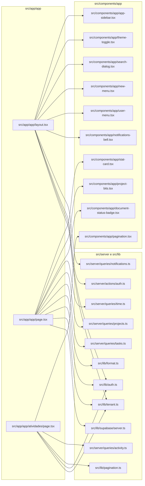
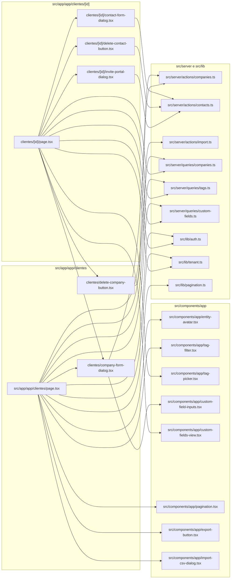

# 12. App: layout interno, dashboard, atividades e clientes

> 10 arquivos de código · 10 fichas completas · 0 em tabela de exceção.

Este módulo cobre a área autenticada do produto (rotas sob `/app`): o layout que envolve todas as telas internas (barra lateral, cabeçalho, notificações, tema), o dashboard (`Visão geral`), a trilha de auditoria (`Atividades`) e o CRUD de clientes (empresas) com seus contatos, tags, campos personalizados e acesso ao portal do cliente. As páginas são RSC que leem dados no servidor; os formulários de criação/edição são dialogs client com `useActionState` que chamam Server Actions.

## Diagrama de dependências

Parte 1 — layout, dashboard e atividades:

Parte 2 — clientes e contatos:

## Fichas

### `src/app/app/layout.tsx`
**Propósito:** Layout RSC de toda a área autenticada sob `/app`. Monta a barra lateral, o cabeçalho com busca/menus/notificações e aplica o tema de cores da empresa ativa.
**Processo:** chama `requireUser()` (redireciona para `/login` se não houver sessão) e, em paralelo, `getProfile()` e `getMemberships()`. Com `getActiveTenant(memberships)` resolve a empresa ativa. Se não houver empresa, renderiza uma tela "Nenhuma empresa vinculada" com botão para `/plataforma` (se `is_super_admin`) e um formulário com `signOutAction`. Havendo empresa, carrega `listNotifications` e `unreadCount` e renderiza `SidebarProvider` (com `style` de branding gerado a partir de `primaryColor`), `AppSidebar`, `SidebarInset`, cabeçalho (logo/nome da empresa, `SearchDialog`, `NewMenu`, `NotificationsBell`, `ThemeToggle`, `UserMenu`) e `<main>{children}</main>`.
**Estado:** `implementado`
**Testes:** sem teste
**Depende de:**
- `src/components/ui/sidebar.tsx`, `separator.tsx`, `button.tsx`: primitivos de UI do layout.
- `src/components/app/app-sidebar.tsx`: navegação lateral (recebe `memberships`/`activeTenantId`).
- `src/components/app/theme-toggle.tsx`, `search-dialog.tsx`, `new-menu.tsx`, `user-menu.tsx`, `notifications-bell.tsx`: widgets do cabeçalho.
- `src/server/queries/notifications.ts`: `listNotifications`, `unreadCount` (tabela `notifications`).
- `src/lib/tenant.ts`: `getActiveTenant` (resolve tenant ativo das memberships).
- `src/lib/auth.ts`: `requireUser`, `getProfile`, `getMemberships`.
- `src/server/actions/auth.ts`: `signOutAction` (logout na tela sem empresa).
- Tabelas lidas: `profiles`, `memberships`, `tenants`, `notifications`.
**Usado por:** ponto de entrada do segmento `/app` (convenção de arquivo do Next.js); envolve todas as rotas filhas (`/app`, `/app/clientes`, `/app/atividades`, etc.).
**Bibliotecas externas:** `next/link`, `lucide-react`.
**Rota da página:** envolve todas as rotas sob `/app` · **O que o usuário vê e faz:** sidebar de navegação, cabeçalho com nome/logo da empresa, busca, criar, notificações, tema e menu do usuário; navega entre as seções. **APIs/actions que chama:** `getProfile`, `getMemberships`, `getActiveTenant`, `listNotifications`, `unreadCount`, `signOutAction` · **Guardas:** exige sessão (`requireUser` → redireciona `/login`); sem empresa ativa mostra tela dedicada (não redireciona).

### `src/app/app/page.tsx`
**Propósito:** Dashboard "Visão geral" (`/app`). Reúne indicadores, gráficos e listas resumidas da empresa ativa.
**Processo:** resolve `getMemberships`/`getActiveTenant` (retorna `null` se não houver empresa). Em um único `Promise.all` com `createClient()` lê contagens de `companies`, `projects`, `tasks`, as horas de `time_entries`, além de `listProjects`/`listTasks`, faturas (`invoices` + `payments`), feed de `comments` e `time_entries` recentes e despesas do mês (`expenses`). Calcula horas dos últimos 14 dias, distribuição de tarefas por status (`TASK_STATUSES`), faturamento dos últimos 6 meses, a receber/recebido, despesas do mês e feed de atividade. Renderiza `StatCard`, barras de horas, donut de status, gráfico de faturamento, feed, projetos recentes (`ProjectStatusBadge`, `ProgressBar`) e bloco financeiro (`InvoiceStatusBadge`).
**Estado:** `implementado`
**Testes:** sem teste
**Depende de:**
- `src/components/app/stat-card.tsx`, `project-bits.tsx` (`ProgressBar`, `ProjectStatusBadge`), `document-status-badge.tsx` (`InvoiceStatusBadge`): cartões e badges.
- `src/server/queries/projects.ts`: `listProjects` (tabela `projects`).
- `src/server/queries/tasks.ts`: `listTasks` (tabela `tasks`).
- `src/server/queries/time.ts`: `formatDuration`.
- `src/lib/constants.ts`: `TASK_STATUSES`; `src/lib/format.ts`: `formatDate`, `formatMoney`.
- `src/lib/auth.ts`, `src/lib/tenant.ts`, `src/lib/supabase/server.ts`: sessão/tenant/cliente supabase.
- Tabelas lidas: `companies`, `projects`, `tasks`, `time_entries`, `invoices`, `payments`, `comments`, `expenses`, `profiles`.
**Usado por:** ponto de entrada da rota `/app` (convenção de arquivo do Next.js).
**Bibliotecas externas:** `next/link`, `lucide-react`.
**Rota da página:** `/app` · **O que o usuário vê e faz:** painel com 4 indicadores, gráficos de horas (14 dias), tarefas por status e faturamento (6 meses), feed de atividade, projetos recentes e resumo financeiro; clica para navegar a projetos/faturas/despesas. **APIs/actions que chama:** `listProjects`, `listTasks` e leituras diretas no Supabase · **Guardas:** exige sessão (herdada do layout); sem empresa ativa retorna `null`.

### `src/app/app/atividades/page.tsx`
**Propósito:** Página "Atividades" (`/app/atividades`): trilha de auditoria da empresa, com filtro por entidade e paginação.
**Processo:** lê `searchParams` (`page`, `entity`), normaliza com `parsePage` e resolve a empresa ativa. Chama `listActivityPage(tenantId, { page, pageSize: PAGE_SIZE, entity })`. Renderiza um formulário GET para filtrar por entidade (mapa `ENTITIES`), uma tabela (`Table`) com data, usuário, entidade (badge), ação (mapa `ACTIONS`) e link "Ver" (via `entityHref`, que monta a base por entidade) e o componente `Pagination`.
**Estado:** `implementado`
**Testes:** sem teste
**Depende de:**
- `src/server/queries/activity.ts`: `listActivityPage` (tabela `activity_log`; join `profiles`).
- `src/components/app/pagination.tsx`: paginação.
- `src/lib/pagination.ts`: `PAGE_SIZE`, `parsePage`.
- `src/lib/auth.ts`, `src/lib/tenant.ts`: sessão/tenant.
- Tabelas lidas: `activity_log`, `profiles`.
**Usado por:** ponto de entrada da rota `/app/atividades` (convenção de arquivo do Next.js).
**Bibliotecas externas:** `next/link`, `lucide-react`.
**Rota da página:** `/app/atividades` · **O que o usuário vê e faz:** tabela de registros de auditoria; filtra por entidade, limpa o filtro, navega entre páginas e abre o item relacionado. **APIs/actions que chama:** `listActivityPage` · **Guardas:** exige sessão (herdada do layout); sem empresa ativa retorna `null`.

### `src/app/app/clientes/page.tsx`
**Propósito:** Listagem de clientes/empresas (`/app/clientes`), com filtro por tag, contagem de contatos, exportação, importação CSV e botão de novo cliente.
**Processo:** lê `searchParams` (`tag`, `page`); se houver `tag`, resolve `entityIdsByTag`. Em paralelo chama `listCompaniesPage`, `countContactsByCompany`, `listTags` e `listCustomFieldDefinitions`. Renderiza cabeçalho com `ExportButton` (`/app/exportar/clientes`), `ImportCsvDialog` (`importCompaniesAction`) e `CompanyFormDialog`; `TagFilter`; a lista de empresas (cada item é um `Link` para `/app/clientes/[id]` com `EntityAvatar` e contagem de contatos) ou um aviso de lista vazia; e `Pagination`.
**Estado:** `implementado`
**Testes:** sem teste
**Depende de:**
- `src/server/queries/companies.ts`: `listCompaniesPage`, `countContactsByCompany` (tabelas `companies`, `contacts`).
- `src/server/queries/tags.ts`: `entityIdsByTag`, `listTags` (tabelas `tags`, `entity_tags`).
- `src/server/queries/custom-fields.ts`: `listCustomFieldDefinitions`.
- `src/server/actions/import.ts`: `importCompaniesAction` (passada ao `ImportCsvDialog`).
- `src/components/app/entity-avatar.tsx`, `tag-filter.tsx`, `pagination.tsx`, `export-button.tsx`, `import-csv-dialog.tsx`.
- `./company-form-dialog.tsx`: `CompanyFormDialog`.
- `src/lib/auth.ts`, `src/lib/tenant.ts`, `src/lib/pagination.ts`.
**Usado por:** ponto de entrada da rota `/app/clientes` (convenção de arquivo do Next.js).
**Bibliotecas externas:** `next/link`, `lucide-react`.
**Rota da página:** `/app/clientes` · **O que o usuário vê e faz:** lista de empresas com contatos/telefone; filtra por tag, troca de página, exporta, importa CSV e cria um novo cliente. **APIs/actions que chama:** `listCompaniesPage`, `countContactsByCompany`, `listTags`, `entityIdsByTag`, `listCustomFieldDefinitions`, `importCompaniesAction` · **Guardas:** exige sessão (herdada do layout); sem empresa ativa retorna `null`.

### `src/app/app/clientes/company-form-dialog.tsx`
**Propósito:** Dialog client de criar/editar cliente (empresa), reutilizado na listagem e no detalhe. Contém os campos de empresa e os campos personalizados.
**Processo:** recebe `company?`, `customFields?`, `customValues?` e `label`. Escolhe `updateCompanyAction` se houver `company`, senão `createCompanyAction`, ligadas via `useActionState`. No `useEffect`, em sucesso fecha o dialog e mostra `toast.success`; em erro, `toast.error`. Renderiza `Dialog`/`DialogTrigger` (botão) e um `<form action={formAction}>` com `Input`/`Textarea` (nome obrigatório, CNPJ, telefone, site, cidade, estado, país, endereço, observações), `input hidden id` no modo edição e `CustomFieldInputs`. Botão Salvar fica desabilitado enquanto `isPending`.
**Estado:** `implementado`
**Testes:** sem teste
**Depende de:**
- `src/server/actions/companies.ts`: `createCompanyAction`, `updateCompanyAction`, tipo `CompanyFormState` (tabela `companies`).
- `src/server/queries/companies.ts`: tipo `Company`.
- `src/server/queries/custom-fields.ts`: tipo `CustomFieldDefinition`.
- `src/components/app/custom-field-inputs.tsx`: `CustomFieldInputs`.
- primitivos `src/components/ui/{button,dialog,input,label,textarea}.tsx`.
**Usado por:** `src/app/app/clientes/page.tsx` (novo cliente), `src/app/app/clientes/[id]/page.tsx` (editar).
**Bibliotecas externas:** `react` (`useActionState`, `useEffect`, `useState`), `sonner` (toast), `lucide-react`.
**Componente (não é página):** renderiza um botão que abre o dialog com o formulário de empresa; chama `createCompanyAction`/`updateCompanyAction`; mostra toasts de sucesso/erro.

### `src/app/app/clientes/delete-company-button.tsx`
**Propósito:** Botão client que exclui (soft delete) um cliente, com confirmação.
**Processo:** renderiza um `<form action={deleteCompanyAction}>` com `input hidden id`. No `onSubmit`, chama `confirm(...)` e faz `preventDefault` se o usuário cancelar. Botão `destructive` "Excluir".
**Estado:** `implementado`
**Testes:** sem teste
**Depende de:**
- `src/server/actions/companies.ts`: `deleteCompanyAction` (marca `companies.deleted_at`).
- `src/components/ui/button.tsx`.
**Usado por:** `src/app/app/clientes/[id]/page.tsx`.
**Bibliotecas externas:** nenhuma relevante (usa `confirm` do navegador).
**Componente (não é página):** renderiza o botão "Excluir" e a confirmação; chama `deleteCompanyAction`.

### `src/app/app/clientes/[id]/page.tsx`
**Propósito:** Página de detalhe do cliente (`/app/clientes/[id]`): dados da empresa, campos personalizados, tags e contatos.
**Processo:** lê `params.id`, resolve a empresa ativa e busca `getCompany(id)`; se não achar, chama `notFound()`. Em paralelo carrega `listContacts`, `tagsForEntity`, `listTags`, `listCustomFieldDefinitions` e `customFieldValuesForEntity`. Renderiza link de volta, cabeçalho (nome, localização, `TagPicker`, `CompanyFormDialog` de edição e `DeleteCompanyButton`), card com dados (`DetailRow`), `CustomFieldsCard` e a tabela de contatos (nome + badge "Principal", e-mail, telefone, cargo) com `InvitePortalDialog`, `ContactFormDialog` (editar) e `DeleteContactButton` por linha.
**Estado:** `implementado`
**Testes:** sem teste
**Depende de:**
- `src/server/queries/companies.ts`: `getCompany`, `listContacts` (tabelas `companies`, `contacts`).
- `src/server/queries/tags.ts`: `tagsForEntity`, `listTags`.
- `src/server/queries/custom-fields.ts`: `listCustomFieldDefinitions`, `customFieldValuesForEntity`.
- `src/components/app/tag-picker.tsx`, `custom-fields-view.tsx` (`CustomFieldsCard`).
- `../company-form-dialog.tsx`, `../delete-company-button.tsx`, `./contact-form-dialog.tsx`, `./delete-contact-button.tsx`, `./invite-portal-dialog.tsx`.
- `src/lib/auth.ts`, `src/lib/tenant.ts`.
- primitivos `src/components/ui/{badge,card,table}.tsx`.
**Usado por:** ponto de entrada da rota dinâmica `/app/clientes/[id]` (convenção de arquivo do Next.js).
**Bibliotecas externas:** `next/link`, `next/navigation` (`notFound`), `lucide-react`.
**Rota da página:** `/app/clientes/[id]` · **O que o usuário vê e faz:** vê os dados do cliente, edita/exclui, gerencia tags e campos personalizados, e cria/edita/remove contatos ou libera acesso ao portal. **APIs/actions que chama:** `getCompany`, `listContacts`, `listTags`, `tagsForEntity`, `listCustomFieldDefinitions`, `customFieldValuesForEntity` · **Guardas:** exige sessão (herdada do layout); cliente inexistente → `notFound()`; sem empresa ativa retorna `null`.

### `src/app/app/clientes/[id]/contact-form-dialog.tsx`
**Propósito:** Dialog client de criar/editar contato de um cliente.
**Processo:** recebe `companyId`, `contact?` e `label`; mantém estado `isPrimary`. Escolhe `updateContactAction` ou `createContactAction` em `useActionState`; em sucesso fecha e faz `toast.success`, em erro `toast.error`. Renderiza dialog com `<form action={formAction}>` contendo `input hidden company_id` (+ `id` na edição), campos nome (obrigatório), sobrenome, e-mail, telefone, cargo e um `Checkbox` "Contato principal" espelhado em `input hidden is_primary` (`"on"`/vazio).
**Estado:** `implementado`
**Testes:** sem teste
**Depende de:**
- `src/server/actions/contacts.ts`: `createContactAction`, `updateContactAction`, tipo `ContactFormState` (tabela `contacts`).
- `src/server/queries/companies.ts`: tipo `Contact`.
- primitivos `src/components/ui/{button,checkbox,dialog,input,label}.tsx`.
**Usado por:** `src/app/app/clientes/[id]/page.tsx`.
**Bibliotecas externas:** `react` (`useActionState`, `useEffect`, `useState`), `sonner`, `lucide-react`.
**Componente (não é página):** renderiza o botão/dialog do formulário de contato; chama `createContactAction`/`updateContactAction`; exibe toasts.

### `src/app/app/clientes/[id]/delete-contact-button.tsx`
**Propósito:** Botão client que remove (soft delete) um contato do cliente, com confirmação.
**Processo:** renderiza `<form action={deleteContactAction}>` com `input hidden id` e `company_id`; no `onSubmit` chama `confirm` e `preventDefault` se cancelado. Botão "Remover" em tom `destructive`.
**Estado:** `implementado`
**Testes:** sem teste
**Depende de:**
- `src/server/actions/contacts.ts`: `deleteContactAction` (marca `contacts.deleted_at`).
- `src/components/ui/button.tsx`.
**Usado por:** `src/app/app/clientes/[id]/page.tsx`.
**Bibliotecas externas:** nenhuma relevante (`confirm` do navegador).
**Componente (não é página):** renderiza o botão "Remover" e a confirmação; chama `deleteContactAction`.

### `src/app/app/clientes/[id]/invite-portal-dialog.tsx`
**Propósito:** Dialog client para liberar acesso do contato ao portal do cliente, definindo uma senha inicial.
**Processo:** recebe `contactId`, `companyId`, `contactName`, `hasEmail`, `alreadyActive`. Se `alreadyActive`, renderiza só um `Badge` "Portal ativo". Senão, monta `useActionState` com `inviteContactToPortalAction`; em sucesso fecha e `toast.success`, em erro mostra no dialog e `toast.error`. Renderiza botão "Dar acesso" (desabilitado sem e-mail) e um `<form action={formAction}>` com `input hidden contact_id`/`company_id`, campo senha (mínimo 8, `type="text"`) e mensagem de erro.
**Estado:** `implementado`
**Testes:** sem teste
**Depende de:**
- `src/server/actions/contacts.ts`: `inviteContactToPortalAction`, tipo `InviteContactState` (cria usuário no Supabase Auth via `createAdminClient` e grava `contacts.user_id`; tabela `contacts`).
- primitivos `src/components/ui/{button,badge,dialog,input,label}.tsx`.
**Usado por:** `src/app/app/clientes/[id]/page.tsx`.
**Bibliotecas externas:** `react` (`useActionState`, `useEffect`, `useState`), `sonner`.
**Componente (não é página):** renderiza o botão "Dar acesso"/badge "Portal ativo" e o dialog de senha; chama `inviteContactToPortalAction`.

## Tabela das fichas do módulo

| § | Arquivo | Propósito em 1 linha |
|---|---------|----------------------|
| §12.1 | `src/app/app/layout.tsx` | Layout da área autenticada: sidebar, cabeçalho, notificações e branding do tenant. |
| §12.2 | `src/app/app/page.tsx` | Dashboard "Visão geral" com indicadores, gráficos e resumos. |
| §12.3 | `src/app/app/atividades/page.tsx` | Trilha de auditoria com filtro por entidade e paginação. |
| §12.4 | `src/app/app/clientes/page.tsx` | Listagem de clientes com tags, import/export e criação. |
| §12.5 | `src/app/app/clientes/company-form-dialog.tsx` | Dialog de criar/editar cliente (com campos personalizados). |
| §12.6 | `src/app/app/clientes/delete-company-button.tsx` | Botão de excluir cliente com confirmação. |
| §12.7 | `src/app/app/clientes/[id]/page.tsx` | Detalhe do cliente: dados, tags, campos e contatos. |
| §12.8 | `src/app/app/clientes/[id]/contact-form-dialog.tsx` | Dialog de criar/editar contato do cliente. |
| §12.9 | `src/app/app/clientes/[id]/delete-contact-button.tsx` | Botão de remover contato com confirmação. |
| §12.10 | `src/app/app/clientes/[id]/invite-portal-dialog.tsx` | Dialog de liberar acesso do contato ao portal. |
