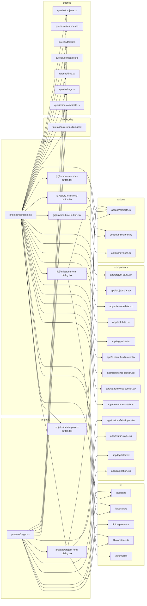
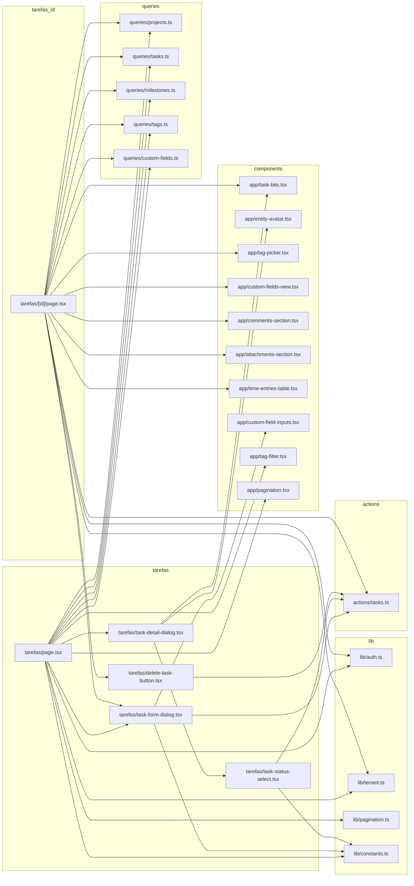

# 13. App: projetos (com Gantt/marcos) e tarefas

> 14 arquivos de código · 14 fichas completas · 0 em tabela de exceção.

Este módulo cobre as telas de **entrega** do Orbit CRM: a listagem e o detalhe de
projetos (com marcos, cronograma/Gantt, equipe, horas e faturamento) e a listagem
e o detalhe de tarefas (lista/kanban, checklist e status rápido). As páginas são
Server Components que leem via `src/server/queries/*` e usam o tenant ativo; os
formulários e botões são client components que chamam Server Actions de
`src/server/actions/projects.ts`, `milestones.ts`, `tasks.ts` e `invoices.ts`.
As actions, tabelas e validações estão detalhadas em
[07-servidor-actions-negocio](07-servidor-actions-negocio.md),
[03-validacoes-zod](03-validacoes-zod.md) e no [modelo de dados](../04-modelo-de-dados.md) §4.

## Diagrama de dependências do módulo

São dois diagramas: o primeiro cobre **projetos**; o segundo, **tarefas**. A seta
`A --> B` significa "A depende de B".

### `src/app/app/projetos/page.tsx`

**Propósito:** Listar os projetos do tenant ativo agrupados por status (Pendentes, Em andamento, Concluídos, Cancelados), com progresso, prazo, contagem de tarefas e equipe.
**Processo:** RSC assíncrono. Lê `searchParams` (`tag`, `page`), resolve `getMemberships()` + `getActiveTenant()` e, se houver tag, filtra com `entityIdsByTag(..., "project", tag)`. Em `Promise.all` carrega `listProjectsPage` (paginado), `projectMembersByProject`, `taskCountsByProject`, `listCompanies`, `listTags` e `listCustomFieldDefinitions(..., "project")`. Renderiza os grupos definidos em `GROUPS` (por `status`) e cada linha em `ProjectRow`, que mostra nome, cliente, `done/total` de tarefas, `DeadlinePill` (dias restantes/atrasado), barra de progresso e `AvatarStack`. Usa `Pagination` e `TagFilter`.
**Estado:** `implementado`
**Testes:** sem teste.
**Depende de:**
- `src/server/queries/projects.ts`: `listProjectsPage`, `projectMembersByProject`, `ProjectListRow`.
- `src/server/queries/tasks.ts`: `taskCountsByProject`.
- `src/server/queries/companies.ts`: `listCompanies`.
- `src/server/queries/tags.ts`: `listTags`, `entityIdsByTag`.
- `src/server/queries/custom-fields.ts`: `listCustomFieldDefinitions`.
- `src/lib/auth.ts` / `src/lib/tenant.ts`: `getMemberships`, `getActiveTenant`.
- `src/lib/pagination.ts`: `PAGE_SIZE`, `parsePage`.
- `src/components/app/avatar-stack.tsx`, `tag-filter.tsx`, `pagination.tsx`.
- `src/app/app/projetos/project-form-dialog.tsx`.
- Banco: tabelas `projects`, `project_members`, `tasks`, `companies`, `tags`, `entity_tags`, `custom_field_definitions`.
**Usado por:** rota `/app/projetos`; linkado por `src/components/app/app-sidebar.tsx` e `src/components/app/new-menu.tsx` (e a partir do dashboard em `src/app/app/page.tsx`). É ponto de entrada.
**Bibliotecas externas:** `next/link`, `lucide-react`.

### `src/app/app/projetos/project-form-dialog.tsx`

**Propósito:** Dialog de criar/editar projeto, reaproveitado nas telas de lista e detalhe.
**Processo:** Client component (`"use client"`). Escolhe a action conforme houver `project`: `updateProjectAction` ou `createProjectAction`. Usa `useActionState(action, undefined)` e, em `useEffect`, fecha o dialog e dispara `toast.success`/`toast.error` conforme `state`. O formulário envia `name`, `company_id`, `status`, `billing_type`, `estimated_hours`, `start_date`, `deadline`, `project_cost`, `rate_per_hour`, `progress`, `progress_from_tasks` (checkbox), `description` e, quando edição, `id` escondido; os selects usam `PROJECT_STATUSES` e `PROJECT_BILLING_TYPES`. Renderiza `CustomFieldInputs` para campos personalizados.
**Estado:** `implementado`
**Testes:** sem teste.
**Depende de:**
- `src/server/actions/projects.ts`: `createProjectAction`, `updateProjectAction`, `ProjectFormState`.
- `src/lib/constants.ts`: `PROJECT_STATUSES`, `PROJECT_BILLING_TYPES`.
- `src/components/app/custom-field-inputs.tsx`.
- `src/components/ui/{button,dialog,input,label,textarea}`.
- Banco: tabelas `projects`, `custom_field_values` (via action).
**Usado por:** `src/app/app/projetos/page.tsx` (criar), `src/app/app/projetos/[id]/page.tsx` (editar).
**Bibliotecas externas:** `react` (`useActionState`), `sonner`, `lucide-react`.

### `src/app/app/projetos/delete-project-button.tsx`

**Propósito:** Botão que exclui (soft delete) o projeto atual, com confirmação.
**Processo:** Client component. Renderiza um `<form action={deleteProjectAction}>` com `id` escondido; o `onSubmit` chama `confirm("Excluir este projeto?")` e cancela se o usuário recusar. O botão é `variant="destructive"`.
**Estado:** `implementado`
**Testes:** sem teste.
**Depende de:**
- `src/server/actions/projects.ts`: `deleteProjectAction` (marca `deleted_at` e redireciona para `/app/projetos`).
- `src/components/ui/button.tsx`.
- Banco: tabela `projects`.
**Usado por:** `src/app/app/projetos/[id]/page.tsx`.
**Bibliotecas externas:** nenhuma relevante.

### `src/app/app/projetos/[id]/page.tsx`

**Propósito:** Página de detalhe do projeto: visão geral, marcos, tarefas, cronograma (Gantt), equipe, faturamento de horas, timesheet, campos personalizados, comentários e anexos.
**Processo:** RSC. Resolve tenant, carrega o projeto com `getProject` (e `notFound()` se não existir) e, em `Promise.all`, busca cliente (`getCompany`), empresas, `listProjects`, `listProjectMembers`, `listTenantMembers`, `listTasks({ projectId })`, `listUnbilledBillableEntries` + `summarizeBillable`, `listMilestones`, `listMilestoneOptions`, tags (`tagsForEntity`, `listTags`), campos personalizados de projeto e de tarefa e valores. Depois carrega `listTaskDependencies`. Calcula `progress` (pelas tarefas quando `progress_from_tasks`) e `available` (membros do tenant fora do projeto). Renderiza cards: Visão geral, Marcos (`MilestoneFormDialog`/`DeleteMilestoneButton`), Tarefas (tabela + `TaskFormDialog`), Cronograma (`ProjectGantt`), Equipe (form com `addProjectMemberAction` + `RemoveMemberButton`), faixa de horas faturáveis com `InvoiceTimeButton`, `TimeEntriesTable`, `CustomFieldsCard`, `CommentsSection` e `AttachmentsSection`.
**Estado:** `implementado`
**Testes:** sem teste.
**Depende de:**
- `src/server/queries/projects.ts`: `getProject`, `listProjects`, `listProjectMembers`, `listTenantMembers`.
- `src/server/queries/companies.ts`: `getCompany`, `listCompanies`.
- `src/server/queries/tasks.ts`: `listTasks`, `listTaskDependencies`.
- `src/server/queries/milestones.ts`: `listMilestones`, `listMilestoneOptions`.
- `src/server/queries/time.ts`: `listUnbilledBillableEntries`, `summarizeBillable`, `formatDuration`.
- `src/server/queries/tags.ts` / `src/server/queries/custom-fields.ts`.
- `src/server/actions/projects.ts`: `addProjectMemberAction`.
- `src/lib/auth.ts`, `src/lib/tenant.ts`, `src/lib/format.ts`, `src/lib/constants.ts`.
- Componentes `src/components/app/{project-bits,milestone-bits,project-gantt,task-bits,tag-picker,custom-fields-view,comments-section,attachments-section,time-entries-table}.tsx`.
- Locais: `../project-form-dialog.tsx`, `../delete-project-button.tsx`, `./milestone-form-dialog.tsx`, `./delete-milestone-button.tsx`, `./remove-member-button.tsx`, `./invoice-time-button.tsx`, `../../tarefas/task-form-dialog.tsx`.
- Banco: `projects`, `project_members`, `milestones`, `tasks`, `task_dependencies`, `tags`, `custom_field_definitions`, `custom_field_values`.
**Usado por:** rota `/app/projetos/[id]`; linkada por `src/app/app/projetos/page.tsx` e `src/app/app/page.tsx`. É ponto de entrada.
**Bibliotecas externas:** `next/link`, `next/navigation`, `lucide-react`.

### `src/app/app/projetos/[id]/milestone-form-dialog.tsx`

**Propósito:** Dialog de criar/editar marco do projeto, com seletor de cor.
**Processo:** Client component. Escolhe `updateMilestoneAction` ou `createMilestoneAction` conforme houver `milestone`; usa `useActionState` e, em `useEffect`, fecha e mostra `toast` a partir de `state`. Mantém a cor em `useState` (inicial `milestone?.color ?? MILESTONE_COLORS[0]`) e envia `project_id` (escondido), `name`, `status` (de `MILESTONE_STATUSES`), `color` (radio), `start_date`, `due_date`, `description` e `id` na edição.
**Estado:** `implementado`
**Testes:** sem teste.
**Depende de:**
- `src/server/actions/milestones.ts`: `createMilestoneAction`, `updateMilestoneAction`, `MilestoneFormState`.
- `src/lib/constants.ts`: `MILESTONE_COLORS`, `MILESTONE_STATUSES`.
- `src/components/ui/{button,dialog,input,label,textarea}`.
- Banco: tabela `milestones`.
**Usado por:** `src/app/app/projetos/[id]/page.tsx`.
**Bibliotecas externas:** `react` (`useActionState`), `sonner`, `lucide-react`.

### `src/app/app/projetos/[id]/delete-milestone-button.tsx`

**Propósito:** Botão que exclui (soft delete) um marco do projeto.
**Processo:** Client component. `<form action={deleteMilestoneAction}>` com `id` e `project_id` escondidos; `onSubmit` confirma com `confirm("Excluir este marco?")`. A action também desvincula tarefas do marco (`tasks.milestone_id = null`).
**Estado:** `implementado`
**Testes:** sem teste.
**Depende de:**
- `src/server/actions/milestones.ts`: `deleteMilestoneAction`.
- `src/components/ui/button.tsx`.
- Banco: tabelas `milestones`, `tasks`.
**Usado por:** `src/app/app/projetos/[id]/page.tsx`.
**Bibliotecas externas:** nenhuma relevante.

### `src/app/app/projetos/[id]/remove-member-button.tsx`

**Propósito:** Botão que remove um membro da equipe do projeto.
**Processo:** Client component. `<form action={removeProjectMemberAction}>` com `project_id` e `user_id` escondidos; `onSubmit` confirma com `confirm("Remover este membro do projeto?")`.
**Estado:** `implementado`
**Testes:** sem teste.
**Depende de:**
- `src/server/actions/projects.ts`: `removeProjectMemberAction`.
- `src/components/ui/button.tsx`.
- Banco: tabela `project_members`.
**Usado por:** `src/app/app/projetos/[id]/page.tsx`.
**Bibliotecas externas:** nenhuma relevante.

### `src/app/app/projetos/[id]/invoice-time-button.tsx`

**Propósito:** Botão que gera uma fatura a partir das horas faturáveis não faturadas do projeto.
**Processo:** Client component. `<form action={invoiceBillableTimeAction}>` com `project_id` escondido; `onSubmit` confirma com `confirm(...)`. A action agrupa os apontamentos por tarefa/valor, chama a RPC `next_document_number`, calcula totais e cria a fatura.
**Estado:** `implementado`
**Testes:** sem teste.
**Depende de:**
- `src/server/actions/invoices.ts`: `invoiceBillableTimeAction`.
- `src/components/ui/button.tsx`.
- Banco/RPC: tabelas `time_entries`, `invoices`, `projects`; RPC `next_document_number`.
**Usado por:** `src/app/app/projetos/[id]/page.tsx`.
**Bibliotecas externas:** nenhuma relevante.

### `src/app/app/tarefas/page.tsx`

**Propósito:** Listar as tarefas do tenant ativo em duas visões: lista agrupada por status ou quadro Kanban, com filtro por tag, paginação e criação de tarefa.
**Processo:** RSC. Lê `searchParams` (`view=kanban`, `tag`, `page`), resolve tenant e, se houver tag, filtra por `entityIdsByTag(..., "task", tag)`. Em `Promise.all` carrega `listProjects`, `listTenantMembers`, `listMilestoneOptions`, `listTags` e campos personalizados de tarefa. No Kanban usa `listTasks` (tudo) e filtra por tags em memória; senão usa `listTasksPage`. Renderiza `KanbanBoard` (colunas por `TASK_STATUSES`) ou `TaskList` (seções por status), cada item via `TaskDetailDialog` (`variant="card"` ou `"row"`). Inclui alternador Lista/Kanban, `TagFilter`, `Pagination` e `TaskFormDialog`.
**Estado:** `implementado`
**Testes:** sem teste.
**Depende de:**
- `src/server/queries/tasks.ts`: `listTasks`, `listTasksPage`, `TaskListRow`.
- `src/server/queries/projects.ts`: `listProjects`, `listTenantMembers`.
- `src/server/queries/milestones.ts`: `listMilestoneOptions`.
- `src/server/queries/tags.ts`, `src/server/queries/custom-fields.ts`.
- `src/lib/auth.ts`, `src/lib/tenant.ts`, `src/lib/pagination.ts`, `src/lib/constants.ts`, `src/lib/utils.ts` (`cn`).
- `src/components/app/tag-filter.tsx`, `src/components/app/pagination.tsx`.
- `src/app/app/tarefas/task-form-dialog.tsx`, `task-detail-dialog.tsx`.
- Banco: `tasks`, `projects`, `milestones`, `tags`, `entity_tags`, `custom_field_definitions`.
**Usado por:** rota `/app/tarefas`; linkada por `src/components/app/app-sidebar.tsx` e `src/components/app/new-menu.tsx`. É ponto de entrada.
**Bibliotecas externas:** `next/link`.

### `src/app/app/tarefas/task-form-dialog.tsx`

**Propósito:** Dialog de criar/editar tarefa, com projeto, marco, responsável, datas, prioridade e faturamento.
**Processo:** Client component. Usa `useActionState` com `updateTaskAction` ou `createTaskAction` e `useEffect` para fechar/toast. Mantém `projectId` em `useState` (inicial `task?.project_id ?? defaultProjectId`) e filtra `milestones` pelo projeto selecionado para popular o select de marco. Envia `id` (edição), `name`, `project_id`, `milestone_id`, `assignee_id`, `status` (`TASK_STATUSES`), `priority` (`TASK_PRIORITIES`), `start_date`, `due_date`, `hourly_rate`, `billable` (checkbox) e `description`, além de `CustomFieldInputs`.
**Estado:** `implementado`
**Testes:** sem teste.
**Depende de:**
- `src/server/actions/tasks.ts`: `createTaskAction`, `updateTaskAction`, `TaskFormState`.
- `src/lib/constants.ts`: `TASK_STATUSES`, `TASK_PRIORITIES`.
- `src/components/app/custom-field-inputs.tsx`.
- `src/components/ui/{button,dialog,input,label,textarea}`.
- Banco: tabelas `tasks`, `custom_field_values` (via action).
**Usado por:** `src/app/app/tarefas/page.tsx`, `src/app/app/tarefas/[id]/page.tsx`, `src/app/app/projetos/[id]/page.tsx`.
**Bibliotecas externas:** `react` (`useActionState`), `sonner`, `lucide-react`.

### `src/app/app/tarefas/task-status-select.tsx`

**Propósito:** Select de status inline que altera a tarefa e atualiza a tela sem recarregar.
**Processo:** Client component. Guarda o status atual e chama `updateTaskStatusAction({ id, status })` dentro de `startTransition` no `onChange`, seguido de `router.refresh()`. Fica `disabled` enquanto `isPending`. As opções vêm de `TASK_STATUSES`.
**Estado:** `implementado`
**Testes:** sem teste.
**Depende de:**
- `src/server/actions/tasks.ts`: `updateTaskStatusAction`.
- `src/lib/constants.ts`: `TASK_STATUSES`.
- Banco: tabela `tasks`.
**Usado por:** `src/app/app/tarefas/task-detail-dialog.tsx`.
**Bibliotecas externas:** `react` (`useTransition`), `next/navigation` (`useRouter`).

### `src/app/app/tarefas/task-detail-dialog.tsx`

**Propósito:** Dialog de pré-visualização da tarefa, aberto a partir do card do Kanban ou da linha da lista, com troca rápida de status e link para a página completa.
**Processo:** Client component. `DialogTrigger` renderiza um `<button>` estilizado como card (`variant="card"`) ou linha (`variant="row"`), mostrando nome, projeto, `DeadlinePill` (dias restantes/atrasado), `TaskPriorityBadge`, `TaskStatusBadge` e `EntityAvatar`. O conteúdo mostra badges, um `<dl>` com projeto/responsável/datas, a descrição, um `TaskStatusSelect` e o link `Abrir página completa →` para `/app/tarefas/[id]`.
**Estado:** `implementado`
**Testes:** sem teste.
**Depende de:**
- `src/app/app/tarefas/task-status-select.tsx`.
- `src/components/app/task-bits.tsx`, `src/components/app/entity-avatar.tsx`.
- `src/components/ui/dialog`.
- Banco: nenhum direto (recebe `TaskListRow` pronto).
**Usado por:** `src/app/app/tarefas/page.tsx`.
**Bibliotecas externas:** `next/link`, `lucide-react`.

### `src/app/app/tarefas/delete-task-button.tsx`

**Propósito:** Botão que exclui (soft delete) a tarefa e redireciona para onde o usuário estava.
**Processo:** Client component. `<form action={deleteTaskAction}>` com `id`, `project_id` e `redirect_to` (default `/app/tarefas`) escondidos; `onSubmit` confirma com `confirm("Excluir esta tarefa?")`.
**Estado:** `implementado`
**Testes:** sem teste.
**Depende de:**
- `src/server/actions/tasks.ts`: `deleteTaskAction`.
- `src/components/ui/button.tsx`.
- Banco: tabela `tasks`.
**Usado por:** `src/app/app/tarefas/[id]/page.tsx`.
**Bibliotecas externas:** nenhuma relevante.

### `src/app/app/tarefas/[id]/page.tsx`

**Propósito:** Página de detalhe da tarefa: detalhes, checklist, campos personalizados, comentários, anexos e tempo registrado.
**Processo:** RSC. Resolve tenant, carrega a tarefa com `getTask` (e `notFound()`), depois em `Promise.all` busca `getProject`, `listProjects`, `listTenantMembers`, `listChecklist`, `listMilestoneOptions`, tags (`tagsForEntity`/`listTags`) e campos personalizados/valores. Deriva `milestoneName`, `assigneeName` e a contagem de itens concluídos do checklist. Renderiza cards Detalhes (com link para o projeto), Checklist (form `toggleChecklistItemAction`/`deleteChecklistItemAction` por item e `addChecklistItemAction` no rodapé), `CustomFieldsCard`, `CommentsSection`, `AttachmentsSection` e `TimeEntriesTable`. No topo, `TaskFormDialog` (editar) e `DeleteTaskButton`.
**Estado:** `implementado`
**Testes:** sem teste.
**Depende de:**
- `src/server/queries/tasks.ts`: `getTask`, `listChecklist`.
- `src/server/queries/projects.ts`: `getProject`, `listProjects`, `listTenantMembers`.
- `src/server/queries/milestones.ts`: `listMilestoneOptions`.
- `src/server/queries/tags.ts`, `src/server/queries/custom-fields.ts`.
- `src/server/actions/tasks.ts`: `addChecklistItemAction`, `toggleChecklistItemAction`, `deleteChecklistItemAction`.
- `src/lib/auth.ts`, `src/lib/tenant.ts`.
- Componentes `src/components/app/{task-bits,tag-picker,custom-fields-view,comments-section,attachments-section,time-entries-table}.tsx`.
- Locais: `../task-form-dialog.tsx`, `../delete-task-button.tsx`.
- Banco: `tasks`, `projects`, `milestones`, `task_checklist_items`, `tags`, `entity_tags`, `custom_field_definitions`, `custom_field_values`.
**Usado por:** rota `/app/tarefas/[id]`; linkada por `src/app/app/tarefas/task-detail-dialog.tsx`, `src/app/app/projetos/[id]/page.tsx` e `src/server/reminders.ts` (URL de notificação). É ponto de entrada.
**Bibliotecas externas:** `next/link`, `next/navigation`, `lucide-react`.

## Fichas do módulo

| § | Arquivo | Propósito em 1 linha |
|---|---------|----------------------|
| §13.1 | `src/app/app/projetos/page.tsx` | Lista projetos por status com progresso, prazo, tarefas e equipe. |
| §13.2 | `src/app/app/projetos/project-form-dialog.tsx` | Dialog de criar/editar projeto. |
| §13.3 | `src/app/app/projetos/delete-project-button.tsx` | Botão que exclui (soft delete) o projeto. |
| §13.4 | `src/app/app/projetos/[id]/page.tsx` | Detalhe do projeto: marcos, tarefas, Gantt, equipe, horas e anexos. |
| §13.5 | `src/app/app/projetos/[id]/milestone-form-dialog.tsx` | Dialog de criar/editar marco. |
| §13.6 | `src/app/app/projetos/[id]/delete-milestone-button.tsx` | Botão que exclui um marco. |
| §13.7 | `src/app/app/projetos/[id]/remove-member-button.tsx` | Botão que remove membro da equipe. |
| §13.8 | `src/app/app/projetos/[id]/invoice-time-button.tsx` | Botão que fatura as horas não faturadas do projeto. |
| §13.9 | `src/app/app/tarefas/page.tsx` | Lista/kanban de tarefas com filtro por tag e paginação. |
| §13.10 | `src/app/app/tarefas/task-form-dialog.tsx` | Dialog de criar/editar tarefa. |
| §13.11 | `src/app/app/tarefas/task-status-select.tsx` | Select inline de mudança de status. |
| §13.12 | `src/app/app/tarefas/task-detail-dialog.tsx` | Dialog de pré-visualização da tarefa. |
| §13.13 | `src/app/app/tarefas/delete-task-button.tsx` | Botão que exclui (soft delete) a tarefa. |
| §13.14 | `src/app/app/tarefas/[id]/page.tsx` | Detalhe da tarefa: checklist, campos, comentários e tempo. |
