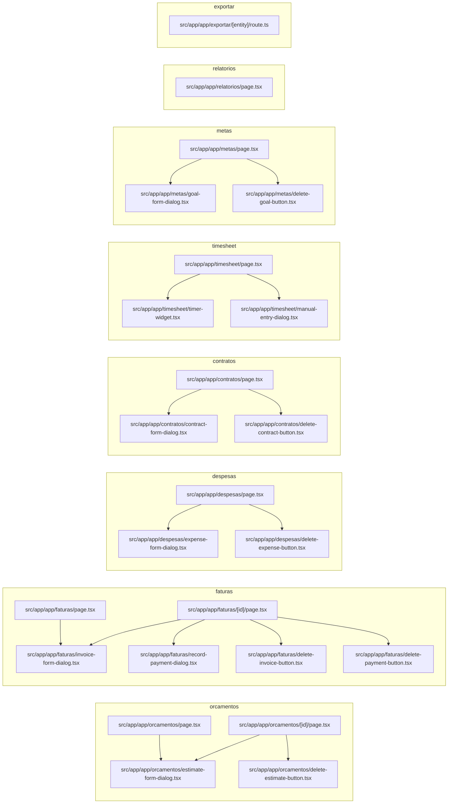

# 14. App: financeiro (orçamentos, faturas, despesas, contratos), horas, metas, relatórios e exportação

> 24 arquivos de código · 24 fichas completas · 0 em tabela de exceção.

Este módulo reúne as telas operacionais e financeiras do Orbit CRM dentro de `/app`: orçamentos (propostas), faturas (cobranças e pagamentos), despesas, contratos, registro de horas (timesheet), metas, relatórios e a rota de exportação CSV. Todas as páginas são Server Components que dependem de sessão + tenant ativo, leem dados via `src/server/queries/*` e delegam escrita para Server Actions em `src/server/actions/*`; os formulários são client components com `useActionState`. Os valores financeiros passam por `computeTotals`/`buildDocumentValues` e o isolamento por `tenant_id` é reforçado por RLS no banco.

## Diagrama de dependências do módulo

## Fichas

### `src/app/app/orcamentos/page.tsx`
**Propósito:** Listar os orçamentos do tenant ativo em tabela paginada, com atalho de exportação CSV e botão para criar novo orçamento.
**Processo:** Server Component assíncrono. Recebe `searchParams`, resolve `page` com `parsePage`, obtém `getMemberships()` e `getActiveTenant()` (se não houver tenant ativo, retorna `null`). Cria o client Supabase com `createClient()` e dispara em paralelo `listEstimatesPage`, `listCompanies`, `listProjects` e `getTenantFinanceSettings`. Renderiza a tabela (número com link para `/app/orcamentos/[id]`, cliente, data, validade, `EstimateStatusBadge`, total via `formatMoney`), a `Pagination` e o `ExportButton` apontando para `/app/exportar/orcamentos`. O botão "Novo orçamento" abre `EstimateFormDialog`.
**Estado:** `implementado`
**Testes:** sem teste (nenhum arquivo `*.test.*`/`*.spec.*` em `src`).
**Depende de:**
- `src/server/queries/documents.ts`: `listEstimatesPage` lê a tabela `estimates`.
- `src/server/queries/companies.ts`: `listCompanies` lê `companies` (opções do seletor).
- `src/server/queries/projects.ts`: `listProjects` lê `projects` (opções do seletor).
- `src/server/documents.ts`: `getTenantFinanceSettings` lê `tenants` (`currency`, `estimate_prefix`).
- `src/lib/auth.ts`: `getMemberships` (sessão).
- `src/lib/tenant.ts`: `getActiveTenant`.
- `src/lib/pagination.ts`: `PAGE_SIZE`, `parsePage`.
- `src/lib/supabase/server.ts`: `createClient`.
- `src/components/app/{document-status-badge,pagination,export-button}.tsx` e `src/components/ui/table.tsx`: UI.
- `./estimate-form-dialog.tsx`: formulário de criação.
**Usado por:** ponto de entrada da rota `/app/orcamentos` (Next.js App Router).
**Bibliotecas externas:** `next/link`, `lucide-react`.

---

### `src/app/app/orcamentos/estimate-form-dialog.tsx`
**Propósito:** Dialog (client) para criar ou editar um orçamento, com editor de itens e cálculo de totais em tempo real.
**Processo:** Mantém estado local de `lineItems`, `discountType`, `discountPercent` e `adjustment`; escolhe `createEstimateAction` ou `updateEstimateAction` conforme receba ou não um `estimate`, ligando ao `useActionState` (devolve `{ error?, success? }`). Em `useEffect` mostra `toast` e fecha o dialog em sucesso. O `DocumentItemsEditor` edita os itens; `computeTotals` recalcula subtotal/impostos/desconto/total exibidos. O formulário envia `items` serializado em JSON (input hidden) e `currency`; envia `id` quando é edição.
**Estado:** `implementado`
**Testes:** sem teste.
**Depende de:**
- `src/server/actions/estimates.ts`: `createEstimateAction`, `updateEstimateAction`, tipo `EstimateFormState`.
- `src/lib/documents/totals.ts`: `computeTotals`, `LineItemInput`.
- `src/components/app/document-items-editor.tsx`: editor de itens.
- `src/lib/format.ts`: `formatMoney`.
- `src/server/queries/documents.ts`: tipos `DocumentItem`, `Estimate`.
- `src/components/ui/{button,dialog,input,label,textarea}.tsx`: UI.
**Usado por:** `src/app/app/orcamentos/page.tsx`, `src/app/app/orcamentos/[id]/page.tsx`.
**Bibliotecas externas:** `react`, `sonner` (toast), `lucide-react`.

---

### `src/app/app/orcamentos/delete-estimate-button.tsx`
**Propósito:** Botão (client) que exclui um orçamento após confirmação.
**Processo:** Renderiza um `<form action={deleteEstimateAction}>` com `<input hidden name="id">`. No `onSubmit` chama `confirm("Excluir este orçamento?")` e cancela o envio se o usuário recusar. A action faz a exclusão e o `revalidatePath`.
**Estado:** `implementado`
**Testes:** sem teste.
**Depende de:**
- `src/server/actions/estimates.ts`: `deleteEstimateAction` (apaga de `estimates`).
- `src/components/ui/button.tsx`: `Button`.
**Usado por:** `src/app/app/orcamentos/[id]/page.tsx`.
**Bibliotecas externas:** nenhuma relevante.

---

### `src/app/app/orcamentos/[id]/page.tsx`
**Propósito:** Detalhe de um orçamento: itens, resumo de valores, dados do cliente, mudança de status, conversão em fatura, edição e exclusão.
**Processo:** Server Component que lê `params.id`, resolve o tenant ativo e busca `getEstimate` (se não existir, `notFound()`). Em paralelo carrega `listDocumentItems(..., "estimate", id)`, `getCompany` (quando há cliente), `listCompanies`, `listProjects` e `getTenantFinanceSettings`. Renderiza tabela de itens (calculando `qty * rate` e imposto por item) e o resumo (`subtotal`, `total_tax`, `discount_total`, `total`). Mostra `EstimateFormDialog` (edição), um form `updateEstimateStatusAction` para trocar o status e o `DeleteEstimateButton`. Se `estimate.invoice_id` existe, mostra "Ver fatura"; senão, form `convertEstimateToInvoiceAction` ("Converter em fatura").
**Estado:** `implementado`
**Testes:** sem teste.
**Depende de:**
- `src/server/queries/documents.ts`: `getEstimate`, `listDocumentItems` (tabelas `estimates`, `document_items`).
- `src/server/queries/companies.ts`: `getCompany`, `listCompanies` (`companies`).
- `src/server/queries/projects.ts`: `listProjects` (`projects`).
- `src/server/documents.ts`: `getTenantFinanceSettings` (`tenants`).
- `src/server/actions/estimates.ts`: `convertEstimateToInvoiceAction` (cria `invoices` e atualiza `estimates`), `updateEstimateStatusAction`.
- `src/lib/constants.ts`: `ESTIMATE_STATUSES`.
- `src/lib/auth.ts`, `src/lib/tenant.ts`, `src/lib/supabase/server.ts`, `src/lib/format.ts`.
- `../estimate-form-dialog.tsx`, `../delete-estimate-button.tsx`.
**Usado por:** ponto de entrada da rota `/app/orcamentos/[id]`.
**Bibliotecas externas:** `next/link`, `next/navigation` (`notFound`), `lucide-react`.

---

### `src/app/app/faturas/page.tsx`
**Propósito:** Listar as faturas do tenant ativo em tabela paginada, com exportação CSV e criação de nova fatura.
**Processo:** Mesmo padrão de `orcamentos/page.tsx`: resolve `page`, tenant ativo, e em paralelo chama `listInvoicesPage`, `listCompanies`, `listProjects` e `getTenantFinanceSettings`. Renderiza a tabela (número com link para `/app/faturas/[id]`, cliente, data, vencimento, `InvoiceStatusBadge` recebendo `due_date`, total), `Pagination` e `ExportButton` para `/app/exportar/faturas`; `InvoiceFormDialog` cria novas faturas.
**Estado:** `implementado`
**Testes:** sem teste.
**Depende de:**
- `src/server/queries/documents.ts`: `listInvoicesPage` lê `invoices`.
- `src/server/queries/companies.ts`, `src/server/queries/projects.ts`, `src/server/documents.ts` (`tenants`).
- `src/lib/{auth,tenant,pagination}.ts`, `src/lib/supabase/server.ts`, `src/lib/format.ts`.
- `src/components/app/{document-status-badge,pagination,export-button}.tsx`, `src/components/ui/table.tsx`.
- `./invoice-form-dialog.tsx`.
**Usado por:** ponto de entrada da rota `/app/faturas`.
**Bibliotecas externas:** `next/link`, `lucide-react`.

---

### `src/app/app/faturas/invoice-form-dialog.tsx`
**Propósito:** Dialog (client) para criar ou editar uma fatura, com editor de itens e cálculo de totais.
**Processo:** Análogo a `EstimateFormDialog`, mas usa `createInvoiceAction`/`updateInvoiceAction` e o tipo `Invoice`. Mantém `lineItems`, desconto e ajuste; recalcula com `computeTotals`; envia `items` (JSON) e `currency`; inclui `due_date` e `expiry` não (fatura usa `due_date`). `useEffect` exibe toast e fecha em sucesso.
**Estado:** `implementado`
**Testes:** sem teste.
**Depende de:**
- `src/server/actions/invoices.ts`: `createInvoiceAction`, `updateInvoiceAction`, `InvoiceFormState`.
- `src/lib/documents/totals.ts`, `src/lib/format.ts`, `src/server/queries/documents.ts` (tipos).
- `src/components/app/document-items-editor.tsx`, `src/components/ui/*`.
**Usado por:** `src/app/app/faturas/page.tsx`, `src/app/app/faturas/[id]/page.tsx`.
**Bibliotecas externas:** `react`, `sonner`, `lucide-react`.

---

### `src/app/app/faturas/record-payment-dialog.tsx`
**Propósito:** Dialog (client) para registrar um pagamento vinculado a uma fatura.
**Processo:** Recebe `invoiceId` e `amountDue` (pré-preenche o valor devido) e liga `recordPaymentAction` ao `useActionState`. Envia `invoice_id`, `amount`, `payment_date`, `payment_mode` (opções de `PAYMENT_MODES`), `transaction_id` e `note`. Em sucesso, fecha e mostra `toast`.
**Estado:** `implementado`
**Testes:** sem teste.
**Depende de:**
- `src/server/actions/invoices.ts`: `recordPaymentAction` (insere em `payments` e recomputa status de `invoices`).
- `src/lib/constants.ts`: `PAYMENT_MODES`.
- `src/components/ui/{button,dialog,input,label,textarea}.tsx`.
**Usado por:** `src/app/app/faturas/[id]/page.tsx` (cabeçalho e card "Pagamentos").
**Bibliotecas externas:** `react`, `sonner`.

---

### `src/app/app/faturas/delete-invoice-button.tsx`
**Propósito:** Botão (client) que exclui uma fatura após confirmação.
**Processo:** `<form action={deleteInvoiceAction}>` com `id` oculto; `confirm("Excluir esta fatura?")` no `onSubmit`. A action remove de `invoices` (e itens/pagamentos associados, conforme RLS/cascata) e revalida a rota.
**Estado:** `implementado`
**Testes:** sem teste.
**Depende de:**
- `src/server/actions/invoices.ts`: `deleteInvoiceAction`.
- `src/components/ui/button.tsx`.
**Usado por:** `src/app/app/faturas/[id]/page.tsx`.
**Bibliotecas externas:** nenhuma relevante.

---

### `src/app/app/faturas/delete-payment-button.tsx`
**Propósito:** Ícone de lixeira (client) que remove um pagamento específico de uma fatura.
**Processo:** `<form action={deletePaymentAction}>` com `id` (do pagamento) e `invoice_id` ocultos, e ícone `Trash2` com `aria-label`. Confirma com `confirm("Remover este pagamento?")`. A action apaga de `payments` e recomputa o status da fatura.
**Estado:** `implementado`
**Testes:** sem teste.
**Depende de:**
- `src/server/actions/invoices.ts`: `deletePaymentAction`.
- `lucide-react`: ícone `Trash2`.
**Usado por:** `src/app/app/faturas/[id]/page.tsx`.
**Bibliotecas externas:** `lucide-react`.

---

### `src/app/app/faturas/[id]/page.tsx`
**Propósito:** Detalhe de uma fatura: itens, resumo (faturado/pago/em aberto), dados, status e lista de pagamentos com registro/remoção.
**Processo:** Server Component; resolve `params.id` e tenant; `getInvoice` (senão `notFound()`). Em paralelo carrega `listDocumentItems(..., "invoice", id)`, `listPayments`, `sumPayments`, `getCompany`, `listCompanies`, `listProjects` e `getTenantFinanceSettings`. Calcula `amountDue = total - paid`. Renderiza itens, resumo (incluindo linhas "Pago" e "Em aberto"), o form `updateInvoiceStatusAction` (opções de `INVOICE_STATUSES`) e o card "Pagamentos" com `RecordPaymentDialog` (novo pagamento) e `DeletePaymentButton` por linha. No cabeçalho há `RecordPaymentDialog`, `InvoiceFormDialog` (editar) e `DeleteInvoiceButton`.
**Estado:** `implementado`
**Testes:** sem teste.
**Depende de:**
- `src/server/queries/documents.ts`: `getInvoice`, `listDocumentItems`, `listPayments`, `sumPayments` (tabelas `invoices`, `document_items`, `payments`).
- `src/server/queries/companies.ts`, `src/server/queries/projects.ts`, `src/server/documents.ts`.
- `src/server/actions/invoices.ts`: `updateInvoiceStatusAction`.
- `src/lib/constants.ts`: `INVOICE_STATUSES`; `src/lib/format.ts`, `src/lib/auth.ts`, `src/lib/tenant.ts`.
- `../invoice-form-dialog.tsx`, `../delete-invoice-button.tsx`, `../delete-payment-button.tsx`, `../record-payment-dialog.tsx`.
**Usado por:** ponto de entrada da rota `/app/faturas/[id]`.
**Bibliotecas externas:** `next/link`, `next/navigation`, `lucide-react`.

---

### `src/app/app/despesas/page.tsx`
**Propósito:** Listar despesas com filtro por projeto e cliente, paginação, exportação CSV e criação/edição/exclusão por linha.
**Processo:** Server Component; lê `searchParams` (`page`, `project`, `company`), resolve tenant ativo. Em paralelo `listProjects`, `listCompanies` e `listExpensesPage` (com os filtros). Monta o `exportHref` preservando os filtros. Renderiza um form GET de filtro (projeto/cliente + "Limpar"), a tabela (data, título, categoria, projeto, cliente, faturável, valor) e, por linha, `ExpenseFormDialog` (editar) e `DeleteExpenseButton`. `Pagination` preserva os filtros.
**Estado:** `implementado`
**Testes:** sem teste.
**Depende de:**
- `src/server/queries/expenses.ts`: `listExpensesPage` lê `expenses`.
- `src/server/queries/{projects,companies}.ts`: opções de filtro.
- `src/lib/{auth,tenant,pagination}.ts`, `src/lib/format.ts`.
- `src/components/app/{pagination,export-button}.tsx`, `src/components/ui/{table,button}.tsx`.
- `./expense-form-dialog.tsx`, `./delete-expense-button.tsx`.
**Usado por:** ponto de entrada da rota `/app/despesas`.
**Bibliotecas externas:** `next/link`, `lucide-react`.

---

### `src/app/app/despesas/expense-form-dialog.tsx`
**Propósito:** Dialog (client) para criar ou editar uma despesa.
**Processo:** Escolhe `createExpenseAction`/`updateExpenseAction` e liga ao `useActionState`; `useEffect` mostra toast e fecha. Campos: `title` (obrigatório), `category` (com `datalist` de `EXPENSE_CATEGORIES`), `amount`, `date` (padrão hoje), checkbox `billable`, `project_id`, `company_id` e `note`.
**Estado:** `implementado`
**Testes:** sem teste.
**Depende de:**
- `src/server/actions/expenses.ts`: `createExpenseAction`, `updateExpenseAction` (tabela `expenses`).
- `src/lib/constants.ts`: `EXPENSE_CATEGORIES`.
- `src/server/queries/expenses.ts`: tipo `Expense`.
- `src/components/ui/{button,dialog,input,label,textarea}.tsx`.
**Usado por:** `src/app/app/despesas/page.tsx` (criação e edição).
**Bibliotecas externas:** `react`, `sonner`, `lucide-react`.

---

### `src/app/app/despesas/delete-expense-button.tsx`
**Propósito:** Botão (client) que exclui uma despesa após confirmação.
**Processo:** `<form action={deleteExpenseAction}>` com `id` oculto; `confirm("Excluir esta despesa?")`. A action apaga de `expenses` e revalida.
**Estado:** `implementado`
**Testes:** sem teste.
**Depende de:**
- `src/server/actions/expenses.ts`: `deleteExpenseAction`.
- `src/components/ui/button.tsx`.
**Usado por:** `src/app/app/despesas/page.tsx`.
**Bibliotecas externas:** nenhuma relevante.

---

### `src/app/app/contratos/page.tsx`
**Propósito:** Listar contratos com filtro por cliente e status, paginação e ações de criar/editar/excluir.
**Processo:** Server Component; lê `searchParams` (`page`, `company`, `status`) e tenant ativo. Em paralelo `listCompanies` e `listContractsPage` (com filtros). Renderiza form GET de filtro (cliente/status via `CONTRACT_STATUSES`), a tabela (título, cliente, início, término, `ContractStatusBadge` com `end_date`, valor) e, por linha, `ContractFormDialog` (editar) e `DeleteContractButton`. `Pagination` preserva os filtros.
**Estado:** `implementado`
**Testes:** sem teste.
**Depende de:**
- `src/server/queries/contracts.ts`: `listContractsPage` lê `contracts`.
- `src/server/queries/companies.ts`: `companies`.
- `src/lib/constants.ts`: `CONTRACT_STATUSES`.
- `src/lib/{auth,tenant,pagination}.ts`, `src/lib/format.ts`.
- `src/components/app/{pagination,contract-bits}.tsx`, `src/components/ui/{table,button}.tsx`.
- `./contract-form-dialog.tsx`, `./delete-contract-button.tsx`.
**Usado por:** ponto de entrada da rota `/app/contratos`.
**Bibliotecas externas:** `next/link`, `lucide-react`.

---

### `src/app/app/contratos/contract-form-dialog.tsx`
**Propósito:** Dialog (client) para criar ou editar um contrato.
**Processo:** Escolhe `createContractAction`/`updateContractAction` via `useActionState`; `useEffect` mostra toast e fecha. Campos: `title` (obrigatório), `company_id`, `status` (opções de `CONTRACT_STATUSES`), `value`, `start_date`, `end_date`, `description` e `note`.
**Estado:** `implementado`
**Testes:** sem teste.
**Depende de:**
- `src/server/actions/contracts.ts`: `createContractAction`, `updateContractAction` (tabela `contracts`).
- `src/lib/constants.ts`: `CONTRACT_STATUSES`.
- `src/server/queries/contracts.ts`: tipo `Contract`.
- `src/components/ui/{button,dialog,input,label,textarea}.tsx`.
**Usado por:** `src/app/app/contratos/page.tsx`.
**Bibliotecas externas:** `react`, `sonner`, `lucide-react`.

---

### `src/app/app/contratos/delete-contract-button.tsx`
**Propósito:** Botão (client) que exclui um contrato após confirmação.
**Processo:** `<form action={deleteContractAction}>` com `id` oculto; `confirm("Excluir este contrato?")`. A action apaga de `contracts` e revalida.
**Estado:** `implementado`
**Testes:** sem teste.
**Depende de:**
- `src/server/actions/contracts.ts`: `deleteContractAction`.
- `src/components/ui/button.tsx`.
**Usado por:** `src/app/app/contratos/page.tsx`.
**Bibliotecas externas:** nenhuma relevante.

---

### `src/app/app/timesheet/page.tsx`
**Propósito:** Tela de registro de horas: timer em andamento, lançamento manual, lista de apontamentos e exportação CSV.
**Processo:** Server Component; resolve `page` e tenant; obtém `getUser()` e, em paralelo, `listProjects`, `listTasks` e `getRunningEntry` (do usuário atual, se houver). Monta opções de projeto e tarefa (com `project_id`). Renderiza `ExportButton` para `/app/exportar/timesheet`, `ManualEntryDialog`, `TimerWidget` (recebendo o apontamento em andamento) e `TimeEntriesTable` (`showUser`, `paginationBasePath="/app/timesheet"`).
**Estado:** `implementado`
**Testes:** sem teste.
**Depende de:**
- `src/server/queries/time.ts`: `getRunningEntry` (lê `time_entries`).
- `src/server/queries/{projects,tasks}.ts`: `listProjects`, `listTasks`.
- `src/components/app/{time-entries-table,export-button}.tsx`.
- `src/lib/{auth,tenant,pagination}.ts`.
- `./manual-entry-dialog.tsx`, `./timer-widget.tsx`.
**Usado por:** ponto de entrada da rota `/app/timesheet`.
**Bibliotecas externas:** nenhuma relevante (só componentes internos).

---

### `src/app/app/timesheet/timer-widget.tsx`
**Propósito:** Widget (client) do cronômetro: mostra o tempo decorrido do apontamento em andamento (ou o formulário para iniciar um).
**Processo:** Se houver `running`, um `useEffect` monta um `setInterval` de 1s que atualiza `elapsed` a partir de `running.started_at` (limpo no unmount) e exibe projeto/tarefa + tempo formatado, com `<form action={stopTimerAction}>`. Se não houver, renderiza `<form action={startTimerAction}>` com selects de `project_id` e `task_id` (tarefas filtradas por projeto via `useMemo`), campo de nota e checkbox `is_billable`.
**Estado:** `implementado`
**Testes:** sem teste.
**Depende de:**
- `src/server/actions/time.ts`: `startTimerAction`, `stopTimerAction` (tabela `time_entries`).
- `src/components/ui/button.tsx`.
**Usado por:** `src/app/app/timesheet/page.tsx`.
**Bibliotecas externas:** `react`, `lucide-react`.

---

### `src/app/app/timesheet/manual-entry-dialog.tsx`
**Propósito:** Dialog (client) para lançar horas manualmente.
**Processo:** Liga `addManualEntryAction` ao `useActionState`; `useEffect` mostra toast e fecha. Campos: `project_id` (obrigatório), `task_id` (filtrado pelo projeto escolhido), `date`, `hours`, `rate`, checkbox `is_billable` e `note`.
**Estado:** `implementado`
**Testes:** sem teste.
**Depende de:**
- `src/server/actions/time.ts`: `addManualEntryAction` (insere em `time_entries`).
- `src/components/ui/{button,dialog,input,label,textarea}.tsx`.
**Usado por:** `src/app/app/timesheet/page.tsx`.
**Bibliotecas externas:** `react`, `sonner`, `lucide-react`.

---

### `src/app/app/metas/page.tsx`
**Propósito:** Exibir as metas do tenant em cards com barra de progresso, e permitir criar/editar/excluir.
**Processo:** Server Component; resolve tenant ativo e chama `listGoals` (que calcula progresso). Define o mapa `METRICS` para formatar cada métrica (`revenue`→`formatMoney`, `leads`→número, `hours`→`h`). Para cada meta com `progress >= 100` marca como alcançada (ícone/cor). Cada card tem `GoalFormDialog` (editar) e `DeleteGoalButton`; há um `GoalFormDialog` no topo ("Nova meta").
**Estado:** `implementado`
**Testes:** sem teste.
**Depende de:**
- `src/server/queries/goals.ts`: `listGoals`, tipos `GoalMetric`/`GoalWithProgress` (lê `goals` e calcula a partir de `invoices`, `leads`, `time_entries`).
- `src/lib/{auth,tenant}.ts`, `src/lib/format.ts`, `src/lib/utils.ts` (`cn`).
- `src/components/ui/card.tsx`.
- `./goal-form-dialog.tsx`, `./delete-goal-button.tsx`.
**Usado por:** ponto de entrada da rota `/app/metas`.
**Bibliotecas externas:** `lucide-react`.

---

### `src/app/app/metas/goal-form-dialog.tsx`
**Propósito:** Dialog (client) para criar ou editar uma meta.
**Processo:** Escolhe `createGoalAction`/`updateGoalAction` via `useActionState`; `useEffect` mostra toast e fecha. Campos: `title`, `metric` (revenue/leads/hours), `period_start` e `period_end` (padrão do mês corrente, calculado em `monthDefaults`) e `target` (obrigatório).
**Estado:** `implementado`
**Testes:** sem teste.
**Depende de:**
- `src/server/actions/goals.ts`: `createGoalAction`, `updateGoalAction` (tabela `goals`).
- `src/server/queries/goals.ts`: tipo `Goal`.
- `src/components/ui/{button,dialog,input,label}.tsx`.
**Usado por:** `src/app/app/metas/page.tsx`.
**Bibliotecas externas:** `react`, `sonner`, `lucide-react`.

---

### `src/app/app/metas/delete-goal-button.tsx`
**Propósito:** Botão (client) que exclui uma meta após confirmação.
**Processo:** `<form action={deleteGoalAction}>` com `id` oculto; `confirm("Excluir esta meta?")`. A action apaga de `goals` e revalida.
**Estado:** `implementado`
**Testes:** sem teste.
**Depende de:**
- `src/server/actions/goals.ts`: `deleteGoalAction`.
- `src/components/ui/button.tsx`.
**Usado por:** `src/app/app/metas/page.tsx`.
**Bibliotecas externas:** nenhuma relevante.

---

### `src/app/app/relatorios/page.tsx`
**Propósito:** Painel de relatórios com funil de leads, financeiro, rentabilidade, produtividade, despesas e horas, filtrável por período/cliente/projeto e exportável por relatório.
**Processo:** Server Component; lê `searchParams` (`range`, `company`, `project`), resolve tenant ativo e chama `getReportData(tenantId, { days, companyId, projectId })`, desestruturando dezenas de agregados. Renderiza links de período (`RANGES`), form GET de filtro (cliente/projeto) e vários `Card` (funil com `StatCard`/barras por status e tabela de conversão por origem; financeiro com 6 meses e top clientes; rentabilidade por projeto/cliente via `ProfitTable`; produtividade; despesas por categoria/projeto; horas por projeto/pessoa). Cada card tem um `ExportLink` que aponta para `/app/exportar/relatorios?report=...&range=...`.
**Estado:** `implementado`
**Testes:** sem teste.
**Depende de:**
- `src/server/queries/reports.ts`: `getReportData` (lê `projects`, `invoices`, `time_entries`, `expenses`, `tasks`, `payments`; e leads).
- `src/server/queries/time.ts`: `formatDuration`.
- `src/components/app/{stat-card,status-pill}.tsx`, `src/components/ui/{card,button,table}.tsx`.
- `src/lib/{auth,tenant,format,utils}.ts`.
**Usado por:** ponto de entrada da rota `/app/relatorios`.
**Bibliotecas externas:** `next/link`, `lucide-react`.

---

### `src/app/app/exportar/[entity]/route.ts`
**Propósito:** Route handler que gera e devolve arquivos CSV do tenant ativo (clientes, leads, orçamentos, faturas, despesas, timesheet e relatórios).
**Processo:** `GET` resolve `getMemberships()` e `getActiveTenant()`; sem tenant ativo responde 401. Lê o segmento dinâmico `entity` e faz um `switch`: para cada caso busca os dados via query, monta linhas com `toCsv` (rótulos de status traduzidos por `INVOICE_STATUSES`/`ESTIMATE_STATUSES`) e devolve `csvResponse` com BOM `\uFEFF`, `Content-Type: text/csv; charset=utf-8` e `Content-Disposition: attachment`. O caso `relatorios` lê `report`/`range`/`company`/`project`, chama `getReportData` e escolhe colunas conforme o relatório. Entidades/relatórios desconhecidos devolvem 404.
**Estado:** `implementado`
**Testes:** sem teste.
**Depende de:**
- `src/lib/auth.ts` (`getMemberships`), `src/lib/tenant.ts` (`getActiveTenant`), `src/lib/csv.ts` (`toCsv`), `src/lib/constants.ts` (rótulos de status).
- `src/server/queries/{companies,leads,documents,expenses,time,reports}.ts`: leitura dos dados.
**Usado por:** `ExportButton` e links de exportação nas páginas `orcamentos`, `faturas`, `despesas`, `timesheet`, `clientes`, `leads` e `relatorios` (hrefs `/app/exportar/<entity>`).
**Bibliotecas externas:** `next/server` (`NextRequest`).

**Contrato:** `GET /app/exportar/[entity]` — só sessão (requer usuário com tenant ativo; sem checagem de papel).
**Entrada:** path param `entity` (obrigatório); query: `status` (leads), `project` e `company` (despesas/relatórios), `report` e `range` (relatorios). Não há schema Zod — os valores são passados direto às queries.
**Saída:** `text/csv; charset=utf-8` com BOM e `Content-Disposition: attachment; filename="<entity>-<AAAA-MM-DD>.csv"`, status 200.
**Erros:** 401 quando não há tenant ativo ("Não autorizado"); 404 para entidade desconhecida ("Recurso não encontrado") ou relatório desconhecido ("Relatório não encontrado").
**Chama:** queries `listCompanies`, `listLeads`, `listEstimates`, `listInvoices`, `listExpenses`, `listTimeEntries`, `getReportData` (e `formatDuration`) · **Tabelas:** `companies`, `leads`, `estimates`, `invoices`, `expenses`, `time_entries`, `projects`, `tasks`, `payments` · **Telas que consomem:** `/app/orcamentos`, `/app/faturas`, `/app/despesas`, `/app/timesheet`, `/app/clientes`, `/app/leads`, `/app/relatorios`.

---

## Tabela das fichas do módulo

| § | Arquivo | Propósito em 1 linha |
|---|---------|----------------------|
| §14.1 | `src/app/app/orcamentos/page.tsx` | Lista paginada de orçamentos, com exportar e novo. |
| §14.2 | `src/app/app/orcamentos/estimate-form-dialog.tsx` | Dialog de criar/editar orçamento com itens e totais. |
| §14.3 | `src/app/app/orcamentos/delete-estimate-button.tsx` | Botão de excluir orçamento com confirmação. |
| §14.4 | `src/app/app/orcamentos/[id]/page.tsx` | Detalhe do orçamento, status e conversão em fatura. |
| §14.5 | `src/app/app/faturas/page.tsx` | Lista paginada de faturas, com exportar e nova. |
| §14.6 | `src/app/app/faturas/invoice-form-dialog.tsx` | Dialog de criar/editar fatura com itens e totais. |
| §14.7 | `src/app/app/faturas/record-payment-dialog.tsx` | Dialog de registrar pagamento de uma fatura. |
| §14.8 | `src/app/app/faturas/delete-invoice-button.tsx` | Botão de excluir fatura com confirmação. |
| §14.9 | `src/app/app/faturas/delete-payment-button.tsx` | Ícone de remover pagamento de uma fatura. |
| §14.10 | `src/app/app/faturas/[id]/page.tsx` | Detalhe da fatura: itens, pago/em aberto e pagamentos. |
| §14.11 | `src/app/app/despesas/page.tsx` | Lista de despesas com filtros e exportar. |
| §14.12 | `src/app/app/despesas/expense-form-dialog.tsx` | Dialog de criar/editar despesa. |
| §14.13 | `src/app/app/despesas/delete-expense-button.tsx` | Botão de excluir despesa com confirmação. |
| §14.14 | `src/app/app/contratos/page.tsx` | Lista de contratos com filtros por cliente/status. |
| §14.15 | `src/app/app/contratos/contract-form-dialog.tsx` | Dialog de criar/editar contrato. |
| §14.16 | `src/app/app/contratos/delete-contract-button.tsx` | Botão de excluir contrato com confirmação. |
| §14.17 | `src/app/app/timesheet/page.tsx` | Tela de horas: timer, lançamento manual e listagem. |
| §14.18 | `src/app/app/timesheet/timer-widget.tsx` | Widget de cronômetro iniciar/parar apontamento. |
| §14.19 | `src/app/app/timesheet/manual-entry-dialog.tsx` | Dialog de lançar horas manualmente. |
| §14.20 | `src/app/app/metas/page.tsx` | Cards de metas com progresso e ações. |
| §14.21 | `src/app/app/metas/goal-form-dialog.tsx` | Dialog de criar/editar meta. |
| §14.22 | `src/app/app/metas/delete-goal-button.tsx` | Botão de excluir meta com confirmação. |
| §14.23 | `src/app/app/relatorios/page.tsx` | Painel de relatórios (leads, financeiro, horas, etc.). |
| §14.24 | `src/app/app/exportar/[entity]/route.ts` | Rota de exportação CSV por entidade/relatório. |
