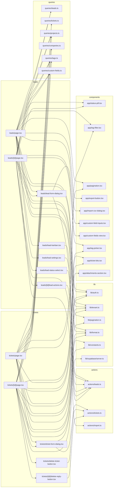
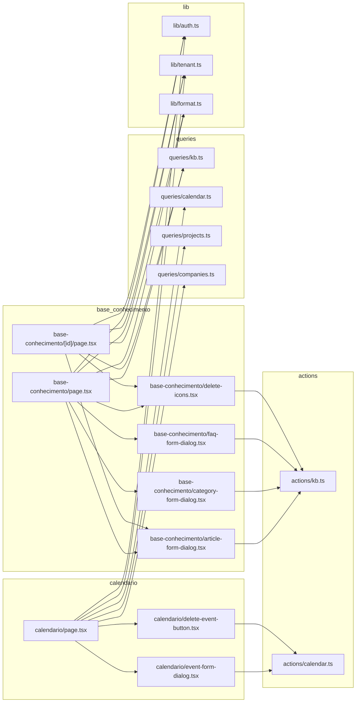

# 15. App: comercial (leads), atendimento (tickets, base de conhecimento) e calendário

> 21 arquivos de código · 21 fichas completas · 0 em tabela de exceção.

Este módulo cobre as telas de **relacionamento com o cliente** fora dos projetos: o
pipeline comercial de **leads** (lista/kanban, detalhe com atividades e conversão em
cliente), o **atendimento** por **tickets** (fila, conversa/respostas, anexos), a
**base de conhecimento** (artigos, categorias e FAQ) e o **calendário** (agenda do
mês com eventos, prazos de tarefas, faturas e contratos). As páginas são Server
Components que leem o tenant ativo via `src/server/queries/*`; formulários, botões e
widgets são client components que chamam Server Actions de `src/server/actions/*`.
Validations, actions e tabelas aparecem em
[03-validacoes-zod](03-validacoes-zod.md),
[07-servidor-actions-negocio](07-servidor-actions-negocio.md) e no
[modelo de dados](../04-modelo-de-dados.md) §4.

## Diagrama de dependências do módulo

São dois diagramas: o primeiro cobre **leads e tickets**; o segundo, **base de
conhecimento e calendário**. A seta `A --> B` significa "A depende de B".

### `src/app/app/leads/page.tsx`

**Propósito:** Listar os leads do tenant em dois modos — tabela paginada (Lista) ou quadro Kanban por status — com filtros de status e tag, exportação, importação CSV e cadastro/configuração.
**Processo:** RSC assíncrono. Lê `searchParams` (`status`, `view`, `tag`, `page`); `kanban = view === "kanban"`. Resolve `getMemberships()` + `getActiveTenant()` e retorna `null` sem empresa ativa. Se houver tag, busca os ids com `entityIdsByTag(tenantId, "lead", tag)`. Em `Promise.all` carrega `listLeadStatuses`, `listLeadSources`, `listTenantMembers`, `listTags` e `listCustomFieldDefinitions(..., "lead")`. No modo Lista usa `listLeadsPage` (paginado, com `statusId`/`ids`) e no Kanban usa `listLeads` filtrando em memória por tag. Renderiza alternador Lista/Kanban, `ExportButton` (aponta para `/app/exportar/leads`), `ImportCsvDialog` com `importLeadsAction`, `LeadSettingsDialog`, `LeadFormDialog`, `TagFilter`, o quadro `LeadKanban` ou a tabela (com `StatusPill`, `Pagination`) e chips de status.
**Estado:** `implementado`
**Testes:** sem teste.
**Depende de:**
- `src/server/queries/leads.ts`: `listLeadStatuses`, `listLeadSources`, `listLeads`, `listLeadsPage`, `LeadListRow`.
- `src/server/queries/projects.ts`: `listTenantMembers`.
- `src/server/queries/tags.ts`: `listTags`, `entityIdsByTag`.
- `src/server/queries/custom-fields.ts`: `listCustomFieldDefinitions`.
- `src/server/actions/import.ts`: `importLeadsAction`.
- `src/lib/auth.ts` / `src/lib/tenant.ts`: `getMemberships`, `getActiveTenant`.
- `src/lib/pagination.ts`: `PAGE_SIZE`, `parsePage`; `src/lib/format.ts`: `formatDate`, `formatMoney`; `src/lib/utils.ts`: `cn`.
- `src/components/app/{status-pill,tag-filter,pagination,export-button,import-csv-dialog}.tsx` e `src/components/ui/table`.
- Locais: `./lead-form-dialog.tsx`, `./lead-settings.tsx`, `./lead-kanban.tsx`. Rota de exportação `/app/exportar/leads` (route handler).
- Banco: tabelas `leads`, `lead_statuses`, `lead_sources`, `profiles`, `tags`, `entity_tags`, `custom_field_definitions`.
**Usado por:** rota `/app/leads`; linkada por `src/components/app/app-sidebar.tsx`. É ponto de entrada.
**Bibliotecas externas:** `next/link`, `lucide-react`.
**Rota da página:** `/app/leads` · **O que o usuário vê e faz:** vê a contagem de leads, alterna entre Lista e Kanban, filtra por status/tag, pagina, exporta/importa CSV, abre configuração de status/origens e cria um novo lead; clica no nome para abrir o detalhe. **APIs/actions que chama:** `listLeadStatuses`, `listLeadSources`, `listTenantMembers`, `listTags`, `entityIdsByTag`, `listCustomFieldDefinitions`, `listLeads`, `listLeadsPage`, `importLeadsAction` · **Guardas:** exige sessão (herdada do layout); sem empresa ativa retorna `null`.

### `src/app/app/leads/lead-form-dialog.tsx`

**Propósito:** Dialog de criar/editar lead, reaproveitado na lista e no detalhe.
**Processo:** Client component. Escolhe a action conforme houver `lead`: `updateLeadAction` ou `createLeadAction`. Usa `useActionState<LeadFormState, FormData>` e, em `useEffect`, fecha o dialog e dispara `toast` conforme `state.success`/`state.error`. O formulário envia `name`, `company`, `title`, `email`, `phone`, `website`, `status_id`, `source_id`, `value`, `assignee_id`, `city`, `country`, `description` e, na edição, `id` escondido. Renderiza também `CustomFieldInputs` para campos personalizados.
**Estado:** `implementado`
**Testes:** sem teste.
**Depende de:**
- `src/server/actions/leads.ts`: `createLeadAction`, `updateLeadAction`, `LeadFormState`.
- `src/server/queries/leads.ts` / `src/server/queries/custom-fields.ts`: tipos `Lead`, `LeadSource`, `LeadStatus`, `CustomFieldDefinition`.
- `src/components/app/custom-field-inputs.tsx` e `src/components/ui/{button,dialog,input,label,textarea}`.
- Banco: tabelas `leads`, `custom_field_values` (via action).
**Usado por:** `src/app/app/leads/page.tsx` (criar), `src/app/app/leads/[id]/page.tsx` (editar).
**Bibliotecas externas:** `react` (`useActionState`), `sonner`, `lucide-react`.
**Renderiza/chama:** botão que abre o dialog; ao salvar chama `createLeadAction`/`updateLeadAction`.

### `src/app/app/leads/lead-kanban.tsx`

**Propósito:** Quadro Kanban de leads com colunas por status (mais uma coluna "Sem status") e arrastar-e-soltar para mudar o status.
**Processo:** Client component. Mantém cópia local dos leads em `useState` (sincronizada com `initialLeads` por `useEffect`) e as colunas derivadas de `statuses` + "Sem status". Em `onDrop`, chama `move(id, columnId)`: atualiza o estado local e, em `startTransition`, chama `setLeadStatusAction({ id, statusId })` e `router.refresh()`.
**Estado:** `implementado`
**Testes:** sem teste.
**Depende de:**
- `src/server/actions/leads.ts`: `setLeadStatusAction`.
- `src/server/queries/leads.ts`: tipos `LeadListRow`, `LeadStatus`.
- `src/lib/format.ts` (`formatMoney`), `src/lib/utils.ts` (`cn`).
- Banco: tabela `leads`.
**Usado por:** `src/app/app/leads/page.tsx` (modo Kanban).
**Bibliotecas externas:** `react` (`useState`, `useEffect`, `useTransition`), `next/link`, `next/navigation` (`useRouter`).

### `src/app/app/leads/lead-settings.tsx`

**Propósito:** Dialog de configuração de status e origens de leads (criar e excluir).
**Processo:** Client component. Duas `useActionState`: uma para `createLeadStatusAction` e outra para `createLeadSourceAction`, cada uma com `useEffect` de `toast`. Lista os status (com cor, marcações "ganho"/"perdido") e as origens; cada linha tem um `<form action={deleteLeadStatusAction|deleteLeadSourceAction}>` com `id` escondido e `confirm` no `onSubmit`.
**Estado:** `implementado`
**Testes:** sem teste.
**Depende de:**
- `src/server/actions/leads.ts`: `createLeadStatusAction`, `createLeadSourceAction`, `deleteLeadStatusAction`, `deleteLeadSourceAction`, `LeadFormState`.
- `src/server/queries/leads.ts`: tipos `LeadSource`, `LeadStatus`.
- `src/components/ui/{button,dialog,input,label}`.
- Banco: tabelas `lead_statuses`, `lead_sources`.
**Usado por:** `src/app/app/leads/page.tsx`.
**Bibliotecas externas:** `react` (`useActionState`), `sonner`, `lucide-react`.
**Renderiza/chama:** lista e formulários de status/origens; chama as quatro actions acima.

### `src/app/app/leads/lead-status-select.tsx`

**Propósito:** Select inline para trocar o status de um lead direto na página de detalhe.
**Processo:** Client component. No `onChange`, monta `FormData` com `id` e `status_id` e, em `startTransition`, chama `updateLeadStatusAction(formData)` seguido de `router.refresh()`. Fica `disabled` enquanto `isPending`.
**Estado:** `implementado`
**Testes:** sem teste.
**Depende de:**
- `src/server/actions/leads.ts`: `updateLeadStatusAction`.
- Banco: tabela `leads`.
**Usado por:** `src/app/app/leads/[id]/page.tsx`.
**Bibliotecas externas:** `react` (`useTransition`), `next/navigation` (`useRouter`).

### `src/app/app/leads/[id]/page.tsx`

**Propósito:** Página de detalhe do lead: dados, status rápido, tags, campos personalizados, atividades/registro de interações e ações de converter em cliente e excluir.
**Processo:** RSC. Resolve tenant, carrega o lead com `getLead` (e `notFound()` se não existir) e, em `Promise.all`, busca `listLeadStatuses`, `listLeadSources`, `listTenantMembers`, `listLeadActivities`, `tagsForEntity(..., "lead", id)`, `listTags`, `listCustomFieldDefinitions(..., "lead")` e `customFieldValuesForEntity`. Calcula status/origem/responsável e renderiza cabeçalho (com `StatusPill`, badges "Convertido"/"Perdido", valor, `TagPicker` e ações: `ConvertLeadButton`/link "Ver cliente", `LeadFormDialog`, `DeleteLeadButton`), card de Descrição, card de Atividades (`.map` + `<form action={addLeadActivityAction}>`), card de Dados (`DetailRow`), card de Status (`LeadStatusSelect`) e `CustomFieldsCard`.
**Estado:** `implementado`
**Testes:** sem teste.
**Depende de:**
- `src/server/queries/leads.ts`: `getLead`, `listLeadActivities`, `listLeadSources`, `listLeadStatuses`.
- `src/server/queries/projects.ts`: `listTenantMembers`.
- `src/server/queries/tags.ts`: `listTags`, `tagsForEntity`.
- `src/server/queries/custom-fields.ts`: `customFieldValuesForEntity`, `listCustomFieldDefinitions`.
- `src/server/actions/leads.ts`: `addLeadActivityAction`.
- `src/lib/auth.ts`, `src/lib/tenant.ts`, `src/lib/format.ts`.
- `src/components/app/{status-pill,tag-picker,custom-fields-view}.tsx` e `src/components/ui/{card,button,textarea,badge}`.
- Locais: `../lead-form-dialog.tsx`, `../lead-status-select.tsx`, `./lead-actions.tsx`.
- Banco: `leads`, `lead_statuses`, `lead_sources`, `lead_activities`, `profiles`, `tags`, `entity_tags`, `custom_field_definitions`, `custom_field_values`.
**Usado por:** rota `/app/leads/[id]`; linkada por `src/app/app/leads/page.tsx` e `src/app/app/leads/lead-kanban.tsx`. É ponto de entrada.
**Bibliotecas externas:** `next/link`, `next/navigation` (`notFound`), `lucide-react`.
**Rota da página:** `/app/leads/[id]` · **O que o usuário vê e faz:** vê dados do lead, muda o status, gerencia tags, registra interações, edita, converte em cliente ou exclui. **APIs/actions que chama:** `getLead`, `listLeadActivities`, `listLeadSources`, `listLeadStatuses`, `listTenantMembers`, `listTags`, `tagsForEntity`, `listCustomFieldDefinitions`, `customFieldValuesForEntity`, `addLeadActivityAction` · **Guardas:** exige sessão (herdada do layout); sem empresa ativa retorna `null`; lead inexistente → `notFound()`.

### `src/app/app/leads/[id]/lead-actions.tsx`

**Propósito:** Dois botões de ação do detalhe do lead: excluir (soft delete) e converter em cliente.
**Processo:** Client component exportando `DeleteLeadButton` e `ConvertLeadButton`. Cada um renderiza um `<form action={...}>` com `id` escondido e `confirm` no `onSubmit`; o primeiro usa `deleteLeadAction` (variant destructive) e o segundo `convertLeadToCustomerAction`.
**Estado:** `implementado`
**Testes:** sem teste.
**Depende de:**
- `src/server/actions/leads.ts`: `convertLeadToCustomerAction`, `deleteLeadAction`.
- `src/components/ui/button.tsx`.
- Banco: `leads`, `companies`, `contacts`, `lead_activities` (na conversão); `leads.deleted_at` (no excluir).
**Usado por:** `src/app/app/leads/[id]/page.tsx`.
**Bibliotecas externas:** nenhuma relevante.
**Renderiza/chama:** botões "Excluir" e "Converter em cliente"; chamam as actions acima.

### `src/app/app/tickets/page.tsx`

**Propósito:** Listar os tickets do tenant com paginação, filtro por tag e criação de novo ticket.
**Processo:** RSC. Lê `searchParams` (`tag`, `page`), resolve tenant e retorna `null` sem empresa ativa. Se houver tag, resolve ids com `entityIdsByTag(..., "ticket", tag)`. Em `Promise.all` carrega `listTicketsPage`, `listDepartments`, `listCompanies`, `listProjects`, `listTenantMembers` e `listTags`. Renderiza cabeçalho com contagem, `TicketFormDialog`, `TagFilter`, tabela (número, assunto, cliente, departamento, responsável, `TicketPriorityBadge`, `TicketStatusBadge`, data) e `Pagination`.
**Estado:** `implementado`
**Testes:** sem teste.
**Depende de:**
- `src/server/queries/tickets.ts`: `listDepartments`, `listTicketsPage`.
- `src/server/queries/companies.ts`: `listCompanies`.
- `src/server/queries/projects.ts`: `listProjects`, `listTenantMembers`.
- `src/server/queries/tags.ts`: `entityIdsByTag`, `listTags`.
- `src/lib/auth.ts`, `src/lib/tenant.ts`, `src/lib/pagination.ts`, `src/lib/format.ts`.
- `src/components/app/{ticket-bits,tag-filter,pagination}.tsx` e `src/components/ui/table`.
- Local: `./ticket-form-dialog.tsx`.
- Banco: tabelas `tickets`, `departments`, `companies`, `projects`, `profiles`, `tags`, `entity_tags`.
**Usado por:** rota `/app/tickets`; linkada por `src/components/app/app-sidebar.tsx`. É ponto de entrada.
**Bibliotecas externas:** `next/link`, `lucide-react`.
**Rota da página:** `/app/tickets` · **O que o usuário vê e faz:** vê a contagem de tickets, filtra por tag, pagina e cria um novo ticket; clica no número para abrir o detalhe. **APIs/actions que chama:** `listTicketsPage`, `listDepartments`, `listCompanies`, `listProjects`, `listTenantMembers`, `listTags`, `entityIdsByTag` · **Guardas:** exige sessão (herdada do layout); sem empresa ativa retorna `null`.

### `src/app/app/tickets/ticket-form-dialog.tsx`

**Propósito:** Dialog de criar/editar ticket, reaproveitado na lista e no detalhe.
**Processo:** Client component. Escolhe `updateTicketAction` ou `createTicketAction` conforme houver `ticket`; `useActionState<TicketFormState, FormData>` + `useEffect` de `toast`. O formulário envia `subject`, `status`, `priority`, `type` (opções de `TICKET_STATUSES`/`TICKET_PRIORITIES`/`TICKET_TYPES`), `department_id`, `company_id`, `assignee_id`, `project_id`, `details` e, na edição, `id` escondido.
**Estado:** `implementado`
**Testes:** sem teste.
**Depende de:**
- `src/server/actions/tickets.ts`: `createTicketAction`, `updateTicketAction`, `TicketFormState`.
- `src/lib/constants.ts`: `TICKET_PRIORITIES`, `TICKET_STATUSES`, `TICKET_TYPES`.
- `src/server/queries/tickets.ts`: tipo `Ticket`.
- `src/components/ui/{button,dialog,input,label,textarea}`.
- Banco: tabela `tickets` (e RPC `next_document_number` via action no create).
**Usado por:** `src/app/app/tickets/page.tsx` (criar), `src/app/app/tickets/[id]/page.tsx` (editar).
**Bibliotecas externas:** `react` (`useActionState`), `sonner`, `lucide-react`.
**Renderiza/chama:** botão que abre o dialog; ao salvar chama `createTicketAction`/`updateTicketAction`.

### `src/app/app/tickets/delete-ticket-button.tsx`

**Propósito:** Botão que exclui (soft delete) o ticket atual, com confirmação.
**Processo:** Client component. `<form action={deleteTicketAction}>` com `id` escondido e `confirm("Excluir este ticket?")` no `onSubmit`; botão `variant="destructive"`.
**Estado:** `implementado`
**Testes:** sem teste.
**Depende de:**
- `src/server/actions/tickets.ts`: `deleteTicketAction` (marca `deleted_at` e redireciona para `/app/tickets`).
- `src/components/ui/button.tsx`.
- Banco: tabela `tickets`.
**Usado por:** `src/app/app/tickets/[id]/page.tsx`.
**Bibliotecas externas:** nenhuma relevante.

### `src/app/app/tickets/[id]/page.tsx`

**Propósito:** Página de detalhe do ticket: descrição, conversa (respostas e notas internas), anexos, detalhes, troca de status e edição/exclusão.
**Processo:** RSC. Resolve tenant, carrega o ticket com `getTicket` (e `notFound()` se ausente) e, em `Promise.all`, `listTicketReplies`, `listDepartments`, `listCompanies`, `listProjects`, `listTenantMembers`, `tagsForEntity` e `listTags`. Cria `createClient()` para ler `contacts` (nome do contato). Renderiza cabeçalho (número, assunto, badges, `TagPicker`, `TicketFormDialog`/`DeleteTicketButton`), card Descrição, card Conversa (lista de respostas destacando `is_internal`, `DeleteReplyButton` e `<form action={addTicketReplyAction}>` com checkbox "Nota interna"), `AttachmentsSection`, card Detalhes (`DetailRow`) e um `<form action={updateTicketStatusAction}>` com select de status.
**Estado:** `implementado`
**Testes:** sem teste.
**Depende de:**
- `src/server/queries/tickets.ts`: `getTicket`, `listDepartments`, `listTicketReplies`.
- `src/server/queries/companies.ts`: `getCompany`, `listCompanies`.
- `src/server/queries/projects.ts`: `listProjects`, `listTenantMembers`.
- `src/server/queries/tags.ts`: `listTags`, `tagsForEntity`.
- `src/lib/supabase/server.ts`: `createClient`; `src/lib/auth.ts`, `src/lib/tenant.ts`, `src/lib/format.ts`, `src/lib/constants.ts`.
- `src/server/actions/tickets.ts`: `addTicketReplyAction`, `updateTicketStatusAction`.
- `src/components/app/{ticket-bits,attachments-section,tag-picker}.tsx` e `src/components/ui/{card,button,textarea}`.
- Locais: `../ticket-form-dialog.tsx`, `../delete-ticket-button.tsx`, `./delete-reply-button.tsx`.
- Banco: `tickets`, `ticket_replies`, `departments`, `companies`, `contacts`, `projects`, `profiles`, `tags`, `entity_tags`.
**Usado por:** rota `/app/tickets/[id]`; linkada por `src/app/app/tickets/page.tsx`. É ponto de entrada.
**Bibliotecas externas:** `next/link`, `next/navigation` (`notFound`), `lucide-react`.
**Rota da página:** `/app/tickets/[id]` · **O que o usuário vê e faz:** lê o ticket, responde (público ou nota interna), anexa arquivos, troca o status, edita ou exclui. **APIs/actions que chama:** `getTicket`, `listTicketReplies`, `listDepartments`, `getCompany`, `listCompanies`, `listProjects`, `listTenantMembers`, `listTags`, `tagsForEntity`, `addTicketReplyAction`, `updateTicketStatusAction` · **Guardas:** exige sessão (herdada do layout); sem empresa ativa retorna `null`; ticket inexistente → `notFound()`.

### `src/app/app/tickets/[id]/delete-reply-button.tsx`

**Propósito:** Botão (ícone de lixeira) que remove uma resposta/nota do ticket, com confirmação.
**Processo:** Client component. `<form action={deleteTicketReplyAction}>` com `id` e `ticket_id` escondidos e `confirm("Remover esta resposta?")` no `onSubmit`.
**Estado:** `implementado`
**Testes:** sem teste.
**Depende de:**
- `src/server/actions/tickets.ts`: `deleteTicketReplyAction`.
- Banco: tabela `ticket_replies`.
**Usado por:** `src/app/app/tickets/[id]/page.tsx`.
**Bibliotecas externas:** `lucide-react`.
**Renderiza/chama:** ícone de exclusão; chama `deleteTicketReplyAction`.

### `src/app/app/base-conhecimento/page.tsx`

**Propósito:** Listar a base de conhecimento em três abas — Artigos (com filtro por categoria), Categorias e FAQ — permitindo criar e excluir cada tipo.
**Processo:** RSC. Lê `searchParams` (`tab`, `categoria`), resolve tenant e retorna `null` sem empresa ativa. Em `Promise.all` carrega `listKbArticles` (com `categoryId` quando filtrado), `listKbCategories` e `listFaqs`. Renderiza cabeçalho com um botão de criação condicional (`CategoryFormDialog`, `FaqFormDialog` ou `ArticleFormDialog`), as abas `TABS` e o conteúdo: grid de categorias (`DeleteCategoryIcon`), lista de FAQ (badge "Rascunho" + `DeleteFaqIcon`) ou grid de artigos (badge de categoria/publicação, contagem de `views`, `formatDate` e `DeleteArticleIcon`).
**Estado:** `implementado`
**Testes:** sem teste.
**Depende de:**
- `src/server/queries/kb.ts`: `listKbArticles`, `listKbCategories`, `listFaqs`.
- `src/lib/auth.ts`, `src/lib/tenant.ts`, `src/lib/format.ts`, `src/lib/utils.ts`.
- `src/components/ui/{card,badge}`.
- Locais: `./article-form-dialog.tsx`, `./category-form-dialog.tsx`, `./faq-form-dialog.tsx`, `./delete-icons.tsx`.
- Banco: `kb_articles`, `kb_categories`, `faqs`.
**Usado por:** rota `/app/base-conhecimento`; linkada por `src/components/app/app-sidebar.tsx`. É ponto de entrada.
**Bibliotecas externas:** `next/link`, `lucide-react`.
**Rota da página:** `/app/base-conhecimento` · **O que o usuário vê e faz:** alterna entre as abas Artigos/Categorias/FAQ, filtra artigos por categoria, cria itens e exclui; clica num artigo para abrir o detalhe. **APIs/actions que chama:** `listKbArticles`, `listKbCategories`, `listFaqs` · **Guardas:** exige sessão (herdada do layout); sem empresa ativa retorna `null`.

### `src/app/app/base-conhecimento/article-form-dialog.tsx`

**Propósito:** Dialog de criar/editar artigo da base de conhecimento.
**Processo:** Client component. Escolhe `updateKbArticleAction` ou `createKbArticleAction` conforme houver `article`; `useActionState<KbFormState, FormData>` + `useEffect` de `toast`. O formulário envia `title`, `category_id`, `is_published` (checkbox), `excerpt`, `content` e, na edição, `id` escondido.
**Estado:** `implementado`
**Testes:** sem teste.
**Depende de:**
- `src/server/actions/kb.ts`: `createKbArticleAction`, `updateKbArticleAction`, `KbFormState`.
- `src/server/queries/kb.ts`: tipo `KbArticle`.
- `src/components/ui/{button,dialog,input,label,textarea}`.
- Banco: tabela `kb_articles` (slug gerado por `uniqueSlug` na action).
**Usado por:** `src/app/app/base-conhecimento/page.tsx` (criar), `src/app/app/base-conhecimento/[id]/page.tsx` (editar).
**Bibliotecas externas:** `react` (`useActionState`), `sonner`, `lucide-react`.
**Renderiza/chama:** botão que abre o dialog; chama as actions acima.

### `src/app/app/base-conhecimento/category-form-dialog.tsx`

**Propósito:** Dialog de criação de categoria da base de conhecimento.
**Processo:** Client component. `useActionState<KbFormState, FormData>` com `createKbCategoryAction` + `useEffect` de `toast`. Formulário com `name` e `description`.
**Estado:** `implementado`
**Testes:** sem teste.
**Depende de:**
- `src/server/actions/kb.ts`: `createKbCategoryAction`, `KbFormState`.
- `src/components/ui/{button,dialog,input,label,textarea}`.
- Banco: tabela `kb_categories`.
**Usado por:** `src/app/app/base-conhecimento/page.tsx` (aba Categorias).
**Bibliotecas externas:** `react` (`useActionState`), `sonner`, `lucide-react`.
**Renderiza/chama:** botão "Nova categoria"; chama `createKbCategoryAction`.

### `src/app/app/base-conhecimento/faq-form-dialog.tsx`

**Propósito:** Dialog de criação de FAQ (pergunta/resposta).
**Processo:** Client component. `useActionState<KbFormState, FormData>` com `createFaqAction` + `useEffect` de `toast`. Formulário com `question`, `answer` e `is_published` (marcado por padrão).
**Estado:** `implementado`
**Testes:** sem teste.
**Depende de:**
- `src/server/actions/kb.ts`: `createFaqAction`, `KbFormState`.
- `src/components/ui/{button,dialog,input,label,textarea}`.
- Banco: tabela `faqs`.
**Usado por:** `src/app/app/base-conhecimento/page.tsx` (aba FAQ).
**Bibliotecas externas:** `react` (`useActionState`), `sonner`, `lucide-react`.
**Renderiza/chama:** botão "Nova FAQ"; chama `createFaqAction`.

### `src/app/app/base-conhecimento/delete-icons.tsx`

**Propósito:** Três ícones de exclusão (artigo, categoria e FAQ) com confirmação, construídos sobre um `DeleteForm` interno.
**Processo:** Client component. `DeleteForm` renderiza `<form action={action}>` com `id` escondido e `confirm(message)` no `onSubmit`. Exporta `DeleteArticleIcon` (`deleteKbArticleAction`), `DeleteCategoryIcon` (`deleteKbCategoryAction`) e `DeleteFaqIcon` (`deleteFaqAction`).
**Estado:** `implementado`
**Testes:** sem teste.
**Depende de:**
- `src/server/actions/kb.ts`: `deleteFaqAction`, `deleteKbArticleAction`, `deleteKbCategoryAction`.
- Banco: `kb_articles`, `kb_categories`, `faqs`.
**Usado por:** `src/app/app/base-conhecimento/page.tsx`, `src/app/app/base-conhecimento/[id]/page.tsx` (`DeleteArticleIcon`).
**Bibliotecas externas:** `lucide-react`.
**Renderiza/chama:** ícones de lixeira; chamam as actions de exclusão.

### `src/app/app/base-conhecimento/[id]/page.tsx`

**Propósito:** Página de detalhe de um artigo da base de conhecimento (conteúdo, categoria, publicação, visualizações e ações de editar/excluir).
**Processo:** RSC. Resolve tenant, carrega o artigo com `getKbArticle` (que também incrementa `views`) e chama `notFound()` se ausente; carrega `listKbCategories` para achar o nome da categoria. Renderiza botão de voltar, cabeçalho (categoria, badge de publicação, `views`, data de atualização, `ArticleFormDialog` e `DeleteArticleIcon`) e um card "Conteúdo".
**Estado:** `implementado`
**Testes:** sem teste.
**Depende de:**
- `src/server/queries/kb.ts`: `getKbArticle` (`views + 1`), `listKbCategories`.
- `src/lib/auth.ts`, `src/lib/tenant.ts`, `src/lib/format.ts`.
- `src/components/ui/{card,badge}`.
- Locais: `../article-form-dialog.tsx`, `../delete-icons.tsx`.
- Banco: `kb_articles`, `kb_categories`.
**Usado por:** rota `/app/base-conhecimento/[id]`; linkada por `src/app/app/base-conhecimento/page.tsx`. É ponto de entrada.
**Bibliotecas externas:** `next/link`, `next/navigation` (`notFound`), `lucide-react`.
**Rota da página:** `/app/base-conhecimento/[id]` · **O que o usuário vê e faz:** lê o conteúdo do artigo, vê categoria/status/visualizações, edita ou exclui. **APIs/actions que chama:** `getKbArticle`, `listKbCategories` · **Guardas:** exige sessão (herdada do layout); sem empresa ativa retorna `null`; artigo inexistente → `notFound()`.

### `src/app/app/calendario/page.tsx`

**Propósito:** Calendário mensal que reúne eventos do tenant e prazos de tarefas, faturas e contratos, com navegação de mês e gestão de eventos.
**Processo:** RSC. Lê `searchParams.month` (formato `YYYY-MM`), calcula a grade (domingo a sábado) e resolve tenant. Em `Promise.all` carrega `listCalendarItems` (eventos + tarefas + faturas + contratos do período), `listMonthEvents`, `listCompanies` e `listProjects`. Agrupa itens por data (`itemsByDate`), monta `days[]`, `monthLabel`, `prevMonth`/`nextMonth`. Renderiza cabeçalho com `EventFormDialog`, card do calendário (grade 7 colunas com chips coloridos; itens com `href` viram link) e card "Eventos do mês" com `EventFormDialog` (editar) e `DeleteEventButton` por evento.
**Estado:** `implementado`
**Testes:** `tests/rls/isolation.test.ts` cobre o isolamento por tenant da tabela `calendar_events` (não a página).
**Depende de:**
- `src/server/queries/calendar.ts`: `listCalendarItems`, `listMonthEvents`, `CalendarItem`.
- `src/server/queries/companies.ts`: `listCompanies`; `src/server/queries/projects.ts`: `listProjects`.
- `src/lib/auth.ts`, `src/lib/tenant.ts`, `src/lib/utils.ts`.
- `src/components/ui/card`.
- Locais: `./event-form-dialog.tsx`, `./delete-event-button.tsx`.
- Banco: `calendar_events`, `tasks`, `invoices`, `contracts`, `companies`, `projects`.
**Usado por:** rota `/app/calendario`; linkada por `src/components/app/app-sidebar.tsx`. É ponto de entrada.
**Bibliotecas externas:** `next/link`, `lucide-react`.
**Rota da página:** `/app/calendario` · **O que o usuário vê e faz:** navega entre meses (anterior/Hoje/próximo), vê eventos/prazos no mês, abre itens linkados e cria/edita/exclui eventos. **APIs/actions que chama:** `listCalendarItems`, `listMonthEvents`, `listCompanies`, `listProjects` · **Guardas:** exige sessão (herdada do layout); sem empresa ativa retorna `null`.

### `src/app/app/calendario/event-form-dialog.tsx`

**Propósito:** Dialog de criar/editar evento do calendário, com data/hora de início e término.
**Processo:** Client component. Escolhe `updateCalendarEventAction` ou `createCalendarEventAction` conforme houver `event`; `useActionState<CalendarFormState, FormData>` + `useEffect` de `toast`. Converte datas para o formato de `datetime-local` com `toInput`. Envia `title`, `start_at`, `end_at`, `company_id`, `project_id`, `description` e, na edição, `id` escondido.
**Estado:** `implementado`
**Testes:** sem teste.
**Depende de:**
- `src/server/actions/calendar.ts`: `createCalendarEventAction`, `updateCalendarEventAction`, `CalendarFormState`.
- `src/server/queries/calendar.ts`: tipo `CalendarEvent`.
- `src/components/ui/{button,dialog,input,label,textarea}`.
- Banco: tabela `calendar_events`.
**Usado por:** `src/app/app/calendario/page.tsx` (criar e editar).
**Bibliotecas externas:** `react` (`useActionState`), `sonner`, `lucide-react`.
**Renderiza/chama:** botão que abre o dialog; chama as actions acima.

### `src/app/app/calendario/delete-event-button.tsx`

**Propósito:** Botão que exclui (soft delete) um evento do calendário, com confirmação.
**Processo:** Client component. `<form action={deleteCalendarEventAction}>` com `id` escondido e `confirm("Excluir este evento?")` no `onSubmit`; botão `variant="ghost"`.
**Estado:** `implementado`
**Testes:** sem teste.
**Depende de:**
- `src/server/actions/calendar.ts`: `deleteCalendarEventAction` (marca `deleted_at`).
- `src/components/ui/button.tsx`.
- Banco: tabela `calendar_events`.
**Usado por:** `src/app/app/calendario/page.tsx`.
**Bibliotecas externas:** nenhuma relevante.

## Tabela das fichas do módulo

| § | Arquivo | Propósito em 1 linha |
|---|---------|----------------------|
| §15.1 | `src/app/app/leads/page.tsx` | Lista/Kanban de leads com filtros, exportação, importação e cadastro. |
| §15.2 | `src/app/app/leads/lead-form-dialog.tsx` | Dialog de criar/editar lead. |
| §15.3 | `src/app/app/leads/lead-kanban.tsx` | Quadro Kanban de leads com drag-and-drop de status. |
| §15.4 | `src/app/app/leads/lead-settings.tsx` | Dialog de configuração de status e origens de leads. |
| §15.5 | `src/app/app/leads/lead-status-select.tsx` | Select inline de troca de status do lead. |
| §15.6 | `src/app/app/leads/[id]/page.tsx` | Detalhe do lead: dados, atividades, tags, campos e conversão/exclusão. |
| §15.7 | `src/app/app/leads/[id]/lead-actions.tsx` | Botões de excluir e converter lead em cliente. |
| §15.8 | `src/app/app/tickets/page.tsx` | Lista paginada de tickets com filtro por tag e criação. |
| §15.9 | `src/app/app/tickets/ticket-form-dialog.tsx` | Dialog de criar/editar ticket. |
| §15.10 | `src/app/app/tickets/delete-ticket-button.tsx` | Botão de excluir ticket com confirmação. |
| §15.11 | `src/app/app/tickets/[id]/page.tsx` | Detalhe do ticket: conversa, anexos, status e edição. |
| §15.12 | `src/app/app/tickets/[id]/delete-reply-button.tsx` | Botão de remover resposta/nota do ticket. |
| §15.13 | `src/app/app/base-conhecimento/page.tsx` | Base de conhecimento em abas (Artigos/Categorias/FAQ). |
| §15.14 | `src/app/app/base-conhecimento/article-form-dialog.tsx` | Dialog de criar/editar artigo. |
| §15.15 | `src/app/app/base-conhecimento/category-form-dialog.tsx` | Dialog de criar categoria. |
| §15.16 | `src/app/app/base-conhecimento/faq-form-dialog.tsx` | Dialog de criar FAQ. |
| §15.17 | `src/app/app/base-conhecimento/delete-icons.tsx` | Ícones de exclusão de artigo, categoria e FAQ. |
| §15.18 | `src/app/app/base-conhecimento/[id]/page.tsx` | Detalhe de artigo da base de conhecimento. |
| §15.19 | `src/app/app/calendario/page.tsx` | Calendário mensal com eventos e prazos. |
| §15.20 | `src/app/app/calendario/event-form-dialog.tsx` | Dialog de criar/editar evento. |
| §15.21 | `src/app/app/calendario/delete-event-button.tsx` | Botão de excluir evento com confirmação. |
