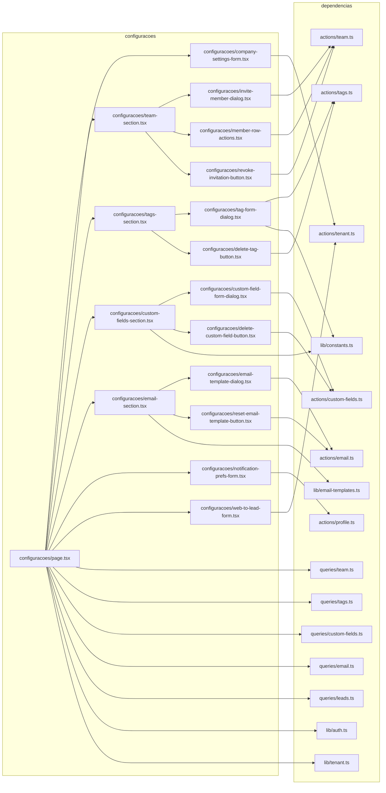
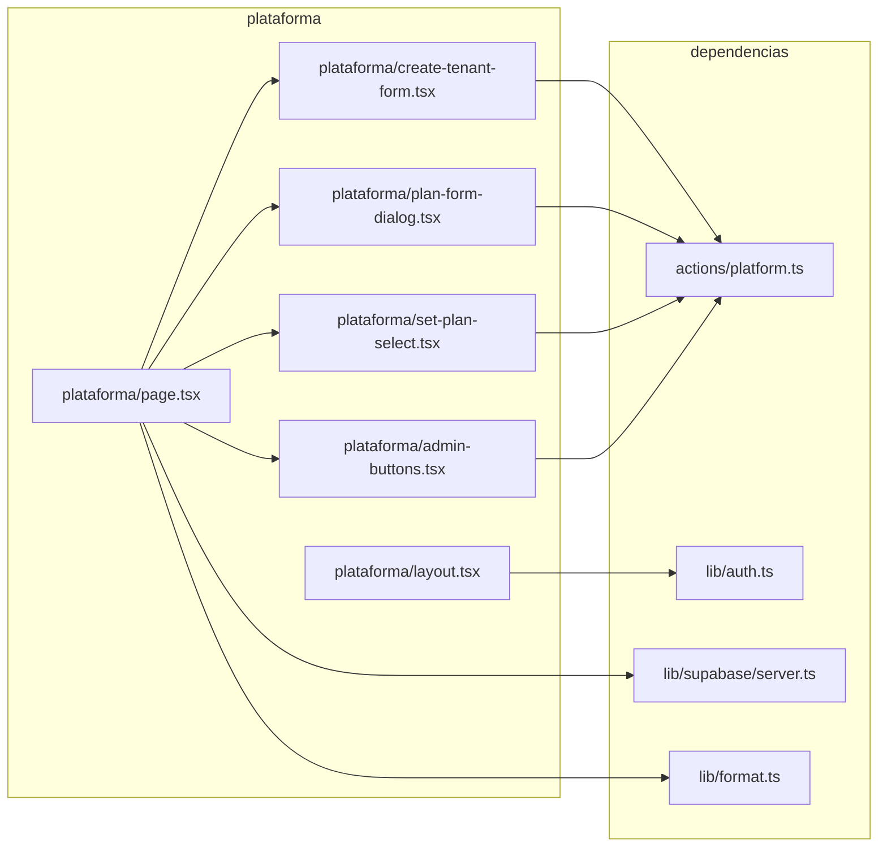

# 16. App: configurações do workspace e painel da plataforma (super-admin)

> 23 arquivos de código · 23 fichas completas · 0 em tabela de exceção.

Este módulo cobre duas áreas do app: (1) a tela **Configurações** de cada
empresa (`/app/configuracoes`), onde membros gerenciam empresa, equipe, tags,
campos personalizados, notificações, e-mails e captação de leads; e (2) o painel
da **plataforma** (`/plataforma`), restrito a super-admins, onde empresas
(tenants) e planos são criados e gerenciados. As páginas são Server Components
que leem via `src/server/queries/*` e o tenant ativo; os formulários e botões são
client components que chamam Server Actions de `tenant.ts`, `team.ts`, `tags.ts`,
`custom-fields.ts`, `email.ts`, `profile.ts` e `platform.ts`. Detalhes das ações,
tabelas e schemas aparecem em [06-servidor-actions-core](06-servidor-actions-core.md),
[07-servidor-actions-negocio](07-servidor-actions-negocio.md),
[03-validacoes-zod](03-validacoes-zod.md) e no [modelo de dados](../04-modelo-de-dados.md) §4.
A guarda de acesso é explicada em [05-regras-e-convencoes](../05-regras-e-convencoes.md).

## Diagrama de dependências do módulo

Dois diagramas: o primeiro cobre **configurações**; o segundo, **plataforma**. A
seta `A --> B` significa "A depende de B".

---

## Fichas

### `src/app/app/configuracoes/page.tsx`

**Propósito:** Página Server Component que monta a tela de Configurações do tenant ativo, com abas (empresa, equipe, tags, campos, notificações, e-mail, captação) controladas por `?tab=`.

**Processo:** Lê `searchParams` (padrão `empresa`) e obtém `getMemberships()`, `getActiveTenant(memberships)` e `getProfile()`. Se não há tenant ativo, retorna `null`. Calcula `canManage = ["owner","admin"].includes(active.role)`. Renderiza a navegação de abas `TABS` como `Link`s e, conforme `tab`, escolhe o conteúdo: `CompanySettingsForm`, `TeamContent` (busca `listTeamMembers` e, se `canManage`, `listPendingInvitations`), `TagsContent` (`listTags`), `CustomFieldsContent` (`listCustomFieldDefinitionsAll`), `NotificationPrefsForm`, `EmailContent` (`listEmailTemplates` + `listEmailLog`) e `WebToLeadContent` (`listLeadSources`).

**Estado:** `implementado`

**Testes:** sem teste (nenhum teste em `tests/` referencia o arquivo).

**Depende de:**
- `src/lib/auth.ts`: `getMemberships`, `getProfile` (papel, dados do usuário e tenants do usuário).
- `src/lib/tenant.ts`: `getActiveTenant` (resolve o tenant ativo por cookie/`x-tenant-slug`).
- `src/server/queries/team.ts`: `listTeamMembers`, `listPendingInvitations`.
- `src/server/queries/tags.ts`: `listTags`.
- `src/server/queries/custom-fields.ts`: `listCustomFieldDefinitionsAll`.
- `src/server/queries/email.ts`: `listEmailTemplates`, `listEmailLog`.
- `src/server/queries/leads.ts`: `listLeadSources`.
- Seções/forms locais: `company-settings-form.tsx`, `team-section.tsx`, `tags-section.tsx`, `custom-fields-section.tsx`, `notification-prefs-form.tsx`, `email-section.tsx`, `web-to-lead-form.tsx`.
- Tabelas lidas (via queries/auth): `memberships`, `tenants`, `profiles`, `invitations`, `tags`, `custom_field_definitions`, `email_templates`, `email_log`, `lead_sources`.

**Usado por:** rota `/app/configuracoes` (ponto de entrada do App Router); link em `src/components/app/app-sidebar.tsx` (`{ title: "Configurações", href: "/app/configuracoes" }`).

**Bibliotecas externas:** `next/link`, `react`, `@/lib/utils` (`cn`).

**Rota da página:** `/app/configuracoes?tab=<empresa|equipe|tags|campos|notificacoes|email|captacao>` · **O que o usuário vê e faz:** abas no topo e, em cada uma, formulários/listas da empresa. Membros veem tudo em modo leitura quando não são gerentes; gerentes (owner/admin) editam.
**APIs/actions que chama:** queries RSC listadas acima; as actions são chamadas pelos componentes filhos. · **Guardas:** middleware (`src/lib/supabase/middleware.ts`) exige sessão para prefixos `/app`; o layout `src/app/app/layout.tsx` chama `requireUser()`; a página exige **membro** (membership ativa) via `getActiveTenant` — sem tenant ativo retorna `null`. Papel controla edição (`canManage`).

### `src/app/app/configuracoes/company-settings-form.tsx`

**Propósito:** Formulário client da aba **Empresa** para editar nome, cor primária e logo do tenant; em modo leitura mostra os valores quando o usuário não pode editar.

**Processo:** Se `!canEdit`, exibe bloco somente-leitura (nome, cor, logo). Caso contrário, useActionState com `updateTenantSettingsAction`; valida a cor com regex `^#[0-9a-fA-F]{6}$` (fallback `#0062FF`), mantém `preview` de cor e envia `FormData` com `name`, `primary_color` e arquivo `logo`. Um `useEffect` mostra `toast` de sucesso/erro conforme `state`.

**Estado:** `implementado`

**Testes:** sem teste.

**Depende de:**
- `src/server/actions/tenant.ts`: `updateTenantSettingsAction`, tipo `TenantSettingsState`.
- `src/components/ui/{button,input,label}.tsx`.
- Tabela escrita (via action): `tenants`; bucket de storage `branding`.

**Usado por:** `src/app/app/configuracoes/page.tsx`.

**Bibliotecas externas:** `react` (`useActionState`, `useEffect`, `useState`), `sonner` (`toast`).

**Rota da página:** dentro de `/app/configuracoes?tab=empresa` · **O que o usuário vê e faz:** edita nome, escolhe cor (color picker) e envia logo (PNG/JPG/SVG até 2 MB); aperta Salvar. · **APIs/actions que chama:** `updateTenantSettingsAction`. · **Guardas:** a action rejeita quem não é `owner`/`admin`; a UI esconde os campos quando `canEdit` é falso.

### `src/app/app/configuracoes/team-section.tsx`

**Propósito:** Server Component que lista os membros do tenant e os convites pendentes, com ações de convidar, alterar papel, remover e revogar (quando o usuário pode gerenciar).

**Processo:** Recebe `members`, `invitations` e `canManage`. Monta iniciais via `initials()` e renderiza `Avatar`/`AvatarFallback` e `Badge`. Para cada membro, renderiza `MemberRowActions`. Se `canManage`, mostra `InviteMemberDialog` no cabeçalho e a lista de convites com `RevokeInvitationButton`.

**Estado:** `implementado`

**Testes:** sem teste.

**Depende de:**
- `src/server/queries/team.ts`: tipos `TeamMember`, `TeamInvitation`.
- `src/components/ui/{avatar,badge}.tsx`.
- `./invite-member-dialog.tsx`, `./member-row-actions.tsx`, `./revoke-invitation-button.tsx`.

**Usado por:** `src/app/app/configuracoes/page.tsx` (função `TeamContent`).

**Bibliotecas externas:** nenhuma relevante.

**O que renderiza:** a lista de membros (avatar, nome, e-mail, papel) e os convites pendentes (e-mail, expiração, papel). · **APIs/actions que chama:** indiretamente as actions de `src/server/actions/team.ts` pelos botões filhos. · **Guardas:** mostra/oculta ações conforme `canManage` (recebido do page).

### `src/app/app/configuracoes/invite-member-dialog.tsx`

**Propósito:** Dialog client para convidar um membro por e-mail com papel (Membro/Administrador), exibindo o link do convite para copiar quando o envio de e-mail não é usado.

**Processo:** useActionState com `inviteMemberAction`. Campo `email` (type=email, obrigatório) e `select role` (padrão `member`). No `useEffect`, se `state.success` sem `inviteLink`, fecha o dialog e dá toast; se vier `inviteLink`, mostra caixa com input read-only e botão de copiar (`copyLink` usa `navigator.clipboard`). Em erro, toast.

**Estado:** `implementado`

**Testes:** sem teste.

**Depende de:**
- `src/server/actions/team.ts`: `inviteMemberAction`, tipo `TeamFormState`.
- `src/components/ui/{button,dialog,input,label}.tsx`.
- Tabelas escritas (via action): `invitations`, `memberships`, `profiles`; e-mail `member_invite`.

**Usado por:** `src/app/app/configuracoes/team-section.tsx`.

**Bibliotecas externas:** `react`, `sonner`, `lucide-react` (`Check`, `Copy`, `UserPlus`).

**O que renderiza:** botão "Convidar" que abre um diálogo com formulário de e-mail/papel e, após o envio, o link de convite. · **APIs/actions que chama:** `inviteMemberAction`. · **Guardas:** o botão só aparece quando `canManage`; a action exige papel `owner`/`admin`.

### `src/app/app/configuracoes/member-row-actions.tsx`

**Propósito:** Controles de linha de um membro: seletor de papel e botão remover (modo gerente) ou apenas o rótulo do papel (modo leitura).

**Processo:** Se `!canManage`, mostra texto com o papel traduzido. Caso contrário, renderiza `select` que, em `onChange`, chama `updateMemberRoleAction({ userId, role })` dentro de `useTransition`; e um `<form action={removeMemberAction}>` com `user_id` escondido e `confirm()` antes de enviar.

**Estado:** `implementado`

**Testes:** sem teste.

**Depende de:**
- `src/server/actions/team.ts`: `removeMemberAction`, `updateMemberRoleAction`.
- `src/components/ui/button.tsx`.
- Tabela escrita (via actions): `memberships`.

**Usado por:** `src/app/app/configuracoes/team-section.tsx`.

**Bibliotecas externas:** `react` (`useTransition`).

**O que renderiza:** seletor de papel (Proprietário/Administrador/Membro) e botão "Remover" por membro. · **APIs/actions que chama:** `updateMemberRoleAction`, `removeMemberAction`. · **Guardas:** ações rejeitadas sem papel `owner`/`admin`; apenas `owner` troca/remove papéis de `owner` e não pode remover o último.

### `src/app/app/configuracoes/revoke-invitation-button.tsx`

**Propósito:** Botão client que revoga um convite pendente.

**Processo:** `<form action={revokeInvitationAction}>` com `id` escondido e `confirm("Revogar este convite?")` antes do envio.

**Estado:** `implementado`

**Testes:** sem teste.

**Depende de:**
- `src/server/actions/team.ts`: `revokeInvitationAction`.
- `src/components/ui/button.tsx`.
- Tabela escrita (via action): `invitations`.

**Usado por:** `src/app/app/configuracoes/team-section.tsx`.

**Bibliotecas externas:** nenhuma relevante.

**O que renderiza:** botão "Revogar" na linha de um convite. · **APIs/actions que chama:** `revokeInvitationAction`. · **Guardas:** action exige `owner`/`admin`.

### `src/app/app/configuracoes/tags-section.tsx`

**Propósito:** Server Component que lista as tags do tenant com sua cor e oferece criar/editar (dialog) e excluir.

**Processo:** Recebe `tags`. Mostra a contagem e o botão `TagFormDialog label="Nova tag"`. Se vazio, mostra estado vazio; senão, lista cada tag com bolinha de cor, `TagFormDialog tag={tag} label="Editar"` e `DeleteTagButton`.

**Estado:** `implementado`

**Testes:** sem teste.

**Depende de:**
- `src/server/queries/tags.ts`: tipo `Tag`.
- `./tag-form-dialog.tsx`, `./delete-tag-button.tsx`.

**Usado por:** `src/app/app/configuracoes/page.tsx` (função `TagsContent`).

**Bibliotecas externas:** nenhuma relevante.

**O que renderiza:** lista de tags com cor e controles de editar/excluir. · **APIs/actions que chama:** indiretamente `tags.ts` via filhos. · **Guardas:** criar/editar exigem membership ativa; excluir exige papel gerente (validado na action).

### `src/app/app/configuracoes/tag-form-dialog.tsx`

**Propósito:** Dialog client para criar ou editar uma tag (nome + cor escolhida entre `TAG_COLORS`).

**Processo:** Escolhe a action (`updateTagAction` se `tag` existe, senão `createTagAction`) e usa `useActionState`. Mantém `color` em estado (padrão `TAG_COLORS[0]`), renderiza radios estilizados com a paleta, e no sucesso fecha e dá toast. Envia `id` (escondido, na edição), `name` e `color`.

**Estado:** `implementado`

**Testes:** sem teste.

**Depende de:**
- `src/server/actions/tags.ts`: `createTagAction`, `updateTagAction`, tipo `TagFormState`.
- `src/lib/constants.ts`: `TAG_COLORS`.
- `src/server/queries/tags.ts`: tipo `Tag`.
- `src/components/ui/{button,dialog,input,label}.tsx`.
- Tabela escrita (via actions): `tags`.

**Usado por:** `src/app/app/configuracoes/tags-section.tsx`.

**Bibliotecas externas:** `react`, `sonner`, `lucide-react` (`Plus`).

**O que renderiza:** diálogo com campo de nome e paleta de cores. · **APIs/actions que chama:** `createTagAction`/`updateTagAction`. · **Guardas:** actions exigem membership ativa; unicidade de nome tratada (código `23505`).

### `src/app/app/configuracoes/delete-tag-button.tsx`

**Propósito:** Botão client para excluir uma tag.

**Processo:** `<form action={deleteTagAction}>` com `id` escondido e `confirm` com o nome da tag antes de enviar.

**Estado:** `implementado`

**Testes:** sem teste.

**Depende de:**
- `src/server/actions/tags.ts`: `deleteTagAction`.
- `src/components/ui/button.tsx`.
- Tabela escrita (via action): `tags`.

**Usado por:** `src/app/app/configuracoes/tags-section.tsx`.

**Bibliotecas externas:** nenhuma relevante.

**O que renderiza:** botão "Excluir" por tag. · **APIs/actions que chama:** `deleteTagAction`. · **Guardas:** action exige papel gerente (`isManager`).

### `src/app/app/configuracoes/custom-fields-section.tsx`

**Propósito:** Server Component que agrupa os campos personalizados por entidade (`CUSTOM_FIELD_ENTITIES`) e permite criar/editar/excluir cada definição.

**Processo:** Itera sobre `CUSTOM_FIELD_ENTITIES`, filtra `definitions` por `entity_type`, mostra contagem e `CustomFieldFormDialog label="Novo campo"`. Para cada campo, exibe rótulo (com `*` se obrigatório), o tipo traduzido por `CUSTOM_FIELD_TYPES` e a chave, além de `CustomFieldFormDialog` (editar) e `DeleteCustomFieldButton`.

**Estado:** `implementado`

**Testes:** sem teste.

**Depende de:**
- `src/lib/constants.ts`: `CUSTOM_FIELD_ENTITIES`, `CUSTOM_FIELD_TYPES`, tipos `CustomFieldEntity`, `CustomFieldType`.
- `src/server/queries/custom-fields.ts`: tipo `CustomFieldDefinition`.
- `./custom-field-form-dialog.tsx`, `./delete-custom-field-button.tsx`.

**Usado por:** `src/app/app/configuracoes/page.tsx` (função `CustomFieldsContent`).

**Bibliotecas externas:** nenhuma relevante.

**O que renderiza:** seções por entidade (Clientes, Projetos, Tarefas, Leads) com a lista de campos e controles. · **APIs/actions que chama:** indiretamente `custom-fields.ts` via filhos. · **Guardas:** criar/editar exigem membership ativa; excluir exige papel gerente.

### `src/app/app/configuracoes/custom-field-form-dialog.tsx`

**Propósito:** Dialog client para criar/editar um campo personalizado (rótulo, chave gerada por `slugify`, tipo, ordem, opções e obrigatoriedade).

**Processo:** Escolhe `updateCustomFieldAction` ou `createCustomFieldAction`. Estados locais `type`, `keyValue` e `keyTouched`; ao digitar o rótulo, se a chave não foi tocada, gera a chave via `slugify`. Envia `entity_type` e `id` (escondidos), `label`, `key`, `field_type`, `position`, `options` (Textarea, só quando tipo `select`) e `required` (checkbox). No sucesso fecha e dá toast.

**Estado:** `implementado`

**Testes:** sem teste.

**Depende de:**
- `src/server/actions/custom-fields.ts`: `createCustomFieldAction`, `updateCustomFieldAction`, tipo `CustomFieldFormState`.
- `src/lib/constants.ts`: `CUSTOM_FIELD_TYPES`, tipo `CustomFieldEntity`.
- `src/server/queries/custom-fields.ts`: tipo `CustomFieldDefinition`.
- `src/components/ui/{button,dialog,input,label,textarea}.tsx`.
- Tabela escrita (via actions): `custom_field_definitions`.

**Usado por:** `src/app/app/configuracoes/custom-fields-section.tsx`.

**Bibliotecas externas:** `react`, `sonner`, `lucide-react` (`Plus`).

**O que renderiza:** diálogo com rótulo, chave, tipo, ordem, opções (quando select) e checkbox obrigatório. · **APIs/actions que chama:** `createCustomFieldAction`/`updateCustomFieldAction`. · **Guardas:** actions exigem membership ativa; unicidade de chave por entidade (`23505`).

### `src/app/app/configuracoes/delete-custom-field-button.tsx`

**Propósito:** Botão client para excluir uma definição de campo personalizado e seus valores.

**Processo:** `<form action={deleteCustomFieldAction}>` com `id` escondido e `confirm` citando o rótulo antes de enviar.

**Estado:** `implementado`

**Testes:** sem teste.

**Depende de:**
- `src/server/actions/custom-fields.ts`: `deleteCustomFieldAction`.
- `src/components/ui/button.tsx`.
- Tabela escrita (via action): `custom_field_definitions`.

**Usado por:** `src/app/app/configuracoes/custom-fields-section.tsx`.

**Bibliotecas externas:** nenhuma relevante.

**O que renderiza:** botão "Excluir" por campo. · **APIs/actions que chama:** `deleteCustomFieldAction`. · **Guardas:** action exige papel gerente (`isManager`).

### `src/app/app/configuracoes/email-section.tsx`

**Propósito:** Server Component da aba **E-mail**: lista os modelos (`EMAIL_TEMPLATES`) com indicação de personalização, variáveis detectadas e o log de envios recentes.

**Processo:** Para cada modelo em `EMAIL_TEMPLATES`, usa a versão custom (`templates[key]`) se existir, calcula variáveis via `extractVariables` (regex `\{\{(\w+)\}\}`) no assunto+corpo e renderiza `EmailTemplateDialog` e, se custom, `ResetEmailTemplateButton`. Em "Envios recentes", lista `log` com `Badge` de status (`STATUS_LABEL`) e data em pt-BR.

**Estado:** `implementado`

**Testes:** sem teste.

**Depende de:**
- `src/lib/email-templates.ts`: `EMAIL_TEMPLATES`.
- `src/server/queries/email.ts`: tipos `EmailLogRow`, `EmailTemplateRow`.
- `src/components/ui/badge.tsx`.
- `./email-template-dialog.tsx`, `./reset-email-template-button.tsx`.

**Usado por:** `src/app/app/configuracoes/page.tsx` (função `EmailContent`).

**Bibliotecas externas:** nenhuma relevante.

**O que renderiza:** lista de modelos de e-mail editáveis e o histórico de envios. · **APIs/actions que chama:** indiretamente `email.ts` via filhos. · **Guardas:** edição exibida só quando `canManage`; actions exigem `owner`/`admin`.

### `src/app/app/configuracoes/email-template-dialog.tsx`

**Propósito:** Dialog client para editar o assunto e o corpo (HTML) de um modelo de e-mail do tenant.

**Processo:** useActionState com `saveEmailTemplateAction`. Envia `key` escondido, `subject` e `body` (Textarea). Mostra as variáveis disponíveis (`{{var}}`). No sucesso fecha e dá toast.

**Estado:** `implementado`

**Testes:** sem teste.

**Depende de:**
- `src/server/actions/email.ts`: `saveEmailTemplateAction`, tipo `EmailTemplateState`.
- `src/components/ui/{button,dialog,input,label,textarea}.tsx`.
- Tabela escrita (via action): `email_templates`.

**Usado por:** `src/app/app/configuracoes/email-section.tsx`.

**Bibliotecas externas:** `react`, `sonner`.

**O que renderiza:** diálogo com assunto, corpo HTML e lista de variáveis. · **APIs/actions que chama:** `saveEmailTemplateAction`. · **Guardas:** action exige `owner`/`admin`.

### `src/app/app/configuracoes/reset-email-template-button.tsx`

**Propósito:** Botão client que restaura o modelo de e-mail ao padrão (remove a personalização do tenant).

**Processo:** `<form action={resetEmailTemplateAction}>` com `key` escondido e `confirm("Restaurar o modelo padrão?")` antes do envio.

**Estado:** `implementado`

**Testes:** sem teste.

**Depende de:**
- `src/server/actions/email.ts`: `resetEmailTemplateAction`.
- `src/components/ui/button.tsx`.
- Tabela escrita (via action): `email_templates`.

**Usado por:** `src/app/app/configuracoes/email-section.tsx`.

**Bibliotecas externas:** nenhuma relevante.

**O que renderiza:** botão "Restaurar" nos modelos personalizados. · **APIs/actions que chama:** `resetEmailTemplateAction`. · **Guardas:** action exige `owner`/`admin`.

### `src/app/app/configuracoes/notification-prefs-form.tsx`

**Propósito:** Formulário client da aba **Notificações** para o usuário escolher receber lembretes por e-mail.

**Processo:** useActionState com `updateNotificationPrefsAction`; checkbox `notify_email` (default `notifyEmail`). No `useEffect`, toast de sucesso/erro.

**Estado:** `implementado`

**Testes:** sem teste.

**Depende de:**
- `src/server/actions/profile.ts`: `updateNotificationPrefsAction`, tipo `NotificationPrefsState`.
- `src/components/ui/button.tsx`.
- Tabela escrita (via action): `profiles` (`notify_email`).

**Usado por:** `src/app/app/configuracoes/page.tsx` (aba `notificacoes`, usando `profile.notify_email`).

**Bibliotecas externas:** `react`, `sonner`.

**Rota da página:** dentro de `/app/configuracoes?tab=notificacoes` · **O que o usuário vê e faz:** checkbox de lembretes por e-mail e botão Salvar. · **APIs/actions que chama:** `updateNotificationPrefsAction`. · **Guardas:** a action exige sessão (`getUser`) e atualiza o próprio perfil.

### `src/app/app/configuracoes/web-to-lead-form.tsx`

**Propósito:** Formulário client da aba **Captação** para ativar o formulário público (web-to-lead), escolher a origem dos leads e copiar o link público; em modo leitura mostra apenas o status.

**Processo:** useActionState com `updateWebToLeadAction`. Estados `on` (checkbox) e `copied`. `copy()` monta `${window.location.origin}/f/${slug}` e usa `navigator.clipboard`. Envia `web_to_lead_enabled` e `web_to_lead_source_id`. Se `!canManage`, mostra um resumo "Formulário público: ativo/inativo" e o slug.

**Estado:** `implementado`

**Testes:** sem teste.

**Depende de:**
- `src/server/actions/tenant.ts`: `updateWebToLeadAction`, tipo `TenantSettingsState`.
- `src/components/ui/{button,label}.tsx`.
- Tabela escrita (via action): `tenants` (`web_to_lead_enabled`, `web_to_lead_source_id`).

**Usado por:** `src/app/app/configuracoes/page.tsx` (função `WebToLeadContent`).

**Bibliotecas externas:** `react`, `sonner`, `lucide-react` (`Check`, `Copy`).

**Rota da página:** dentro de `/app/configuracoes?tab=captacao` · **O que o usuário vê e faz:** ativa o formulário público, escolhe a origem e copia o link `/f/{slug}`. · **APIs/actions que chama:** `updateWebToLeadAction`. · **Guardas:** action exige `owner`/`admin`; UI read-only quando `canManage` é falso.

### `src/app/plataforma/layout.tsx`

**Propósito:** Layout Server Component do painel da plataforma: força super-admin e monta o cabeçalho com o nome do app e link de volta ao app.

**Processo:** Chama `requireSuperAdmin()` (redireciona para `/app` se não for super-admin). Renderiza header fixo com logo "O", `APP_NAME`, rótulo "plataforma" e botão "Voltar ao app" (`Link href="/app"`), seguido do conteúdo em `<main>`.

**Estado:** `implementado`

**Testes:** sem teste.

**Depende de:**
- `src/lib/auth.ts`: `requireSuperAdmin`.
- `src/lib/constants.ts`: `APP_NAME`.
- `src/components/ui/button.tsx`.
- Tabela lida (via auth): `profiles` (`is_super_admin`).

**Usado por:** Next.js como layout das rotas `/plataforma/*`; link para `/plataforma` em `src/app/app/layout.tsx` (aparece a super-admins sem empresa).

**Bibliotecas externas:** `next/link`, `react`.

**Rota da página:** envolve `/plataforma` · **O que o usuário vê e faz:** cabeçalho "Orbit CRM / plataforma" e botão de voltar ao app. · **APIs/actions que chama:** nenhuma direta. · **Guardas:** `requireSuperAdmin()` — exige sessão e `profiles.is_super_admin`; senão redireciona para `/app` (o middleware também exige sessão em `/plataforma`).

### `src/app/plataforma/page.tsx`

**Propósito:** Página Server Component do painel da plataforma: cria novas empresas, gerencia planos e lista as empresas cadastradas com seleção de plano e exclusão.

**Processo:** Cria o client Supabase (`createClient`) e busca em paralelo `tenants` (`id,name,slug,status,plan_id,created_at`) e `plans` (`*` ordenado por `price`). Renderiza formulário `CreateTenantForm`, a lista de planos (`PlanFormDialog`, `DeletePlanButton`, resumo de limites via `limitsSummary` e `formatMoney`) e a tabela de empresas (`SetPlanSelect`, `Badge` de status, `DeleteTenantButton`).

**Estado:** `implementado`

**Testes:** sem teste.

**Depende de:**
- `src/lib/supabase/server.ts`: `createClient`.
- `src/lib/format.ts`: `formatMoney`.
- `src/components/ui/{badge,card,table}.tsx`.
- `./create-tenant-form.tsx`, `./plan-form-dialog.tsx` (tipo `PlanRow`), `./set-plan-select.tsx`, `./admin-buttons.tsx`.
- Tabelas lidas: `tenants`, `plans`.

**Usado por:** rota `/plataforma` (ponto de entrada do App Router).

**Bibliotecas externas:** nenhuma além dos componentes de UI.

**Rota da página:** `/plataforma` · **O que o usuário vê e faz:** cria empresa, cria/edita/exclui planos, troca o plano de cada empresa e exclui empresas. · **APIs/actions que chama:** as actions de `src/server/actions/platform.ts` via componentes filhos. · **Guardas:** o layout `plataforma/layout.tsx` exige super-admin; as actions também revalidam `is_super_admin`.

### `src/app/plataforma/create-tenant-form.tsx`

**Propósito:** Formulário client para criar uma nova empresa (tenant) com nome e slug opcional.

**Processo:** useActionState com `createTenantAction`. Campos `name` (obrigatório) e `slug` (opcional). Mostra mensagem de erro ou de sucesso conforme `state`.

**Estado:** `implementado`

**Testes:** sem teste.

**Depende de:**
- `src/server/actions/platform.ts`: `createTenantAction`, tipo `CreateTenantState`.
- `src/components/ui/{button,input,label}.tsx`.
- Tabelas escritas (via action): `tenants`, `memberships`, `lead_statuses`, `lead_sources`, `departments`.

**Usado por:** `src/app/plataforma/page.tsx`.

**Bibliotecas externas:** `react` (`useActionState`).

**O que renderiza:** linha com nome, slug e botão "Criar empresa", com feedback inline. · **APIs/actions que chama:** `createTenantAction`. · **Guardas:** action exige `profiles.is_super_admin`.

### `src/app/plataforma/plan-form-dialog.tsx`

**Propósito:** Dialog client para criar ou editar um plano (nome, descrição, preço, ciclo, trial, limites e "mais popular") e exporta o tipo `PlanRow`.

**Processo:** Escolhe `updatePlanAction`/`createPlanAction` e usa `useActionState`. Envia `id` (escondido, na edição), `name`, `description`, `price`, `interval`, `trial_days`, os limites por recurso (`limits_clients`…`limits_leads`) e `most_popular`. No sucesso fecha e dá toast.

**Estado:** `implementado`

**Testes:** sem teste.

**Depende de:**
- `src/server/actions/platform.ts`: `createPlanAction`, `updatePlanAction`, tipo `PlanFormState`.
- `src/components/ui/{button,dialog,input,label,textarea}.tsx`.
- Tabela escrita (via actions): `plans`.

**Usado por:** `src/app/plataforma/page.tsx`.

**Bibliotecas externas:** `react`, `sonner`, `lucide-react` (`Plus`).

**O que renderiza:** diálogo com dados do plano e limites por recurso. · **APIs/actions que chama:** `createPlanAction`/`updatePlanAction`. · **Guardas:** actions exigem `is_super_admin`.

### `src/app/plataforma/set-plan-select.tsx`

**Propósito:** Seletor client que define o plano de uma empresa na tabela da plataforma.

**Processo:** Em `onChange`, monta um `FormData` com `tenant_id` e `plan_id` e chama `setTenantPlanAction` dentro de `startTransition`; depois `router.refresh()` para recarregar os dados do servidor. Desabilita enquanto `isPending`.

**Estado:** `implementado`

**Testes:** sem teste.

**Depende de:**
- `src/server/actions/platform.ts`: `setTenantPlanAction`.
- Tabela escrita (via action): `tenants` (`plan_id`).

**Usado por:** `src/app/plataforma/page.tsx`.

**Bibliotecas externas:** `react` (`useTransition`), `next/navigation` (`useRouter`).

**O que renderiza:** `<select>` com "— Sem plano —" e os planos disponíveis. · **APIs/actions que chama:** `setTenantPlanAction`. · **Guardas:** action exige `is_super_admin`.

### `src/app/plataforma/admin-buttons.tsx`

**Propósito:** Botões client de exclusão de plano e de empresa no painel da plataforma.

**Processo:** `DeletePlanButton` usa `<form action={deletePlanAction}>` com `confirm("Excluir este plano?")`; `DeleteTenantButton` usa `<form action={deleteTenantAction}>` com `confirm` de aviso de ação irreversível. Ambos enviam `id` escondido.

**Estado:** `implementado`

**Testes:** sem teste.

**Depende de:**
- `src/server/actions/platform.ts`: `deletePlanAction`, `deleteTenantAction`.
- `src/components/ui/button.tsx`.
- Tabelas escritas (via actions): `plans`, `tenants`.

**Usado por:** `src/app/plataforma/page.tsx`.

**Bibliotecas externas:** nenhuma relevante.

**O que renderiza:** botões "Excluir" para planos e empresas. · **APIs/actions que chama:** `deletePlanAction`, `deleteTenantAction`. · **Guardas:** actions exigem `is_super_admin`.

---

## Tabela das fichas do módulo

| § | Arquivo | Propósito em 1 linha |
|---|---------|----------------------|
| 16.1 | `src/app/app/configuracoes/page.tsx` | Tela de Configurações do tenant com abas que escolhem o conteúdo. |
| 16.2 | `src/app/app/configuracoes/company-settings-form.tsx` | Edita nome, cor e logo da empresa. |
| 16.3 | `src/app/app/configuracoes/team-section.tsx` | Lista membros e convites pendentes com ações. |
| 16.4 | `src/app/app/configuracoes/invite-member-dialog.tsx` | Convida membro por e-mail e mostra o link do convite. |
| 16.5 | `src/app/app/configuracoes/member-row-actions.tsx` | Troca o papel do membro e o remove. |
| 16.6 | `src/app/app/configuracoes/revoke-invitation-button.tsx` | Revoga um convite pendente. |
| 16.7 | `src/app/app/configuracoes/tags-section.tsx` | Lista tags do tenant com criar/editar/excluir. |
| 16.8 | `src/app/app/configuracoes/tag-form-dialog.tsx` | Dialog para criar/editar tag com paleta de cores. |
| 16.9 | `src/app/app/configuracoes/delete-tag-button.tsx` | Exclui uma tag. |
| 16.10 | `src/app/app/configuracoes/custom-fields-section.tsx` | Agrupa campos personalizados por entidade. |
| 16.11 | `src/app/app/configuracoes/custom-field-form-dialog.tsx` | Dialog para criar/editar campo personalizado. |
| 16.12 | `src/app/app/configuracoes/delete-custom-field-button.tsx` | Exclui um campo personalizado. |
| 16.13 | `src/app/app/configuracoes/email-section.tsx` | Lista modelos de e-mail e envios recentes. |
| 16.14 | `src/app/app/configuracoes/email-template-dialog.tsx` | Edita assunto e corpo de um modelo de e-mail. |
| 16.15 | `src/app/app/configuracoes/reset-email-template-button.tsx` | Restaura o modelo de e-mail padrão. |
| 16.16 | `src/app/app/configuracoes/notification-prefs-form.tsx` | Preferência de receber lembretes por e-mail. |
| 16.17 | `src/app/app/configuracoes/web-to-lead-form.tsx` | Ativa o formulário público e copia o link. |
| 16.18 | `src/app/plataforma/layout.tsx` | Layout do painel da plataforma com guarda de super-admin. |
| 16.19 | `src/app/plataforma/page.tsx` | Painel que gerencia empresas e planos. |
| 16.20 | `src/app/plataforma/create-tenant-form.tsx` | Cria nova empresa (tenant). |
| 16.21 | `src/app/plataforma/plan-form-dialog.tsx` | Dialog para criar/editar plano. |
| 16.22 | `src/app/plataforma/set-plan-select.tsx` | Define o plano de uma empresa. |
| 16.23 | `src/app/plataforma/admin-buttons.tsx` | Botões de excluir plano e empresa. |
