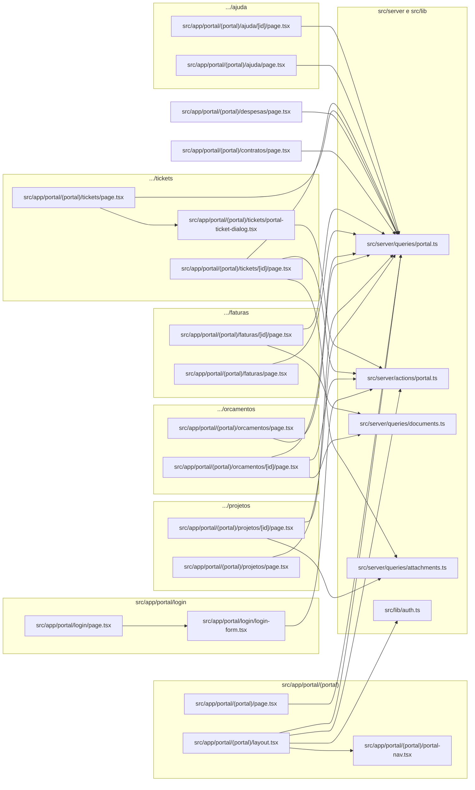

# 17. Portal do cliente (somente leitura + aprovação de orçamento e tickets)

> 18 arquivos de código · 18 fichas completas · 0 em tabela de exceção.

O portal do cliente é uma área logada separada do painel da equipe (`/app`). Quem entra aqui é o **contato** de um cliente — uma pessoa vinculada a uma `company` (empresa) e a um `tenant`, cujo usuário de auth foi ligado a um registro em `contacts` (coluna `contacts.user_id`). No portal o cliente **acompanha** projetos, tarefas, marcos, orçamentos, faturas, contratos e despesas; **aprova ou recusa** orçamentos; e **abre e responde tickets** de suporte. As páginas são RSC (server components) e, com poucas exceções, apenas leem dados: a maior parte vem de **RPCs `security definer`** (`portal_contact`, `portal_list_projects`, `portal_get_project`, `portal_list_tasks`, `portal_list_milestones`, `portal_list_contracts`, `portal_list_expenses`) e o resto de **tabelas com RLS específica do cliente** — o cliente compartilha o papel `authenticated` com a equipe, então as RPCs existem justamente para não vazar colunas internas. A aprovação de orçamento é a única escrita "de negócio" do cliente em documento e passa pela RPC `client_respond_estimate`; os tickets usam RLS própria (`source = 'portal'`). Autenticação, papéis e isolamento estão em [regras e convenções](../05-regras-e-convencoes.md) §5; o fluxo de login em [processos](../02-processos.md) §2; o schema em [modelo de dados](../04-modelo-de-dados.md) §4.

## Diagrama de dependências do módulo



## Fichas

### `src/app/portal/login/page.tsx`

**Propósito:** página de login do portal do cliente, em `/portal/login`; mostra o formulário de entrada e, em ambientes de demonstração, credenciais de exemplo.
**Processo:** server component com `metadata` (título "Portal do cliente"). Lê `process.env.NEXT_PUBLIC_DEMO_LOGIN`; quando vale `"true"`, renderiza o componente `DemoCredentials` passando `email="cliente@orbit.demo"`, `password="Portal#2026"` e o rótulo "Acesso de demonstração (portal do cliente)". Monta um `Card` centralizado com o logotipo "O", o título e a descrição "Acompanhe seus projetos, orçamentos e faturas." e, dentro do `CardContent`, o componente `PortalLoginForm`.
**Estado:** `implementado`.
**Testes:** sem teste (nenhum teste importa `src/app/portal/login/page.tsx`).
**Depende de:**
- `src/app/portal/login/login-form.tsx`: `PortalLoginForm`.
- `src/components/ui/card.tsx`: `Card`, `CardHeader`, `CardTitle`, `CardDescription`, `CardContent`.
- `src/components/app/demo-credentials.tsx`: `DemoCredentials` (só quando a flag está ligada).
- Env: `NEXT_PUBLIC_DEMO_LOGIN`.

**Usado por:** ponto de entrada — rota `/portal/login`. É o destino do redirecionamento de quem não está logado e tenta abrir qualquer rota `/portal` (ver `src/lib/supabase/middleware.ts`) e também é apontado no rodapé da tela de login da equipe em [11-app-nucleo-auth-e-publico](11-app-nucleo-auth-e-publico.md) §11.8.
**Bibliotecas externas:** `next` (tipo `Metadata`).

**Rota da página:** `/portal/login` · **O que o usuário vê e faz:** digita e-mail e senha do contato e entra no portal; quando a demonstração está ativa, vê as credenciais e pode preenchê-las com um clique.
**APIs/actions que chama:** `PortalLoginForm` chama `portalSignInAction` · **Guardas:** pública (o middleware redireciona para cá quem não tem sessão).

### `src/app/portal/login/login-form.tsx`

**Propósito:** formulário client de login do portal; envia e-mail/senha para a server action e exibe o erro.
**Processo:** usa `useActionState<PortalAuthState, FormData>(portalSignInAction, undefined)`, obtendo `state`, `formAction` e `isPending`. Renderiza `<form action={formAction}>` com campos `email` (obrigatório, `autoComplete="email"`) e `password` (obrigatório, `autoComplete="current-password"`), mostra `state?.error` num `<p role="alert">` e um `Button` que fica desabilitado com o texto "Entrando..." enquanto pendente.
**Estado:** `implementado`.
**Testes:** sem teste próprio; o schema `signInSchema` que a action usa é coberto em `tests/unit/validations.test.ts`.
**Depende de:**
- `src/server/actions/portal.ts`: `portalSignInAction` e o tipo `PortalAuthState`.
- `src/components/ui/button.tsx`, `src/components/ui/input.tsx`, `src/components/ui/label.tsx`.

**Usado por:** `src/app/portal/login/page.tsx`.
**Bibliotecas externas:** `react` (`useActionState`).

**Rota da página:** componente do `/portal/login` · **O que o usuário vê e faz:** digita e-mail e senha e clica em "Entrar no portal"; em sucesso a action redireciona para `/portal`.
**APIs/actions que chama:** `portalSignInAction` (valida com `signInSchema` e chama `supabase.auth.signInWithPassword`) · **Guardas:** pública; a action redireciona para `/portal` no sucesso.

### `src/app/portal/(portal)/layout.tsx`

**Propósito:** layout de todas as páginas internas do portal; exige sessão, verifica se o usuário é contato de algum cliente e monta o cabeçalho com a navegação.
**Processo:** `PortalLayout` é assíncrono. Chama `getUser()` de `src/lib/auth.ts`; se não houver usuário, faz `redirect("/portal/login")`. Em seguida chama `getPortalContact()`; se o retorno for nulo (usuário logado que não é contato de cliente), renderiza uma tela "Sem acesso ao portal" com um formulário que aciona `portalSignOutAction`. Caso contrário, monta o `<header>` com o nome da empresa (`contact.company_name`) e do contato (`contact.first_name`), um formulário de "Sair" (`portalSignOutAction`) e o componente `PortalNav`; por fim envolve os filhos em `<main>`.
**Estado:** `implementado`.
**Testes:** sem teste (nenhum teste importa `layout.tsx`).
**Depende de:**
- `src/lib/auth.ts`: `getUser()`.
- `src/server/queries/portal.ts`: `getPortalContact()` (RPC `portal_contact`).
- `src/server/actions/portal.ts`: `portalSignOutAction`.
- `src/app/portal/(portal)/portal-nav.tsx`: `PortalNav`.
- `src/components/ui/button.tsx`: `Button`.
- `next/link`, `next/navigation` (`redirect`).

**Usado por:** ponto de entrada — o Next.js App Router aplica automaticamente este layout a **todas** as rotas do grupo `(portal)`.
**Bibliotecas externas:** `next/link`, `next/navigation`.

**Rota da página:** layout de `/portal` e subrotas · **O que o usuário vê e faz:** vê o cabeçalho com o nome da empresa, seu primeiro nome, o botão "Sair" e a barra de navegação.
**APIs/actions que chama:** `getUser`, `getPortalContact`, `portalSignOutAction` · **Guardas:** exige sessão (redireciona para `/portal/login`); sem vínculo de contato, mostra "Sem acesso ao portal".

### `src/app/portal/(portal)/page.tsx`

**Propósito:** visão geral do portal; resume projetos ativos, orçamentos pendentes e valor em aberto e lista os itens mais recentes.
**Processo:** chama `getPortalContact()`; se não houver contato, retorna `null`. Depois, em `Promise.all`, busca `listPortalProjects(contact.company_id)`, `listPortalEstimates(contact.company_id)` e `listPortalInvoices(contact.company_id)`. Calcula `activeProjects` (status `2` ou `1`), `pendingEstimates` (status `1` ou `2`) e `openAmount` (soma de `invoice.total` com status `1` ou `3`). Renderiza saudação "Olá, {first_name}!", três `StatCard` e três cartões (Projetos, Faturas, Orçamentos) com até 5 itens cada, usando `ProjectStatusBadge`/`ProgressBar`, `InvoiceStatusBadge` e `EstimateStatusBadge`.
**Estado:** `implementado`.
**Testes:** sem teste.
**Depende de:**
- `src/server/queries/portal.ts`: `getPortalContact`, `listPortalProjects`, `listPortalEstimates`, `listPortalInvoices`.
- `src/components/ui/card.tsx`, `src/components/app/stat-card.tsx`, `src/components/app/project-bits.tsx`, `src/components/app/document-status-badge.tsx`.
- `src/lib/format.ts`: `formatDate`, `formatMoney`.

**Usado por:** ponto de entrada — rota `/portal`.
**Bibliotecas externas:** `next/link`, `lucide-react` (`FileText`, `FolderKanban`, `Receipt`).

**Rota da página:** `/portal` · **O que o usuário vê e faz:** vê os números-resumo e listas curtas de projetos, faturas e orçamentos, com links para os detalhes.
**APIs/actions que chama:** `getPortalContact`, `listPortalProjects` (RPC `portal_list_projects`), `listPortalEstimates` e `listPortalInvoices` (leitura direta de `estimates`/`invoices` via RLS) · **Guardas:** exige sessão e vínculo de contato (pelo `layout.tsx`).

### `src/app/portal/(portal)/portal-nav.tsx`

**Propósito:** barra de navegação do portal; destaca a seção atual.
**Processo:** client component (`"use client"`). Define a constante `ITEMS` com os links Visão geral, Projetos, Orçamentos, Faturas, Contratos, Despesas, Tickets e Ajuda. Usa `usePathname()` para calcular se o item está ativo (`pathname === "/portal"` para a visão geral; `pathname.startsWith(item.href)` para os demais) e aplica as classes com `cn` (item ativo recebe `border-primary text-primary font-medium`).
**Estado:** `implementado`.
**Testes:** sem teste.
**Depende de:**
- `src/lib/utils.ts`: `cn`.
- `next/link`, `next/navigation` (`usePathname`).

**Usado por:** `src/app/portal/(portal)/layout.tsx`.
**Bibliotecas externas:** `next/link`, `next/navigation`.

**Rota da página:** componente do layout do portal · **O que o usuário vê e faz:** clica nas abas para navegar entre as seções do portal.
**APIs/actions que chama:** nenhuma · **Guardas:** nenhuma (só renderiza links).

### `src/app/portal/(portal)/projetos/page.tsx`

**Propósito:** lista os projetos da empresa do cliente.
**Processo:** `getPortalContact()`; se nulo, retorna `null`. Chama `listPortalProjects(contact.company_id)` (RPC `portal_list_projects`). Se não houver projetos, mostra um bloco "Nenhum projeto ainda."; senão, um grid de `Card`s com o nome (link para o detalhe), `ProjectStatusBadge`, `ProgressBar` e o prazo formatado.
**Estado:** `implementado`.
**Testes:** sem teste próprio; a RPC `portal_list_projects` é coberta em `tests/rls/isolation.test.ts` ("Portal lê projetos da empresa via RPC e não direto na tabela").
**Depende de:**
- `src/server/queries/portal.ts`: `getPortalContact`, `listPortalProjects`.
- `src/components/ui/card.tsx`, `src/components/app/project-bits.tsx`, `src/lib/format.ts`.

**Usado por:** ponto de entrada — rota `/portal/projetos`; linkada pela navegação e pela visão geral.
**Bibliotecas externas:** `next/link`.

**Rota da página:** `/portal/projetos` · **O que o usuário vê e faz:** vê a grade dos seus projetos e abre um projeto pelo nome.
**APIs/actions que chama:** `listPortalProjects` (RPC `portal_list_projects`) · **Guardas:** exige sessão e vínculo de contato (pelo `layout.tsx`).

### `src/app/portal/(portal)/projetos/[id]/page.tsx`

**Propósito:** detalhe de um projeto do cliente, com tarefas, marcos e arquivos.
**Processo:** recebe `params.id`. Chama `getPortalContact()` (nulo → `null`) e `getPortalProject(contact.company_id, id)` (RPC `portal_get_project`); se o projeto não existir, `notFound()`. Em `Promise.all`, busca `listPortalTasks(project.id)` (RPC `portal_list_tasks`), `listPortalMilestones(project.id)` (RPC `portal_list_milestones`) e `listAttachments(contact.tenant_id, "project", project.id)`. Renderiza cabeçalho com status/progresso/prazo, a descrição, e cartões de Tarefas (nome, prazo, `TaskStatusBadge`), Marcos (cor, nome, prazo, `MilestoneStatusBadge`) e Arquivos (links assinados).
**Estado:** `implementado`.
**Testes:** sem teste próprio; as RPCs `portal_get_project`/`portal_list_tasks`/`portal_list_milestones` e a leitura de anexo pelo cliente são cobertas em `tests/rls/isolation.test.ts`.
**Depende de:**
- `src/server/queries/portal.ts`: `getPortalContact`, `getPortalProject`, `listPortalTasks`, `listPortalMilestones`.
- `src/server/queries/attachments.ts`: `listAttachments`.
- `src/components/ui/card.tsx`, `src/components/app/project-bits.tsx`, `src/components/app/milestone-bits.tsx`, `src/components/app/task-bits.tsx`, `src/lib/format.ts`.
- `next/navigation` (`notFound`).
- Tabelas/RPCs: RPCs `portal_get_project`, `portal_list_tasks`, `portal_list_milestones`; lê `attachments` (RLS `attachments_client_select`) e gera URLs assinadas do bucket `attachments`.

**Usado por:** ponto de entrada — rota `/portal/projetos/[id]`; linkada pela lista de projetos e pela visão geral.
**Bibliotecas externas:** `next/link`, `next/navigation`, `lucide-react` (`ArrowLeft`, `FileText`).

**Rota da página:** `/portal/projetos/[id]` · **O que o usuário vê e faz:** acompanha o andamento do projeto: tarefas, marcos e arquivos liberados; 404 se o projeto não for dele.
**APIs/actions que chama:** `getPortalProject`, `listPortalTasks`, `listPortalMilestones`, `listAttachments` · **Guardas:** exige sessão e vínculo de contato; `notFound()` quando o projeto não pertence à empresa do contato.

### `src/app/portal/(portal)/orcamentos/page.tsx`

**Propósito:** lista os orçamentos da empresa do cliente.
**Processo:** `getPortalContact()` (nulo → `null`). Chama `listPortalEstimates(contact.company_id)`, que faz leitura direta da tabela `estimates` filtrando por `company_id` e `deleted_at is null` (o RLS `estimates_client_select` garante o isolamento). Renderiza uma tabela com Número (link para o detalhe), Data, Validade, Status (`EstimateStatusBadge`) e Total.
**Estado:** `implementado`.
**Testes:** sem teste próprio; a policy que impede o cliente de ver orçamento em rascunho é coberta em `tests/rls/isolation.test.ts` ("Cliente do portal não lê orçamento em rascunho").
**Depende de:**
- `src/server/queries/portal.ts`: `getPortalContact`, `listPortalEstimates`.
- `src/components/ui/table.tsx`, `src/components/app/document-status-badge.tsx`, `src/lib/format.ts`.
- Tabela: lê `estimates` via RLS (`estimates_client_select`).

**Usado por:** ponto de entrada — rota `/portal/orcamentos`; linkada pela navegação e pela visão geral.
**Bibliotecas externas:** `next/link`.

**Rota da página:** `/portal/orcamentos` · **O que o usuário vê e faz:** vê a lista dos seus orçamentos e abre um para ver os itens e aprovar.
**APIs/actions que chama:** `listPortalEstimates` (tabela `estimates` via RLS) · **Guardas:** exige sessão e vínculo de contato (pelo `layout.tsx`).

### `src/app/portal/(portal)/orcamentos/[id]/page.tsx`

**Propósito:** detalhe do orçamento, com itens e os botões de aceitar/recusar (a aprovação do cliente).
**Processo:** recebe `params.id`. `getPortalContact()` (nulo → `null`); `getEstimate(contact.tenant_id, id)` (leitura direta de `estimates` via RLS); se não existir, `notFound()`. Busca `listDocumentItems(contact.tenant_id, "estimate", id)` (tabela `document_items`). Define `canRespond = estimate.status === 1 || estimate.status === 2`. Renderiza os itens (descrição × qtd × rate), o total e a validade. Se `canRespond`, mostra dois formulários que enviam para `respondEstimateAction` com campos escondidos `id` e `accept` ("1" para aceitar, "0" para recusar):

```tsx
// src/app/portal/(portal)/orcamentos/[id]/page.tsx
<form action={respondEstimateAction}>
  <input type="hidden" name="id" value={estimate.id} />
  <input type="hidden" name="accept" value="1" />
  <Button type="submit">Aceitar orçamento</Button>
</form>
```

**Estado:** `implementado`.
**Testes:** sem teste próprio; a action chama a RPC `client_respond_estimate`, que **não** tem teste dedicado em `tests/rls/isolation.test.ts` (busca por `client_respond_estimate` não retornou nada).
**Depende de:**
- `src/server/queries/portal.ts`: `getPortalContact`.
- `src/server/queries/documents.ts`: `getEstimate`, `listDocumentItems`.
- `src/server/actions/portal.ts`: `respondEstimateAction`.
- `src/components/ui/card.tsx`, `src/components/ui/button.tsx`, `src/components/app/document-status-badge.tsx`, `src/lib/format.ts`.
- `next/navigation` (`notFound`).
- Tabelas/RPCs: lê `estimates` e `document_items` via RLS; a aprovação usa a RPC `client_respond_estimate`.

**Usado por:** ponto de entrada — rota `/portal/orcamentos/[id]`; linkada pela lista e pela visão geral.
**Bibliotecas externas:** `next/link`, `next/navigation`, `lucide-react` (`ArrowLeft`).

**Rota da página:** `/portal/orcamentos/[id]` · **O que o usuário vê e faz:** confere os itens e o total e clica em "Aceitar orçamento" ou "Recusar" (só quando o status permite).
**APIs/actions que chama:** `getEstimate`, `listDocumentItems`, `respondEstimateAction` (que chama a RPC `client_respond_estimate`) · **Guardas:** exige sessão e vínculo de contato; `notFound()` quando o orçamento não é da empresa; os botões só aparecem com status `1` ou `2`.

### `src/app/portal/(portal)/faturas/page.tsx`

**Propósito:** lista as faturas da empresa do cliente.
**Processo:** `getPortalContact()` (nulo → `null`). Chama `listPortalInvoices(contact.company_id)`, que lê direto a tabela `invoices` filtrando por `company_id` e `deleted_at is null` (RLS `invoices_client_select`). Renderiza a tabela com Número (link), Data, Vencimento, Status (`InvoiceStatusBadge`, que marca "Vencida") e Total.
**Estado:** `implementado`.
**Testes:** sem teste próprio.
**Depende de:**
- `src/server/queries/portal.ts`: `getPortalContact`, `listPortalInvoices`.
- `src/components/ui/table.tsx`, `src/components/app/document-status-badge.tsx`, `src/lib/format.ts`.
- Tabela: lê `invoices` via RLS (`invoices_client_select`).

**Usado por:** ponto de entrada — rota `/portal/faturas`; linkada pela navegação e pela visão geral.
**Bibliotecas externas:** `next/link`.

**Rota da página:** `/portal/faturas` · **O que o usuário vê e faz:** vê suas faturas e abre uma para ver itens, pagamentos e valor em aberto.
**APIs/actions que chama:** `listPortalInvoices` (tabela `invoices` via RLS) · **Guardas:** exige sessão e vínculo de contato (pelo `layout.tsx`).

### `src/app/portal/(portal)/faturas/[id]/page.tsx`

**Propósito:** detalhe da fatura, com itens, resumo financeiro e pagamentos registrados.
**Processo:** recebe `params.id`. `getPortalContact()` (nulo → `null`); `getInvoice(contact.tenant_id, id)` (leitura direta de `invoices` via RLS); se não existir, `notFound()`. Em `Promise.all`, busca `listDocumentItems(contact.tenant_id, "invoice", id)`, `listPayments(contact.tenant_id, id)` e `sumPayments(contact.tenant_id, id)`. Calcula `amountDue = Number(invoice.total) - paid`. Renderiza os itens, um cartão "Resumo" (subtotal, impostos, total, pago, em aberto e vencimento) e, quando há pagamentos, uma lista com data, meio de pagamento e valor.
**Estado:** `implementado`.
**Testes:** sem teste próprio.
**Depende de:**
- `src/server/queries/portal.ts`: `getPortalContact`.
- `src/server/queries/documents.ts`: `getInvoice`, `listDocumentItems`, `listPayments`, `sumPayments`.
- `src/components/ui/card.tsx`, `src/components/app/document-status-badge.tsx`, `src/lib/format.ts`.
- `next/navigation` (`notFound`).
- Tabelas: lê `invoices`, `document_items` e `payments` via RLS (`invoices_client_select`, `document_items_client_select`, `payments_client_select`).

**Usado por:** ponto de entrada — rota `/portal/faturas/[id]`; linkada pela lista e pela visão geral.
**Bibliotecas externas:** `next/link`, `next/navigation`, `lucide-react` (`ArrowLeft`).

**Rota da página:** `/portal/faturas/[id]` · **O que o usuário vê e faz:** confere os itens, o que já foi pago e quanto falta; 404 se a fatura não for da empresa.
**APIs/actions que chama:** `getInvoice`, `listDocumentItems`, `listPayments`, `sumPayments` · **Guardas:** exige sessão e vínculo de contato; `notFound()` quando a fatura não é da empresa.

### `src/app/portal/(portal)/contratos/page.tsx`

**Propósito:** lista os contratos da empresa do cliente.
**Processo:** `getPortalContact()` (nulo → `null`). Chama `listPortalContracts(contact.company_id)` (RPC `portal_list_contracts`, que projeta só colunas seguras — sem a coluna `note`). Renderiza a tabela com Título (e descrição, se houver), Início, Término, Status (`ContractStatusBadge`, que marca "Vencido") e Valor.
**Estado:** `implementado`.
**Testes:** sem teste próprio; a RPC `portal_list_contracts` é coberta em `tests/rls/isolation.test.ts` ("Cliente do portal vê contratos da própria empresa" / "não vê contratos de outra empresa" / "não cria contrato nem despesa").
**Depende de:**
- `src/server/queries/portal.ts`: `getPortalContact`, `listPortalContracts`.
- `src/components/ui/table.tsx`, `src/components/app/contract-bits.tsx`, `src/lib/format.ts`.
- RPC: `portal_list_contracts` (lê `contracts` dentro da função `security definer`).

**Usado por:** ponto de entrada — rota `/portal/contratos`; linkada pela navegação.
**Bibliotecas externas:** nenhuma além do framework.

**Rota da página:** `/portal/contratos` · **O que o usuário vê e faz:** vê seus contratos, datas, status e valor.
**APIs/actions que chama:** `listPortalContracts` (RPC `portal_list_contracts`) · **Guardas:** exige sessão e vínculo de contato (pelo `layout.tsx`).

### `src/app/portal/(portal)/despesas/page.tsx`

**Propósito:** lista as despesas faturáveis (custos repassados) vinculadas aos projetos do cliente.
**Processo:** `getPortalContact()` (nulo → `null`). Chama `listPortalExpenses(contact.company_id)` (RPC `portal_list_expenses`, sem a coluna interna `note`; só despesas com `billable = true`). A query normaliza cada linha, montando `project` a partir de `project_id`/`project_name`. Renderiza a tabela com Data, Descrição, Categoria, Projeto e Valor.
**Estado:** `implementado`.
**Testes:** sem teste próprio; a RPC `portal_list_expenses` é coberta em `tests/rls/isolation.test.ts` ("Cliente do portal vê apenas despesas faturáveis da própria empresa" / "não vê despesas de outra empresa").
**Depende de:**
- `src/server/queries/portal.ts`: `getPortalContact`, `listPortalExpenses`.
- `src/components/ui/table.tsx`, `src/lib/format.ts`.
- RPC: `portal_list_expenses` (lê `expenses` e `projects` dentro da função `security definer`).

**Usado por:** ponto de entrada — rota `/portal/despesas`; linkada pela navegação.
**Bibliotecas externas:** nenhuma além do framework.

**Rota da página:** `/portal/despesas` · **O que o usuário vê e faz:** vê os custos repassados dos seus projetos, com data, categoria e valor.
**APIs/actions que chama:** `listPortalExpenses` (RPC `portal_list_expenses`) · **Guardas:** exige sessão e vínculo de contato (pelo `layout.tsx`).

### `src/app/portal/(portal)/tickets/page.tsx`

**Propósito:** lista os tickets de suporte abertos pelo cliente e permite abrir um novo.
**Processo:** `getPortalContact()` (nulo → `null`). Chama `listPortalTickets(contact.company_id)`, que lê direto `tickets` filtrando por `company_id` e `deleted_at is null` (RLS `tickets_client_select`). Renderiza o título com o botão `PortalTicketDialog` ("Novo ticket") e a tabela com Número (link para o detalhe), Assunto, Prioridade (`TicketPriorityBadge`), Status (`TicketStatusBadge`) e Atualizado.
**Estado:** `implementado`.
**Testes:** sem teste próprio.
**Depende de:**
- `src/server/queries/portal.ts`: `getPortalContact`, `listPortalTickets`.
- `src/app/portal/(portal)/tickets/portal-ticket-dialog.tsx`: `PortalTicketDialog`.
- `src/components/ui/table.tsx`, `src/components/app/ticket-bits.tsx`, `src/lib/format.ts`.
- Tabela: lê `tickets` via RLS (`tickets_client_select`).

**Usado por:** ponto de entrada — rota `/portal/tickets`; linkada pela navegação.
**Bibliotecas externas:** `next/link`.

**Rota da página:** `/portal/tickets` · **O que o usuário vê e faz:** vê seus chamados, abre um novo pelo diálogo e entra no detalhe de um existente.
**APIs/actions que chama:** `listPortalTickets` (tabela `tickets` via RLS); o diálogo chama `createPortalTicketAction` · **Guardas:** exige sessão e vínculo de contato (pelo `layout.tsx`).

### `src/app/portal/(portal)/tickets/[id]/page.tsx`

**Propósito:** detalhe do ticket, com a conversa e o formulário para o cliente responder.
**Processo:** recebe `params.id`. `getPortalContact()` (nulo → `null`); `getPortalTicket(id)` (leitura direta de `tickets` por id — o RLS restringe ao ticket do próprio contato/empresa); se não existir, `notFound()`. Em `Promise.all`, busca `listPortalTicketReplies(ticket.id)` (tabela `ticket_replies` via RLS; marca `from_client` quando `contact_id` não é nulo) e `listAttachments(contact.tenant_id, "ticket", ticket.id)`. Renderiza número, assunto, status/prioridade, a descrição, a conversa (mensagens do cliente com fundo destacado) e o formulário que envia para `addPortalTicketReplyAction` (campo escondido `ticket_id` + `Textarea body`). Se houver arquivos, lista os links assinados.
**Estado:** `implementado`.
**Testes:** sem teste próprio.
**Depende de:**
- `src/server/queries/portal.ts`: `getPortalContact`, `getPortalTicket`, `listPortalTicketReplies`.
- `src/server/queries/attachments.ts`: `listAttachments`.
- `src/server/actions/portal.ts`: `addPortalTicketReplyAction`.
- `src/components/ui/card.tsx`, `src/components/ui/button.tsx`, `src/components/ui/textarea.tsx`, `src/components/app/ticket-bits.tsx`, `src/lib/format.ts`.
- `next/navigation` (`notFound`).
- Tabelas: lê `tickets` (RLS `tickets_client_select`), `ticket_replies` (RLS `ticket_replies_client_select`) e `attachments` (RLS `attachments_client_select`).

**Usado por:** ponto de entrada — rota `/portal/tickets/[id]`; linkada pela lista de tickets e pelo redirecionamento após criar um ticket.
**Bibliotecas externas:** `next/link`, `next/navigation`, `lucide-react` (`ArrowLeft`, `FileText`).

**Rota da página:** `/portal/tickets/[id]` · **O que o usuário vê e faz:** acompanha a conversa com o suporte, envia uma nova mensagem e baixa os arquivos do ticket; 404 se o ticket não for dele.
**APIs/actions que chama:** `getPortalTicket`, `listPortalTicketReplies`, `listAttachments`, `addPortalTicketReplyAction` · **Guardas:** exige sessão e vínculo de contato; `notFound()` quando o ticket não é do contato/empresa; a resposta só grava com `is_internal = false`.

### `src/app/portal/(portal)/tickets/portal-ticket-dialog.tsx`

**Propósito:** diálogo client para o cliente abrir um novo ticket de suporte.
**Processo:** client component (`"use client"`). Usa `useState` para controlar `open` e `useActionState<PortalTicketState, FormData>(createPortalTicketAction, undefined)` para `state`/`formAction`/`isPending`. Um `useEffect` dispara `toast.error(state.error)` quando há erro. Renderiza um `Dialog` com gatilho `Button` ("Novo ticket") e, no conteúdo, o formulário com `subject` (obrigatório), os `select` de Prioridade (opções de `TICKET_PRIORITIES`, padrão `"2"`) e Tipo (`TICKET_TYPES`, padrão `"3"`) e `details` (`Textarea`). O botão de envio mostra "Enviando..."/"Abrir ticket".
**Estado:** `implementado`.
**Testes:** sem teste.
**Depende de:**
- `src/server/actions/portal.ts`: `createPortalTicketAction` e o tipo `PortalTicketState`.
- `src/lib/constants.ts`: `TICKET_PRIORITIES`, `TICKET_TYPES`.
- `src/components/ui/dialog.tsx`, `src/components/ui/button.tsx`, `src/components/ui/input.tsx`, `src/components/ui/label.tsx`, `src/components/ui/textarea.tsx`.
- `sonner` (toasts).

**Usado por:** `src/app/portal/(portal)/tickets/page.tsx`.
**Bibliotecas externas:** `react`, `sonner`, `lucide-react` (`Plus`).

**Rota da página:** componente do `/portal/tickets` (não é página) · **O que o usuário vê e faz:** abre o diálogo, preenche assunto/prioridade/tipo/descrição e cria o ticket.
**APIs/actions que chama:** `createPortalTicketAction` (confere plano com `checkPlanLimitWith`, gera número com a RPC `next_document_number`, insere em `tickets` com `source = 'portal'` e redireciona ao detalhe) · **Guardas:** exige vínculo de contato (a action devolve erro "Sem acesso ao portal." caso contrário); insert restrito pelo RLS `tickets_client_insert`.

### `src/app/portal/(portal)/ajuda/page.tsx`

**Propósito:** central de ajuda do portal, com artigos da base de conhecimento e perguntas frequentes.
**Processo:** em `Promise.all`, chama `listPortalArticles()` (lê `kb_articles` com a categoria `kb_categories(name)` via RLS) e `listPortalFaqs()` (lê `faqs` via RLS). Renderiza um grid de cartões de artigos (título linkado, trecho, categoria e data) e, quando houver, um cartão "Perguntas frequentes" com pergunta e resposta.
**Estado:** `implementado`.
**Testes:** sem teste próprio.
**Depende de:**
- `src/server/queries/portal.ts`: `listPortalArticles`, `listPortalFaqs`.
- `src/components/ui/card.tsx`, `src/components/ui/badge.tsx`, `src/lib/format.ts`.
- Tabelas: lê `kb_articles`/`kb_categories` (RLS `kb_articles_client_select`, `kb_categories_client_select`) e `faqs` (RLS `faqs_client_select`).

**Usado por:** ponto de entrada — rota `/portal/ajuda`; linkada pela navegação.
**Bibliotecas externas:** `next/link`, `lucide-react` (`BookOpen`).

**Rota da página:** `/portal/ajuda` · **O que o usuário vê e faz:** navega pelos artigos de ajuda e lê as perguntas frequentes.
**APIs/actions que chama:** `listPortalArticles`, `listPortalFaqs` (tabelas `kb_articles`, `faqs` via RLS) · **Guardas:** exige sessão e vínculo de contato (pelo `layout.tsx`).

### `src/app/portal/(portal)/ajuda/[id]/page.tsx`

**Propósito:** leitura de um artigo da central de ajuda.
**Processo:** recebe `params.id`. Chama `getPortalArticle(id)` (lê `kb_articles` por id, com a categoria, via RLS); se não existir, `notFound()`. Renderiza o link de volta, o título, a categoria, a data de atualização e o conteúdo do artigo (`article.content` ou "Sem conteúdo.").
**Estado:** `implementado`.
**Testes:** sem teste.
**Depende de:**
- `src/server/queries/portal.ts`: `getPortalArticle`.
- `src/components/ui/card.tsx`, `src/components/ui/badge.tsx`, `src/lib/format.ts`.
- `next/navigation` (`notFound`).
- Tabelas: lê `kb_articles`/`kb_categories` via RLS.

**Usado por:** ponto de entrada — rota `/portal/ajuda/[id]`; linkada pela lista da central de ajuda.
**Bibliotecas externas:** `next/link`, `next/navigation`, `lucide-react` (`ArrowLeft`).

**Rota da página:** `/portal/ajuda/[id]` · **O que o usuário vê e faz:** lê o conteúdo completo de um artigo; 404 se o artigo não existir ou não for do tenant.
**APIs/actions que chama:** `getPortalArticle` (tabela `kb_articles` via RLS) · **Guardas:** exige sessão e vínculo de contato (pelo `layout.tsx`); `notFound()` quando o artigo não está disponível.

## Fichas do módulo

| § | Arquivo | Propósito em 1 linha |
|---|---------|----------------------|
| §17.1 | `src/app/portal/login/page.tsx` | Página de login do portal em `/portal/login`, com credenciais demo opcionais. |
| §17.2 | `src/app/portal/login/login-form.tsx` | Formulário de login que chama `portalSignInAction`. |
| §17.3 | `src/app/portal/(portal)/layout.tsx` | Layout do portal: exige sessão e contato, cabeçalho e navegação. |
| §17.4 | `src/app/portal/(portal)/page.tsx` | Visão geral com resumo de projetos, orçamentos e faturas. |
| §17.5 | `src/app/portal/(portal)/portal-nav.tsx` | Barra de navegação do portal com destaque da seção atual. |
| §17.6 | `src/app/portal/(portal)/projetos/page.tsx` | Lista os projetos da empresa do cliente. |
| §17.7 | `src/app/portal/(portal)/projetos/[id]/page.tsx` | Detalhe do projeto: tarefas, marcos e arquivos. |
| §17.8 | `src/app/portal/(portal)/orcamentos/page.tsx` | Lista os orçamentos do cliente. |
| §17.9 | `src/app/portal/(portal)/orcamentos/[id]/page.tsx` | Detalhe do orçamento com aceitar/recusar (`client_respond_estimate`). |
| §17.10 | `src/app/portal/(portal)/faturas/page.tsx` | Lista as faturas do cliente. |
| §17.11 | `src/app/portal/(portal)/faturas/[id]/page.tsx` | Detalhe da fatura: itens, resumo e pagamentos. |
| §17.12 | `src/app/portal/(portal)/contratos/page.tsx` | Lista os contratos via RPC `portal_list_contracts`. |
| §17.13 | `src/app/portal/(portal)/despesas/page.tsx` | Lista as despesas faturáveis via RPC `portal_list_expenses`. |
| §17.14 | `src/app/portal/(portal)/tickets/page.tsx` | Lista os tickets e abre o diálogo de novo chamado. |
| §17.15 | `src/app/portal/(portal)/tickets/[id]/page.tsx` | Detalhe do ticket com conversa e resposta do cliente. |
| §17.16 | `src/app/portal/(portal)/tickets/portal-ticket-dialog.tsx` | Diálogo client para abrir um ticket via `createPortalTicketAction`. |
| §17.17 | `src/app/portal/(portal)/ajuda/page.tsx` | Central de ajuda: artigos e perguntas frequentes. |
| §17.18 | `src/app/portal/(portal)/ajuda/[id]/page.tsx` | Leitura de um artigo da central de ajuda. |
