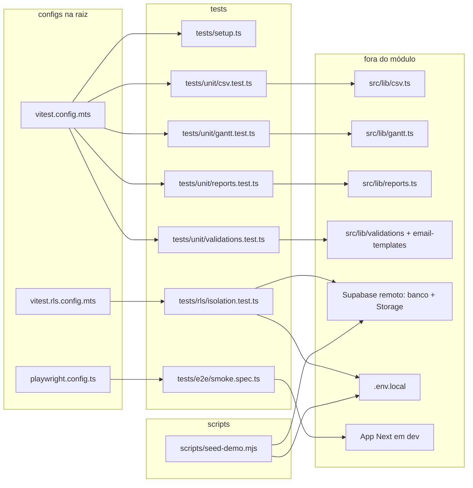

# 18. Testes e scripts

> 8 arquivos de código + 3 configs · 3 fichas completas · 5 em tabela de exceção.

Este módulo é a **qualidade e a carga de demonstração** do Orbit CRM. Ele reúne o script de seed (`scripts/seed-demo.mjs`) que popula um tenant com dados realistas, o setup do Vitest, os testes unitários (lógica pura de `src/lib`, rodando em jsdom via Vitest), o teste de **RLS** contra um Supabase remoto real (`tests/rls/isolation.test.ts`, o mais importante: ~118 casos de isolamento entre tenants e de permissões) e o smoke de E2E com Playwright. O que ele prova é justamente o que o [modelo de dados](../04-modelo-de-dados.md) §4 desenha: que `tenant_id` + RLS isolam os dados, que os papéis são respeitados e que as RPCs do portal só devolvem o que podem.

## Dependências do módulo

## Fichas

### §18.1 `scripts/seed-demo.mjs`

**Propósito:** script Node avulso que apaga e repopula o tenant `easy-prospect` com dados de demonstração (empresas, contatos, projetos, tarefas, financeiro, helpdesk, leads, base de conhecimento etc.), usando a **service role** do Supabase (portanto ignorando RLS).
**Processo:** roda no topo (top-level await). Primeiro carrega `.env.local` via `process.loadEnvFile` (se existir) e lê `NEXT_PUBLIC_SUPABASE_URL` e `SUPABASE_SERVICE_ROLE_KEY`; se faltar, imprime erro e sai com código 1. Cria `admin = createClient(url, serviceKey, ...)`. Define `DEMO_PASSWORD` e a lista `demoUsers` (ana/bruno/carla/diego `@orbit.demo`). Helpers: `pick`, `rand`, `iso`, `daysFromNow`, `tsDaysAgo`, `slugify`. `getTenantId()` busca o tenant pelo `slug = "easy-prospect"`. `ensureDemoUsers(tenantId)` lista usuários (`admin.auth.admin.listUsers`), cria os que faltam (`admin.auth.admin.createUser` com `email_confirm`), corrige `profiles.full_name` dos que ficaram sem nome e faz `upsert` de `memberships` (`onConflict: "tenant_id,user_id"`). Em seguida `seed(tenantId)`: acha o profile do dono ("Werner Saboia"); chama `wipe(tenantId)`, que apaga os arquivos do bucket `attachments` (`listAllFiles` caminha recursivamente + `wipeStorage`) e depois apaga linhas das tabelas por `tenant_id` numa ordem que respeita as FKs (`payments`, `document_items`, `invoices`, `estimates`, `comments`, `attachments`, `ticket_replies`, `tickets`, `departments`, `time_entries`, `task_checklist_items`, `tasks`, `project_members`, `projects`, `contacts`, `companies`, `kb_articles`, `kb_categories`, `faqs`, `lead_activities`, `leads`, `lead_statuses`, `lead_sources`, `notifications`). Depois insere, nesta ordem: 8 `companies`; 1–3 `contacts` por empresa; acesso ao portal (`cliente@orbit.demo` criado via auth e ligado ao primeiro contato, gravando `contacts.user_id`); 6 `projects`; `project_members`; `tasks` (3–6 por projeto); `task_checklist_items`; `comments` (de task e de project); `time_entries`; uploads no bucket `attachments` e linhas em `attachments`; `estimates` + `document_items`; `invoices` + `document_items` + `payments`; `departments`; `tickets` (e atualiza `tenants.next_ticket_number`); `ticket_replies`; anexos de ticket; `kb_categories` + `kb_articles`; `faqs`; `lead_statuses` + `lead_sources` + `leads` + `lead_activities`; sobe o tenant para o plano "Pro" (`plans` + `tenants.plan_id`/`plan_status`); e `notifications` do dono. Retorna um resumo com as contagens e imprime no fim (`Seed concluído`, e-mails de demo e a senha).
**Estado:** `implementado` — 1138 linhas, executa o fluxo inteiro de ponta a ponta.
**Testes:** sem teste (é uma ferramenta operacional; roda-se com `npm run seed:demo`).
**Depende de:**
- `.env.local`: lê `NEXT_PUBLIC_SUPABASE_URL` e `SUPABASE_SERVICE_ROLE_KEY` (nomes de variáveis; valores não aparecem aqui).
- `@supabase/supabase-js`: cria o cliente admin e chama `auth.admin.*`, `.from()`, `.storage.from()` e `.rpc`/`.upsert`.
- Tabelas do banco que **lê e escreve**: `tenants`, `profiles`, `memberships`, `companies`, `contacts`, `projects`, `project_members`, `tasks`, `task_checklist_items`, `comments`, `time_entries`, `attachments`, `estimates`, `document_items`, `invoices`, `payments`, `departments`, `tickets`, `ticket_replies`, `kb_categories`, `kb_articles`, `faqs`, `lead_statuses`, `lead_sources`, `leads`, `lead_activities`, `plans`, `notifications`.
- Buckets de Storage `attachments` e `branding` (uploads e limpeza).

**Usado por:** `package.json` (script `"seed:demo": "node scripts/seed-demo.mjs"`) — é um ponto de entrada, não é importado por nenhum outro arquivo.
**Bibliotecas externas:** `@supabase/supabase-js`; módulos nativos `node:fs` (`existsSync`), `process.loadEnvFile` e `crypto.randomUUID`.

### §18.2 `tests/setup.ts`

**Propósito:** arquivo de setup carregado pelo Vitest antes dos testes unitários; só registra os matchers extras do `jest-dom` no `expect`.
**Processo:** tem uma única linha, `import "@testing-library/jest-dom/vitest"`, que estende o `expect` do Vitest com matchers de DOM (`toBeVisible`, `toHaveTextContent`, etc.). É declarado em `setupFiles` do `vitest.config.mts`.
**Estado:** `implementado` — 1 linha.
**Testes:** é o próprio setup (não tem teste).
**Depende de:**
- `@testing-library/jest-dom`: registra os matchers.
- `vitest`: o `expect` estendido (via integração `/vitest` do jest-dom).

**Usado por:** `vitest.config.mts` (chave `test.setupFiles`); indiretamente por todos os testes de `tests/unit/`.
**Bibliotecas externas:** `@testing-library/jest-dom`.

### §18.3 `tests/rls/isolation.test.ts`

**Propósito:** teste de integração de RLS/isolamento que roda **contra um Supabase real** (não usa mock): prova que um usuário de um tenant nunca lê/escreve/assina arquivos de outro, que papéis são respeitados e que as RPCs do portal só devolvem o que o cliente pode ver.
**Processo:** roda em ambiente `node` (`// @vitest-environment node`) e carrega `.env.local` via `process.loadEnvFile`, lendo `NEXT_PUBLIC_SUPABASE_URL`, `NEXT_PUBLIC_SUPABASE_ANON_KEY` e `SUPABASE_SERVICE_ROLE_KEY`. O bloco inteiro é `describe.runIf(hasEnv)` — se faltar env, o arquivo é **pulado**. No `beforeAll`, com o cliente `admin` (service role), cria o cenário: dois tenants descartáveis (`Empresa A`/`Empresa B` com sufixo de `randomUUID`), usuários `owner` de A e B, caso de portal (empresa + contato + usuário `cliente` ligado por `contacts.user_id`), usuário `admin` e `member` no tenant A; e as linhas-base de cada tenant — `companies`, `projects`, `tasks`, `milestones`, `tags`, `custom_field_definitions`, `estimates` e `invoices` — mais `memberships`. Depois cria clientes com a **anon key** e faz `signInWithPassword` para A, B, dono-do-portal, admin e member. Os **118 testes** verificam, por tabela: leitura só do próprio tenant; `insert`/`update`/`delete` cruzando tenant sempre com erro; isolamento de `profiles`/`memberships`/`invitations`; checklist, comentários, anexos, horas (`time_entries`) e a regra de um único timer em execução por usuário; RPCs `next_document_number` e `time_entries_summary` restritas ao tenant; milestones e vínculo `tasks.milestone_id`; tags/`taggables` e campos personalizados (`custom_field_definitions`/`custom_field_values`); financeiro (`document_items`, `payments`, `expenses`, `contracts`, `calendar_events`, `goals`, `email_templates`); auditoria (`activity_log` gerado por trigger, com autor, e sem `insert` direto); Storage `attachments` e `branding` (upload e `createSignedUrl` barrados fora do tenant); regressões de segurança (não se promover a `is_super_admin`; admin não vira `owner` nem remove o `owner`; owner não mexe em `status`/`plan_status` do tenant; member não apaga horas de outro nem cria notificação para outro); e o **cliente do portal**, que só vê a própria empresa via RPCs (`portal_list_projects`, `portal_list_tasks`, `portal_list_milestones`, `portal_list_contracts`, `portal_list_expenses`) — nunca lendo `projects`/`tasks`/`companies`/`profiles`/`estimates` em rascunho direto — e não cria contrato nem despesa; por fim, `check_rate_limit` bloqueia após o limite e `profiles.email` é preenchido. No `afterAll`, remove os arquivos enviados aos buckets `attachments`/`branding` e apaga os dois tenants e todos os usuários de auth criados.
**Estado:** `implementado` — 2013 linhas, 118 casos.
**Testes:** é o próprio teste de RLS.
**Depende de:**
- `.env.local`: lê `NEXT_PUBLIC_SUPABASE_URL`, `NEXT_PUBLIC_SUPABASE_ANON_KEY` e `SUPABASE_SERVICE_ROLE_KEY` (nomes de variáveis).
- `@supabase/supabase-js`: clientes admin/anon e chamadas a `auth`, `.from()`, `.storage` e `.rpc`.
- Schema, policies, triggers e RPCs criados por `supabase/migrations/*` (ver [01-banco-migrations-e-seed](01-banco-migrations-e-seed.md) §01) — o teste depende de existirem no Supabase remoto.
- Tabelas exercitadas: `tenants`, `profiles`, `memberships`, `invitations`, `companies`, `contacts`, `projects`, `project_members`, `tasks`, `task_checklist_items`, `task_dependencies`, `milestones`, `comments`, `attachments`, `time_entries`, `estimates`, `invoices`, `document_items`, `payments`, `expenses`, `contracts`, `calendar_events`, `tags`, `taggables`, `custom_field_definitions`, `custom_field_values`, `goals`, `email_templates`, `activity_log`, `notifications`, `rate_limit_hits`. RPCs: `next_document_number`, `time_entries_summary`, `check_rate_limit`, `portal_list_projects`, `portal_list_tasks`, `portal_list_milestones`, `portal_list_contracts`, `portal_list_expenses`. Buckets `attachments` e `branding`.

**Usado por:** `vitest.rls.config.mts` (chave `test.include`); roda com `npm run test:rls`.
**Bibliotecas externas:** `@supabase/supabase-js`, `vitest`, `node:fs`, `node:crypto`.

## Tabela de exceção — demais testes

Arquivos de teste ficam em tabela (o comportamento que cobrem já é descrito nas fichas dos módulos de código correspondentes).

| Arquivo | O que testa | Motivo da exceção |
|---|---|---|
| `tests/unit/csv.test.ts` | `toCsv` e `parseCsv` de `src/lib/csv.ts`: cabeçalho/linhas com `;`, escape de `;`/aspas/quebras, `parseCsv` respeita campos entre aspas e ignora linhas vazias. | Arquivo de teste. |
| `tests/unit/gantt.test.ts` | Helpers de `src/lib/gantt.ts`: `addDays`/`diffDays`, `normalizeSchedule` (empurra sucessoras, não mexe nas já posicionadas, sem dependência, tarefa inexistente) e `wouldCreateCycle` (ciclo indireto, aresta OK, autodependência). | Arquivo de teste. |
| `tests/unit/reports.test.ts` | Funções de `src/lib/reports.ts`: `buildProfitability` (margem e ordenação), `buildProductivity` (tarefas concluídas no período, horas, valor faturável) e `buildLeadConversionBySource` (total/ganhos/perdidos/abertos, conversão e ordenação). | Arquivo de teste. |
| `tests/unit/validations.test.ts` | Validações Zod e utilitários: `signInSchema`, `milestoneSchema`, `tagSchema`, `customFieldDefinitionSchema`, `tenantSettingsSchema`, `inviteMemberSchema`/`acceptInvitationSchema`, `expenseSchema`, `contractSchema`, `calendarEventSchema`, `goalSchema`, `publicLeadSchema` e `renderTemplate`. | Arquivo de teste. |
| `tests/e2e/smoke.spec.ts` | Smoke de Playwright: a raiz redireciona para `/login` quando não autenticado e a página de login mostra o botão "Entrar". | Arquivo de teste. |

## Configs citadas

- `vitest.config.mts` (raiz): testes unitários — `environment: "jsdom"`, `globals: true`, `include: tests/unit/**`, `setupFiles: ["tests/setup.ts"]`, alias `@ → ./src`.
- `vitest.rls.config.mts` (raiz): testes de RLS — `environment: "node"`, `include: tests/rls/**`, `fileParallelism: false` e timeouts de 30s/60s (roda contra o Supabase remoto), alias `@ → ./src`.
- `playwright.config.ts` (raiz): E2E — `testDir: "./tests/e2e"`, projeto `chromium`, `webServer` sobe `npm run dev` (salvo se `E2E_BASE_URL` estiver definido).

## Tabela das fichas do módulo

| § | Arquivo | Propósito em 1 linha |
|---|---------|----------------------|
| §18.1 | `scripts/seed-demo.mjs` | Apaga e repopula o tenant de demo com dados realistas, usando a service role. |
| §18.2 | `tests/setup.ts` | Setup do Vitest: registra os matchers do `jest-dom`. |
| §18.3 | `tests/rls/isolation.test.ts` | 118 casos de isolamento/RLS e RPCs contra um Supabase real. |
| — | `tests/unit/{csv,gantt,reports,validations}.test.ts`, `tests/e2e/smoke.spec.ts` | Testes unitários e smoke de E2E (ver tabela de exceção acima). |
| config | `vitest.config.mts` | Configuração dos testes unitários (jsdom + setupFiles). |
| config | `vitest.rls.config.mts` | Configuração dos testes de RLS (node, serial, contra o Supabase remoto). |
| config | `playwright.config.ts` | Configuração do E2E (chromium + webServer de dev). |
