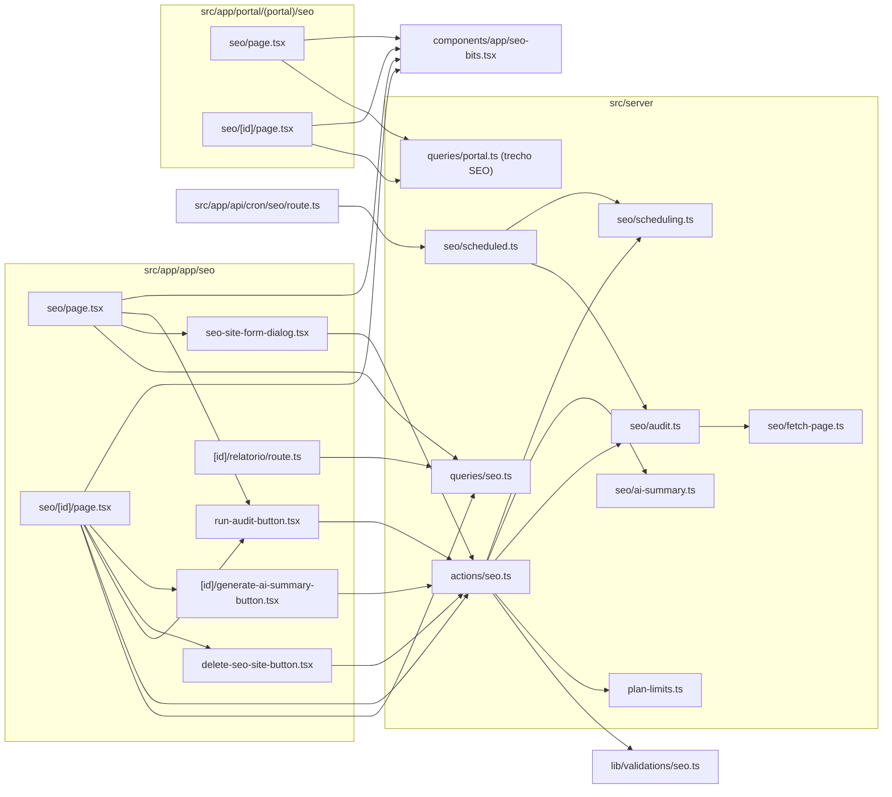

# 19. SEO (sites monitorados, auditoria técnica, agendamento, IA e portal)

> 25 arquivos de código · 19 fichas completas · 6 em tabela de exceção (4 migrations e 2 testes).
> Retrato de `main@413c601` (04/11/2026). Entrou depois de `29aac19`. Evidência no formato `arquivo:linha`.

O módulo de SEO deixa a equipe **cadastrar o site de um cliente** (`seo_sites`), **rodar uma auditoria técnica e de conteúdo** da página informada e **guardar o histórico** (`seo_audits`). A auditoria baixa o HTML com um guarda contra SSRF (`src/server/seo/fetch-page.ts`), aplica **26 verificações** em cinco categorias (Conteúdo, Técnico, Performance, Segurança e Social) e calcula um **score 0–100** ponderado pela severidade (`src/server/seo/audit.ts:43`, `:561`). Cada site pode ter **monitoramento agendado** (manual, diário, semanal ou mensal), executado por um cron da Vercel às 09:30 (`vercel.json`, rota `/api/cron/seo`). Sobre uma auditoria concluída, a equipe pode **gerar um resumo com IA** (OpenAI, `src/server/seo/ai-summary.ts`) e **baixar um relatório em PDF** (`pdf-lib`). O **cliente do portal** vê os sites vinculados à empresa dele e a última auditoria concluída por duas RPCs `security definer` (`0046`, recriada em `0048`).

Permissões: qualquer membro do tenant cria site, audita, muda o intervalo e gera o resumo; **só `owner`/`admin` excluem** (action `src/server/actions/seo.ts:217` e policy de DELETE em `0045_seo_audits.sql:76`). A exclusão pela action é soft delete (`deleted_at`), então as auditorias continuam no banco.

## Diagrama de dependências do módulo

## Fichas

### §19.1 `src/lib/validations/seo.ts`

**Propósito:** schemas Zod do cadastro de site e da troca de intervalo de monitoramento.
**Processo:** `siteUrl` faz `preprocess`: apara a string e, se não começar com `http://`/`https://`, prefixa `https://` (`:8`); depois exige URL válida com até 2048 caracteres. `checkInterval` converte para inteiro e só aceita os valores de `SEO_CHECK_INTERVALS` (`0, 1, 7, 30`). `seoSiteSchema` (`:22`) tem `label` opcional (string vazia vira `undefined`, até 120), `url`, `company_id` UUID opcional e `check_interval_days` com default `0`. `seoMonitoringSchema` (`:34`) só valida o intervalo.
**Estado:** `implementado`.
**Testes:** sem teste próprio (nenhum teste importa `@/lib/validations/seo`).
**Depende de:** `zod`; `src/lib/constants.ts`: `SEO_CHECK_INTERVALS` (`constants.ts:5`).
**Usado por:** `src/server/actions/seo.ts` (§19.2).
**Bibliotecas externas:** `zod`.

### §19.2 `src/server/actions/seo.ts`

**Propósito:** server actions do SEO: cadastrar site, auditar agora, mudar o intervalo, gerar resumo com IA e excluir.
**Processo:**
- `createSeoSiteAction` (`:21`): resolve a empresa ativa, chama `checkPlanLimit(tenantId, "seo_sites")` (`:28`), valida com `seoSiteSchema`; sem rótulo, usa o `hostname` da URL (`:41`); insere em `seo_sites` com `created_by` e revalida `/app/seo`.
- `runSeoAuditAction` (`:59`): busca o site do tenant (sem `deleted_at`), insere uma auditoria com `status: 1` (executando) (`:78`), chama `runSeoAudit(site.url)` **de forma síncrona** dentro da action e grava `status: 2` com score, contagens e o `result` completo em jsonb (`:99`–`:113`); em exceção grava `status: 3` e a mensagem em `error` (`:118`–`:126`). Em qualquer caso recalcula `next_audit_at` com `nextAuditAt(check_interval_days)` (`:129`–`:133`) e redireciona para `/app/seo/<id>`.
- `updateSeoMonitoringAction` (`:140`): valida o intervalo e grava `check_interval_days` e o novo `next_audit_at`.
- `generateSeoAiSummaryAction` (`:167`): carrega a auditoria `status = 2` do site e do tenant, chama `generateSeoAiSummary(result)` e grava `ai_summary`; erros do provedor voltam como mensagem.
- `deleteSeoSiteAction` (`:214`): exige `isManager(active.role)` (`:217`) e marca `deleted_at`.
**Estado:** `implementado`. Não há rate limit para `runSeoAuditAction` nem para o resumo com IA.
**Testes:** sem teste das actions (ver [06](../06-problemas-e-dividas.md) #4); os helpers que elas chamam têm teste (§19.4, §19.5, §19.6, §19.8).
**Depende de:** `src/lib/supabase/server.ts`, `src/lib/auth.ts` (`getUser`), `src/lib/tenant.ts` (`getActiveMembership`), `src/lib/db-error.ts`, `src/lib/logger.ts`, §19.1, `src/server/plan-limits.ts` (`checkPlanLimit`), `src/server/permissions.ts` (`isManager`), §19.4, §19.6, §19.8. Tabelas `seo_sites`, `seo_audits`.
**Usado por:** §19.11, §19.12, §19.13, §19.14 (formulário de monitoramento), §19.15.
**Bibliotecas externas:** `next/cache`, `next/navigation`.

> **Limite de plano:** `seo_sites` está em `RESOURCE_TABLES` (`src/server/plan-limits.ts:13`), mas nesta `main` o super-admin não consegue configurá-lo ([06](../06-problemas-e-dividas.md) #24, **resolvido no PR #23, aguardando merge**).

### §19.3 `src/server/queries/seo.ts`

**Propósito:** leituras de SEO para as telas internas e para a exportação CSV.
**Processo:**
- `listSeoSitesPage` (`:46`): página de `seo_sites` do tenant (`count: "exact"`), depois busca em paralelo os nomes de `companies` e **todas** as auditorias desses sites ordenadas por data, e fica com a mais recente por site (`latestBySite`, `:100`).
- `getSeoSite` (`:117`): site + nome do cliente.
- `getLatestSeoAudit` (`:149`): a auditoria mais recente do site, em qualquer status, com `result` e `ai_summary`.
- `listSeoAuditHistory` (`:168`): as 10 últimas auditorias (resumo).
- `listSeoAuditsForExport` (`:195`): todas as auditorias do tenant com o rótulo do site (para `/app/exportar/seo`).
Todas filtram por `tenant_id` explicitamente, além da RLS.
**Estado:** `implementado`. A lista busca todas as auditorias dos sites da página para pegar só a última, o que cresce com o histórico.
**Testes:** sem teste.
**Depende de:** `src/lib/supabase/server.ts`; tipo `SeoAuditResult` de §19.4.
**Usado por:** §19.11, §19.14, §19.16; `src/app/app/exportar/[entity]/route.ts:140` (`case "seo"`, CSV com Site, URL, Data, Status, Score e contagens).
**Bibliotecas externas:** nenhuma.

### §19.4 `src/server/seo/audit.ts`

**Propósito:** motor da auditoria: aplica as verificações no HTML e calcula o score.
**Processo:** `buildChecks(page)` (`:103`) faz o parse com `node-html-parser` e devolve 26 `SeoCheck` (`id`, `category`, `label`, `severity`, `status` pass/warn/fail, `message`). Verificações por id: `status_code`, `https`, `title`, `meta_description`, `h1`, `canonical`, `meta_robots`, `lang`, `viewport`, `charset`, `doctype`, `favicon`, `image_alt`, `internal_links`, `external_links`, `unsafe_target_blank`, `deprecated_tags`, `word_count`, `text_html_ratio`, `response_time`, `page_size`, `dom_size`, `compression`, `security_headers`, `opengraph`, `schema`. `summarize(checks)` (`:561`) usa os pesos `major: 4`, `moderate: 2`, `minor: 1` (`:43`): `pass` soma o peso, `warn` soma metade e `fail` não soma; o score é `round(ganho / possível × 100)`; `warn` e `fail` contam como problema por severidade. `runSeoAudit(url)` (`:605`) junta `fetchHtml` + `buildChecks` + `summarize` e devolve o `SeoAuditResult` (`version: 1`), que é gravado inteiro em `seo_audits.result`.
**Estado:** `implementado`. Audita **uma URL** (não rastreia o site).
**Testes:** `tests/unit/seo-audit.test.ts` (página completa aprovada, página incompleta penalizada, pesos do score).
**Depende de:** §19.5 (`fetchHtml`, `FetchedPage`); `node-html-parser`.
**Usado por:** §19.2, §19.7; tipos usados por §19.3, §19.6, §19.16, §19.18, §19.19 e `src/server/queries/portal.ts`.
**Bibliotecas externas:** `node-html-parser`.

### §19.5 `src/server/seo/fetch-page.ts`

**Propósito:** baixar o HTML da página auditada com proteção contra SSRF e limites de tempo e tamanho.
**Processo:** constantes `MAX_BYTES = 2_000_000`, `MAX_REDIRECTS = 5`, `TIMEOUT_MS = 8_000` e user-agent `OrbitCRM-SEO/0.1` (`:4`–`:7`). `isPrivateAddress` (`:64`) rejeita faixas IPv4 privadas, loopback, link-local, CGNAT e multicast, e IPv6 `::1`, `fc/fd`, `fe8`–`feb` e IPv4 mapeado. `assertPublicUrl` (`:71`) só aceita `http:`/`https:`, bloqueia `localhost`, `*.local`, `*.internal` e resolve o DNS (`lookup`, `:96`), recusando se **qualquer** endereço for privado. `fetchHtml` (`:110`) segue redirecionamentos **manualmente** (`redirect: "manual"`), revalidando cada destino; exige `content-type` `text/html` e corta páginas acima de 2 MB (pelo header e pelo corpo).
**Estado:** `implementado`. A checagem resolve o DNS e depois o `fetch` (`:134`) resolve de novo, então não fixa o IP validado.
**Testes:** `tests/unit/seo-audit.test.ts` (`isPrivateAddress`: bloqueia faixas privadas/reservadas e libera públicas).
**Depende de:** `node:dns/promises`, `node:net`.
**Usado por:** §19.4.
**Bibliotecas externas:** nenhuma (APIs do Node).

### §19.6 `src/server/seo/ai-summary.ts`

**Propósito:** gerar o resumo em português de uma auditoria pela API da OpenAI.
**Processo:** lê `OPENAI_API_KEY` e `OPENAI_MODEL` de `env()` (`src/lib/env.ts:16`–`:17`, modelo padrão `gpt-4o-mini`); sem chave lança `SeoAiError` (`:10`). Monta um prompt com URL final, score, contagens e a lista de verificações que não passaram, pedindo três parágrafos (diagnóstico, prioridades, próximos passos). Faz `POST https://api.openai.com/v1/chat/completions` (`:41`) com `temperature: 0.3`, `max_tokens: 450` e timeout de 8 s (`:60`). Resposta vazia ou não-OK vira `SeoAiError`.
**Estado:** `implementado`. A variável é opcional; sem ela o botão devolve o erro na tela.
**Testes:** `tests/unit/seo-ai.test.ts` (gera o resumo com `fetch` simulado; falha sem chave).
**Depende de:** `src/lib/env.ts`; tipo `SeoAuditResult` de §19.4. Env: `OPENAI_API_KEY`, `OPENAI_MODEL` (`.env.example:23`–`:24`).
**Usado por:** §19.2 (`generateSeoAiSummaryAction`).
**Bibliotecas externas:** nenhuma (`fetch` nativo).

### §19.7 `src/server/seo/scheduled.ts`

**Propósito:** executar as auditorias agendadas que já venceram (chamado pelo cron).
**Processo:** `runScheduledSeoAudits(limit = 3)` (`:20`–`:21`) usa o **cliente admin** (`createAdminClient`, `:23`; ignora RLS) e seleciona até 3 sites sem `deleted_at`, com `check_interval_days > 0` e `next_audit_at <= agora`, ordenados pelo vencimento. Para cada site, em paralelo (`Promise.allSettled`, `:40`): insere a auditoria `status: 1` com `created_by: null`, roda `runSeoAudit`, grava `status: 2` e agenda o próximo `next_audit_at` pelo intervalo do site. Em erro grava `status: 3` (se a auditoria chegou a ser criada) e **reagenda para o dia seguinte** (`nextAuditAt(1)`, `:109`). Devolve `{ processed, ok, failed }`.
**Estado:** `implementado`. Processa no máximo 3 sites por execução e o cron roda uma vez por dia, então a fila anda 3 sites/dia no total da plataforma.
**Testes:** sem teste próprio; `nextAuditAt` é testado (§19.8).
**Depende de:** `src/lib/supabase/admin.ts`, `src/lib/logger.ts`, §19.4, §19.8.
**Usado por:** §19.9.
**Bibliotecas externas:** nenhuma.

### §19.8 `src/server/seo/scheduling.ts`

**Propósito:** calcular a data da próxima auditoria.
**Processo:** `nextAuditAt(days, from = new Date())` (`:1`) devolve `null` para `days <= 0` e, senão, `from + days` em UTC (ISO).
**Estado:** `implementado`.
**Testes:** `tests/unit/seo-audit.test.ts` (bloco `scheduling`).
**Depende de:** nada.
**Usado por:** §19.2, §19.7.
**Bibliotecas externas:** nenhuma.

### §19.9 `src/app/api/cron/seo/route.ts`

**Propósito:** endpoint do cron diário de SEO.
**Processo:** `GET` com `dynamic = "force-dynamic"`. Sem `CRON_SECRET` responde 503 (`:19`); compara `Authorization` com `Bearer <CRON_SECRET>` usando `timingSafeEqual` (`safeEqual`, `:23`) e responde 401 se não bater; chama `runScheduledSeoAudits()` (`:29`) e devolve `{ success: true, processed, ok, failed }`, ou 500 em exceção.
**Estado:** `implementado`. Agendado em `vercel.json` como `30 9 * * *` (09:30 UTC).
**Testes:** sem teste.
**Depende de:** `next/server`, `node:crypto`, `src/lib/logger.ts`, §19.7. Env: `CRON_SECRET`.
**Usado por:** ponto de entrada — Vercel Cron (`vercel.json`).
**Bibliotecas externas:** `next`.

### §19.10 `src/components/app/seo-bits.tsx`

**Propósito:** selos visuais do SEO.
**Processo:** `SeoScoreBadge` (`:4`) mostra "Sem nota" quando `null` e colore o número (≥ 80 verde, ≥ 50 âmbar, abaixo vermelho); `SeoAuditStatusBadge` (`:25`) traduz 1/2/3 em Executando/Concluída/Erro; `SeoCheckStatusBadge` (`:42`) e `SeoSeverityBadge` (`:70`) mostram o resultado e a severidade de cada verificação.
**Estado:** `implementado`.
**Testes:** sem teste.
**Depende de:** `src/components/ui/badge.tsx`, `src/lib/utils.ts`.
**Usado por:** §19.11, §19.14, §19.18, §19.19.
**Bibliotecas externas:** nenhuma.

### §19.11 `src/app/app/seo/page.tsx`

**Propósito:** lista dos sites monitorados do tenant.
**Processo:** server component paginado (`parsePage`, `PAGE_SIZE`). Resolve o tenant ativo e busca em paralelo `listCompanies` e `listSeoSitesPage` (`:34`–`:37`). Mostra o total, o botão de exportar (`/app/exportar/seo`, `:54`) e o diálogo de novo site; a tabela traz site, cliente, score e status da última auditoria, data e os botões "Auditar" e "Abrir".
**Estado:** `implementado`.
**Testes:** sem teste.
**Depende de:** §19.3, §19.10, §19.12, §19.13, `src/server/queries/companies.ts`, `src/components/app/export-button.tsx`, `src/components/app/pagination.tsx`, `src/lib/pagination.ts`, `src/lib/auth.ts`, `src/lib/tenant.ts`.
**Usado por:** ponto de entrada — rota `/app/seo`; link "SEO" do menu (`src/components/app/app-sidebar.tsx:43`).
**Bibliotecas externas:** `next/link`, `lucide-react`.

**Rota da página:** `/app/seo` · **O que o usuário vê e faz:** vê os sites e o último score, cadastra um site, dispara uma auditoria, exporta o histórico em CSV.
**APIs/actions que chama:** `listSeoSitesPage`, `createSeoSiteAction` (pelo diálogo), `runSeoAuditAction` (pelo botão) · **Guardas:** sessão e tenant ativo (layout de `/app`).

### §19.12 `src/app/app/seo/seo-site-form-dialog.tsx`

**Propósito:** diálogo client para cadastrar um site.
**Processo:** `useActionState(createSeoSiteAction)`; campos `url` (obrigatório), `label`, `company_id` (select com "— Nenhum —") e `check_interval_days` (opções de `SEO_CHECK_INTERVAL_LABELS`: Manual, Diário, Semanal, Mensal). Fecha e mostra toast no sucesso; mostra toast de erro na falha.
**Estado:** `implementado`.
**Testes:** sem teste.
**Depende de:** §19.2, `src/lib/constants.ts` (`SEO_CHECK_INTERVAL_LABELS`, `:7`), `src/components/ui/{button,dialog,input,label}.tsx`, `sonner`.
**Usado por:** §19.11.
**Bibliotecas externas:** `react`, `sonner`, `lucide-react`.

**Rota da página:** componente de `/app/seo` · **O que o usuário vê e faz:** informa a URL, o rótulo, o cliente e o intervalo · **APIs/actions que chama:** `createSeoSiteAction` · **Guardas:** as da action (empresa ativa e limite de plano).

### §19.13 `src/app/app/seo/run-audit-button.tsx`

**Propósito:** botão "Auditar agora" (ou rótulo customizado) que dispara a auditoria.
**Processo:** formulário com `site_id` oculto e `action={runSeoAuditAction}`; o botão usa `useFormStatus` para girar o ícone e mostrar "Auditando..." enquanto a action roda (a auditoria é síncrona).
**Estado:** `implementado`.
**Testes:** sem teste.
**Depende de:** §19.2, `src/components/ui/button.tsx`, `src/lib/utils.ts`.
**Usado por:** §19.11, §19.14.
**Bibliotecas externas:** `react-dom` (`useFormStatus`), `lucide-react`.

### §19.14 `src/app/app/seo/[id]/page.tsx`

**Propósito:** detalhe de um site: última auditoria, verificações por categoria, resumo com IA, monitoramento e histórico.
**Processo:** resolve o tenant (`:64`), carrega `getSeoSite` (404 se não existir) e, em paralelo, `getLatestSeoAudit` e `listSeoAuditHistory`. Agrupa as verificações por `CATEGORIES` (`:41`). Com uma auditoria concluída mostra "Gerar resumo com IA" e o link do PDF (`/app/seo/<id>/relatorio`, `:122`); mostra "Auditar agora" e, **só para owner/admin**, "Excluir". Exibe o `ai_summary` quando existe (`:224`), o formulário de intervalo que chama `updateSeoMonitoringAction` (`:291`) e a tabela "Histórico" (`:331`).
**Estado:** `implementado`.
**Testes:** sem teste.
**Depende de:** §19.2, §19.3, §19.10, §19.13, §19.15, §19.17, `src/server/permissions.ts` (`isManager`), `src/lib/constants.ts`, `src/lib/format.ts`, componentes `ui`.
**Usado por:** ponto de entrada — rota `/app/seo/[id]`; também é o destino da busca global (`src/server/actions/search.ts:95`).
**Bibliotecas externas:** `next/link`, `next/navigation`, `lucide-react`.

**Rota da página:** `/app/seo/[id]` · **O que o usuário vê e faz:** lê o score e cada verificação, gera o resumo, baixa o PDF, muda o intervalo e consulta o histórico · **APIs/actions que chama:** `runSeoAuditAction`, `updateSeoMonitoringAction`, `generateSeoAiSummaryAction`, `deleteSeoSiteAction` · **Guardas:** sessão e tenant; excluir só para owner/admin.

### §19.15 `src/app/app/seo/delete-seo-site-button.tsx`

**Propósito:** botão de exclusão do site com confirmação.
**Processo:** formulário com `id` oculto e `action={deleteSeoSiteAction}`; `confirm("Remover este site e o histórico de auditorias?")` antes de enviar. O texto fala em remover o histórico, mas a action faz soft delete só do site (§19.2).
**Estado:** `implementado`.
**Testes:** sem teste.
**Depende de:** §19.2, `src/components/ui/button.tsx`.
**Usado por:** §19.14 (renderizado só para owner/admin).
**Bibliotecas externas:** nenhuma.

### §19.16 `src/app/app/seo/[id]/relatorio/route.ts`

**Propósito:** gerar o relatório da última auditoria em PDF.
**Processo:** `GET` (`:51`) com `dynamic = "force-dynamic"`. Sem tenant ativo responde 401; site inexistente responde 404, e também quando a auditoria mais recente não está concluída (`status !== 2`) ou não tem `result` (`:68`). Monta o documento com `PDFDocument.create()` (`:72`) e fontes padrão do `pdf-lib`, e devolve `application/pdf` como anexo `seo-<slug>-<data>.pdf` (`:293`).
**Estado:** `implementado`.
**Testes:** sem teste.
**Depende de:** `pdf-lib`, `src/lib/auth.ts`, `src/lib/tenant.ts`, §19.3; tipo `SeoCheckCategory` de §19.4.
**Usado por:** link "PDF" de §19.14.
**Bibliotecas externas:** `pdf-lib`.

### §19.17 `src/app/app/seo/[id]/generate-ai-summary-button.tsx`

**Propósito:** botão client "Gerar resumo com IA".
**Processo:** `useActionState(generateSeoAiSummaryAction)` com `site_id` e `audit_id` ocultos; no sucesso mostra toast e faz `router.refresh()`; no erro mostra o toast com a mensagem (por exemplo, a chave da OpenAI ausente).
**Estado:** `implementado`.
**Testes:** sem teste.
**Depende de:** §19.2, `src/components/ui/button.tsx`, `sonner`, `next/navigation`.
**Usado por:** §19.14.
**Bibliotecas externas:** `react`, `sonner`, `lucide-react`.

### §19.18 `src/app/portal/(portal)/seo/page.tsx`

**Propósito:** lista, no portal, dos sites de SEO da empresa do cliente.
**Processo:** `PortalSeoPage` (`:8`) chama `getPortalContact()` (retorna `null` sem contato) e `listPortalSeoSites(contact.company_id)`, que executa a RPC `portal_list_seo_sites`. Mostra cartões com rótulo, URL, score e data da última auditoria concluída.
**Estado:** `implementado`.
**Testes:** sem teste; a RPC não tem teste de RLS (ver [06](../06-problemas-e-dividas.md) #25).
**Depende de:** `src/server/queries/portal.ts` (`getPortalContact`, `listPortalSeoSites`), §19.10, `src/lib/format.ts`, `src/components/ui/card.tsx`.
**Usado por:** ponto de entrada — rota `/portal/seo`; aba "SEO" do portal (`src/app/portal/(portal)/portal-nav.tsx:14`).
**Bibliotecas externas:** `next/link`, `lucide-react`.

**Rota da página:** `/portal/seo` · **O que o usuário vê e faz:** vê os sites e o score, e abre o detalhe · **APIs/actions que chama:** RPC `portal_list_seo_sites` · **Guardas:** sessão e vínculo de contato (layout do portal); a RPC confere `is_client_of_company`.

### §19.19 `src/app/portal/(portal)/seo/[id]/page.tsx`

**Propósito:** detalhe, no portal, da última auditoria concluída de um site.
**Processo:** `PortalSeoDetailPage` (`:28`) chama `getPortalSeoAudit(contact.company_id, id)` (RPC `portal_get_seo_audit`) e dá 404 sem resultado. Mostra score, contagens por severidade, o resumo com IA quando existe e as verificações agrupadas por categoria (só as categorias com itens).
**Estado:** `implementado`. O portal vê apenas auditorias `status = 2`; não vê histórico nem dispara auditoria.
**Testes:** sem teste.
**Depende de:** `src/server/queries/portal.ts` (`getPortalContact`, `getPortalSeoAudit`), §19.10, componentes `ui`.
**Usado por:** ponto de entrada — rota `/portal/seo/[id]`, linkada por §19.18.
**Bibliotecas externas:** `next/link`, `next/navigation`, `lucide-react`.

**Rota da página:** `/portal/seo/[id]` · **O que o usuário vê e faz:** lê a nota, os problemas e o resumo · **APIs/actions que chama:** RPC `portal_get_seo_audit` · **Guardas:** sessão e contato; a RPC filtra por `company_id` e `is_client_of_company`.

## Trechos de SEO em arquivos compartilhados

Esses arquivos já têm ficha nos módulos de `29aac19`; abaixo, só o que o SEO acrescentou.

| Arquivo | O que o SEO acrescentou |
|---|---|
| `src/server/queries/portal.ts` | `listPortalSeoSites` (RPC `portal_list_seo_sites`) e `getPortalSeoAudit` (RPC `portal_get_seo_audit`, inclui `ai_summary`) — `:219`, `:245`. |
| `src/server/plan-limits.ts` | recurso `seo_sites` em `ResourceTable`/`RESOURCE_TABLES` — `:5`, `:13`. |
| `src/server/actions/search.ts` | a busca global também procura em `seo_sites` e devolve o tipo `"seo"` com link `/app/seo/<id>` — `:46`, `:95`. |
| `src/app/app/exportar/[entity]/route.ts` | `case "seo"`: CSV das auditorias — `:140`. |
| `src/lib/constants.ts` | `SEO_CHECK_INTERVALS` e `SEO_CHECK_INTERVAL_LABELS` — `:5`, `:7`. |
| `src/lib/env.ts` | `OPENAI_API_KEY` (opcional) e `OPENAI_MODEL` (padrão `gpt-4o-mini`) — `:16`–`:17`. |
| `src/components/app/app-sidebar.tsx` | item "SEO" → `/app/seo` — `:43`. |
| `src/app/portal/(portal)/portal-nav.tsx` | aba "SEO" → `/portal/seo` — `:14`. |
| `vercel.json` | cron `/api/cron/seo` às `30 9 * * *`. |

## Tabela de exceção — migrations e testes

| Arquivo | Conteúdo | Motivo da exceção |
|---|---|---|
| `supabase/migrations/0045_seo_audits.sql` | Cria `seo_sites` (`:3`; `company_id` com FK composta para `companies`, soft delete) e `seo_audits` (`:29`; `status` 1–3, `score` 0–100, contagens por severidade, `result jsonb`, `error`, FK composta para o site com `on delete cascade`); índices `(id, tenant_id)`; RLS: membro lê, cria e altera; **DELETE só owner/admin** (`:76`, `:87`). | Migração de schema + RLS. |
| `supabase/migrations/0046_portal_seo.sql` | RPCs `security definer` `portal_list_seo_sites(p_company)` (`:9`) e `portal_get_seo_audit(p_company, p_site)` (`:55`): só sites da empresa, só a última auditoria `status = 2`, guardadas por `is_client_of_company`; `execute` revogado de `public`/`anon`. | Migração de RPC/portal. |
| `supabase/migrations/0047_seo_monitoring.sql` | Colunas `check_interval_days` (`0, 1, 7, 30`) e `next_audit_at` (`:3`–`:6`); índice parcial `seo_sites_due_idx`; trigger `set_seo_next_audit` (`:13`, `:34`) que preenche `next_audit_at` quando o intervalo é > 0 e zera quando é 0. | Migração de schema + trigger. |
| `supabase/migrations/0048_seo_ai_summary.sql` | Coluna `seo_audits.ai_summary` (`:3`–`:4`) e recriação de `portal_get_seo_audit` devolvendo o resumo (`:8`–`:10`). | Migração de schema + RPC. |
| `tests/unit/seo-audit.test.ts` | `buildChecks` (página completa passa, incompleta é penalizada), `summarize` (pesos), `nextAuditAt` e `isPrivateAddress` (guarda de SSRF). | Arquivo de teste. |
| `tests/unit/seo-ai.test.ts` | `generateSeoAiSummary` com `fetch` simulado: gera o resumo e falha sem `OPENAI_API_KEY`. | Arquivo de teste. |

> Não há teste de RLS para `seo_sites`, `seo_audits` nem para as RPCs do portal: `tests/rls/isolation.test.ts` não cita nenhuma tabela `seo_*` (ver [06](../06-problemas-e-dividas.md) #25).

## Fichas do módulo

| § | Arquivo | Propósito em 1 linha |
|---|---|---|
| §19.1 | `src/lib/validations/seo.ts` | Schemas Zod do site e do intervalo de monitoramento. |
| §19.2 | `src/server/actions/seo.ts` | Cadastrar, auditar, agendar, resumir com IA e excluir site. |
| §19.3 | `src/server/queries/seo.ts` | Leituras de sites, auditorias, histórico e exportação. |
| §19.4 | `src/server/seo/audit.ts` | 26 verificações e score ponderado por severidade. |
| §19.5 | `src/server/seo/fetch-page.ts` | Download do HTML com guarda de SSRF, timeout e limite de 2 MB. |
| §19.6 | `src/server/seo/ai-summary.ts` | Resumo da auditoria pela API da OpenAI. |
| §19.7 | `src/server/seo/scheduled.ts` | Executa até 3 auditorias vencidas por chamada do cron. |
| §19.8 | `src/server/seo/scheduling.ts` | Calcula `next_audit_at`. |
| §19.9 | `src/app/api/cron/seo/route.ts` | Cron diário de SEO protegido por `CRON_SECRET`. |
| §19.10 | `src/components/app/seo-bits.tsx` | Selos de score, status, resultado e severidade. |
| §19.11 | `src/app/app/seo/page.tsx` | Lista de sites monitorados. |
| §19.12 | `src/app/app/seo/seo-site-form-dialog.tsx` | Diálogo de novo site. |
| §19.13 | `src/app/app/seo/run-audit-button.tsx` | Botão que dispara a auditoria. |
| §19.14 | `src/app/app/seo/[id]/page.tsx` | Detalhe do site com verificações, IA, monitoramento e histórico. |
| §19.15 | `src/app/app/seo/delete-seo-site-button.tsx` | Exclusão do site (soft delete) com confirmação. |
| §19.16 | `src/app/app/seo/[id]/relatorio/route.ts` | Relatório da última auditoria em PDF. |
| §19.17 | `src/app/app/seo/[id]/generate-ai-summary-button.tsx` | Botão do resumo com IA. |
| §19.18 | `src/app/portal/(portal)/seo/page.tsx` | Sites de SEO do cliente no portal. |
| §19.19 | `src/app/portal/(portal)/seo/[id]/page.tsx` | Última auditoria concluída no portal. |
