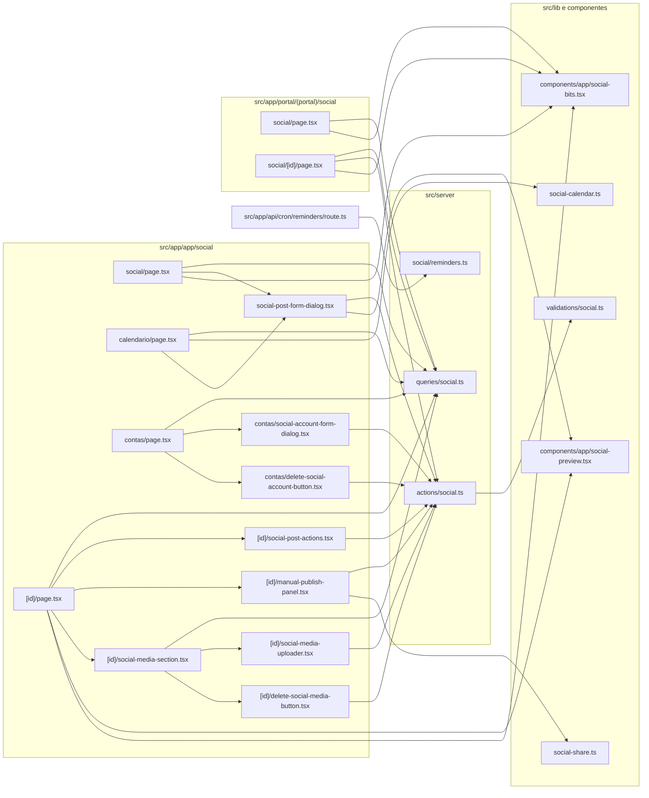

# 20. Social (contas, posts, aprovação, calendário, mídia e publicação manual)

> 28 arquivos de código · 22 fichas completas · 6 em tabela de exceção (3 migrations e 3 testes).
> Retrato de `main@413c601` (04/11/2026). Entrou depois de `29aac19`. Evidência no formato `arquivo:linha`. Spec do produto: [`docs/specs/social-media.md`](../../specs/social-media.md).

O módulo Social organiza o **planejamento de posts de redes sociais dos clientes**: a equipe cadastra as **contas sociais** de cada cliente (`social_accounts`), escreve o **post** (`social_posts`) escolhendo as contas de destino (`social_post_targets`), anexa **imagens** (`social_media`, bucket privado `social_media`) e leva o post por um **fluxo de aprovação** interno ou pelo **portal do cliente**. Depois de aprovado, o post é **agendado** e aparece no **calendário mensal**. A publicação é **manual** nesta fase: o cron diário cria lembretes para posts agendados nas próximas 24 h, e alguém da equipe copia o texto, abre a rede (links de compartilhamento) e marca o post como publicado. Toda mudança de estado grava um evento em `social_post_events`, que aparece como histórico do post.

Não há integração com as APIs das redes: `provider_account_id` é digitado à mão, as colunas `external_post_id`/`attempts`/`failure_reason` e os status `publishing`, `partially_published` e `failed` existem no banco, mas nenhum código os grava. A tabela `social_settings` (aprovação obrigatória, fuso, IA, `publish_mode`) também não é lida nem gravada por nenhum código. Ver [06](../06-problemas-e-dividas.md) #22, #23, #26–#29.

## Ciclo de vida do post (como o código implementa)

| De | Para | Quem | Onde |
|---|---|---|---|
| — | `draft` (se "requer aprovação") ou `approved` | qualquer membro | `createSocialPostAction` (`src/server/actions/social.ts:131`) |
| `draft`, `rejected` | `pending_approval` | qualquer membro | `submitSocialPostAction` (`:174`, `:181`) |
| `pending_approval` | `approved` ou `rejected` | owner/admin | `approveSocialPostAction` (`:194`, `:208`), `rejectSocialPostAction` (`:231`, `:249`) |
| `pending_approval` | `approved` ou `rejected` | contato do cliente (portal) | RPC `portal_respond_social_post` (`0049_social_foundation.sql:303`, `:327`) |
| `approved` | `scheduled` | owner/admin | `scheduleSocialPostAction` (`:262`, `:283`) |
| `approved`, `scheduled` | `published` | **qualquer membro** | `markSocialPostPublishedAction` (`:293`, `:309`) |
| `draft`, `pending_approval`, `approved`, `scheduled` | `cancelled` | owner/admin | `cancelSocialPostAction` (`:347`, `:359`) |
| qualquer | soft delete (`deleted_at`) | owner/admin | `deleteSocialPostAction` (`:370`) |

O portal não vê rascunhos (`p.status <> 'draft'`, `0049:247`, `:298`).

## Diagrama de dependências do módulo

## Fichas

### §20.1 `src/lib/validations/social.ts`

**Propósito:** schemas Zod de conta social, post, agendamento e resposta do portal.
**Processo:** `SOCIAL_PROVIDER_VALUES` (`:3`) lista as 8 redes aceitas (linkedin, instagram, facebook, x, tiktok, threads, youtube, pinterest), as mesmas do `check` de `social_accounts.provider` (`0049:17`–`:19`). `socialAccountSchema` (`:14`) exige rede, `provider_account_id` (1–200) e `display_name` (1–160), com `company_id` opcional. `socialPostSchema` (`:23`) exige `company_id` UUID ("Selecione um cliente"), conteúdo de 1 a 5.000 caracteres e pelo menos uma conta em `target_ids`; `requires_approval` tem default `true`. `socialScheduleSchema` (`:38`) só exige a string de data. `socialPostResponseSchema` (`:42`) valida `post_id`, `approve` e nota de até 1.000 caracteres.
**Estado:** `implementado`.
**Testes:** `tests/unit/social.test.ts` (post válido, conteúdo e conta obrigatórios, conta válida, rede desconhecida rejeitada).
**Depende de:** `zod`.
**Usado por:** §20.4.
**Bibliotecas externas:** `zod`.

### §20.2 `src/lib/social-calendar.ts`

**Propósito:** helpers puros do calendário mensal.
**Processo:** `parseMonth` (`:31`) lê `?month=AAAA-MM` e cai no mês atual (UTC) se inválido; `monthKey` (`:44`), `addMonths` (`:48`), `monthRange` (`:56`, início e fim do mês em UTC, ISO), `monthLabel` (`:65`), `buildCalendarDays` (`:76`, grade com dias do mês anterior e seguinte, semana começando no domingo) e `dateKey` (`:98`, `toISOString().slice(0, 10)`, ou seja, a data **em UTC**).
**Estado:** `implementado`. Como tudo é UTC, um post agendado à noite no horário de Brasília cai no quadrado do dia seguinte.
**Testes:** `tests/unit/social-calendar.test.ts` (mês da URL, navegação entre meses e anos, intervalo em UTC, grade).
**Depende de:** nada.
**Usado por:** §20.12.
**Bibliotecas externas:** nenhuma.

### §20.3 `src/lib/social-share.ts`

**Propósito:** montar links "abrir na rede" para a publicação manual.
**Processo:** `extractFirstUrl` (`:7`) pega a primeira URL do texto. `buildSocialShareLinks` (`:12`) sempre devolve X (`twitter.com/intent/tweet`), Bluesky e WhatsApp com o texto; se houver URL no texto, acrescenta Telegram, Facebook (`sharer.php`) e LinkedIn (`share-offsite`), que compartilham o link.
**Estado:** `implementado`.
**Testes:** `tests/unit/social-share.test.ts`.
**Depende de:** nada.
**Usado por:** §20.17.
**Bibliotecas externas:** nenhuma.

### §20.4 `src/server/actions/social.ts`

**Propósito:** todas as escritas do Social: contas, posts, transições de status, mídia e a resposta do portal.
**Processo:**
- `recordEvent` (`:21`): insere em `social_post_events` (evento, autor, metadata).
- `createSocialAccountAction` (`:38`): só owner/admin (`:44`); valida e insere a conta com `connected_by`. `deleteSocialAccountAction` (`:75`): só owner/admin, soft delete.
- `createSocialPostAction` (`:94`): valida; confere que todas as contas escolhidas existem no tenant e não foram excluídas (`:112`–`:121`); insere o post como `draft` ou, sem aprovação, `approved` (`:131`); insere os destinos e o evento `created`. A mensagem de sucesso é sempre "Post criado como rascunho." (`:155`) e revalida também `/app/social/posts` (`:154`), rota que não existe.
- `submitSocialPostAction` (`:158`), `approveSocialPostAction` (`:191`), `rejectSocialPostAction` (`:228`), `scheduleSocialPostAction` (`:259`), `markSocialPostPublishedAction` (`:293`), `cancelSocialPostAction` (`:344`), `deleteSocialPostAction` (`:367`): as transições da tabela acima; cada uma grava o evento correspondente e redireciona para o post. Publicar atualiza também todos os destinos para `published` (`:325`–`:333`) e grava o evento com `mode: "manual"`.
- `registerSocialMediaAction` (`:386`): exige que o caminho comece com `<tenantId>/` (`:395`) e que o post seja do tenant; insere em `social_media`. `deleteSocialMediaAction` (`:427`): owner/admin ou o autor da mídia (`:445`); remove o objeto do Storage e a linha.
- `respondPortalSocialPostAction` (`:457`): resolve o contato do portal, valida e chama a RPC `portal_respond_social_post` (`:469`).
**Estado:** `implementado`, com divergências: sem `checkPlanLimit` (#22); eventos gravados mesmo quando a atualização condicional não muda nada (#26); `scheduled_at` interpretado no fuso do servidor (#27); não confere se as contas são do mesmo cliente do post (#28); publicar não exige papel gerencial (#29). Números em [06](../06-problemas-e-dividas.md).
**Testes:** sem teste das actions (ver [06](../06-problemas-e-dividas.md) #4).
**Depende de:** `src/lib/supabase/server.ts`, `src/lib/auth.ts`, `src/lib/tenant.ts`, `src/lib/db-error.ts`, `src/server/permissions.ts` (`isManager`), §20.1, `src/server/queries/portal.ts` (`getPortalContact`). Tabelas `social_accounts`, `social_posts`, `social_post_targets`, `social_post_events`, `social_media`; bucket `social_media`.
**Usado por:** §20.10, §20.14, §20.15, §20.16, §20.17, §20.19, §20.20, §20.22.
**Bibliotecas externas:** `next/cache`, `next/navigation`.

### §20.5 `src/server/queries/social.ts`

**Propósito:** leituras do Social para as telas internas, a exportação e o portal.
**Processo:**
- `listSocialAccounts` (`:56`): contas ativas do tenant.
- `listSocialPostsPage` (`:76`): página de posts com filtros opcionais `status` e `companyId`, completada com destinos, clientes e contas (repete a lógica de `hydrateSocialPosts` em vez de chamá-la).
- `hydrateSocialPosts` (`:192`, interna), usada por `listSocialCalendar` (`:285`, posts com `scheduled_at` no intervalo) e `listSocialPostsForExport` (`:304`).
- `listSocialMedia` (`:329`): mídias do post com URLs assinadas por 1 hora (`createSignedUrls(..., 3600)`, `:350`).
- `getSocialPost` (`:369`): post com destinos, cliente, contas e eventos (`social_post_events`, `:392`).
- `listPortalSocialPosts` (`:469`) e `getPortalSocialPost` (`:489`): RPCs `portal_list_social_posts` e `portal_get_social_post`.
**Estado:** `implementado`.
**Testes:** sem teste.
**Depende de:** `src/lib/supabase/server.ts`.
**Usado por:** §20.9, §20.12, §20.13, §20.15, §20.18, §20.21, §20.22; `src/app/app/exportar/[entity]/route.ts:176` (`case "social"`).
**Bibliotecas externas:** nenhuma.

### §20.6 `src/server/social/reminders.ts`

**Propósito:** lembrete diário de posts agendados para publicar manualmente.
**Processo:** `runSocialPublishReminders` (`:21`) usa o cliente admin e busca até 50 posts `scheduled`, sem `deleted_at`, ainda sem `manual_reminder_sent_at` e com `scheduled_at` até daqui a 24 h (`:24`–`:34`). Destinatário: o autor do post ou, sem autor, os owner/admin ativos do tenant (`:41`–`:51`). Para cada um cria a notificação `social_publish_due` com link `/app/social/<id>` (`:59`) e, se o perfil tem e-mail e `notify_email`, envia o template `social_publish_due` (`:76`). Por fim marca `manual_reminder_sent_at` (`:90`–`:94`). Em erro, registra no log e devolve zeros.
**Estado:** `implementado`. Posts com data já vencida também entram (o filtro é só `<= agora + 24 h`).
**Testes:** sem teste.
**Depende de:** `src/lib/supabase/admin.ts`, `src/lib/logger.ts`, `src/server/notifications.ts` (`createNotification`), `src/server/email.ts` (`sendTenantEmail`); template em `src/lib/email-templates.ts:28`. Env: `NEXT_PUBLIC_SITE_URL`.
**Usado por:** `src/app/api/cron/reminders/route.ts:30`–`:33`, que roda os lembretes gerais e os do Social em paralelo (cron das 09:00).
**Bibliotecas externas:** nenhuma.

### §20.7 `src/components/app/social-bits.tsx`

**Propósito:** selos de status do post e de rede.
**Processo:** `SocialStatusBadge` (`:8`) usa rótulo e cor de `SOCIAL_POST_STATUSES` (cai em `draft` se o status for desconhecido); `SocialProviderBadge` (`:24`) usa o rótulo de `SOCIAL_PROVIDERS`.
**Estado:** `implementado`.
**Testes:** sem teste.
**Depende de:** `src/lib/constants.ts` (`SOCIAL_POST_STATUSES` `:38`, `SOCIAL_PROVIDERS` `:14`).
**Usado por:** §20.9, §20.13, §20.15, §20.21, §20.22.
**Bibliotecas externas:** nenhuma.

### §20.8 `src/components/app/social-preview.tsx`

**Propósito:** prévia do post por rede, com contador de caracteres.
**Processo:** `SocialPreview` (`:9`) mostra o nome da conta e a rede, o texto, as imagens com URL e o contador `n/limite`, onde o limite vem de `SOCIAL_PROVIDER_LIMITS` (`:20`; padrão 5.000). Acima do limite, o contador fica vermelho e aparece "O texto excede o limite desta rede." O limite é só aviso visual; a action não bloqueia.
**Estado:** `implementado`.
**Testes:** os limites são conferidos em `tests/unit/social.test.ts`; o componente não tem teste.
**Depende de:** `src/lib/constants.ts` (`SOCIAL_PROVIDER_LIMITS` `:27`, `SOCIAL_PROVIDERS`), `src/lib/utils.ts`.
**Usado por:** §20.10, §20.15.
**Bibliotecas externas:** nenhuma.

### §20.9 `src/app/app/social/page.tsx`

**Propósito:** lista de posts do tenant com filtros.
**Processo:** `SocialPage` (`:33`) lê `page`, `status` e `company` da URL e busca em paralelo clientes, contas e `listSocialPostsPage`. Botões: exportar (`/app/exportar/social`), calendário, contas e novo post. Filtros por cliente e status (opções de `SOCIAL_POST_STATUSES`). Tabela: Post, Cliente, Redes, Status e Agendado; paginação mantém os filtros.
**Estado:** `implementado`.
**Testes:** sem teste.
**Depende de:** §20.5, §20.7, §20.10, `src/server/queries/companies.ts`, `src/components/app/{export-button,pagination}.tsx`, `src/lib/{auth,tenant,pagination,format,constants}.ts`.
**Usado por:** ponto de entrada — rota `/app/social`; item "Social" do menu (`src/components/app/app-sidebar.tsx:44`).
**Bibliotecas externas:** `next/link`, `lucide-react`.

**Rota da página:** `/app/social` · **O que o usuário vê e faz:** filtra e abre posts, cria um post, vai ao calendário ou às contas · **APIs/actions que chama:** `listSocialPostsPage`, `createSocialPostAction` (pelo diálogo) · **Guardas:** sessão e tenant ativo.

### §20.10 `src/app/app/social/social-post-form-dialog.tsx`

**Propósito:** compositor de post (diálogo client).
**Processo:** `SocialPostFormDialog` (`:29`) usa `useActionState(createSocialPostAction)`. Ao escolher o cliente, mostra só as contas sem cliente ou daquele cliente (`visibleAccounts`, `:54`); o usuário marca as contas (`target_ids`), escreve o texto e vê uma `SocialPreview` por conta marcada; a caixa `requires_approval` (`:155`) define se o post nasce como rascunho ou aprovado.
**Estado:** `implementado`. O filtro de contas por cliente existe só na tela (ver #28).
**Testes:** sem teste.
**Depende de:** §20.4, §20.8, `src/lib/constants.ts` (`SOCIAL_PROVIDERS`), tipo `SocialAccount` de §20.5, componentes `ui`, `sonner`.
**Usado por:** §20.9, §20.12.
**Bibliotecas externas:** `react`, `sonner`, `lucide-react`.

**Rota da página:** componente de `/app/social` e `/app/social/calendario` · **O que o usuário vê e faz:** escolhe cliente e contas, escreve e confere a prévia · **APIs/actions que chama:** `createSocialPostAction` · **Guardas:** as da action.

### §20.11 `src/app/app/social/contas/social-account-form-dialog.tsx`

**Propósito:** diálogo client para cadastrar conta social.
**Processo:** `SocialAccountFormDialog` (`:26`) com `useActionState(createSocialAccountAction)`; campos `provider` (redes de `SOCIAL_PROVIDERS`), `company_id`, `display_name` e `provider_account_id` (digitado; não há OAuth).
**Estado:** `implementado`.
**Testes:** sem teste.
**Depende de:** §20.4, `src/lib/constants.ts`, componentes `ui`, `sonner`.
**Usado por:** §20.13 (renderizado só para owner/admin).
**Bibliotecas externas:** `react`, `sonner`, `lucide-react`.

### §20.12 `src/app/app/social/calendario/page.tsx`

**Propósito:** calendário mensal dos posts agendados.
**Processo:** `SocialCalendarPage` (`:31`) lê `?month`, calcula o intervalo com `monthRange` e busca `listSocialCalendar`, clientes e contas. Agrupa os posts por `dateKey(scheduled_at)` (`:49`–`:55`) e desenha a grade de `buildCalendarDays` (`:58`), com navegação para o mês anterior, o seguinte e o atual; cada post é um link colorido pelo status.
**Estado:** `implementado`. Os dias são em UTC (§20.2).
**Testes:** os helpers têm teste (§20.2); a página não.
**Depende de:** §20.2, §20.5, §20.10, `src/server/queries/companies.ts`, `src/lib/{auth,tenant,constants}.ts`.
**Usado por:** ponto de entrada — rota `/app/social/calendario`, linkada por §20.9.
**Bibliotecas externas:** `next/link`, `lucide-react`.

**Rota da página:** `/app/social/calendario` · **O que o usuário vê e faz:** navega pelos meses e abre posts; cria post · **APIs/actions que chama:** `listSocialCalendar` · **Guardas:** sessão e tenant ativo.

### §20.13 `src/app/app/social/contas/page.tsx`

**Propósito:** lista das contas sociais do tenant.
**Processo:** `SocialAccountsPage` (`:18`) busca clientes e `listSocialAccounts`. Tabela com Conta, Rede, Cliente e Status ("Conectada" se `status === 1`, senão "Indisponível"). O botão de nova conta e o de excluir aparecem só para owner/admin.
**Estado:** `implementado`.
**Testes:** sem teste.
**Depende de:** §20.5, §20.7, §20.11, §20.14, `src/server/permissions.ts`, `src/server/queries/companies.ts`.
**Usado por:** ponto de entrada — rota `/app/social/contas`, linkada por §20.9.
**Bibliotecas externas:** nenhuma além de `react`.

**Rota da página:** `/app/social/contas` · **O que o usuário vê e faz:** vê as contas; owner/admin cadastra e exclui · **APIs/actions que chama:** `createSocialAccountAction`, `deleteSocialAccountAction` · **Guardas:** sessão; ações só owner/admin (tela, action e RLS `0049:174`–`:183`).

### §20.14 `src/app/app/social/contas/delete-social-account-button.tsx`

**Propósito:** botão de exclusão de conta social.
**Processo:** formulário com `id` oculto e `action={deleteSocialAccountAction}` (soft delete).
**Estado:** `implementado`.
**Testes:** sem teste.
**Depende de:** §20.4, `src/components/ui/button.tsx`.
**Usado por:** §20.13.
**Bibliotecas externas:** nenhuma.

### §20.15 `src/app/app/social/[id]/page.tsx`

**Propósito:** detalhe do post: ações de status, publicação manual, mídia, prévias, destinos, agenda e histórico.
**Processo:** `SocialPostDetailPage` (`:28`) carrega `getSocialPost` (404 sem post) e `listSocialMedia` (`:41`). Mostra `SocialPostActions` com `canManage = isManager(role)` (`:67`–`:70`), o painel de publicação manual quando o status é `approved` ou `scheduled` (`:82`–`:83`), a seção de mídia (`:86`), uma prévia por destino com as imagens, a lista de destinos e seus status, a agenda com o motivo da rejeição e o histórico de eventos com os rótulos de `SOCIAL_EVENT_LABELS`.
**Estado:** `implementado`. As mídias são lidas duas vezes por requisição (aqui e em §20.18), cada vez gerando URLs assinadas.
**Testes:** sem teste.
**Depende de:** §20.5, §20.7, §20.8, §20.16, §20.17, §20.18, `src/server/permissions.ts`, `src/lib/{auth,tenant,format,constants}.ts`.
**Usado por:** ponto de entrada — rota `/app/social/[id]`; link das notificações de lembrete (§20.6).
**Bibliotecas externas:** `next/link`, `next/navigation`, `lucide-react`.

**Rota da página:** `/app/social/[id]` · **O que o usuário vê e faz:** acompanha e move o post pelo fluxo, anexa imagens e publica manualmente · **APIs/actions que chama:** as transições de §20.4 · **Guardas:** sessão e tenant; botões gerenciais só para owner/admin.

### §20.16 `src/app/app/social/[id]/social-post-actions.tsx`

**Propósito:** botões das transições de status do post.
**Processo:** `SocialPostActions` mostra, conforme o status: "Enviar para aprovação" em `draft`/`rejected` (qualquer membro, `:26`); "Aprovar" e o formulário de rejeição com motivo em `pending_approval` (só `canManage`, `:35`, `:107`); o campo `datetime-local` de agendamento em `approved` (`:44`, `:59`–`:60`); "Cancelar" nos estados ativos e "Excluir" (só `canManage`, `:71`–`:73`, `:87`).
**Estado:** `implementado`.
**Testes:** sem teste.
**Depende de:** §20.4, `src/components/ui/{button,input}.tsx`.
**Usado por:** §20.15.
**Bibliotecas externas:** nenhuma.

### §20.17 `src/app/app/social/[id]/manual-publish-panel.tsx`

**Propósito:** painel de publicação manual.
**Processo:** botão para copiar o texto (`navigator.clipboard`, `:20`), botão de compartilhar pelo sistema (`navigator.share`, quando existe, `:28`), os links de `buildSocialShareLinks` e o formulário "Marcar como publicado" que chama `markSocialPostPublishedAction` (`:91`).
**Estado:** `implementado`.
**Testes:** os links têm teste (§20.3); o componente não.
**Depende de:** §20.3, §20.4, `src/components/ui/button.tsx`, `sonner`.
**Usado por:** §20.15.
**Bibliotecas externas:** `sonner`, `lucide-react`.

### §20.18 `src/app/app/social/[id]/social-media-section.tsx`

**Propósito:** cartão "Mídia" do post (server component).
**Processo:** `SocialMediaSection` chama `listSocialMedia` e mostra as imagens com botão de remover, ou a mensagem de vazio; o cabeçalho traz o uploader.
**Estado:** `implementado`. Aparece em qualquer status do post.
**Testes:** sem teste.
**Depende de:** §20.5, §20.19, §20.20, `src/components/ui/card.tsx`.
**Usado por:** §20.15.
**Bibliotecas externas:** nenhuma.

### §20.19 `src/app/app/social/[id]/social-media-uploader.tsx`

**Propósito:** envio de imagem do post direto ao Storage.
**Processo:** client component. Recusa arquivos que não são `image/*` (`:28`) e acima de 10 MB (`:33`); envia ao bucket `social_media` no caminho `<tenantId>/social/<postId>/<uuid>-<nome>` (`:42`) com o cliente Supabase do navegador e depois chama `registerSocialMediaAction` (`:52`) para gravar a linha em `social_media`.
**Estado:** `implementado`. Tipo e tamanho são checados só no navegador; o bucket e a action não restringem MIME nem tamanho.
**Testes:** sem teste.
**Depende de:** `src/lib/supabase/client.ts`, §20.4, `sonner`, `next/navigation`.
**Usado por:** §20.18.
**Bibliotecas externas:** `react`, `sonner`, `lucide-react`.

### §20.20 `src/app/app/social/[id]/delete-social-media-button.tsx`

**Propósito:** remover uma imagem do post.
**Processo:** formulário com `id`/`post_id` e `action={deleteSocialMediaAction}`, com `confirm("Remover esta imagem?")`.
**Estado:** `implementado`.
**Testes:** sem teste.
**Depende de:** §20.4, `src/components/ui/button.tsx`.
**Usado por:** §20.18.
**Bibliotecas externas:** `lucide-react`.

### §20.21 `src/app/portal/(portal)/social/page.tsx`

**Propósito:** lista, no portal, dos posts da empresa do cliente (exceto rascunhos).
**Processo:** `PortalSocialPage` (`:9`) chama `getPortalContact()` e `listPortalSocialPosts(contact.company_id)` (RPC `portal_list_social_posts`). Mostra cartões com o texto, o status, o número de redes, a data agendada e o motivo da rejeição, quando há.
**Estado:** `implementado`.
**Testes:** sem teste; RPCs sem teste de RLS (#23).
**Depende de:** `src/server/queries/portal.ts` (`getPortalContact`), §20.5, §20.7, `src/lib/format.ts`, `src/components/ui/card.tsx`.
**Usado por:** ponto de entrada — rota `/portal/social`; aba "Social" do portal (`src/app/portal/(portal)/portal-nav.tsx:15`).
**Bibliotecas externas:** `next/link`, `lucide-react`.

**Rota da página:** `/portal/social` · **O que o usuário vê e faz:** vê os posts e abre os que aguardam aprovação · **APIs/actions que chama:** RPC `portal_list_social_posts` · **Guardas:** sessão e contato; a RPC confere `is_client_of_company`.

### §20.22 `src/app/portal/(portal)/social/[id]/page.tsx`

**Propósito:** detalhe do post no portal, com aprovação ou rejeição.
**Processo:** `PortalSocialDetailPage` (`:23`) chama `getPortalSocialPost` (RPC `portal_get_social_post`, 404 sem resultado) e mostra texto, agenda e destinos (rede, nome da conta e status). Quando o status é `pending_approval` (`:111`), mostra o formulário com `post_id`, campo `note` e dois botões `approve=1`/`approve=0` que enviam para `respondPortalSocialPostAction` (`:117`). Exibe o motivo da rejeição quando existe.
**Estado:** `implementado`. O portal não mostra as imagens do post (não há policy nem RPC do cliente para `social_media`).
**Testes:** sem teste.
**Depende de:** `src/server/queries/portal.ts` (`getPortalContact`), §20.4, §20.5, §20.7, componentes `ui`.
**Usado por:** ponto de entrada — rota `/portal/social/[id]`, linkada por §20.21.
**Bibliotecas externas:** `next/link`, `next/navigation`, `lucide-react`.

**Rota da página:** `/portal/social/[id]` · **O que o usuário vê e faz:** lê o post e aprova ou rejeita com comentário · **APIs/actions que chama:** RPCs `portal_get_social_post` e `portal_respond_social_post` · **Guardas:** sessão e contato; a RPC só aceita posts `pending_approval` da empresa do contato.

## Trechos do Social em arquivos compartilhados

| Arquivo | O que o Social acrescentou |
|---|---|
| `src/lib/constants.ts` | `SOCIAL_PROVIDERS` (`:14`), `SOCIAL_PROVIDER_LIMITS` (`:27`, limite de **caracteres** por rede), `SOCIAL_POST_STATUSES` (`:38`), `SOCIAL_EVENT_LABELS` (`:53`). |
| `src/lib/email-templates.ts` | template `social_publish_due` (`:28`). |
| `src/app/api/cron/reminders/route.ts` | chama `runSocialPublishReminders()` junto com `runReminders()` (`:4`, `:30`–`:33`) e devolve o resultado em `social`. |
| `src/app/app/exportar/[entity]/route.ts` | `case "social"`: CSV dos posts (`:176`). |
| `src/components/app/app-sidebar.tsx` | item "Social" → `/app/social` (`:44`). |
| `src/app/portal/(portal)/portal-nav.tsx` | aba "Social" → `/portal/social` (`:15`). |

## Tabela de exceção — migrations e testes

| Arquivo | Conteúdo | Motivo da exceção |
|---|---|---|
| `supabase/migrations/0049_social_foundation.sql` | Cria `social_settings` (`:3`, PK = `tenant_id`), `social_accounts` (`:13`; rede em `check`, `status` 1–4, único por `(tenant_id, provider, provider_account_id)` ativo, `:35`), `social_posts` (`:48`; `status` text com 10 valores, `:54`–`:67`; aprovação, rejeição e falha), `social_post_targets` (`:96`; post × conta, único `(post_id, account_id)`) e `social_post_events` (`:128`). RLS (`:162`–`:212`): membro lê tudo; settings e contas só owner/admin escrevem; posts e destinos qualquer membro cria e altera; DELETE de posts só owner/admin; eventos sem UPDATE/DELETE. RPCs do portal `portal_list_social_posts` (`:217`), `portal_get_social_post` (`:252`) e `portal_respond_social_post` (`:303`), todas `security definer` com `is_client_of_company`. | Migração de schema + RLS + RPC. |
| `supabase/migrations/0050_social_manual_publish.sql` | `social_posts.manual_reminder_sent_at` (`:3`–`:4`), `social_settings.publish_mode` `manual`/`provider` (`:6`–`:8`) e índice parcial dos posts agendados sem lembrete (`:10`). | Migração de schema. |
| `supabase/migrations/0051_social_media.sql` | Cria `social_media` (`:17`; FK composta para o post, caminho único por tenant); INSERT exige `storage_path_tenant(storage_path) = tenant_id` (`:44`–`:49`); bucket privado `social_media` (`:53`–`:55`) com policies de leitura, envio e exclusão por membro do tenant do caminho (`:57`–`:76`). | Migração de schema + Storage. |
| `tests/unit/social.test.ts` | `socialPostSchema`, `socialAccountSchema`, presença dos status principais e dos limites por rede. | Arquivo de teste. |
| `tests/unit/social-calendar.test.ts` | Helpers de §20.2. | Arquivo de teste. |
| `tests/unit/social-share.test.ts` | Helpers de §20.3. | Arquivo de teste. |

> A migration `0052_soft_delete_managers_only.sql` não é do Social: ela restringe a exclusão de clientes, projetos e tarefas a owner/admin (ver [06](../06-problemas-e-dividas.md) #3) e está listada no módulo 01 do [inventário](00-inventario.md).
>
> Não há teste de RLS para nenhuma tabela `social_*` nem para as RPCs do portal ([06](../06-problemas-e-dividas.md) #23).

## Fichas do módulo

| § | Arquivo | Propósito em 1 linha |
|---|---|---|
| §20.1 | `src/lib/validations/social.ts` | Schemas Zod de conta, post, agendamento e resposta do portal. |
| §20.2 | `src/lib/social-calendar.ts` | Helpers do calendário mensal (UTC). |
| §20.3 | `src/lib/social-share.ts` | Links "abrir na rede" para publicar manualmente. |
| §20.4 | `src/server/actions/social.ts` | Escritas: contas, posts, transições, mídia e resposta do portal. |
| §20.5 | `src/server/queries/social.ts` | Leituras internas, exportação e RPCs do portal. |
| §20.6 | `src/server/social/reminders.ts` | Lembrete de posts agendados nas próximas 24 h. |
| §20.7 | `src/components/app/social-bits.tsx` | Selos de status e de rede. |
| §20.8 | `src/components/app/social-preview.tsx` | Prévia por rede com contador de caracteres. |
| §20.9 | `src/app/app/social/page.tsx` | Lista de posts com filtros. |
| §20.10 | `src/app/app/social/social-post-form-dialog.tsx` | Compositor de post. |
| §20.11 | `src/app/app/social/contas/social-account-form-dialog.tsx` | Cadastro de conta social. |
| §20.12 | `src/app/app/social/calendario/page.tsx` | Calendário mensal. |
| §20.13 | `src/app/app/social/contas/page.tsx` | Lista de contas sociais. |
| §20.14 | `src/app/app/social/contas/delete-social-account-button.tsx` | Exclusão de conta. |
| §20.15 | `src/app/app/social/[id]/page.tsx` | Detalhe do post. |
| §20.16 | `src/app/app/social/[id]/social-post-actions.tsx` | Botões de transição de status. |
| §20.17 | `src/app/app/social/[id]/manual-publish-panel.tsx` | Publicação manual. |
| §20.18 | `src/app/app/social/[id]/social-media-section.tsx` | Cartão de mídia. |
| §20.19 | `src/app/app/social/[id]/social-media-uploader.tsx` | Envio de imagem ao Storage. |
| §20.20 | `src/app/app/social/[id]/delete-social-media-button.tsx` | Remoção de imagem. |
| §20.21 | `src/app/portal/(portal)/social/page.tsx` | Posts do cliente no portal. |
| §20.22 | `src/app/portal/(portal)/social/[id]/page.tsx` | Aprovação ou rejeição no portal. |
