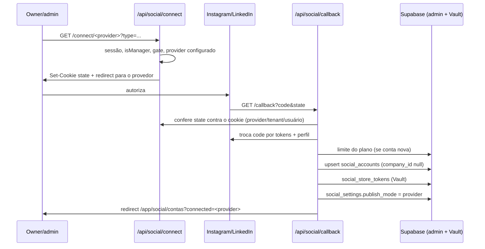
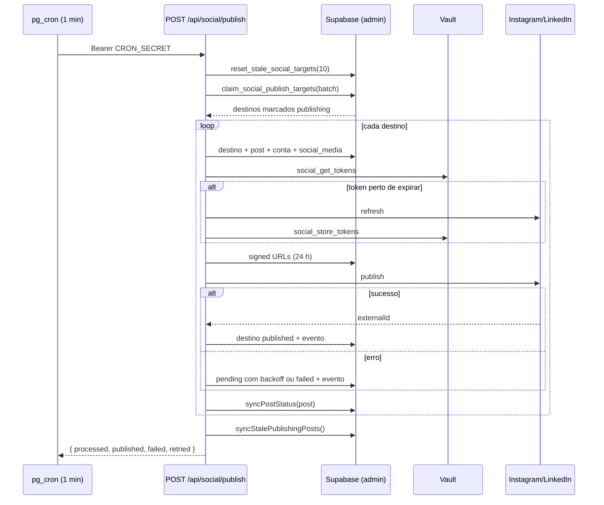

# 21. Publicação nativa (OAuth e worker do Social: Instagram e LinkedIn)

> 22 arquivos de código · 11 fichas completas · 11 em tabela de exceção (2 migrations e 9 testes).
> Retrato de `main@5086092` (15/11/2026). Complementa o módulo [20 Social](20-social.md), que descreve o fluxo de post, aprovação, calendário e publicação **manual**. Spec: [`docs/specs/social-media.md`](../../specs/social-media.md); passo a passo de configuração: [`docs/social-native-setup.md`](../../social-native-setup.md).

O modo nativo liga o Social às APIs do **Instagram** (conta Professional, via Instagram Login) e do **LinkedIn** (perfil pessoal e Página da empresa). A equipe conecta a conta por **OAuth** em `/app/social/contas`; os tokens ficam no **Supabase Vault** (nunca no navegador). Quando o post é **agendado** e o tenant está em `social_settings.publish_mode='provider'`, um worker chamado pelo **pg_cron a cada minuto** (`POST /api/social/publish`) publica cada destino nativo, grava o id externo e agrega o status do post (`publishing`, `published`, `partially_published` ou `failed`). As demais redes — e qualquer tenant em modo `manual` — continuam no fluxo manual do módulo [20](20-social.md): lembrete, cópia do texto e "Marcar como publicado".

## Como o modo nativo é ligado

| Chave | Onde | Efeito |
|---|---|---|
| `SOCIAL_NATIVE_ENABLED` | `src/lib/env.ts:37`, `:67` (`socialNativeEnabled`) | porta única: sem `"true"`, as rotas de conexão/callback/worker respondem como desligadas, a UI esconde os botões e o worker não processa. |
| `INSTAGRAM_APP_ID` / `INSTAGRAM_APP_SECRET` | `src/lib/env.ts:39`–`:40` | `instagramProvider.isConfigured` (`src/server/social/providers/instagram.ts:27`). |
| `LINKEDIN_CLIENT_ID` / `LINKEDIN_CLIENT_SECRET` | `src/lib/env.ts:42`–`:43` | `linkedinProvider.isConfigured` (`src/server/social/providers/linkedin.ts:30`). |
| `INSTAGRAM_API_VERSION` | `src/lib/env.ts:41` (padrão `v23.0`) | prefixo das chamadas ao `graph.instagram.com`. |
| `LINKEDIN_API_VERSION` | `src/lib/env.ts:44` (padrão `202601`) | header `LinkedIn-Version`. |
| `LINKEDIN_ORGANIZATION_URN` | `src/lib/env.ts:45` | opcional; fixa a Página usada quando não se quer descobrir pelo OAuth. |
| `SOCIAL_PUBLISH_BATCH_SIZE` | `src/lib/env.ts:38` (1–50, padrão 5) | quantos destinos o worker reivindica por execução. |
| `CRON_SECRET` | `src/app/api/social/publish/route.ts:368` | segredo exigido no `Authorization: Bearer` do worker. |
| `NEXT_PUBLIC_SITE_URL` | `src/server/social/oauth.ts:13` | base da `redirect_uri` de OAuth e das URLs públicas. |

O cadastro **manual** de conta (`SocialAccountFormDialog`) esconde Instagram e LinkedIn quando o modo nativo está ligado, e `createSocialAccountAction` recusa esses provedores com a mensagem "Use o botão Conectar conta..." (`src/server/actions/social.ts:57`–`:66`). Com o modo desligado, o cadastro manual por `provider_account_id` continua valendo (útil para redes sem API).

## Fluxo de conexão (OAuth)

1. `/app/social/contas` mostra os botões **Conectar Instagram**, **Conectar LinkedIn (perfil)** e **Conectar LinkedIn (Página)** (`src/app/app/social/contas/page.tsx:123`–`:157`) quando `socialNativeEnabled()` e o usuário é owner/admin.
2. `GET /api/social/connect/<provider>` (`src/app/api/social/connect/[provider]/route.ts`): exige sessão, tenant ativo e `isManager` (`:28`–`:36`); confere o gate e se o provedor está configurado (`:37`–`:41`); decide o tipo (`instagram` sempre; LinkedIn `member` ou `organization` por `?type=`, `:44`–`:54`); gera `state` e grava um cookie **httpOnly** com `provider:tipo:tenant:usuário:state` por 10 min (`src/server/social/oauth.ts:21`–`:31`, `:60`); redireciona para a URL de autorização do provedor.
3. O provedor devolve o usuário a `GET /api/social/callback/<provider>` com `code`/`state`. A rota trata `error` do provedor (`:33`), exige o gate (`:39`), sessão/tenant (`:43`) e provedor configurado (`:48`); lê o cookie e confere provedor, `state`, **tenant** e **usuário** (`src/server/social/oauth.ts:34`–`:57`; chamada em `:54`–`:59`).
4. Troca o `code` por tokens e perfil (`:63`). Se a conta (`tenant + provider + provider_account_id`) ainda não existe, aplica o limite de plano `social_accounts` (`:79`–`:88`). Faz **upsert** com nome, avatar, `account_type`, `scopes`, `metadata` mesclada e `last_synced_at` (`:90`–`:132`) — a conta nasce como **da agência** (`company_id: null`).
5. Grava os tokens no Vault (`:134`) e força `social_settings.publish_mode='provider'` no tenant (`:135`–`:142`).
6. Redireciona para `/app/social/contas?connected=<provider>`; erros viram `?error=...` (e `detail` para Página do LinkedIn/tester do Instagram, `:150`–`:165`). A tela traduz os códigos (`page.tsx:21`–`:32`, `:78`–`:89`).

## Tokens no Vault

- `social_store_tokens`, `social_get_tokens` e `social_clear_tokens` são RPCs `security definer` da migration `0054` (`:23`, `:91`, `:114`) com `execute` revogado de `public/anon/authenticated` e concedido só a `service_role` (`:294`–`:318`).
- `src/server/social/tokens.ts` só é usado no servidor: grava (`:4`), lê (`:18`) e apaga (`:37`) via cliente **admin**.
- `getValidTokens` (`:45`) renova o token quando faltam **menos de 5 minutos** (`:54`–`:55`) e o provedor permite renovar — Instagram sempre tenta (`ig_refresh_token`), LinkedIn só com `refresh_token` (`:56`). Se a renovação falhar, devolve o token atual e a publicação falha/retenta (`:60`–`:66`).
- Ao excluir a conta, `deleteSocialAccountAction` chama `clearSocialTokens` antes do soft delete (`src/server/actions/social.ts:114`–`:118`).

## Worker de publicação

O gatilho **não** é a Vercel: `configure_social_publish_cron(url, secret)` (`0054:217`) guarda a URL e o segredo no Vault e agenda no **pg_cron** um `net.http_post` para `POST <site>/api/social/publish` **a cada minuto** (`:277`–`:290`). O guia operacional está em [`docs/social-native-setup.md`](../../social-native-setup.md) §6.

1. `POST /api/social/publish` (`src/app/api/social/publish/route.ts:367`) exige `CRON_SECRET` e compara o `Authorization` em tempo constante (`:21`–`:26`, `:374`–`:378`). Sem segredo configurado, responde 503; desligado, responde `{ ok: true, skipped: true }` (`:369`–`:382`).
2. `reset_stale_social_targets(10)` devolve para `pending` destinos presos em `publishing` há mais de 10 min (`0054:194`; chamada em `:385`).
3. `claim_social_publish_targets(limit)` (`0054:146`) seleciona destinos vencidos com `FOR UPDATE SKIP LOCKED` e os marca `publishing` com `locked_at`, em ordem de `scheduled_at`. Filtros: destino `pending`/`failed` e `next_attempt_at` vencido; post `scheduled`/`publishing`, `scheduled_at <= now()`, não excluído; conta ativa (`status=1`), não excluída, provider nativo; e `social_settings.publish_mode='provider'` (`0054:159`–`:180`).
4. Para cada destino, `processTarget` (`route.ts:142`) relê destino, post, conta e mídias; se algo sumiu ou o post não está mais agendado, marca falha (`:179`–`:203`); se o provedor não está configurado ou a conta está desconectada, falha sem retentar (`:205`–`:240`).
5. Gera URLs assinadas de **24 h** para as imagens do bucket `social_media` (`:244`–`:267`) e bloqueia Instagram sem imagem (`:269`–`:286`). Chama `provider.publish` (`:288`–`:302`).
6. Sucesso: destino `published` com `external_post_id`, `published_at` e `metadata` do provedor; evento `published` com `mode: "native"` (`:309`–`:330`).
7. Depois de cada destino, `syncPostStatus` (`:49`) agrega: algum destino ativo → `publishing`; todos publicados → `published` (com `published_at`, limpa `failure_reason`); parte publicada → `partially_published`; todos falharam → `failed` (`:60`–`:104`). No fim, `syncStalePublishingPosts` (`:106`) corrige até 25 posts que ficaram em `publishing` sem destino ativo.

## Retry, backoff e status

- `MAX_RETRIES = 4` (`route.ts:19`). O contador é `social_post_targets.attempts`, incrementado a cada erro.
- Backoff em minutos `[1, 5, 15, 60]` (`src/server/social/backoff.ts:1`): `socialPublishNextAttemptAt(attempts)` usa o índice `attempts - 1`, saturando em 60 min (`:3`–`:13`). Testado em `tests/unit/social-native.test.ts:9`–`:32`.
- Erros **4xx** do provedor (exceto **429**) são definitivos; 429, 5xx, rede e timeout retentam (`route.ts:334`–`:337`). Ao retentar: destino `pending`, `next_attempt_at` calculado, `locked_at=null` e evento `retried`; ao desistir: `failed`, `next_attempt_at=null` e evento `failed` (`:339`–`:363`).
- O botão **Tentar novamente** (`src/app/app/social/[id]/social-post-actions.tsx:72`–`:79`) chama `retrySocialPostAction` (`src/server/actions/social.ts:456`): devolve destinos `failed`/`publishing` para `pending` com `attempts=0` e `next_attempt_at=now` (`:483`–`:497`), recoloca o post em `scheduled` (`:499`–`:507`) e grava o evento `retried` com `mode: "native"` (`:510`).

| Status do destino | Significado |
|---|---|
| `pending` | aguardando (ou esperando o backoff) |
| `publishing` | reivindicado pelo worker (`locked_at`); volta a `pending` após 10 min sem conclusão |
| `published` | publicado com `external_post_id` |
| `failed` | falha definitiva, com `error` |

Os status do **post** usados pelo modo nativo (`publishing`, `published`, `partially_published`, `failed`) já existiam na `0049`; o worker é quem passou a gravá-los. O histórico usa `SOCIAL_EVENT_LABELS` (`src/lib/constants.ts:71`), que já tinha `published`, `failed` e `retried`.

## Diferenças entre os provedores

| | Instagram | LinkedIn |
|---|---|---|
| Tipo de conta | `instagram` (`supportsAccountType`, `instagram.ts:65`) | `member` ou `organization` (`linkedin.ts:107`) |
| Autorização | `instagram.com/oauth/authorize` (`:15`) | `linkedin.com/oauth/v2/authorization` (`:17`) |
| Escopos | `instagram_business_basic`, `instagram_business_content_publish` (`:18`) | `openid profile w_member_social` (+ `w_organization_social`, `r_organization_social`, `rw_organization_admin` na Página) (`:20`–`:28`) |
| Token | troca por token longo (`:35`–`:43`); renovável por `ig_refresh_token` (`:157`) | `access_token` + `refresh_token` quando o app devolve (`:164`–`:168`); renovação por `refresh_token` (`:200`) |
| Perfil | `GET /me` com `user_id`, `username`, `account_type`, avatar (`:108`–`:127`) | `GET /v2/userinfo`; na Página descobre o `organizationalTarget` via `organizationalEntityAcls` ou usa `LINKEDIN_ORGANIZATION_URN` (`:53`–`:89`) |
| Imagem | **obrigatória**; a Meta baixa a URL assinada (`:177`–`:182`) | opcional; upload direto na Images API (`:247`–`:287`) |
| Publicação | container `/<id>/media`, espera `status_code=FINISHED` por até 10 tentativas de 2 s (se não chegar, tenta publicar mesmo assim; `ERROR` aborta), depois `/<id>/media_publish` (`:176`–`:243`) | `POST /rest/posts` com `author`, `commentary`, `visibility=PUBLIC` e `lifecycleState=PUBLISHED` (`:289`–`:317`) |
| Id externo | id do `media_publish` (`:230`–`:238`) | header `x-restli-id`/`x-linkedin-id` ou `linkedin:<timestamp>` (`:319`–`:322`) |
| Limite de texto | o editor avisa pelo `SOCIAL_PROVIDER_LIMITS`; a API pode recusar | bloqueia > 3.000 caracteres antes de chamar a API (`:237`–`:241`) |
| Erros | `SocialProviderError` com status HTTP (`:106`–`:111`) | idem, preservando o corpo da resposta (`:311`–`:316`) |

## Segurança

- **Tokens** só no Vault; as RPCs de token são `service_role`-only (`0054:294`–`:318`). O navegador nunca recebe token.
- **OAuth**: `state` aleatório em cookie `httpOnly`, `sameSite=lax`, 10 min (`oauth.ts:60`–`:68`), conferido contra provedor, tenant e usuário (`:47`–`:57`). Conectar (rota) e desconectar (action) exigem owner/admin; o callback revalida a sessão, o tenant e o usuário que iniciaram o `state`.
- **Worker**: `CRON_SECRET` comparado com `timingSafeEqual` (`route.ts:21`); usa cliente admin (ignora RLS) apenas no fluxo do cron.
- **Destino por cliente**: a regra de `src/lib/social-accounts.ts` é repetida no banco pela `0053` (três triggers `security definer`, erro `23514`), impedindo destino de outro cliente também por API direta. Ver [06](../06-problemas-e-dividas.md) #28.
- **Configuração**: no código, só o callback grava `publish_mode` (como `provider`); um tenant que nunca conectou conta fica em `manual` (`src/server/queries/social.ts:96`–`:103`).
- **Limitações conhecidas**: contas conectadas por OAuth nascem como **da agência** (`company_id: null`) e não há tela/action para vinculá-las a um cliente; o worker processa no máximo `SOCIAL_PUBLISH_BATCH_SIZE` destinos por minuto; não há cron de renovação de token (só na hora de publicar); o fluxo completo do worker com banco/API reais não tem teste (os providers, tokens, OAuth e guardas têm unitários; #31 resolvido).

## Lembrete manual (cron das 09:00)

O cron diário `GET /api/cron/reminders` continua chamando `runSocialPublishReminders` (`src/server/social/reminders.ts:56`), mas o lembrete só é criado quando o post tem **algum destino manual**: tenant em `publish_mode='manual'`, rede sem integração nativa ou conta desconectada/excluída (`needsManualPublishReminder`, `:26`). Posts 100% nativos em modo `provider` são pulados (e marcados com `manual_reminder_sent_at` para não serem revarridos). O corpo da notificação passou a ser "Publicação manual." Este filtro foi o item #32 do [06](../06-problemas-e-dividas.md) (resolvido) e é testado em `tests/unit/social-reminders.test.ts`.

## Trechos em arquivos compartilhados

| Arquivo | O que o modo nativo acrescentou |
|---|---|
| `src/lib/env.ts` | `socialNativeEnabled` (`:67`) e as variáveis de Instagram/LinkedIn/batch (`:37`–`:45`). |
| `.env.example` | bloco do Social nativo (`:30`–`:39`). |
| `src/server/actions/social.ts` | bloqueio do cadastro manual de IG/LinkedIn com o modo ligado (`:57`–`:66`); `clearSocialTokens` ao excluir (`:114`–`:118`); bloqueio de agendamento de Instagram sem imagem (`:346`–`:373`); `retrySocialPostAction` (`:456`–`:516`); "Marcar como publicado" grava destinos `pending`/`failed` (`:434`–`:445`). |
| `src/server/queries/social.ts` | `getSocialSettings` (`:86`) lê `publish_mode`, `max_retries` e o fuso; `listSocialAccounts` expõe `account_type` e `token_expires_at` (`:66`). |
| `src/app/app/social/contas/page.tsx` | botões de conexão (`:123`–`:157`); status da conta por `token_expires_at` (`:34`–`:44`). |
| `src/app/app/social/contas/social-account-form-dialog.tsx` | esconde Instagram/LinkedIn do cadastro manual quando o modo está ligado (`:68`–`:75`). |
| `src/app/app/social/[id]/page.tsx` | esconde o painel manual quando há destino nativo (`:61`–`:71`); avisa Instagram sem imagem (`:108`–`:113`). |
| `src/app/app/social/[id]/social-post-actions.tsx` | botão "Tentar novamente" em `failed`/`partially_published` (`:72`–`:79`). |
| `src/lib/database.types.ts` | tipos das RPCs `social_store_tokens`, `social_get_tokens`, `social_clear_tokens`, `claim_social_publish_targets`, `reset_stale_social_targets` e `configure_social_publish_cron` (`:3114`–`:3155`). |
| `src/server/social/reminders.ts` | o lembrete diário consulta `publish_mode`, destinos e status da conta e só notifica quando há destino manual (`needsManualPublishReminder`, `:26`); posts 100% nativos são pulados (#32 resolvido). |

## Tabela de exceção — migrations e testes

| Arquivo | Conteúdo | Motivo da exceção |
|---|---|---|
| `supabase/migrations/0053_social_targets_same_company.sql` | Três triggers `security definer`: destino de post (`:12`, `:42`), troca de cliente do post (`:49`, `:77`) e troca de cliente da conta em uso (`:83`, `:112`). Todos levantam `23514`; `company_id` nulo (agência) é sempre permitido. | Migração de integridade/segurança. |
| `supabase/migrations/0054_social_native_publishing.sql` | Colunas de OAuth/token em `social_accounts` (`account_type`, `access_token_id`, `refresh_token_id`, `token_expires_at`, `scopes`, `last_synced_at`, `:1`–`:8`) e de retry em `social_post_targets` (`next_attempt_at`, `locked_at`, `metadata`, `:14`–`:17`); índice dos destinos vencidos (`:19`); RPCs de token no Vault (`:23`, `:91`, `:114`), claim (`:146`), reset (`:194`) e cron (`:217`); grants só para `service_role` (`:294`–`:318`). | Migração de schema + RPC + integração com Vault/pg_cron. |
| `tests/unit/social-native.test.ts` | Backoff 1/5/15/60 e saturação (`:9`–`:32`), `socialPublishIsFinalFailure` (`:34`–`:46`), `splitScopes` (`:48`–`:60`) e `zonedTimeToUtc` (`:62`–`:78`). | Arquivo de teste. |
| `tests/unit/social-accounts.test.ts` | `isAccountAllowedForCompany` e `validatePostTargets` (`:10`–`:63`). | Arquivo de teste. |
| `tests/unit/social-reminders.test.ts` | `needsManualPublishReminder`: sem destino, modo manual, só nativos ativos, destino sem integração, conta inativa e provider desconhecido (`:7`–`:45`). | Arquivo de teste (do lembrete do módulo 20, ajustado pelo modo nativo). |
| `tests/unit/social-providers.test.ts` | Instagram e LinkedIn com `fetch` simulado: OAuth, erros, imagem obrigatória, container, upload e publicação (`:1`–`:343`). | Arquivo de teste. |
| `tests/unit/social-tokens.test.ts` | Vault (gravar/ler/limpar) e `getValidTokens` (token válido, renovação, Instagram sem refresh e falha) (`:1`–`:212`). | Arquivo de teste. |
| `tests/unit/social-oauth.test.ts` | `redirect_uri`, formato/validação do `state` em cookie e opções do cookie (`:1`–`:97`). | Arquivo de teste. |
| `tests/unit/social-publish-route.test.ts` | Guardas do worker (503/401/skip), lote vazio e falha de claim (`:1`–`:120`). | Arquivo de teste. |
| `tests/unit/social-connect-route.test.ts` | Sessão/papel/gate/provider, tipo de conta, redirect e cookie de `state` (`:1`–`:146`). | Arquivo de teste. |
| `tests/unit/social-callback-route.test.ts` | Erro do provedor, gate, `state` divergente, limite de plano, upsert/tokens e `publish_mode` (`:1`–`:208`). | Arquivo de teste. |

> Cobertura de RLS: `tests/rls/isolation.test.ts:2121` testa a regra de **mesmo cliente** nos destinos (`0053`). Não há teste de isolamento entre tenants para as RPCs de token/claim ([06](../06-problemas-e-dividas.md) #23). Providers, tokens, OAuth, rotas de conexão/callback/publicação e guardas do worker têm teste unitário (#31 resolvido); o fluxo completo com banco/API reais não.

## Fichas do módulo

| § | Arquivo | Propósito em 1 linha |
|---|---|---|
| §21.1 | `src/lib/social-accounts.ts` | Regra pura de conta de destino permitida por cliente. |
| §21.2 | `src/server/social/provider.ts` | Contrato comum dos provedores, erro HTTP e utilidades de resposta/escopo. |
| §21.3 | `src/server/social/index.ts` | Registro dos provedores nativos e `getSocialProvider`. |
| §21.4 | `src/server/social/oauth.ts` | `redirect_uri`, `state` em cookie e validação do retorno. |
| §21.5 | `src/server/social/tokens.ts` | Leitura/gravação no Vault e renovação de token antes de publicar. |
| §21.6 | `src/server/social/backoff.ts` | Cálculo puro do próximo retry. |
| §21.7 | `src/server/social/providers/instagram.ts` | OAuth, perfil, refresh e publicação no Instagram. |
| §21.8 | `src/server/social/providers/linkedin.ts` | OAuth, perfil/Página, refresh e publicação no LinkedIn. |
| §21.9 | `src/app/api/social/connect/[provider]/route.ts` | Início do OAuth com guardas e cookie de `state`. |
| §21.10 | `src/app/api/social/callback/[provider]/route.ts` | Troca do código, upsert da conta, tokens no Vault e `publish_mode`. |
| §21.11 | `src/app/api/social/publish/route.ts` | Worker do cron: claim, envio, retry e agregação de status. |

### §21.1 `src/lib/social-accounts.ts`

**Propósito:** decidir se uma conta pode receber um post de um cliente.
**Processo:** `isAccountAllowedForCompany` (`:7`) aceita conta sem cliente (agência) ou do mesmo `company_id`. `validatePostTargets` (`:17`) monta um `Map` dos ids, ignora ids repetidos e devolve `{ ok: false, reason: "not_found" }` ou `"other_company"` na primeira violação (`:22`–`:29`).
**Estado:** `implementado`. A mesma regra está nos triggers da `0053` (defesa em profundidade).
**Testes:** `tests/unit/social-accounts.test.ts` (6 casos).
**Depende de:** nada (função pura).
**Usado por:** `createSocialPostAction` (`src/server/actions/social.ts:161`); a `0053` repete a mesma regra no banco.
**Bibliotecas externas:** nenhuma.

### §21.2 `src/server/social/provider.ts`

**Propósito:** contrato e utilidades comuns aos provedores nativos.
**Processo:** define `SocialProviderId` (`:1`), `SocialAccountType` (`:3`), `OAuthTokenSet` (`:5`), `SocialProfile` (`:12`), `SocialPublishMedia/Input/Result` (`:20`–`:36`) e a interface `SocialProvider` (`:50`) com `isConfigured`, `supportsAccountType`, `getAuthUrl`, `exchangeCode`, `refreshTokens` e `publish`. `SocialProviderError` (`:63`) carrega o status HTTP (usado no retry). `readProviderResponse` (`:93`) faz o parse tolerante (JSON ou texto) e lança o erro com a mensagem do provedor; `secondsFromNow` (`:116`) e `splitScopes` (`:122`) convertem expiração e escopos.
**Estado:** `implementado`.
**Testes:** `splitScopes` em `tests/unit/social-native.test.ts:48`.
**Depende de:** nada.
**Usado por:** §21.3–§21.8 e §21.11.
**Bibliotecas externas:** nenhuma.

### §21.3 `src/server/social/index.ts`

**Propósito:** registrar e resolver os provedores nativos.
**Processo:** monta o mapa `instagram`/`linkedin` (`:5`–`:8`); `isNativeSocialProvider` (`:10`) e `getSocialProvider` (`:16`) restringem a união; `nativeSocialProviders` (`:20`) devolve os dois objetos.
**Estado:** `implementado`.
**Testes:** sem teste.
**Depende de:** §21.2, §21.7, §21.8.
**Usado por:** rotas de conexão/callback/worker, `src/app/app/social/contas/page.tsx` e `createSocialAccountAction`.
**Bibliotecas externas:** nenhuma.

### §21.4 `src/server/social/oauth.ts`

**Propósito:** montar a `redirect_uri`, criar e validar o `state` do OAuth.
**Processo:** `getOAuthRedirectUri` (`:13`) usa `NEXT_PUBLIC_SITE_URL` (fallback `localhost:3000`) e monta `/api/social/callback/<provider>`; `createOAuthState` (`:21`) gera um `crypto.randomUUID()` e o payload `provider:tipo:tenant:usuário:state`; `readOAuthState` (`:34`) lê o cookie `orbit.social.oauth` (`:5`) e devolve `null` se provedor, `state`, tenant ou usuário não baterem (`:47`–`:57`); `oauthCookieOptions` (`:60`) define `httpOnly`, `secure` em produção, `sameSite=lax`, `path=/` e 600 s.
**Estado:** `implementado`.
**Testes:** `tests/unit/social-oauth.test.ts` (redirect_uri, formato do `state`, leitura/recusa do cookie e opções).
**Depende de:** `next/headers`, `src/lib/env.ts` e §21.2.
**Usado por:** §21.9 e §21.10.
**Bibliotecas externas:** `next/headers`.

### §21.5 `src/server/social/tokens.ts`

**Propósito:** guardar/ler/limpar tokens no Vault e renová-los antes de publicar.
**Processo:** `storeSocialTokens` (`:4`), `getSocialTokens` (`:18`) e `clearSocialTokens` (`:37`) delegam às RPCs da `0054` pelo cliente admin. `getValidTokens` (`:45`) compara `expiresAt` com agora, considera "perto de expirar" menos de 5 min (`:54`–`:55`), tenta renovar quando o provedor permite (`:56`) e regrava (`:60`–`:63`); em falha, devolve o token atual (`:64`–`:66`). Conta sem token lança "reconecte a conta" (`:50`–`:52`).
**Estado:** `implementado`. Sem cron de renovação: só renova quando o worker vai publicar. A renovação silenciosa em falha deixa o erro para a publicação.
**Testes:** `tests/unit/social-tokens.test.ts` (gravar/ler/limpar, token válido, renovação, Instagram sem refresh e falha de renovação).
**Depende de:** `src/lib/supabase/admin.ts`, §21.2, RPCs da `0054`.
**Usado por:** §21.10 e §21.11.
**Bibliotecas externas:** nenhuma.

### §21.6 `src/server/social/backoff.ts`

**Propósito:** calcular o próximo horário de tentativa.
**Processo:** a constante `SOCIAL_PUBLISH_BACKOFF_MINUTES` (`:1`) é `[1, 5, 15, 60]`; `socialPublishNextAttemptAt(attempts, now)` (`:3`) usa `attempts - 1` como índice, mínimo 0 e máximo 3, e devolve ISO em `now + minutos` (`:7`–`:12`).
**Estado:** `implementado`.
**Testes:** `tests/unit/social-native.test.ts:9`–`:32` (inclusive saturação) e `socialPublishIsFinalFailure` (`:34`–`:46`: 4xx×429×5xx×limite).
**Depende de:** nada (puro).
**Usado por:** §21.11.
**Bibliotecas externas:** nenhuma.

### §21.7 `src/server/social/providers/instagram.ts`

**Propósito:** implementar OAuth e publicação do Instagram (Instagram Login).
**Processo:** `SCOPES` (`:18`); `configured` exige App ID/Secret (`:27`); `getAuthUrl` (`:69`) monta a autorização; `exchangeCode` (`:80`) troca o código, converte para token longo (`:35`–`:43`, `:103`), lê `/me` com `user_id`, `username`, `account_type` e avatar (`:108`–`:127`) e devolve perfil `instagram` com `metadata.username`. `refreshTokens` (`:157`) usa `ig_refresh_token`. `publish` (`:176`) exige imagem, cria o container (`/<id>/media`), consulta `status_code` até `FINISHED` (10 tentativas de 2 s; `ERROR` aborta) (`:207`–`:216`) e publica (`/<id>/media_publish`) (`:218`–`:229`), devolvendo `container_id` na metadata.
**Estado:** `implementado`. A Meta precisa baixar a imagem em URL pública: `localhost` não serve (ver `docs/social-native-setup.md` §4).
**Testes:** `tests/unit/social-providers.test.ts` com `fetch` simulado (troca de código, erro 400, exigência de imagem, container `FINISHED`/`ERROR` e publicação).
**Depende de:** `src/lib/env.ts`, §21.2.
**Usado por:** §21.3; conectado por §21.9/§21.10 e acionado por §21.11.
**Bibliotecas externas:** `fetch`.

### §21.8 `src/server/social/providers/linkedin.ts`

**Propósito:** implementar OAuth e publicação do LinkedIn (perfil e Página).
**Processo:** escopos `MEMBER_SCOPES`/`ORGANIZATION_SCOPES` (`:20`–`:28`); `configured` exige client ID/secret (`:30`); `getAuthUrl` (`:111`) escolhe os escopos pelo tipo; `exchangeCode` (`:122`) troca o código e lê `/v2/userinfo` (`:145`); na Página, `fetchOrganization` (`:53`) usa `LINKEDIN_ORGANIZATION_URN` ou busca a primeira Página administrada em `organizationalEntityAcls` (`:61`–`:88`), e o `metadata.author_urn` guarda `urn:li:organization:*` ou `urn:li:person:*` (`:189`–`:196`). `refreshTokens` (`:200`) exige `refresh_token`. `publish` (`:236`) limita o texto a 3.000 caracteres, faz upload da imagem opcional pela Images API (`:247`–`:287`) e publica em `POST /rest/posts` (`:289`–`:317`), devolvendo o id dos headers (`:319`–`:322`).
**Estado:** `implementado`. Publicar como Página exige o Marketing Developer Platform (escopos de organização); sem isso, o OAuth falha e a tela mostra a mensagem específica.
**Testes:** `tests/unit/social-providers.test.ts` com `fetch` simulado (perfil, Página fixa via `LINKEDIN_ORGANIZATION_URN`, limite de 3.000, upload de imagem e publicação só texto).
**Depende de:** `src/lib/env.ts`, §21.2.
**Usado por:** §21.3; conectado por §21.9/§21.10 e acionado por §21.11.
**Bibliotecas externas:** `fetch`.

### §21.9 `src/app/api/social/connect/[provider]/route.ts`

**Propósito:** iniciar o OAuth de um provedor.
**Processo:** `GET` (`:23`) lê o provider da rota; exige sessão e `getActiveMembership` (`:28`–`:35`), `isManager` (`:36`), gate `socialNativeEnabled` (`:37`), provider existente e configurado (`:39`–`:41`). Define o tipo da conta (`instagram` sempre; LinkedIn por `?type=organization`, senão `member`, `:44`–`:54`), valida com `supportsAccountType`, cria o `state`/cookie (`src/server/social/oauth.ts:21`) e redireciona com o cookie (`:63`–`:65`). Erros voltam para `/app/social/contas?error=...` (`:17`–`:21`).
**Estado:** `implementado`.
**Testes:** `tests/unit/social-connect-route.test.ts` (sessão, papel, gate, provider, tipo de conta, redirect e cookie).
**Depende de:** `src/lib/{auth,env,tenant}.ts`, `src/server/permissions.ts`, §21.3, §21.4.
**Usado por:** botões de §20.13 (`src/app/app/social/contas/page.tsx:132`–`:148`).
**Bibliotecas externas:** `next/server`.

### §21.10 `src/app/api/social/callback/[provider]/route.ts`

**Propósito:** concluir o OAuth: conta, tokens no Vault e `publish_mode`.
**Processo:** `GET` (`:23`) trata `error` do provedor (`:33`–`:38`), gate (`:39`), sessão (`:43`) e provider configurado (`:48`–`:51`); exige `code` (`:52`) e valida o `state` contra o cookie **e** o tenant/usuário atuais (`:54`–`:59`). Troca o código (`:63`) e, se a conta é nova, aplica `checkPlanLimitWith(..., "social_accounts")` (`:79`–`:88`). Faz upsert em `social_accounts` (merge de `metadata`, `scopes`, `account_type`, `status=1`, `last_synced_at`, `connected_by`) (`:90`–`:132`), grava os tokens (`:134`) e faz upsert de `social_settings` com `publish_mode='provider'` (`:135`–`:142`). Registra `social.oauth.connected` e redireciona com `connected`; no erro, loga `social.oauth.failed` e devolve `?error=oauth` com `detail` para Página/tester (`:150`–`:165`).
**Estado:** `implementado`. A conta é sempre criada como da agência (`company_id: null`).
**Testes:** `tests/unit/social-callback-route.test.ts` (erro do provedor, gate, `state` divergente, limite de plano, conta nova/existente, tokens e `publish_mode`).
**Depende de:** `src/lib/{auth,env,logger,tenant}.ts`, `src/lib/supabase/admin.ts`, `src/server/plan-limits.ts`, §21.3–§21.5.
**Usado por:** retorno do provedor no OAuth iniciado em §21.9.
**Bibliotecas externas:** `next/server`.

### §21.11 `src/app/api/social/publish/route.ts`

**Propósito:** worker de publicação nativa chamado pelo pg_cron.
**Processo:** constantes `MAX_RETRIES=4` (`:19`) e `safeEqual` (`:21`); `recordEvent` (`:33`) insere em `social_post_events`; `syncPostStatus` (`:49`) agrega os destinos no status do post; `syncStalePublishingPosts` (`:106`) corrige posts presos em `publishing`; `processTarget` (`:142`) relê destino/post/conta/mídia, trata sumiço e status inválido (`:179`–`:240`), valida provedor/conta (`:205`–`:240`), gera URLs assinadas de 24 h (`:244`–`:267`), exige imagem no Instagram (`:269`–`:286`), publica (`:288`–`:302`) e grava sucesso (`:309`–`:330`) ou falha/retry com backoff e evento (`:331`–`:364`). `POST` (`:367`) exige `CRON_SECRET` (`:368`–`:378`), respeita o gate (`:380`–`:382`), reseta destinos presos (`:385`), reivindica o lote (`:392`–`:400`), processa e agrega (`:405`–`:419`) e responde `{ ok, processed, published, failed, retried }`.
**Estado:** `implementado`. Depende de `pg_cron` e `pg_net` habilitados e de `configure_social_publish_cron` rodado com a URL/segredo corretos (`0054:217`).
**Testes:** `tests/unit/social-publish-route.test.ts` cobre as guardas (503 sem segredo, 401 com segredo errado e skip desligado), lote vazio e falha de claim; `processTarget` com banco/API reais e o fluxo completo ainda não têm teste. A cobertura unitária de providers, tokens, OAuth e guardas do handler fecha o #31.
**Depende de:** `src/lib/{env,logger}.ts`, `src/lib/supabase/admin.ts`, `src/lib/database.types.ts`, §21.3, §21.5, §21.6, §21.7, §21.8, RPCs da `0054`.
**Usado por:** `pg_cron` (job `social-publish`, a cada minuto, criado pela `0054:277`).
**Bibliotecas externas:** `next/server`, `node:crypto`.
